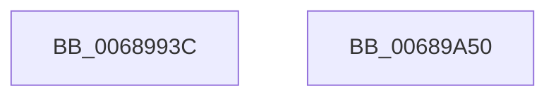

# MiUnmapLegacyAwePage

- RVA: `0x0068993C`–`0x00689A51` (길이 `277` bytes)
- VA: `0x000000014068993C`
- 실행 섹션: `.text`
- PDB 이름 있음: `예`; PDB Function 태그: `아니요`
- unwind 정보 RVA: `0x000B0E24`
- 디코드: `72`개 명령, `277/277` bytes 표시
- 미해석 바이트: `0` (있으면 어셈블리에 `.byte`로 보존)

> 이 문서는 커널 이미지의 기계어와 PDB 기호를 분석해 생성했습니다. 4번과 5번은 함수 원형과 자료형을 바이너리 사용 방식에서 추정한 C 해석이며 원본 소스 복구 결과는 아닙니다.

## 1. Dependencies

- 직접 호출 지점: **7**; 고유 호출 대상: **7**
- 직접 호출자로 확인된 함수: **1**
- RIP 상대 이미지 참조: **1**

### Outgoing calls
- `0x006899CC` → [MiLockWorkingSetSharedAtDpc](../23/MiLockWorkingSetSharedAtDpc_function_00239574.md) (function, `0x00239574`)
- `0x006899D7` → [MiLockNestedPageTable](../23/MiLockNestedPageTable_function_0023E890.md) (function, `0x0023E890`)
- `0x006899F1` → [MiUpdateAwePageTable](../36/MiUpdateAwePageTable_function_00368730.md) (function, `0x00368730`)
- `0x00689A03` → [MiInsertTbFlushEntry](../29/MiInsertTbFlushEntry_function_00293670.md) (function, `0x00293670`)
- `0x00689A0E` → [MiUnlockPageTable](../21/MiUnlockPageTable_function_00216EC0.md) (function, `0x00216EC0`)
- `0x00689A18` → [MiUnlockWorkingSetShared](../27/MiUnlockWorkingSetShared_function_0027D690.md) (function, `0x0027D690`)
- `0x00689A2C` → [MiDecrementAweMapCount](MiDecrementAweMapCount_function_00688158.md) (function, `0x00688158`)

### Direct callers
- [MiBuildPhysicalPageFreeChain](MiBuildPhysicalPageFreeChain_function_00687C80.md) at `0x00687E12`

### Static image references
- `0x006899DC` → RVA `0x00010880` (`.rdata`; read)

## 2. Other-region calls and transfers

- 다른 실행 섹션으로 향하는 call: **0**
- 별도 외부 분기/꼬리 이동을 확인하지 못했습니다.

## 3. Assembly (complete function range)

```asm
0068993C  48 89 5C 24 08                  mov qword ptr [rsp + 8], rbx
00689941  48 89 6C 24 18                  mov qword ptr [rsp + 0x18], rbp
00689946  48 89 74 24 20                  mov qword ptr [rsp + 0x20], rsi
0068994B  57                              push rdi
0068994C  41 54                           push r12
0068994E  41 55                           push r13
00689950  41 56                           push r14
00689952  41 57                           push r15
00689954  48 83 EC 20                     sub rsp, 0x20
00689958  65 48 8B 04 25 88 01 00 00      mov rax, qword ptr gs:[0x188]
00689961  4D 8B F9                        mov r15, r9
00689964  49 8B E8                        mov rbp, r8
00689967  4C 8B E2                        mov r12, rdx
0068996A  4C 8B E9                        mov r13, rcx
0068996D  4C 8B B0 B8 00 00 00            mov r14, qword ptr [rax + 0xb8]
00689974  48 8D 04 52                     lea rax, [rdx + rdx*2]
00689978  48 03 C0                        add rax, rax
0068997B  49 81 C6 00 04 00 00            add r14, 0x400
00689982  48 B9 08 00 00 00 00 DE FF FF   movabs rcx, 0xffffde0000000008
0068998C  48 8B 3C C1                     mov rdi, qword ptr [rcx + rax*8]
00689990  48 8B F7                        mov rsi, rdi
00689993  48 B9 00 00 00 00 80 F6 FF FF   movabs rcx, 0xfffff68000000000
0068999D  48 C1 E6 19                     shl rsi, 0x19
006899A1  48 8B C1                        mov rax, rcx
006899A4  48 C1 E0 19                     shl rax, 0x19
006899A8  48 8B DF                        mov rbx, rdi
006899AB  48 2B F0                        sub rsi, rax
006899AE  48 C1 EB 09                     shr rbx, 9
006899B2  48 B8 F8 FF FF FF 7F 00 00 00   movabs rax, 0x7ffffffff8
006899BC  48 C1 FE 10                     sar rsi, 0x10
006899C0  48 23 D8                        and rbx, rax
006899C3  48 8B C1                        mov rax, rcx
006899C6  49 8B CE                        mov rcx, r14
006899C9  48 03 D8                        add rbx, rax
006899CC  E8 A3 FB BA FF                  call 0x140239574
006899D1  48 8B D3                        mov rdx, rbx
006899D4  49 8B CE                        mov rcx, r14
006899D7  E8 B4 4E BB FF                  call 0x14023e890
006899DC  48 8B 05 9D 6E 98 FF            mov rax, qword ptr [rip - 0x679163]
006899E3  41 83 C8 FF                     or r8d, 0xffffffff
006899E7  48 83 CA FF                     or rdx, 0xffffffffffffffff
006899EB  48 89 07                        mov qword ptr [rdi], rax
006899EE  48 8B CB                        mov rcx, rbx
006899F1  E8 3A ED CD FF                  call 0x140368730
006899F6  45 33 C9                        xor r9d, r9d
006899F9  48 8B D6                        mov rdx, rsi
006899FC  48 8B CD                        mov rcx, rbp
006899FF  45 8D 41 01                     lea r8d, [r9 + 1]
00689A03  E8 68 9C C0 FF                  call 0x140293670
00689A08  48 8B D3                        mov rdx, rbx
00689A0B  49 8B CE                        mov rcx, r14
00689A0E  E8 AD D4 B8 FF                  call 0x140216ec0
00689A13  B2 11                           mov dl, 0x11
00689A15  49 8B CE                        mov rcx, r14
00689A18  E8 73 3C BF FF                  call 0x14027d690
00689A1D  4D 8B CF                        mov r9, r15
00689A20  41 B8 02 00 00 00               mov r8d, 2
00689A26  49 8B D4                        mov rdx, r12
00689A29  49 8B CD                        mov rcx, r13
00689A2C  E8 27 E7 FF FF                  call 0x140688158
00689A31  48 8B 5C 24 50                  mov rbx, qword ptr [rsp + 0x50]
00689A36  33 C0                           xor eax, eax
00689A38  48 8B 6C 24 60                  mov rbp, qword ptr [rsp + 0x60]
00689A3D  48 8B 74 24 68                  mov rsi, qword ptr [rsp + 0x68]
00689A42  48 83 C4 20                     add rsp, 0x20
00689A46  41 5F                           pop r15
00689A48  41 5E                           pop r14
00689A4A  41 5D                           pop r13
00689A4C  41 5C                           pop r12
00689A4E  5F                              pop rdi
00689A4F  C3                              ret
00689A50  CC                              int3
```

## 4. C-style interpretation (structured pseudocode)

```c
__int64 __fastcall MiUnmapLegacyAwePage(__int64 a1, __int64 a2, __int64 a3, __int64 a4)
{
    __int64 result;
    __int64 v_r14;
    __int64 v_rbx;
    __int64 v_rsi;
    __int64 v_rsp;
    unsigned __int64 v_stack_p18;
    unsigned __int64 v_stack_p20;
    unsigned __int64 v_stack_p8;

    v_stack_p8 = v_rbx;
    v_stack_p18 = v_rbp;
    v_stack_p20 = v_rsi;
    v_rsp = (v_rsp) - (32);
    result = (a2 + a2 * 2) + (a2 + a2 * 2);
    v_r14 = (*(unsigned __int64 *)(*(unsigned __int64 *)(gs_base + (0 + 392)) + 184)) + (0x400ULL);
    v_rsi = (*(unsigned __int64 *)(a1 + result * 8)) << (25);
    result = (a1) << (25);
    v_rsi = (v_rsi) - (result);
    v_rbx = (*(unsigned __int64 *)(a1 + result * 8)) >> (9);
    v_rsi = (v_rsi) >> (16);
    v_rbx = (v_rbx) & (result);
    v_rbx = (v_rbx) + (a1);
    result = MiLockWorkingSetSharedAtDpc(v_r14, a2, a3, a4);
    result = MiLockNestedPageTable(v_r14, v_rbx, a3, a4);
    a3 = (unsigned int)((a3) | (0xFFFFFFFFULL));
    a2 = (v_rbx) | (-1);
    *(unsigned __int64 *)(*(unsigned __int64 *)(a1 + result * 8)) = *(unsigned __int64 *)(v_rip - 6787427);
    result = MiUpdateAwePageTable(v_rbx, a2, a3, a4);
    a4 = 0;
    result = MiInsertTbFlushEntry(a3, v_rsi, a4 + 1, a4);
    result = MiUnlockPageTable(v_r14, v_rbx, a4 + 1, a4);
    result = MiUnlockWorkingSetShared(v_r14, 17, a4 + 1, a4);
    result = MiDecrementAweMapCount(a1, a2, 2, 0);
    result = 0;
    v_rsp = (v_rsp) + (32);
    return result;
}
```

## 5. (Beta) C Style

```c
int64_t MiUnmapLegacyAwePage(int64_t Arg1, void *Arg2, int64_t Arg3, int64_t Arg4)
{
    uint8_t *arg2 = (uint8_t *)Arg2;

    int64_t result;
    int64_t local_r14;
    int64_t local_rbx;
    int64_t local_rsi;
    int64_t local_rsp;
    uint64_t v_stack_p18;
    uint64_t v_stack_p20;
    uint64_t v_stack_p8;

    v_stack_p8 = local_rbx;
    v_stack_p18 = local_rbp;
    v_stack_p20 = local_rsi;
    local_rsp = (local_rsp) - (32);
    result = (Arg2 + Arg2 * 2) + (Arg2 + Arg2 * 2);
    local_r14 = (*(uint64_t *)(*(uint64_t *)(gs_base + (0 + 0x188)) + 0xB8)) + (0x400ULL);
    local_rsi = (*(uint64_t *)(Arg1 + result * 8)) << (25);
    result = (Arg1) << (25);
    local_rsi = (local_rsi) - (result);
    local_rbx = (*(uint64_t *)(Arg1 + result * 8)) >> (9);
    local_rsi = (local_rsi) >> (16);
    local_rbx = (local_rbx) & (result);
    local_rbx = (local_rbx) + (Arg1);
    result = MiLockWorkingSetSharedAtDpc(local_r14, Arg2, Arg3, Arg4);
    result = MiLockNestedPageTable(local_r14, local_rbx, Arg3, Arg4);
    Arg3 = (uint32_t)((Arg3) | (0xFFFFFFFFULL));
    Arg2 = (local_rbx) | (-1);
    *(uint64_t *)(*(uint64_t *)(Arg1 + result * 8)) = *(uint64_t *)(v_rip - 0x679163);
    result = MiUpdateAwePageTable(local_rbx, Arg2, Arg3, Arg4);
    Arg4 = 0;
    result = MiInsertTbFlushEntry(Arg3, local_rsi, Arg4 + 1, Arg4);
    result = MiUnlockPageTable(local_r14, local_rbx, Arg4 + 1, Arg4);
    result = MiUnlockWorkingSetShared(local_r14, 17, Arg4 + 1, Arg4);
    result = MiDecrementAweMapCount(Arg1, Arg2, 2, 0);
    result = 0;
    local_rsp = (local_rsp) + (32);
    return result;
}
```

### 관측된 메모리 오프셋

구조체 형식이 확인되지 않은 접근은 인자 기준의 오프셋으로만 기록했습니다.

| 기준 인자 | 오프셋 표현 | 폭 (bit) | 접근 |
|---|---:|---:|---|
| `Arg2` | `+ 0x0 + rdx*2` | `64` | `R` |

## 6. Execution-region graph

[열기: 2D/3D 그래프와 함수 탐색 컨트롤 패널](../../../control-panel.html?section=text&rva=0x0068993C&view=graph)

- 2D 그래프는 위에서 아래로 흐르고, 3D 그래프는 빈 공간을 드래그해 회전합니다. Shift+드래그는 이동, 휠은 확대·축소, 함수 노드 선택은 대상 보고서 이동입니다.

### Static fallback


