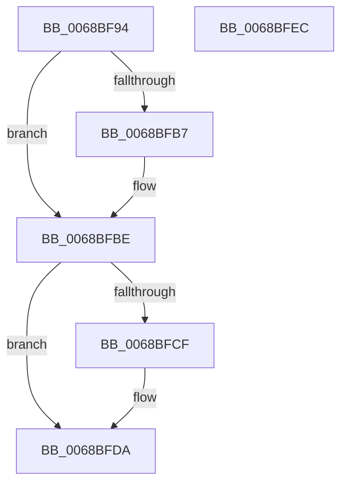

# MiUpdateAvailableEvents

- RVA: `0x0068BF94`–`0x0068BFED` (길이 `89` bytes)
- VA: `0x000000014068BF94`
- 실행 섹션: `.text`
- PDB 이름 있음: `예`; PDB Function 태그: `아니요`
- unwind 정보 RVA: `0x0005CAAC`
- 디코드: `25`개 명령, `89/89` bytes 표시
- 미해석 바이트: `0` (있으면 어셈블리에 `.byte`로 보존)

> 이 문서는 커널 이미지의 기계어와 PDB 기호를 분석해 생성했습니다. 4번과 5번은 함수 원형과 자료형을 바이너리 사용 방식에서 추정한 C 해석이며 원본 소스 복구 결과는 아닙니다.

## 1. Dependencies

- 직접 호출 지점: **3**; 고유 호출 대상: **3**
- 직접 호출자로 확인된 함수: **1**
- RIP 상대 이미지 참조: **1**

### Outgoing calls
- `0x0068BFB9` → [KiRaiseIrqlProcessIrqlFlags](../4F/KiRaiseIrqlProcessIrqlFlags_function_004F56FC.md) (function, `0x004F56FC`)
- `0x0068BFC1` → [MiUpdateAvailableEventsAtDpc](../3B/MiUpdateAvailableEventsAtDpc_function_003BC804.md) (function, `0x003BC804`)
- `0x0068BFD5` → [KiLowerIrqlProcessIrqlFlags](../4F/KiLowerIrqlProcessIrqlFlags_function_004F5698.md) (function, `0x004F5698`)

### Direct callers
- [MiInitializeMemoryEvents](../../page/81/MiInitializeMemoryEvents_function_0081123C.md) at `0x00811311`

### Static image references
- `0x0068BFAE` → RVA `0x00FC6D20` (`ALMOSTRO`; read)

## 2. Other-region calls and transfers

- 다른 실행 섹션으로 향하는 call: **0**
- 별도 외부 분기/꼬리 이동을 확인하지 못했습니다.

## 3. Assembly (complete function range)

```asm
0068BF94  48 89 5C 24 08                  mov qword ptr [rsp + 8], rbx
0068BF99  57                              push rdi
0068BF9A  48 83 EC 20                     sub rsp, 0x20
0068BF9E  48 8B F9                        mov rdi, rcx
0068BFA1  44 0F 20 C3                     mov rbx, cr8
0068BFA5  BA 02 00 00 00                  mov edx, 2
0068BFAA  44 0F 22 C2                     mov cr8, rdx
0068BFAE  83 3D 6B AD 93 00 00            cmp dword ptr [rip + 0x93ad6b], 0
0068BFB5  74 07                           je 0x14068bfbe
0068BFB7  8A CB                           mov cl, bl
0068BFB9  E8 3E 97 E6 FF                  call 0x1404f56fc
0068BFBE  48 8B CF                        mov rcx, rdi
0068BFC1  E8 3E 08 D3 FF                  call 0x1403bc804
0068BFC6  83 3D 53 AD 93 00 00            cmp dword ptr [rip + 0x93ad53], 0
0068BFCD  74 0B                           je 0x14068bfda
0068BFCF  44 0F 20 C1                     mov rcx, cr8
0068BFD3  8A D3                           mov dl, bl
0068BFD5  E8 BE 96 E6 FF                  call 0x1404f5698
0068BFDA  0F B6 C3                        movzx eax, bl
0068BFDD  44 0F 22 C0                     mov cr8, rax
0068BFE1  48 8B 5C 24 30                  mov rbx, qword ptr [rsp + 0x30]
0068BFE6  48 83 C4 20                     add rsp, 0x20
0068BFEA  5F                              pop rdi
0068BFEB  C3                              ret
0068BFEC  CC                              int3
```

## 4. C-style interpretation (structured pseudocode)

```c
__int64 __fastcall MiUpdateAvailableEvents(__int64 a1)
{
    __int64 result;
    __int64 v_rsp;
    unsigned __int64 v_stack_p8;

    v_stack_p8 = v_rbx;
    v_rsp = (v_rsp) - (32);
    if ((*(unsigned int *)(v_rip + 9678187)) != 0) {
        a1 = (unsigned __int8)(v_cr8);
        result = KiRaiseIrqlProcessIrqlFlags(a1, 2, a3, a4);
    }
    result = MiUpdateAvailableEventsAtDpc(a1, 2, a3, a4);
    if ((*(unsigned int *)(v_rip + 9678163)) != 0) {
        a1 = 2;
        a2 = (unsigned __int8)(v_cr8);
        result = KiLowerIrqlProcessIrqlFlags(a1, a2, a3, a4);
    }
    v_rsp = (v_rsp) + (32);
    return (unsigned __int8)(v_cr8);
}
```

## 5. (Beta) C Style

```c
int64_t MiUpdateAvailableEvents(int64_t Arg1)
{
    int64_t result;
    int64_t local_rsp;
    uint64_t v_stack_p8;

    v_stack_p8 = local_rbx;
    local_rsp = (local_rsp) - (32);
    if ((*(uint32_t *)(v_rip + 0x93AD6B)) != 0) {
        Arg1 = (uint8_t)(v_cr8);
        result = KiRaiseIrqlProcessIrqlFlags(Arg1, 2, a3, a4);
    }
    result = MiUpdateAvailableEventsAtDpc(Arg1, 2, a3, a4);
    if ((*(uint32_t *)(v_rip + 0x93AD53)) != 0) {
        Arg1 = 2;
        a2 = (uint8_t)(v_cr8);
        result = KiLowerIrqlProcessIrqlFlags(Arg1, a2, a3, a4);
    }
    local_rsp = (local_rsp) + (32);
    return (uint8_t)(v_cr8);
}
```

## 6. Execution-region graph

[열기: 2D/3D 그래프와 함수 탐색 컨트롤 패널](../../../control-panel.html?section=text&rva=0x0068BF94&view=graph)

- 2D 그래프는 위에서 아래로 흐르고, 3D 그래프는 빈 공간을 드래그해 회전합니다. Shift+드래그는 이동, 휠은 확대·축소, 함수 노드 선택은 대상 보고서 이동입니다.

### Static fallback


