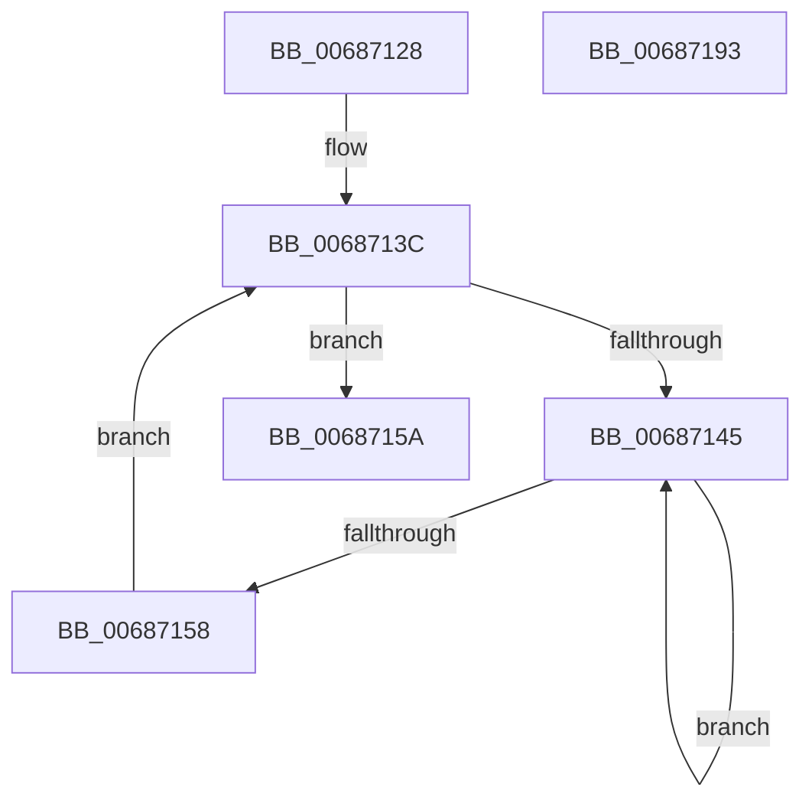

# MiUpdateEnclavePfnProtection

- RVA: `0x00687128`–`0x00687194` (길이 `108` bytes)
- VA: `0x0000000140687128`
- 실행 섹션: `.text`
- PDB 이름 있음: `예`; PDB Function 태그: `아니요`
- unwind 정보 RVA: `0x0005CAAC`
- 디코드: `29`개 명령, `108/108` bytes 표시
- 미해석 바이트: `0` (있으면 어셈블리에 `.byte`로 보존)

> 이 문서는 커널 이미지의 기계어와 PDB 기호를 분석해 생성했습니다. 4번과 5번은 함수 원형과 자료형을 바이너리 사용 방식에서 추정한 C 해석이며 원본 소스 복구 결과는 아닙니다.

## 1. Dependencies

- 직접 호출 지점: **1**; 고유 호출 대상: **1**
- 직접 호출자로 확인된 함수: **1**
- RIP 상대 이미지 참조: **0**

### Outgoing calls
- `0x0068714A` → [KeYieldProcessorEx](../3F/KeYieldProcessorEx_function_003FBD00.md) (function, `0x003FBD00`)

### Direct callers
- [MiProtectEnclavePages](../4D/MiProtectEnclavePages_function_004D5528.md) at `0x004D5937`

### Static image references
- 디코드된 RIP-relative 메모리 참조가 없습니다.

## 2. Other-region calls and transfers

- 다른 실행 섹션으로 향하는 call: **0**
- 별도 외부 분기/꼬리 이동을 확인하지 못했습니다.

## 3. Assembly (complete function range)

```asm
00687128  48 89 5C 24 08                  mov qword ptr [rsp + 8], rbx
0068712D  57                              push rdi
0068712E  48 83 EC 20                     sub rsp, 0x20
00687132  83 64 24 38 00                  and dword ptr [rsp + 0x38], 0
00687137  48 8B D9                        mov rbx, rcx
0068713A  8B FA                           mov edi, edx
0068713C  F0 48 0F BA 6B 18 3F            lock bts qword ptr [rbx + 0x18], 0x3f
00687143  73 15                           jae 0x14068715a
00687145  48 8D 4C 24 38                  lea rcx, [rsp + 0x38]
0068714A  E8 B1 4B D7 FF                  call 0x1403fbd00
0068714F  48 8B 43 18                     mov rax, qword ptr [rbx + 0x18]
00687153  48 85 C0                        test rax, rax
00687156  78 ED                           js 0x140687145
00687158  EB E2                           jmp 0x14068713c
0068715A  48 8B 43 10                     mov rax, qword ptr [rbx + 0x10]
0068715E  48 8B D7                        mov rdx, rdi
00687161  48 C1 E2 05                     shl rdx, 5
00687165  48 8B CA                        mov rcx, rdx
00687168  48 33 C8                        xor rcx, rax
0068716B  48 B8 FF FF FF FF FF FF FF 7F   movabs rax, 0x7fffffffffffffff
00687175  48 81 E1 1F FC FF FF            and rcx, 0xfffffffffffffc1f
0068717C  48 33 CA                        xor rcx, rdx
0068717F  48 89 4B 10                     mov qword ptr [rbx + 0x10], rcx
00687183  F0 48 21 43 18                  lock and qword ptr [rbx + 0x18], rax
00687188  48 8B 5C 24 30                  mov rbx, qword ptr [rsp + 0x30]
0068718D  48 83 C4 20                     add rsp, 0x20
00687191  5F                              pop rdi
00687192  C3                              ret
00687193  CC                              int3
```

## 4. C-style interpretation (structured pseudocode)

```c
__int64 __fastcall MiUpdateEnclavePfnProtection(__int64 a1, int a2)
{
    __int64 result;
    __int64 v_rsp;
    unsigned int v_stack_p10;
    unsigned __int64 v_stack_p8;

    v_stack_p8 = v_rbx;
    v_rsp = (v_rsp) - (32);
loc_0068713C:
    if (condition_is_above_or_equal) goto loc_0068715A;
loc_00687145:
    result = KeYieldProcessorEx(v_stack_p10, a2, a3, a4);
    if (sign_flag) goto loc_00687145;
    goto loc_0068713C;
loc_0068715A:
    a2 = ((unsigned int)(a2)) << (5);
    a1 = (a2) ^ (*(unsigned __int64 *)(a1 + 16));
    a1 = (a1) & (-993);
    a1 = (a1) ^ (a2);
    *(unsigned __int64 *)(a1 + 16) = a1;
    v_rsp = (v_rsp) + (32);
    return *(unsigned __int64 *)(a1 + 16);
}
```

## 5. (Beta) C Style

```c
int64_t MiUpdateEnclavePfnProtection(void *Arg1, int32_t Arg2)
{
    uint8_t *arg1 = (uint8_t *)Arg1;

    int64_t result;
    int64_t local_rsp;
    uint32_t v_stack_p10;
    uint64_t v_stack_p8;

    v_stack_p8 = local_rbx;
    local_rsp = (local_rsp) - (32);
loc_0068713C:
    if (condition_is_above_or_equal) goto loc_0068715A;
loc_00687145:
    result = KeYieldProcessorEx(v_stack_p10, Arg2, a3, a4);
    if (sign_flag) goto loc_00687145;
    goto loc_0068713C;
loc_0068715A:
    Arg2 = ((uint32_t)(Arg2)) << (5);
    Arg1 = (Arg2) ^ (*(uint64_t *)(arg1 + 0x10));
    Arg1 = (Arg1) & (-993);
    Arg1 = (Arg1) ^ (Arg2);
    *(void **)(arg1 + 0x10) = Arg1;
    local_rsp = (local_rsp) + (32);
    return *(uint64_t *)(arg1 + 0x10);
}
```

### 관측된 메모리 오프셋

구조체 형식이 확인되지 않은 접근은 인자 기준의 오프셋으로만 기록했습니다.

| 기준 인자 | 오프셋 표현 | 폭 (bit) | 접근 |
|---|---:|---:|---|
| `Arg1` | `+ 0x10` | `64` | `R` |
| `Arg1` | `+ 0x10` | `64` | `W` |
| `Arg1` | `+ 0x18` | `64` | `R` |
| `Arg1` | `+ 0x18` | `64` | `R/W` |

## 6. Execution-region graph

[열기: 2D/3D 그래프와 함수 탐색 컨트롤 패널](../../../control-panel.html?section=text&rva=0x00687128&view=graph)

- 2D 그래프는 위에서 아래로 흐르고, 3D 그래프는 빈 공간을 드래그해 회전합니다. Shift+드래그는 이동, 휠은 확대·축소, 함수 노드 선택은 대상 보고서 이동입니다.

### Static fallback


