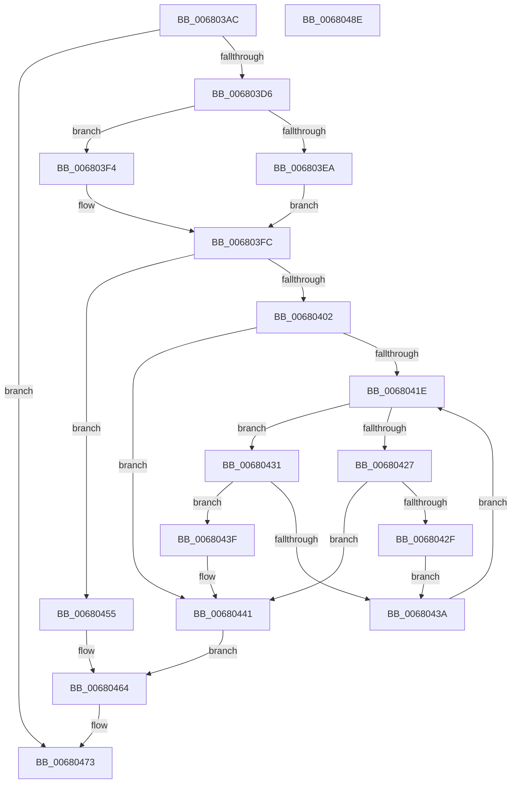

# MiUpdatePageFileList

- RVA: `0x006803AC`–`0x0068048F` (길이 `227` bytes)
- VA: `0x00000001406803AC`
- 실행 섹션: `.text`
- PDB 이름 있음: `예`; PDB Function 태그: `아니요`
- unwind 정보 RVA: `0x0005E6B4`
- 디코드: `60`개 명령, `227/227` bytes 표시
- 미해석 바이트: `0` (있으면 어셈블리에 `.byte`로 보존)

> 이 문서는 커널 이미지의 기계어와 PDB 기호를 분석해 생성했습니다. 4번과 5번은 함수 원형과 자료형을 바이너리 사용 방식에서 추정한 C 해석이며 원본 소스 복구 결과는 아닙니다.

## 1. Dependencies

- 직접 호출 지점: **5**; 고유 호출 대상: **5**
- 직접 호출자로 확인된 함수: **3**
- RIP 상대 이미지 참조: **2**

### Outgoing calls
- `0x006803ED` → [ExAcquireSpinLockExclusiveAtDpcLevel](../24/ExAcquireSpinLockExclusiveAtDpcLevel_function_00248E80.md) (function, `0x00248E80`)
- `0x006803F4` → [ExAcquireSpinLockExclusive](../24/ExAcquireSpinLockExclusive_function_00248690.md) (function, `0x00248690`)
- `0x0068044E` → [RtlAvlInsertNodeEx](../26/RtlAvlInsertNodeEx_function_00265790.md) (function, `0x00265790`)
- `0x0068045F` → [RtlAvlRemoveNode](../29/RtlAvlRemoveNode_function_00296650.md) (function, `0x00296650`)
- `0x0068046E` → [MiReleaseSpinLockExclusive](../24/MiReleaseSpinLockExclusive_function_002482C0.md) (function, `0x002482C0`)

### Direct callers
- [MiIncreaseCommitLimits](MiIncreaseCommitLimits_function_0068CADC.md) at `0x0068CBAE`
- [MiDeletePagefile](../../page/7F/MiDeletePagefile_function_007FFB88.md) at `0x007FFC07`
- [MiInsertPageFileInList](../../page/7F/MiInsertPageFileInList_function_007FFF80.md) at `0x008003A5`

### Static image references
- `0x006803DD` → RVA `0x00E37388` (`.data`; read)
- `0x00680412` → RVA `0x00E37380` (`.data`; read)

## 2. Other-region calls and transfers

- 다른 실행 섹션으로 향하는 call: **0**
- 별도 외부 분기/꼬리 이동을 확인하지 못했습니다.

## 3. Assembly (complete function range)

```asm
006803AC  48 8B C4                        mov rax, rsp
006803AF  48 89 58 08                     mov qword ptr [rax + 8], rbx
006803B3  48 89 68 10                     mov qword ptr [rax + 0x10], rbp
006803B7  48 89 70 18                     mov qword ptr [rax + 0x18], rsi
006803BB  48 89 78 20                     mov qword ptr [rax + 0x20], rdi
006803BF  41 56                           push r14
006803C1  48 83 EC 20                     sub rsp, 0x20
006803C5  33 DB                           xor ebx, ebx
006803C7  8B F2                           mov esi, edx
006803C9  48 8B F9                        mov rdi, rcx
006803CC  48 39 59 18                     cmp qword ptr [rcx + 0x18], rbx
006803D0  0F 84 9D 00 00 00               je 0x140680473
006803D6  4C 8D B1 E0 00 00 00            lea r14, [rcx + 0xe0]
006803DD  48 8D 0D A4 6F 7B 00            lea rcx, [rip + 0x7b6fa4]
006803E4  40 F6 C6 02                     test sil, 2
006803E8  74 0A                           je 0x1406803f4
006803EA  40 B5 11                        mov bpl, 0x11
006803ED  E8 8E 8A BC FF                  call 0x140248e80
006803F2  EB 08                           jmp 0x1406803fc
006803F4  E8 97 82 BC FF                  call 0x140248690
006803F9  40 8A E8                        mov bpl, al
006803FC  40 F6 C6 01                     test sil, 1
00680400  74 53                           je 0x140680455
00680402  48 8B 4F 18                     mov rcx, qword ptr [rdi + 0x18]
00680406  B8 00 01 00 00                  mov eax, 0x100
0068040B  66 09 87 AC 00 00 00            or word ptr [rdi + 0xac], ax
00680412  48 8B 15 67 6F 7B 00            mov rdx, qword ptr [rip + 0x7b6f67]
00680419  48 85 D2                        test rdx, rdx
0068041C  74 23                           je 0x140680441
0068041E  48 3B 8A 38 FF FF FF            cmp rcx, qword ptr [rdx - 0xc8]
00680425  73 0A                           jae 0x140680431
00680427  48 8B 02                        mov rax, qword ptr [rdx]
0068042A  48 85 C0                        test rax, rax
0068042D  74 12                           je 0x140680441
0068042F  EB 09                           jmp 0x14068043a
00680431  48 8B 42 08                     mov rax, qword ptr [rdx + 8]
00680435  48 85 C0                        test rax, rax
00680438  74 05                           je 0x14068043f
0068043A  48 8B D0                        mov rdx, rax
0068043D  EB DF                           jmp 0x14068041e
0068043F  B3 01                           mov bl, 1
00680441  4D 8B CE                        mov r9, r14
00680444  48 8D 0D 35 6F 7B 00            lea rcx, [rip + 0x7b6f35]
0068044B  44 8A C3                        mov r8b, bl
0068044E  E8 3D 53 BE FF                  call 0x140265790
00680453  EB 0F                           jmp 0x140680464
00680455  49 8B D6                        mov rdx, r14
00680458  48 8D 0D 21 6F 7B 00            lea rcx, [rip + 0x7b6f21]
0068045F  E8 EC 61 C1 FF                  call 0x140296650
00680464  40 8A D5                        mov dl, bpl
00680467  48 8D 0D 1A 6F 7B 00            lea rcx, [rip + 0x7b6f1a]
0068046E  E8 4D 7E BC FF                  call 0x1402482c0
00680473  48 8B 5C 24 30                  mov rbx, qword ptr [rsp + 0x30]
00680478  48 8B 6C 24 38                  mov rbp, qword ptr [rsp + 0x38]
0068047D  48 8B 74 24 40                  mov rsi, qword ptr [rsp + 0x40]
00680482  48 8B 7C 24 48                  mov rdi, qword ptr [rsp + 0x48]
00680487  48 83 C4 20                     add rsp, 0x20
0068048B  41 5E                           pop r14
0068048D  C3                              ret
0068048E  CC                              int3
```

## 4. C-style interpretation (structured pseudocode)

```c
__int64 __fastcall MiUpdatePageFileList(__int64 a1, int a2)
{
    __int64 result;
    __int64 v_rbx;
    __int64 v_rsp;
    unsigned __int64 v_stack_p10;
    unsigned __int64 v_stack_p18;
    unsigned __int64 v_stack_p20;
    unsigned __int64 v_stack_p8;

    *(unsigned __int64 *)(v_rsp + 8) = v_rbx;
    *(unsigned __int64 *)(v_rsp + 16) = v_rbp;
    *(unsigned __int64 *)(v_rsp + 24) = v_rsi;
    *(unsigned __int64 *)(v_rsp + 32) = v_rdi;
    v_rsp = (v_rsp) - (32);
    v_rbx = 0;
    if ((*(unsigned __int64 *)(a1 + 24)) == 0) goto loc_00680473;
    if ((((unsigned __int8)((unsigned int)(a2))) & (2)) == 0) goto loc_006803F4;
    result = ExAcquireSpinLockExclusiveAtDpcLevel(v_rip + 8089508, a2, a3, a4);
    goto loc_006803FC;
loc_006803F4:
    result = ExAcquireSpinLockExclusive(v_rip + 8089508, a2, a3, a4);
loc_006803FC:
    if ((((unsigned __int8)((unsigned int)(a2))) & (1)) == 0) goto loc_00680455;
    if (*(unsigned __int64 *)(v_rip + 8089447) == 0) goto loc_00680441;
loc_0068041E:
    if ((*(unsigned __int64 *)(a1 + 24)) >= (*(unsigned __int64 *)(*(unsigned __int64 *)(v_rip + 8089447) - 200))) goto loc_00680431;
    if (*(unsigned __int64 *)(*(unsigned __int64 *)(v_rip + 8089447)) == 0) goto loc_00680441;
    goto loc_0068043A;
loc_00680431:
    if (*(unsigned __int64 *)(*(unsigned __int64 *)(v_rip + 8089447) + 8) == 0) goto loc_0068043F;
loc_0068043A:
    goto loc_0068041E;
loc_0068043F:
loc_00680441:
    result = RtlAvlInsertNodeEx(v_rip + 8089397, *(unsigned __int64 *)(*(unsigned __int64 *)(v_rip + 8089447) + 8), 1, a1 + 224);
    goto loc_00680464;
loc_00680455:
    result = RtlAvlRemoveNode(v_rip + 8089377, a1 + 224, 1, a1 + 224);
loc_00680464:
    result = MiReleaseSpinLockExclusive(v_rip + 8089370, (unsigned __int8)((unsigned __int8)(result)), 1, a1 + 224);
loc_00680473:
    v_rsp = (v_rsp) + (32);
    return result;
}
```

## 5. (Beta) C Style

```c
int64_t MiUpdatePageFileList(void *Arg1, int32_t Arg2)
{
    uint8_t *arg1 = (uint8_t *)Arg1;

    int64_t result;
    int64_t local_rbx;
    int64_t local_rsp;
    uint64_t v_stack_p10;
    uint64_t v_stack_p18;
    uint64_t v_stack_p20;
    uint64_t v_stack_p8;

    *(uint64_t *)(local_rsp + 0x8) = local_rbx;
    *(uint64_t *)(local_rsp + 0x10) = local_rbp;
    *(uint64_t *)(local_rsp + 0x18) = local_rsi;
    *(uint64_t *)(local_rsp + 0x20) = local_rdi;
    local_rsp = (local_rsp) - (32);
    local_rbx = 0;
    if ((*(uint64_t *)(arg1 + 0x18)) == 0) goto loc_00680473;
    if ((((uint8_t)((uint32_t)(Arg2))) & (2)) == 0) goto loc_006803F4;
    result = ExAcquireSpinLockExclusiveAtDpcLevel(v_rip + 8089508, Arg2, a3, a4);
    goto loc_006803FC;
loc_006803F4:
    result = ExAcquireSpinLockExclusive(v_rip + 8089508, Arg2, a3, a4);
loc_006803FC:
    if ((((uint8_t)((uint32_t)(Arg2))) & (1)) == 0) goto loc_00680455;
    if (*(uint64_t *)(v_rip + 0x7B6F67) == 0) goto loc_00680441;
loc_0068041E:
    if ((*(uint64_t *)(arg1 + 0x18)) >= (*(uint64_t *)(*(uint64_t *)(v_rip + 0x7B6F67) - 0xC8))) goto loc_00680431;
    if (*(uint64_t *)(*(uint64_t *)(v_rip + 0x7B6F67)) == 0) goto loc_00680441;
    goto loc_0068043A;
loc_00680431:
    if (*(uint64_t *)(*(uint64_t *)(v_rip + 0x7B6F67) + 0x8) == 0) goto loc_0068043F;
loc_0068043A:
    goto loc_0068041E;
loc_0068043F:
loc_00680441:
    result = RtlAvlInsertNodeEx(v_rip + 8089397, *(uint64_t *)(*(uint64_t *)(v_rip + 0x7B6F67) + 0x8), 1, Arg1 + 224);
    goto loc_00680464;
loc_00680455:
    result = RtlAvlRemoveNode(v_rip + 8089377, Arg1 + 224, 1, Arg1 + 224);
loc_00680464:
    result = MiReleaseSpinLockExclusive(v_rip + 8089370, (uint8_t)((uint8_t)(result)), 1, Arg1 + 224);
loc_00680473:
    local_rsp = (local_rsp) + (32);
    return result;
}
```

### 관측된 메모리 오프셋

구조체 형식이 확인되지 않은 접근은 인자 기준의 오프셋으로만 기록했습니다.

| 기준 인자 | 오프셋 표현 | 폭 (bit) | 접근 |
|---|---:|---:|---|
| `Arg1` | `+ 0x18` | `64` | `R` |
| `Arg1` | `+ 0xAC` | `16` | `R/W` |
| `Arg1` | `+ 0xE0` | `64` | `R` |

## 6. Execution-region graph

[열기: 2D/3D 그래프와 함수 탐색 컨트롤 패널](../../../control-panel.html?section=text&rva=0x006803AC&view=graph)

- 2D 그래프는 위에서 아래로 흐르고, 3D 그래프는 빈 공간을 드래그해 회전합니다. Shift+드래그는 이동, 휠은 확대·축소, 함수 노드 선택은 대상 보고서 이동입니다.

### Static fallback


