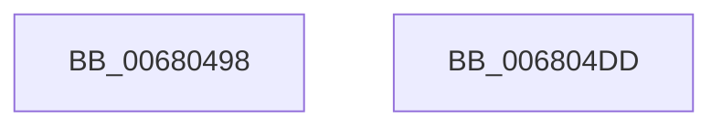

# MiUpdatePagingFileMinimum

- RVA: `0x00680498`–`0x006804DE` (길이 `70` bytes)
- VA: `0x0000000140680498`
- 실행 섹션: `.text`
- PDB 이름 있음: `예`; PDB Function 태그: `아니요`
- unwind 정보 RVA: `0x00060BC4`
- 디코드: `21`개 명령, `70/70` bytes 표시
- 미해석 바이트: `0` (있으면 어셈블리에 `.byte`로 보존)

> 이 문서는 커널 이미지의 기계어와 PDB 기호를 분석해 생성했습니다. 4번과 5번은 함수 원형과 자료형을 바이너리 사용 방식에서 추정한 C 해석이며 원본 소스 복구 결과는 아닙니다.

## 1. Dependencies

- 직접 호출 지점: **2**; 고유 호출 대상: **2**
- 직접 호출자로 확인된 함수: **1**
- RIP 상대 이미지 참조: **0**

### Outgoing calls
- `0x006804B6` → [ExAcquireSpinLockExclusive](../24/ExAcquireSpinLockExclusive_function_00248690.md) (function, `0x00248690`)
- `0x006804C8` → [MiReleaseSpinLockExclusive](../24/MiReleaseSpinLockExclusive_function_002482C0.md) (function, `0x002482C0`)

### Direct callers
- [MiExtendPagingFiles](../../page/7F/MiExtendPagingFiles_function_007FFDD8.md) at `0x007FFE56`

### Static image references
- 디코드된 RIP-relative 메모리 참조가 없습니다.

## 2. Other-region calls and transfers

- 다른 실행 섹션으로 향하는 call: **0**
- 별도 외부 분기/꼬리 이동을 확인하지 못했습니다.

## 3. Assembly (complete function range)

```asm
00680498  48 89 5C 24 08                  mov qword ptr [rsp + 8], rbx
0068049D  48 89 74 24 10                  mov qword ptr [rsp + 0x10], rsi
006804A2  57                              push rdi
006804A3  48 83 EC 20                     sub rsp, 0x20
006804A7  48 8D B1 C8 00 00 00            lea rsi, [rcx + 0xc8]
006804AE  48 8B F9                        mov rdi, rcx
006804B1  48 8B CE                        mov rcx, rsi
006804B4  8B DA                           mov ebx, edx
006804B6  E8 D5 81 BC FF                  call 0x140248690
006804BB  8B 57 08                        mov edx, dword ptr [rdi + 8]
006804BE  48 8B CE                        mov rcx, rsi
006804C1  03 D3                           add edx, ebx
006804C3  89 57 08                        mov dword ptr [rdi + 8], edx
006804C6  8A D0                           mov dl, al
006804C8  E8 F3 7D BC FF                  call 0x1402482c0
006804CD  48 8B 5C 24 30                  mov rbx, qword ptr [rsp + 0x30]
006804D2  48 8B 74 24 38                  mov rsi, qword ptr [rsp + 0x38]
006804D7  48 83 C4 20                     add rsp, 0x20
006804DB  5F                              pop rdi
006804DC  C3                              ret
006804DD  CC                              int3
```

## 4. C-style interpretation (structured pseudocode)

```c
__int64 __fastcall MiUpdatePagingFileMinimum(__int64 a1, int a2)
{
    __int64 result;
    __int64 v_rsp;
    unsigned __int64 v_stack_p10;
    unsigned __int64 v_stack_p8;

    v_stack_p8 = v_rbx;
    v_stack_p10 = v_rsi;
    v_rsp = (v_rsp) - (32);
    result = ExAcquireSpinLockExclusive(a1 + 200, a2, a3, a4);
    a2 = (unsigned int)(((unsigned int)(*(unsigned int *)(a1 + 8))) + ((unsigned int)((unsigned int)(a2))));
    *(unsigned int *)(a1 + 8) = a2;
    result = MiReleaseSpinLockExclusive(a1 + 200, (unsigned __int8)(result), a3, a4);
    v_rsp = (v_rsp) + (32);
    return result;
}
```

## 5. (Beta) C Style

```c
int64_t MiUpdatePagingFileMinimum(void *Arg1, int32_t Arg2)
{
    uint8_t *arg1 = (uint8_t *)Arg1;

    int64_t result;
    int64_t local_rsp;
    uint64_t v_stack_p10;
    uint64_t v_stack_p8;

    v_stack_p8 = local_rbx;
    v_stack_p10 = local_rsi;
    local_rsp = (local_rsp) - (32);
    result = ExAcquireSpinLockExclusive(Arg1 + 200, Arg2, a3, a4);
    Arg2 = (uint32_t)(((uint32_t)(*(uint32_t *)(arg1 + 0x8))) + ((uint32_t)((uint32_t)(Arg2))));
    *(uint32_t *)(arg1 + 0x8) = Arg2;
    result = MiReleaseSpinLockExclusive(Arg1 + 200, (uint8_t)(result), a3, a4);
    local_rsp = (local_rsp) + (32);
    return result;
}
```

### 관측된 메모리 오프셋

구조체 형식이 확인되지 않은 접근은 인자 기준의 오프셋으로만 기록했습니다.

| 기준 인자 | 오프셋 표현 | 폭 (bit) | 접근 |
|---|---:|---:|---|
| `Arg1` | `+ 0x8` | `32` | `R` |
| `Arg1` | `+ 0x8` | `32` | `W` |
| `Arg1` | `+ 0xC8` | `64` | `R` |

## 6. Execution-region graph

[열기: 2D/3D 그래프와 함수 탐색 컨트롤 패널](../../../control-panel.html?section=text&rva=0x00680498&view=graph)

- 2D 그래프는 위에서 아래로 흐르고, 3D 그래프는 빈 공간을 드래그해 회전합니다. Shift+드래그는 이동, 휠은 확대·축소, 함수 노드 선택은 대상 보고서 이동입니다.

### Static fallback


