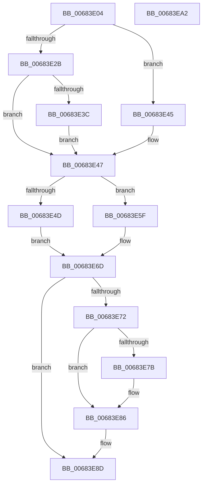

# MiUpdatePatchInProgress

- RVA: `0x00683E04`–`0x00683EA3` (길이 `159` bytes)
- VA: `0x0000000140683E04`
- 실행 섹션: `.text`
- PDB 이름 있음: `예`; PDB Function 태그: `아니요`
- unwind 정보 RVA: `0x0005C954`
- 디코드: `42`개 명령, `159/159` bytes 표시
- 미해석 바이트: `0` (있으면 어셈블리에 `.byte`로 보존)

> 이 문서는 커널 이미지의 기계어와 PDB 기호를 분석해 생성했습니다. 4번과 5번은 함수 원형과 자료형을 바이너리 사용 방식에서 추정한 C 해석이며 원본 소스 복구 결과는 아닙니다.

## 1. Dependencies

- 직접 호출 지점: **2**; 고유 호출 대상: **2**
- 직접 호출자로 확인된 함수: **2**
- RIP 상대 이미지 참조: **5**

### Outgoing calls
- `0x00683E3E` → [KiRaiseIrqlProcessIrqlFlags](../4F/KiRaiseIrqlProcessIrqlFlags_function_004F56FC.md) (function, `0x004F56FC`)
- `0x00683E81` → [KiLowerIrqlProcessIrqlFlags](../4F/KiLowerIrqlProcessIrqlFlags_function_004F5698.md) (function, `0x004F5698`)

### Direct callers
- [MiLinkHotPatchToBase](MiLinkHotPatchToBase_function_00683728.md) at `0x00683777`
- [MiApplyDriverHotPatch](../../page/80/MiApplyDriverHotPatch_function_008018EC.md) at `0x00801CF7`
- [MiApplyDriverHotPatch](../../page/80/MiApplyDriverHotPatch_function_008018EC.md) at `0x00801DDB`

### Static image references
- `0x00683E33` → RVA `0x00FC6D20` (`ALMOSTRO`; read)
- `0x00683E4D` → RVA `0x00E375A0` (`.data`; read/write)
- `0x00683E55` → RVA `0x00E37598` (`.data`; read/write)
- `0x00683E5F` → RVA `0x00E375A0` (`.data`; write)
- `0x00683E66` → RVA `0x00E37598` (`.data`; write)

## 2. Other-region calls and transfers

- 다른 실행 섹션으로 향하는 call: **0**
- 별도 외부 분기/꼬리 이동을 확인하지 못했습니다.

## 3. Assembly (complete function range)

```asm
00683E04  48 89 5C 24 08                  mov qword ptr [rsp + 8], rbx
00683E09  48 89 6C 24 10                  mov qword ptr [rsp + 0x10], rbp
00683E0E  48 89 74 24 18                  mov qword ptr [rsp + 0x18], rsi
00683E13  57                              push rdi
00683E14  48 83 EC 20                     sub rsp, 0x20
00683E18  48 8B F2                        mov rsi, rdx
00683E1B  41 8B F8                        mov edi, r8d
00683E1E  BA 02 00 00 00                  mov edx, 2
00683E23  48 8B E9                        mov rbp, rcx
00683E26  44 84 C2                        test dl, r8b
00683E29  75 1A                           jne 0x140683e45
00683E2B  44 0F 20 C3                     mov rbx, cr8
00683E2F  44 0F 22 C2                     mov cr8, rdx
00683E33  83 3D E6 2E 94 00 00            cmp dword ptr [rip + 0x942ee6], 0
00683E3A  74 0B                           je 0x140683e47
00683E3C  8A CB                           mov cl, bl
00683E3E  E8 B9 18 E7 FF                  call 0x1404f56fc
00683E43  EB 02                           jmp 0x140683e47
00683E45  B3 11                           mov bl, 0x11
00683E47  40 F6 C7 01                     test dil, 1
00683E4B  74 12                           je 0x140683e5f
00683E4D  48 83 25 4B 37 7B 00 00         and qword ptr [rip + 0x7b374b], 0
00683E55  48 83 25 3B 37 7B 00 00         and qword ptr [rip + 0x7b373b], 0
00683E5D  EB 0E                           jmp 0x140683e6d
00683E5F  48 89 2D 3A 37 7B 00            mov qword ptr [rip + 0x7b373a], rbp
00683E66  48 89 35 2B 37 7B 00            mov qword ptr [rip + 0x7b372b], rsi
00683E6D  80 FB 11                        cmp bl, 0x11
00683E70  74 1B                           je 0x140683e8d
00683E72  83 3D A7 2E 94 00 00            cmp dword ptr [rip + 0x942ea7], 0
00683E79  74 0B                           je 0x140683e86
00683E7B  44 0F 20 C1                     mov rcx, cr8
00683E7F  8A D3                           mov dl, bl
00683E81  E8 12 18 E7 FF                  call 0x1404f5698
00683E86  0F B6 C3                        movzx eax, bl
00683E89  44 0F 22 C0                     mov cr8, rax
00683E8D  48 8B 5C 24 30                  mov rbx, qword ptr [rsp + 0x30]
00683E92  48 8B 6C 24 38                  mov rbp, qword ptr [rsp + 0x38]
00683E97  48 8B 74 24 40                  mov rsi, qword ptr [rsp + 0x40]
00683E9C  48 83 C4 20                     add rsp, 0x20
00683EA0  5F                              pop rdi
00683EA1  C3                              ret
00683EA2  CC                              int3
```

## 4. C-style interpretation (structured pseudocode)

```c
__int64 __fastcall MiUpdatePatchInProgress(__int64 a1, __int64 a2, int a3)
{
    __int64 result;
    __int64 v_rsp;
    unsigned __int64 v_stack_p10;
    unsigned __int64 v_stack_p18;
    unsigned __int64 v_stack_p8;

    v_stack_p8 = v_rbx;
    v_stack_p10 = v_rbp;
    v_stack_p18 = v_rsi;
    v_rsp = (v_rsp) - (32);
    if (((2) & ((unsigned __int8)(a3))) != 0) goto loc_00683E45;
    if ((*(unsigned int *)(v_rip + 9711334)) == 0) goto loc_00683E47;
    result = KiRaiseIrqlProcessIrqlFlags((unsigned __int8)(v_cr8), 2, a3, a4);
    goto loc_00683E47;
loc_00683E45:
loc_00683E47:
    if ((((unsigned __int8)((unsigned int)(a3))) & (1)) == 0) goto loc_00683E5F;
    goto loc_00683E6D;
loc_00683E5F:
    *(unsigned __int64 *)(v_rip + 8075066) = a1;
    *(unsigned __int64 *)(v_rip + 8075051) = a2;
loc_00683E6D:
    if (17 == 17) goto loc_00683E8D;
    if ((*(unsigned int *)(v_rip + 9711271)) != 0) {
        a1 = 2;
        a2 = 17;
        result = KiLowerIrqlProcessIrqlFlags(a1, a2, a3, a4);
    }
loc_00683E8D:
    v_rsp = (v_rsp) + (32);
    return 17;
}
```

## 5. (Beta) C Style

```c
int64_t MiUpdatePatchInProgress(int64_t Arg1, int64_t Arg2, int32_t Arg3)
{
    int64_t result;
    int64_t local_rsp;
    uint64_t v_stack_p10;
    uint64_t v_stack_p18;
    uint64_t v_stack_p8;

    v_stack_p8 = local_rbx;
    v_stack_p10 = local_rbp;
    v_stack_p18 = local_rsi;
    local_rsp = (local_rsp) - (32);
    if (((2) & ((uint8_t)(Arg3))) != 0) goto loc_00683E45;
    if ((*(uint32_t *)(v_rip + 0x942EE6)) == 0) goto loc_00683E47;
    result = KiRaiseIrqlProcessIrqlFlags((uint8_t)(v_cr8), 2, Arg3, a4);
    goto loc_00683E47;
loc_00683E45:
loc_00683E47:
    if ((((uint8_t)((uint32_t)(Arg3))) & (1)) == 0) goto loc_00683E5F;
    goto loc_00683E6D;
loc_00683E5F:
    *(uint64_t *)(v_rip + 0x7B373A) = Arg1;
    *(uint64_t *)(v_rip + 0x7B372B) = Arg2;
loc_00683E6D:
    if (17 == 17) goto loc_00683E8D;
    if ((*(uint32_t *)(v_rip + 0x942EA7)) != 0) {
        Arg1 = 2;
        Arg2 = 17;
        result = KiLowerIrqlProcessIrqlFlags(Arg1, Arg2, Arg3, a4);
    }
loc_00683E8D:
    local_rsp = (local_rsp) + (32);
    return 17;
}
```

## 6. Execution-region graph

[열기: 2D/3D 그래프와 함수 탐색 컨트롤 패널](../../../control-panel.html?section=text&rva=0x00683E04&view=graph)

- 2D 그래프는 위에서 아래로 흐르고, 3D 그래프는 빈 공간을 드래그해 회전합니다. Shift+드래그는 이동, 휠은 확대·축소, 함수 노드 선택은 대상 보고서 이동입니다.

### Static fallback


