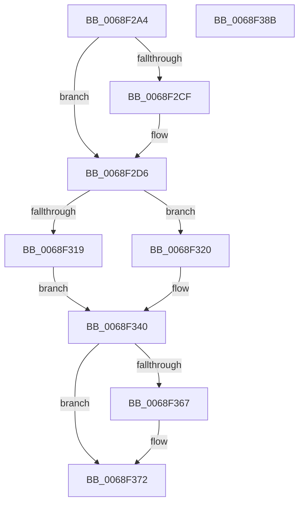

# MiUpdateSlabContextSlabSize

- RVA: `0x0068F2A4`–`0x0068F38C` (길이 `232` bytes)
- VA: `0x000000014068F2A4`
- 실행 섹션: `.text`
- PDB 이름 있음: `예`; PDB Function 태그: `아니요`
- unwind 정보 RVA: `0x000794E0`
- 디코드: `56`개 명령, `232/232` bytes 표시
- 미해석 바이트: `0` (있으면 어셈블리에 `.byte`로 보존)

> 이 문서는 커널 이미지의 기계어와 PDB 기호를 분석해 생성했습니다. 4번과 5번은 함수 원형과 자료형을 바이너리 사용 방식에서 추정한 C 해석이며 원본 소스 복구 결과는 아닙니다.

## 1. Dependencies

- 직접 호출 지점: **6**; 고유 호출 대상: **3**
- 직접 호출자로 확인된 함수: **1**
- RIP 상대 이미지 참조: **4**

### Outgoing calls
- `0x0068F2D1` → [KiRaiseIrqlProcessIrqlFlags](../4F/KiRaiseIrqlProcessIrqlFlags_function_004F56FC.md) (function, `0x004F56FC`)
- `0x0068F2F2` → [MiEnumerateSlabAllocatorsEx](../47/MiEnumerateSlabAllocatorsEx_function_004746F8.md) (function, `0x004746F8`)
- `0x0068F310` → [MiEnumerateSlabAllocatorsEx](../47/MiEnumerateSlabAllocatorsEx_function_004746F8.md) (function, `0x004746F8`)
- `0x0068F339` → [MiEnumerateSlabAllocatorsEx](../47/MiEnumerateSlabAllocatorsEx_function_004746F8.md) (function, `0x004746F8`)
- `0x0068F359` → [MiEnumerateSlabAllocatorsEx](../47/MiEnumerateSlabAllocatorsEx_function_004746F8.md) (function, `0x004746F8`)
- `0x0068F36D` → [KiLowerIrqlProcessIrqlFlags](../4F/KiLowerIrqlProcessIrqlFlags_function_004F5698.md) (function, `0x004F5698`)

### Direct callers
- [MmManagePartitionUpdateAttributes](../../page/80/MmManagePartitionUpdateAttributes_function_0080E5A4.md) at `0x0080E633`

### Static image references
- `0x0068F2C6` → RVA `0x00FC6D20` (`ALMOSTRO`; read)
- `0x0068F2E8` → RVA `0x004BB6A0` (`MiLockSlabAllocator`; read)
- `0x0068F306` → RVA `0x0068D160` (`MiCheckSlabAllocatorEmpty`; read)
- `0x0068F32F` → RVA `0x0068F1C0` (`MiSetSlabAllocatorSlabSize`; read)

## 2. Other-region calls and transfers

- 다른 실행 섹션으로 향하는 call: **0**
- 별도 외부 분기/꼬리 이동을 확인하지 못했습니다.

## 3. Assembly (complete function range)

```asm
0068F2A4  48 89 5C 24 08                  mov qword ptr [rsp + 8], rbx
0068F2A9  48 89 74 24 10                  mov qword ptr [rsp + 0x10], rsi
0068F2AE  57                              push rdi
0068F2AF  48 83 EC 30                     sub rsp, 0x30
0068F2B3  41 8B F8                        mov edi, r8d
0068F2B6  48 8B F1                        mov rsi, rcx
0068F2B9  44 0F 20 C3                     mov rbx, cr8
0068F2BD  BA 02 00 00 00                  mov edx, 2
0068F2C2  44 0F 22 C2                     mov cr8, rdx
0068F2C6  83 3D 53 7A 93 00 00            cmp dword ptr [rip + 0x937a53], 0
0068F2CD  74 07                           je 0x14068f2d6
0068F2CF  8A CB                           mov cl, bl
0068F2D1  E8 26 64 E6 FF                  call 0x1404f56fc
0068F2D6  41 83 C9 FF                     or r9d, 0xffffffff
0068F2DA  C7 44 24 20 08 00 00 00         mov dword ptr [rsp + 0x20], 8
0068F2E2  41 B8 01 00 00 00               mov r8d, 1
0068F2E8  48 8D 15 B1 C3 E2 FF            lea rdx, [rip - 0x1d3c4f]
0068F2EF  48 8B CE                        mov rcx, rsi
0068F2F2  E8 01 54 DE FF                  call 0x1404746f8
0068F2F7  41 83 C9 FF                     or r9d, 0xffffffff
0068F2FB  C7 44 24 20 08 00 00 00         mov dword ptr [rsp + 0x20], 8
0068F303  45 33 C0                        xor r8d, r8d
0068F306  48 8D 15 53 DE FF FF            lea rdx, [rip - 0x21ad]
0068F30D  48 8B CE                        mov rcx, rsi
0068F310  E8 E3 53 DE FF                  call 0x1404746f8
0068F315  85 C0                           test eax, eax
0068F317  74 07                           je 0x14068f320
0068F319  BF 21 00 00 C0                  mov edi, 0xc0000021
0068F31E  EB 20                           jmp 0x14068f340
0068F320  4C 8B C7                        mov r8, rdi
0068F323  C7 44 24 20 08 00 00 00         mov dword ptr [rsp + 0x20], 8
0068F32B  41 83 C9 FF                     or r9d, 0xffffffff
0068F32F  48 8D 15 8A FE FF FF            lea rdx, [rip - 0x176]
0068F336  48 8B CE                        mov rcx, rsi
0068F339  E8 BA 53 DE FF                  call 0x1404746f8
0068F33E  33 FF                           xor edi, edi
0068F340  41 83 C9 FF                     or r9d, 0xffffffff
0068F344  C7 44 24 20 08 00 00 00         mov dword ptr [rsp + 0x20], 8
0068F34C  45 33 C0                        xor r8d, r8d
0068F34F  48 8D 15 4A C3 E2 FF            lea rdx, [rip - 0x1d3cb6]
0068F356  48 8B CE                        mov rcx, rsi
0068F359  E8 9A 53 DE FF                  call 0x1404746f8
0068F35E  83 3D BB 79 93 00 00            cmp dword ptr [rip + 0x9379bb], 0
0068F365  74 0B                           je 0x14068f372
0068F367  44 0F 20 C1                     mov rcx, cr8
0068F36B  8A D3                           mov dl, bl
0068F36D  E8 26 63 E6 FF                  call 0x1404f5698
0068F372  0F B6 CB                        movzx ecx, bl
0068F375  44 0F 22 C1                     mov cr8, rcx
0068F379  48 8B 5C 24 40                  mov rbx, qword ptr [rsp + 0x40]
0068F37E  8B C7                           mov eax, edi
0068F380  48 8B 74 24 48                  mov rsi, qword ptr [rsp + 0x48]
0068F385  48 83 C4 30                     add rsp, 0x30
0068F389  5F                              pop rdi
0068F38A  C3                              ret
0068F38B  CC                              int3
```

## 4. C-style interpretation (structured pseudocode)

```c
__int64 __fastcall MiUpdateSlabContextSlabSize(__int64 a1, __int64 a2, int a3, int a4)
{
    __int64 result;
    __int64 v_rdi;
    __int64 v_rsp;
    unsigned int v_stack_m18;
    unsigned __int64 v_stack_p10;
    unsigned __int64 v_stack_p8;

    v_stack_p8 = v_rbx;
    v_stack_p10 = v_rsi;
    v_rsp = (v_rsp) - (48);
    if ((*(unsigned int *)(v_rip + 9665107)) != 0) {
        a1 = (unsigned __int8)(v_cr8);
        result = KiRaiseIrqlProcessIrqlFlags(a1, 2, a3, a4);
    }
    a4 = (unsigned int)((a4) | (0xFFFFFFFFULL));
    v_stack_m18 = 8;
    result = MiEnumerateSlabAllocatorsEx(a1, v_rip - 1915983, 1, a4);
    a4 = (unsigned int)((a4) | (0xFFFFFFFFULL));
    v_stack_m18 = 8;
    a3 = 0;
    result = MiEnumerateSlabAllocatorsEx(a1, v_rip - 8621, a3, a4);
    if ((unsigned int)(result) == 0) goto loc_0068F320;
    goto loc_0068F340;
loc_0068F320:
    v_stack_m18 = 8;
    a4 = (unsigned int)((a4) | (0xFFFFFFFFULL));
    result = MiEnumerateSlabAllocatorsEx(a1, v_rip - 374, (unsigned int)(0xC0000021ULL), a4);
    v_rdi = 0;
loc_0068F340:
    a4 = (unsigned int)((a4) | (0xFFFFFFFFULL));
    v_stack_m18 = 8;
    a3 = 0;
    result = MiEnumerateSlabAllocatorsEx(a1, v_rip - 1916086, a3, a4);
    if ((*(unsigned int *)(v_rip + 9664955)) != 0) {
        a1 = 2;
        a2 = (unsigned __int8)(v_cr8);
        result = KiLowerIrqlProcessIrqlFlags(a1, a2, a3, a4);
    }
    v_rsp = (v_rsp) + (48);
    return 0;
}
```

## 5. (Beta) C Style

```c
int64_t MiUpdateSlabContextSlabSize(int64_t Arg1, int64_t Arg2, int32_t Arg3, int32_t Arg4)
{
    int64_t result;
    int64_t local_rdi;
    int64_t local_rsp;
    uint32_t v_stack_m18;
    uint64_t v_stack_p10;
    uint64_t v_stack_p8;

    v_stack_p8 = local_rbx;
    v_stack_p10 = local_rsi;
    local_rsp = (local_rsp) - (48);
    if ((*(uint32_t *)(v_rip + 0x937A53)) != 0) {
        Arg1 = (uint8_t)(v_cr8);
        result = KiRaiseIrqlProcessIrqlFlags(Arg1, 2, Arg3, Arg4);
    }
    Arg4 = (uint32_t)((Arg4) | (0xFFFFFFFFULL));
    v_stack_m18 = 8;
    result = MiEnumerateSlabAllocatorsEx(Arg1, v_rip - 1915983, 1, Arg4);
    Arg4 = (uint32_t)((Arg4) | (0xFFFFFFFFULL));
    v_stack_m18 = 8;
    Arg3 = 0;
    result = MiEnumerateSlabAllocatorsEx(Arg1, v_rip - 8621, Arg3, Arg4);
    if ((uint32_t)(result) == 0) goto loc_0068F320;
    goto loc_0068F340;
loc_0068F320:
    v_stack_m18 = 8;
    Arg4 = (uint32_t)((Arg4) | (0xFFFFFFFFULL));
    result = MiEnumerateSlabAllocatorsEx(Arg1, v_rip - 374, (uint32_t)(0xC0000021ULL), Arg4);
    local_rdi = 0;
loc_0068F340:
    Arg4 = (uint32_t)((Arg4) | (0xFFFFFFFFULL));
    v_stack_m18 = 8;
    Arg3 = 0;
    result = MiEnumerateSlabAllocatorsEx(Arg1, v_rip - 1916086, Arg3, Arg4);
    if ((*(uint32_t *)(v_rip + 0x9379BB)) != 0) {
        Arg1 = 2;
        Arg2 = (uint8_t)(v_cr8);
        result = KiLowerIrqlProcessIrqlFlags(Arg1, Arg2, Arg3, Arg4);
    }
    local_rsp = (local_rsp) + (48);
    return 0;
}
```

## 6. Execution-region graph

[열기: 2D/3D 그래프와 함수 탐색 컨트롤 패널](../../../control-panel.html?section=text&rva=0x0068F2A4&view=graph)

- 2D 그래프는 위에서 아래로 흐르고, 3D 그래프는 빈 공간을 드래그해 회전합니다. Shift+드래그는 이동, 휠은 확대·축소, 함수 노드 선택은 대상 보고서 이동입니다.

### Static fallback


