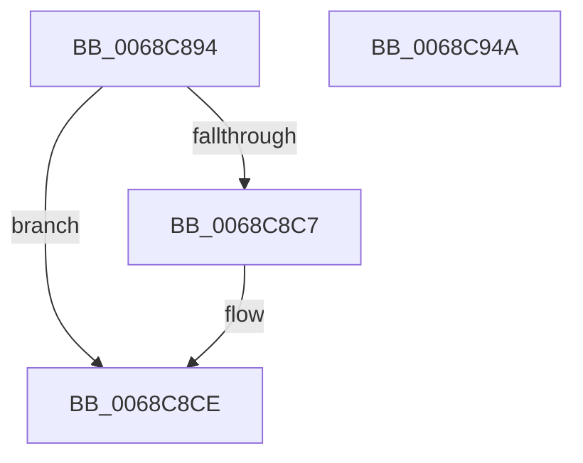

# MiUseProcessorHugeMappingAtDpc

- RVA: `0x0068C894`–`0x0068C94B` (길이 `183` bytes)
- VA: `0x000000014068C894`
- 실행 섹션: `.text`
- PDB 이름 있음: `예`; PDB Function 태그: `아니요`
- unwind 정보 RVA: `0x0005C954`
- 디코드: `46`개 명령, `183/183` bytes 표시
- 미해석 바이트: `0` (있으면 어셈블리에 `.byte`로 보존)

> 이 문서는 커널 이미지의 기계어와 PDB 기호를 분석해 생성했습니다. 4번과 5번은 함수 원형과 자료형을 바이너리 사용 방식에서 추정한 C 해석이며 원본 소스 복구 결과는 아닙니다.

## 1. Dependencies

- 직접 호출 지점: **4**; 고유 호출 대상: **4**
- 직접 호출자로 확인된 함수: **1**
- RIP 상대 이미지 참조: **1**

### Outgoing calls
- `0x0068C8C9` → [KiRaiseIrqlProcessIrqlFlags](../4F/KiRaiseIrqlProcessIrqlFlags_function_004F56FC.md) (function, `0x004F56FC`)
- `0x0068C8F0` → [MiGetUltraMapping](../32/MiGetUltraMapping_function_00323270.md) (function, `0x00323270`)
- `0x0068C91C` → [MiUpdateProtectionMask](../28/MiUpdateProtectionMask_function_002845DC.md) (function, `0x002845DC`)
- `0x0068C92D` → [MiWriteLargePte](../2C/MiWriteLargePte_function_002C6DE0.md) (function, `0x002C6DE0`)

### Direct callers
- [MiSoloZeroHugeRange](MiSoloZeroHugeRange_function_0068C6E4.md) at `0x0068C781`
- [MiSoloZeroHugeRange](MiSoloZeroHugeRange_function_0068C6E4.md) at `0x0068C81F`

### Static image references
- `0x0068C8BE` → RVA `0x00FC6D20` (`ALMOSTRO`; read)

## 2. Other-region calls and transfers

- 다른 실행 섹션으로 향하는 call: **0**
- 별도 외부 분기/꼬리 이동을 확인하지 못했습니다.

## 3. Assembly (complete function range)

```asm
0068C894  48 89 5C 24 08                  mov qword ptr [rsp + 8], rbx
0068C899  48 89 6C 24 10                  mov qword ptr [rsp + 0x10], rbp
0068C89E  48 89 74 24 18                  mov qword ptr [rsp + 0x18], rsi
0068C8A3  57                              push rdi
0068C8A4  48 83 EC 20                     sub rsp, 0x20
0068C8A8  49 8B F9                        mov rdi, r9
0068C8AB  41 8B F0                        mov esi, r8d
0068C8AE  48 8B E9                        mov rbp, rcx
0068C8B1  44 0F 20 C3                     mov rbx, cr8
0068C8B5  BA 02 00 00 00                  mov edx, 2
0068C8BA  44 0F 22 C2                     mov cr8, rdx
0068C8BE  83 3D 5B A4 93 00 00            cmp dword ptr [rip + 0x93a45b], 0
0068C8C5  74 07                           je 0x14068c8ce
0068C8C7  8A CB                           mov cl, bl
0068C8C9  E8 2E 8E E6 FF                  call 0x1404f56fc
0068C8CE  65 48 8B 04 25 20 00 00 00      mov rax, qword ptr gs:[0x20]
0068C8D7  33 D2                           xor edx, edx
0068C8D9  88 1F                           mov byte ptr [rdi], bl
0068C8DB  41 B8 00 00 04 00               mov r8d, 0x40000
0068C8E1  48 8B 98 38 88 00 00            mov rbx, qword ptr [rax + 0x8838]
0068C8E8  44 8D 4A 04                     lea r9d, [rdx + 4]
0068C8EC  48 8D 4B 08                     lea rcx, [rbx + 8]
0068C8F0  E8 7B 69 C9 FF                  call 0x140323270
0068C8F5  48 8B C8                        mov rcx, rax
0068C8F8  48 8B F8                        mov rdi, rax
0068C8FB  48 C1 E9 1B                     shr rcx, 0x1b
0068C8FF  81 E1 F8 FF 1F 00               and ecx, 0x1ffff8
0068C905  48 B8 00 00 A0 7D FB F6 FF FF   movabs rax, 0xfffff6fb7da00000
0068C90F  48 03 C8                        add rcx, rax
0068C912  8B D6                           mov edx, esi
0068C914  48 89 0B                        mov qword ptr [rbx], rcx
0068C917  B9 04 00 00 84                  mov ecx, 0x84000004
0068C91C  E8 BB 7C BF FF                  call 0x1402845dc
0068C921  44 8B C8                        mov r9d, eax
0068C924  48 8B CF                        mov rcx, rdi
0068C927  45 33 C0                        xor r8d, r8d
0068C92A  48 8B D5                        mov rdx, rbp
0068C92D  E8 AE A4 C3 FF                  call 0x1402c6de0
0068C932  48 8B 5C 24 30                  mov rbx, qword ptr [rsp + 0x30]
0068C937  48 8B C7                        mov rax, rdi
0068C93A  48 8B 6C 24 38                  mov rbp, qword ptr [rsp + 0x38]
0068C93F  48 8B 74 24 40                  mov rsi, qword ptr [rsp + 0x40]
0068C944  48 83 C4 20                     add rsp, 0x20
0068C948  5F                              pop rdi
0068C949  C3                              ret
0068C94A  CC                              int3
```

## 4. C-style interpretation (structured pseudocode)

```c
__int64 __fastcall MiUseProcessorHugeMappingAtDpc(__int64 a1, __int64 a2, int a3, __int64 a4)
{
    __int64 result;
    __int64 v_rsp;
    unsigned __int64 v_stack_p10;
    unsigned __int64 v_stack_p18;
    unsigned __int64 v_stack_p8;

    v_stack_p8 = v_rbx;
    v_stack_p10 = v_rbp;
    v_stack_p18 = v_rsi;
    v_rsp = (v_rsp) - (32);
    if ((*(unsigned int *)(v_rip + 9675867)) != 0) {
        a1 = (unsigned __int8)(v_cr8);
        result = KiRaiseIrqlProcessIrqlFlags(a1, 2, a3, a4);
    }
    a2 = 0;
    *(unsigned __int8 *)(a4) = (unsigned __int8)(v_cr8);
    result = MiGetUltraMapping(*(unsigned __int64 *)(*(unsigned __int64 *)(gs_base + (0 + 32)) + 34872) + 8, a2, (unsigned int)(0x40000ULL), a2 + 4);
    a1 = (result) >> (27);
    a1 = (unsigned int)((a1) & (0x1FFFF8ULL));
    a1 = (a1) + (result);
    *(unsigned __int64 *)(*(unsigned __int64 *)(*(unsigned __int64 *)(gs_base + (0 + 32)) + 34872)) = a1;
    result = MiUpdateProtectionMask((unsigned int)(0x84000004ULL), (unsigned int)((unsigned int)((unsigned int)(a3))), (unsigned int)(0x40000ULL), a2 + 4);
    a3 = 0;
    result = MiWriteLargePte(result, a1, a3, (unsigned int)((unsigned int)(result)));
    v_rsp = (v_rsp) + (32);
    return result;
}
```

## 5. (Beta) C Style

```c
int64_t MiUseProcessorHugeMappingAtDpc(int64_t Arg1, int64_t Arg2, int32_t Arg3, void *Arg4)
{
    uint8_t *arg4 = (uint8_t *)Arg4;

    int64_t result;
    int64_t local_rsp;
    uint64_t v_stack_p10;
    uint64_t v_stack_p18;
    uint64_t v_stack_p8;

    v_stack_p8 = local_rbx;
    v_stack_p10 = local_rbp;
    v_stack_p18 = local_rsi;
    local_rsp = (local_rsp) - (32);
    if ((*(uint32_t *)(v_rip + 0x93A45B)) != 0) {
        Arg1 = (uint8_t)(v_cr8);
        result = KiRaiseIrqlProcessIrqlFlags(Arg1, 2, Arg3, Arg4);
    }
    Arg2 = 0;
    *(uint8_t *)(arg4) = (uint8_t)(v_cr8);
    result = MiGetUltraMapping(*(uint64_t *)(*(uint64_t *)(gs_base + (0 + 0x20)) + 0x8838) + 8, Arg2, (uint32_t)(0x40000ULL), Arg2 + 4);
    Arg1 = (result) >> (27);
    Arg1 = (uint32_t)((Arg1) & (0x1FFFF8ULL));
    Arg1 = (Arg1) + (result);
    *(uint64_t *)(*(uint64_t *)(*(uint64_t *)(gs_base + (0 + 0x20)) + 0x8838)) = Arg1;
    result = MiUpdateProtectionMask((uint32_t)(0x84000004ULL), (uint32_t)((uint32_t)((uint32_t)(Arg3))), (uint32_t)(0x40000ULL), Arg2 + 4);
    Arg3 = 0;
    result = MiWriteLargePte(result, Arg1, Arg3, (uint32_t)((uint32_t)(result)));
    local_rsp = (local_rsp) + (32);
    return result;
}
```

### 관측된 메모리 오프셋

구조체 형식이 확인되지 않은 접근은 인자 기준의 오프셋으로만 기록했습니다.

| 기준 인자 | 오프셋 표현 | 폭 (bit) | 접근 |
|---|---:|---:|---|
| `Arg4` | `+ 0x0` | `8` | `W` |

## 6. Execution-region graph

[열기: 2D/3D 그래프와 함수 탐색 컨트롤 패널](../../../control-panel.html?section=text&rva=0x0068C894&view=graph)

- 2D 그래프는 위에서 아래로 흐르고, 3D 그래프는 빈 공간을 드래그해 회전합니다. Shift+드래그는 이동, 휠은 확대·축소, 함수 노드 선택은 대상 보고서 이동입니다.

### Static fallback


