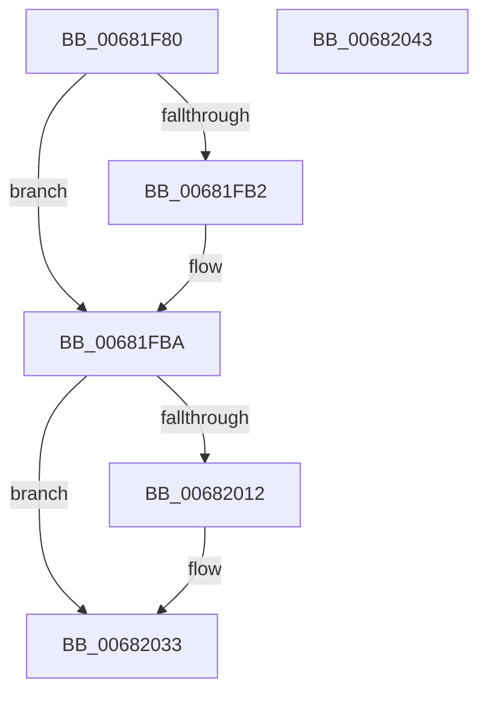

# MiWaitForExtentDeletions

- RVA: `0x00681F80`–`0x00682044` (길이 `196` bytes)
- VA: `0x0000000140681F80`
- 실행 섹션: `.text`
- PDB 이름 있음: `예`; PDB Function 태그: `아니요`
- unwind 정보 RVA: `0x00091FE0`
- 디코드: `49`개 명령, `196/196` bytes 표시
- 미해석 바이트: `0` (있으면 어셈블리에 `.byte`로 보존)

> 이 문서는 커널 이미지의 기계어와 PDB 기호를 분석해 생성했습니다. 4번과 5번은 함수 원형과 자료형을 바이너리 사용 방식에서 추정한 C 해석이며 원본 소스 복구 결과는 아닙니다.

## 1. Dependencies

- 직접 호출 지점: **6**; 고유 호출 대상: **5**
- 직접 호출자로 확인된 함수: **1**
- RIP 상대 이미지 참조: **3**

### Outgoing calls
- `0x00681FA5` → [KeAbPreAcquire](../21/KeAbPreAcquire_function_00210230.md) (function, `0x00210230`)
- `0x00681FB5` → [KeAbPreWait](../20/KeAbPreWait_function_0020E560.md) (function, `0x0020E560`)
- `0x00681FF8` → [MiReleaseSpinLockExclusive](../24/MiReleaseSpinLockExclusive_function_002482C0.md) (function, `0x002482C0`)
- `0x00682008` → [KeWaitForGate](../2C/KeWaitForGate_function_002CA794.md) (function, `0x002CA794`)
- `0x0068201F` → [KeAbPreAcquire](../21/KeAbPreAcquire_function_00210230.md) (function, `0x00210230`)
- `0x0068202E` → [KeAbPostReleaseEx](../26/KeAbPostReleaseEx_function_00262210.md) (function, `0x00262210`)

### Direct callers
- [MiDeleteExtentPfns](MiDeleteExtentPfns_function_006808B0.md) at `0x0068091C`

### Static image references
- `0x00681F9B` → RVA `0x00E2D6E0` (`.data`; read)
- `0x00681FC6` → RVA `0x00E3A8A0` (`.data`; read)
- `0x00681FED` → RVA `0x00E2D6E0` (`.data`; write)

## 2. Other-region calls and transfers

- 다른 실행 섹션으로 향하는 call: **0**
- 별도 외부 분기/꼬리 이동을 확인하지 못했습니다.

## 3. Assembly (complete function range)

```asm
00681F80  48 89 5C 24 08                  mov qword ptr [rsp + 8], rbx
00681F85  48 89 7C 24 10                  mov qword ptr [rsp + 0x10], rdi
00681F8A  55                              push rbp
00681F8B  48 8B EC                        mov rbp, rsp
00681F8E  48 83 EC 40                     sub rsp, 0x40
00681F92  40 8A FA                        mov dil, dl
00681F95  C6 45 EB 00                     mov byte ptr [rbp - 0x15], 0
00681F99  33 D2                           xor edx, edx
00681F9B  48 8D 0D 3E B7 7A 00            lea rcx, [rip + 0x7ab73e]
00681FA2  45 33 C0                        xor r8d, r8d
00681FA5  E8 86 E2 B8 FF                  call 0x140210230
00681FAA  48 8B D8                        mov rbx, rax
00681FAD  48 85 C0                        test rax, rax
00681FB0  74 08                           je 0x140681fba
00681FB2  48 8B C8                        mov rcx, rax
00681FB5  E8 A6 C5 B8 FF                  call 0x14020e560
00681FBA  83 65 EC 00                     and dword ptr [rbp - 0x14], 0
00681FBE  48 8D 45 F0                     lea rax, [rbp - 0x10]
00681FC2  48 89 45 F8                     mov qword ptr [rbp - 8], rax
00681FC6  48 8D 0D D3 88 7B 00            lea rcx, [rip + 0x7b88d3]
00681FCD  48 8D 45 F0                     lea rax, [rbp - 0x10]
00681FD1  66 C7 45 E8 07 01               mov word ptr [rbp - 0x18], 0x107
00681FD7  48 89 45 F0                     mov qword ptr [rbp - 0x10], rax
00681FDB  40 8A D7                        mov dl, dil
00681FDE  48 8B 05 FB B6 7A 00            mov rax, qword ptr [rip + 0x7ab6fb]
00681FE5  48 89 45 E0                     mov qword ptr [rbp - 0x20], rax
00681FE9  48 8D 45 E0                     lea rax, [rbp - 0x20]
00681FED  48 89 05 EC B6 7A 00            mov qword ptr [rip + 0x7ab6ec], rax
00681FF4  C6 45 EA 06                     mov byte ptr [rbp - 0x16], 6
00681FF8  E8 C3 62 BC FF                  call 0x1402482c0
00681FFD  45 33 C0                        xor r8d, r8d
00682000  48 8D 4D E8                     lea rcx, [rbp - 0x18]
00682004  41 8D 50 12                     lea edx, [r8 + 0x12]
00682008  E8 87 87 C4 FF                  call 0x1402ca794
0068200D  48 85 DB                        test rbx, rbx
00682010  74 21                           je 0x140682033
00682012  45 33 C0                        xor r8d, r8d
00682015  48 8D 0D C4 B6 7A 00            lea rcx, [rip + 0x7ab6c4]
0068201C  48 8B D3                        mov rdx, rbx
0068201F  E8 0C E2 B8 FF                  call 0x140210230
00682024  48 8B D3                        mov rdx, rbx
00682027  48 8D 0D B2 B6 7A 00            lea rcx, [rip + 0x7ab6b2]
0068202E  E8 DD 01 BE FF                  call 0x140262210
00682033  48 8B 5C 24 50                  mov rbx, qword ptr [rsp + 0x50]
00682038  48 8B 7C 24 58                  mov rdi, qword ptr [rsp + 0x58]
0068203D  48 83 C4 40                     add rsp, 0x40
00682041  5D                              pop rbp
00682042  C3                              ret
00682043  CC                              int3
```

## 4. C-style interpretation (structured pseudocode)

```c
__int64 __fastcall MiWaitForExtentDeletions(__int64 a1, int a2, int a3)
{
    __int64 result;
    __int64 v_rsp;
    unsigned __int64 v_stack_m10;
    unsigned __int64 v_stack_m18;
    unsigned int v_stack_m1C;
    unsigned __int8 v_stack_m1D;
    unsigned __int8 v_stack_m1E;
    unsigned __int16 v_stack_m20;
    unsigned __int64 v_stack_m28;
    unsigned __int64 v_stack_p10;
    unsigned __int64 v_stack_p8;

    v_stack_p8 = v_rbx;
    v_stack_p10 = v_rdi;
    v_rsp = (v_rsp) - (64);
    v_stack_m1D = 0;
    a2 = 0;
    a3 = 0;
    result = KeAbPreAcquire(v_rip + 8042302, a2, a3, a4);
    if (result != 0) {
        a1 = result;
        result = KeAbPreWait(a1, a2, a3, a4);
    }
    v_stack_m10 = v_stack_m18;
    v_stack_m20 = 263;
    v_stack_m18 = v_stack_m18;
    v_stack_m28 = *(unsigned __int64 *)(v_rip + 8042235);
    *(unsigned __int64 *)(v_rip + 8042220) = v_stack_m28;
    v_stack_m1E = 6;
    result = MiReleaseSpinLockExclusive(v_rip + 8095955, (unsigned __int8)((unsigned __int8)(a2)), a3, a4);
    a3 = 0;
    result = KeWaitForGate(v_stack_m20, a3 + 18, a3, a4);
    if (result != 0) {
        a3 = 0;
        a1 = v_rip + 8042180;
        a2 = result;
        result = KeAbPreAcquire(a1, a2, a3, a4);
        a2 = result;
        a1 = v_rip + 8042162;
        result = KeAbPostReleaseEx(a1, a2, a3, a4);
    }
    v_rsp = (v_rsp) + (64);
    return result;
}
```

## 5. (Beta) C Style

```c
int64_t MiWaitForExtentDeletions(int64_t Arg1, int32_t Arg2, int32_t Arg3)
{
    int64_t result;
    int64_t local_rsp;
    uint64_t v_stack_m10;
    uint64_t v_stack_m18;
    uint32_t v_stack_m1C;
    uint8_t v_stack_m1D;
    uint8_t v_stack_m1E;
    uint16_t v_stack_m20;
    uint64_t v_stack_m28;
    uint64_t v_stack_p10;
    uint64_t v_stack_p8;

    v_stack_p8 = local_rbx;
    v_stack_p10 = local_rdi;
    local_rsp = (local_rsp) - (64);
    v_stack_m1D = 0;
    Arg2 = 0;
    Arg3 = 0;
    result = KeAbPreAcquire(v_rip + 8042302, Arg2, Arg3, a4);
    if (result != 0) {
        Arg1 = result;
        result = KeAbPreWait(Arg1, Arg2, Arg3, a4);
    }
    v_stack_m10 = v_stack_m18;
    v_stack_m20 = 263;
    v_stack_m18 = v_stack_m18;
    v_stack_m28 = *(uint64_t *)(v_rip + 0x7AB6FB);
    *(uint64_t *)(v_rip + 0x7AB6EC) = v_stack_m28;
    v_stack_m1E = 6;
    result = MiReleaseSpinLockExclusive(v_rip + 8095955, (uint8_t)((uint8_t)(Arg2)), Arg3, a4);
    Arg3 = 0;
    result = KeWaitForGate(v_stack_m20, Arg3 + 18, Arg3, a4);
    if (result != 0) {
        Arg3 = 0;
        Arg1 = v_rip + 8042180;
        Arg2 = result;
        result = KeAbPreAcquire(Arg1, Arg2, Arg3, a4);
        Arg2 = result;
        Arg1 = v_rip + 8042162;
        result = KeAbPostReleaseEx(Arg1, Arg2, Arg3, a4);
    }
    local_rsp = (local_rsp) + (64);
    return result;
}
```

## 6. Execution-region graph

[열기: 2D/3D 그래프와 함수 탐색 컨트롤 패널](../../../control-panel.html?section=text&rva=0x00681F80&view=graph)

- 2D 그래프는 위에서 아래로 흐르고, 3D 그래프는 빈 공간을 드래그해 회전합니다. Shift+드래그는 이동, 휠은 확대·축소, 함수 노드 선택은 대상 보고서 이동입니다.

### Static fallback


