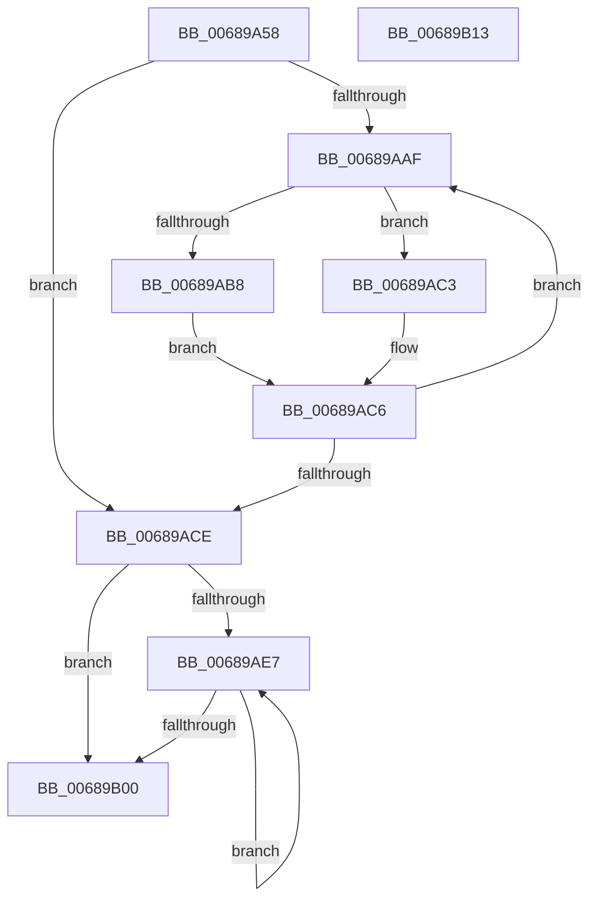

# MiWakeWaitersForAweCacheAttributeChange

- RVA: `0x00689A58`–`0x00689B14` (길이 `188` bytes)
- VA: `0x0000000140689A58`
- 실행 섹션: `.text`
- PDB 이름 있음: `예`; PDB Function 태그: `아니요`
- unwind 정보 RVA: `0x000701D4`
- 디코드: `58`개 명령, `188/188` bytes 표시
- 미해석 바이트: `0` (있으면 어셈블리에 `.byte`로 보존)

> 이 문서는 커널 이미지의 기계어와 PDB 기호를 분석해 생성했습니다. 4번과 5번은 함수 원형과 자료형을 바이너리 사용 방식에서 추정한 C 해석이며 원본 소스 복구 결과는 아닙니다.

## 1. Dependencies

- 직접 호출 지점: **5**; 고유 호출 대상: **5**
- 직접 호출자로 확인된 함수: **1**
- RIP 상대 이미지 참조: **0**

### Outgoing calls
- `0x00689A79` → [MiLockPageInline](../31/MiLockPageInline_function_0031A340.md) (function, `0x0031A340`)
- `0x00689AA2` → [ExAcquireSpinLockExclusiveAtDpcLevel](../24/ExAcquireSpinLockExclusiveAtDpcLevel_function_00248E80.md) (function, `0x00248E80`)
- `0x00689AD2` → [ExReleaseSpinLockExclusiveFromDpcLevel](../24/ExReleaseSpinLockExclusiveFromDpcLevel_function_002497E0.md) (function, `0x002497E0`)
- `0x00689ADD` → [MiUnlockPage](../31/MiUnlockPage_function_0031A3E0.md) (function, `0x0031A3E0`)
- `0x00689AF3` → [KeSignalGate](../2C/KeSignalGate_function_002C748C.md) (function, `0x002C748C`)

### Direct callers
- [MiResolveAwePageConflict](MiResolveAwePageConflict_function_00689758.md) at `0x006898B2`

### Static image references
- 디코드된 RIP-relative 메모리 참조가 없습니다.

## 2. Other-region calls and transfers

- 다른 실행 섹션으로 향하는 call: **0**
- 별도 외부 분기/꼬리 이동을 확인하지 못했습니다.

## 3. Assembly (complete function range)

```asm
00689A58  48 89 5C 24 10                  mov qword ptr [rsp + 0x10], rbx
00689A5D  48 89 6C 24 18                  mov qword ptr [rsp + 0x18], rbp
00689A62  56                              push rsi
00689A63  57                              push rdi
00689A64  41 56                           push r14
00689A66  48 83 EC 20                     sub rsp, 0x20
00689A6A  48 8B D9                        mov rbx, rcx
00689A6D  4C 8D 71 50                     lea r14, [rcx + 0x50]
00689A71  48 8B CA                        mov rcx, rdx
00689A74  48 8B F2                        mov rsi, rdx
00689A77  33 FF                           xor edi, edi
00689A79  E8 C2 08 C9 FF                  call 0x14031a340
00689A7E  44 8B 46 20                     mov r8d, dword ptr [rsi + 0x20]
00689A82  40 8A E8                        mov bpl, al
00689A85  44 89 44 24 40                  mov dword ptr [rsp + 0x40], r8d
00689A8A  41 C1 E8 10                     shr r8d, 0x10
00689A8E  41 80 E0 DF                     and r8b, 0xdf
00689A92  44 88 44 24 42                  mov byte ptr [rsp + 0x42], r8b
00689A97  8B 4C 24 40                     mov ecx, dword ptr [rsp + 0x40]
00689A9B  89 4E 20                        mov dword ptr [rsi + 0x20], ecx
00689A9E  48 8D 4B 30                     lea rcx, [rbx + 0x30]
00689AA2  E8 D9 F3 BB FF                  call 0x140248e80
00689AA7  49 8B 0E                        mov rcx, qword ptr [r14]
00689AAA  48 85 C9                        test rcx, rcx
00689AAD  74 1F                           je 0x140689ace
00689AAF  48 8B 01                        mov rax, qword ptr [rcx]
00689AB2  48 39 71 08                     cmp qword ptr [rcx + 8], rsi
00689AB6  75 0B                           jne 0x140689ac3
00689AB8  48 89 39                        mov qword ptr [rcx], rdi
00689ABB  48 8B F9                        mov rdi, rcx
00689ABE  49 89 06                        mov qword ptr [r14], rax
00689AC1  EB 03                           jmp 0x140689ac6
00689AC3  4C 8B F1                        mov r14, rcx
00689AC6  48 8B C8                        mov rcx, rax
00689AC9  48 85 C0                        test rax, rax
00689ACC  75 E1                           jne 0x140689aaf
00689ACE  48 8D 4B 30                     lea rcx, [rbx + 0x30]
00689AD2  E8 09 FD BB FF                  call 0x1402497e0
00689AD7  40 8A D5                        mov dl, bpl
00689ADA  48 8B CE                        mov rcx, rsi
00689ADD  E8 FE 08 C9 FF                  call 0x14031a3e0
00689AE2  48 85 FF                        test rdi, rdi
00689AE5  74 19                           je 0x140689b00
00689AE7  48 8B 1F                        mov rbx, qword ptr [rdi]
00689AEA  48 8D 4F 10                     lea rcx, [rdi + 0x10]
00689AEE  BA 01 00 00 00                  mov edx, 1
00689AF3  E8 94 D9 C3 FF                  call 0x1402c748c
00689AF8  48 8B FB                        mov rdi, rbx
00689AFB  48 85 DB                        test rbx, rbx
00689AFE  75 E7                           jne 0x140689ae7
00689B00  48 8B 5C 24 48                  mov rbx, qword ptr [rsp + 0x48]
00689B05  48 8B 6C 24 50                  mov rbp, qword ptr [rsp + 0x50]
00689B0A  48 83 C4 20                     add rsp, 0x20
00689B0E  41 5E                           pop r14
00689B10  5F                              pop rdi
00689B11  5E                              pop rsi
00689B12  C3                              ret
00689B13  CC                              int3
```

## 4. C-style interpretation (structured pseudocode)

```c
__int64 __fastcall MiWakeWaitersForAweCacheAttributeChange(__int64 a1, __int64 a2)
{
    __int64 result;
    __int64 v_rdi;
    __int64 v_rsp;
    unsigned __int64 v_stack_p10;
    unsigned __int64 v_stack_p18;
    unsigned int v_stack_p8;
    unsigned __int8 v_stack_pA;

    v_stack_p10 = v_rbx;
    v_stack_p18 = v_rbp;
    v_rsp = (v_rsp) - (32);
    v_rdi = 0;
    result = MiLockPageInline(a2, a2, a3, a4);
    v_stack_p8 = (unsigned int)((unsigned int)(*(unsigned int *)(a2 + 32)));
    a3 = (unsigned int)(((unsigned int)(*(unsigned int *)(a2 + 32))) >> (16));
    a3 = (unsigned __int8)((a3) & (223));
    v_stack_pA = (unsigned __int8)(a3);
    *(unsigned int *)(a2 + 32) = (unsigned int)((unsigned int)(v_stack_p8));
    result = ExAcquireSpinLockExclusiveAtDpcLevel(a1 + 48, a2, a3, a4);
    if (*(unsigned __int64 *)(a1 + 80) == 0) goto loc_00689ACE;
loc_00689AAF:
    if ((*(unsigned __int64 *)(*(unsigned __int64 *)(a1 + 80) + 8)) != a2) goto loc_00689AC3;
    *(unsigned __int64 *)(*(unsigned __int64 *)(a1 + 80)) = 0;
    *(unsigned __int64 *)(a1 + 80) = *(unsigned __int64 *)(*(unsigned __int64 *)(a1 + 80));
    goto loc_00689AC6;
loc_00689AC3:
loc_00689AC6:
    if (*(unsigned __int64 *)(*(unsigned __int64 *)(a1 + 80)) != 0) goto loc_00689AAF;
loc_00689ACE:
    result = ExReleaseSpinLockExclusiveFromDpcLevel(a1 + 48, a2, a3, a4);
    result = MiUnlockPage(a2, (unsigned __int8)((unsigned __int8)(result)), a3, a4);
    if (*(unsigned __int64 *)(a1 + 80) == 0) goto loc_00689B00;
loc_00689AE7:
    result = KeSignalGate(*(unsigned __int64 *)(a1 + 80) + 16, 1, a3, a4);
    if (*(unsigned __int64 *)(*(unsigned __int64 *)(a1 + 80)) != 0) goto loc_00689AE7;
loc_00689B00:
    v_rsp = (v_rsp) + (32);
    return result;
}
```

## 5. (Beta) C Style

```c
int64_t MiWakeWaitersForAweCacheAttributeChange(void *Arg1, void *Arg2)
{
    uint8_t *arg1 = (uint8_t *)Arg1;
    uint8_t *arg2 = (uint8_t *)Arg2;

    int64_t result;
    int64_t local_rdi;
    int64_t local_rsp;
    uint64_t v_stack_p10;
    uint64_t v_stack_p18;
    uint32_t v_stack_p8;
    uint8_t v_stack_pA;

    v_stack_p10 = local_rbx;
    v_stack_p18 = local_rbp;
    local_rsp = (local_rsp) - (32);
    local_rdi = 0;
    result = MiLockPageInline(Arg2, Arg2, a3, a4);
    v_stack_p8 = (uint32_t)((uint32_t)(*(uint32_t *)(arg2 + 0x20)));
    a3 = (uint32_t)(((uint32_t)(*(uint32_t *)(arg2 + 0x20))) >> (16));
    a3 = (uint8_t)((a3) & (223));
    v_stack_pA = (uint8_t)(a3);
    *(uint32_t *)(arg2 + 0x20) = (uint32_t)((uint32_t)(v_stack_p8));
    result = ExAcquireSpinLockExclusiveAtDpcLevel(Arg1 + 48, Arg2, a3, a4);
    if (*(uint64_t *)(arg1 + 0x50) == 0) goto loc_00689ACE;
loc_00689AAF:
    if ((*(uint64_t *)(*(uint64_t *)(arg1 + 0x50) + 0x8)) != Arg2) goto loc_00689AC3;
    *(uint64_t *)(*(uint64_t *)(arg1 + 0x50)) = 0;
    *(uint64_t *)(arg1 + 0x50) = *(uint64_t *)(*(uint64_t *)(arg1 + 0x50));
    goto loc_00689AC6;
loc_00689AC3:
loc_00689AC6:
    if (*(uint64_t *)(*(uint64_t *)(arg1 + 0x50)) != 0) goto loc_00689AAF;
loc_00689ACE:
    result = ExReleaseSpinLockExclusiveFromDpcLevel(Arg1 + 48, Arg2, a3, a4);
    result = MiUnlockPage(Arg2, (uint8_t)((uint8_t)(result)), a3, a4);
    if (*(uint64_t *)(arg1 + 0x50) == 0) goto loc_00689B00;
loc_00689AE7:
    result = KeSignalGate(*(uint64_t *)(arg1 + 0x50) + 16, 1, a3, a4);
    if (*(uint64_t *)(*(uint64_t *)(arg1 + 0x50)) != 0) goto loc_00689AE7;
loc_00689B00:
    local_rsp = (local_rsp) + (32);
    return result;
}
```

### 관측된 메모리 오프셋

구조체 형식이 확인되지 않은 접근은 인자 기준의 오프셋으로만 기록했습니다.

| 기준 인자 | 오프셋 표현 | 폭 (bit) | 접근 |
|---|---:|---:|---|
| `Arg1` | `+ 0x0` | `64` | `R` |
| `Arg1` | `+ 0x30` | `64` | `R` |
| `Arg1` | `+ 0x50` | `64` | `R` |
| `Arg2` | `+ 0x20` | `32` | `R` |
| `Arg2` | `+ 0x20` | `32` | `W` |

## 6. Execution-region graph

[열기: 2D/3D 그래프와 함수 탐색 컨트롤 패널](../../../control-panel.html?section=text&rva=0x00689A58&view=graph)

- 2D 그래프는 위에서 아래로 흐르고, 3D 그래프는 빈 공간을 드래그해 회전합니다. Shift+드래그는 이동, 휠은 확대·축소, 함수 노드 선택은 대상 보고서 이동입니다.

### Static fallback


