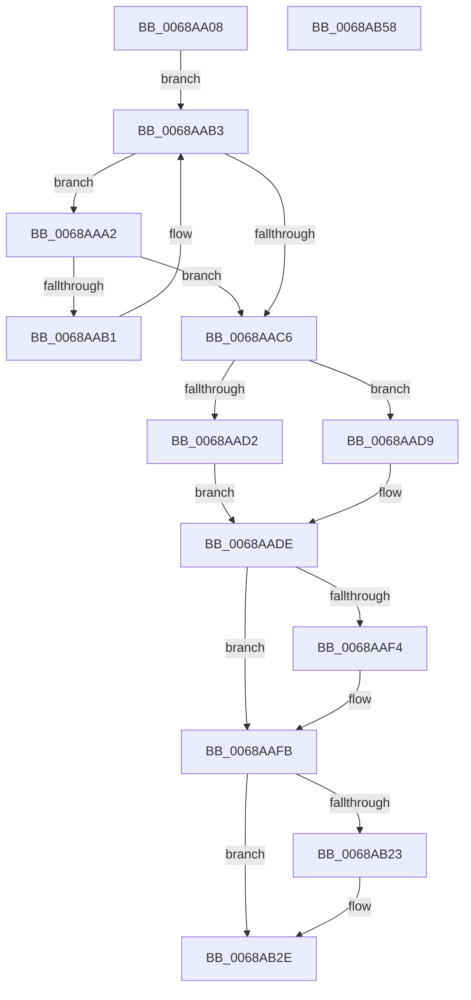

# MiWritePteHighLevel

- RVA: `0x0068AA08`–`0x0068AB59` (길이 `337` bytes)
- VA: `0x000000014068AA08`
- 실행 섹션: `.text`
- PDB 이름 있음: `예`; PDB Function 태그: `아니요`
- unwind 정보 RVA: `0x000D8D2C`
- 디코드: `83`개 명령, `337/337` bytes 표시
- 미해석 바이트: `0` (있으면 어셈블리에 `.byte`로 보존)

> 이 문서는 커널 이미지의 기계어와 PDB 기호를 분석해 생성했습니다. 4번과 5번은 함수 원형과 자료형을 바이너리 사용 방식에서 추정한 C 해석이며 원본 소스 복구 결과는 아닙니다.

## 1. Dependencies

- 직접 호출 지점: **10**; 고유 호출 대상: **10**
- 직접 호출자로 확인된 함수: **1**
- RIP 상대 이미지 참조: **4**

### Outgoing calls
- `0x0068AA42` → [memset](../6C/memset_function_006C6C40.md) (function, `0x006C6C40`)
- `0x0068AA62` → [MiVaToFlushVm](../31/MiVaToFlushVm_function_0031AD84.md) (function, `0x0031AD84`)
- `0x0068AA7D` → [MiInitializeTbFlushList](../29/MiInitializeTbFlushList_function_00294F00.md) (function, `0x00294F00`)
- `0x0068AA85` → [MI_READ_PTE_LOCK_FREE](../28/MI_READ_PTE_LOCK_FREE_function_002828A0.md) (function, `0x002828A0`)
- `0x0068AAD2` → [MiInsertLargeTbFlushEntry](../37/MiInsertLargeTbFlushEntry_function_0037827C.md) (function, `0x0037827C`)
- `0x0068AAD9` → [MiInsertRecursiveTbFlushEntries](../2C/MiInsertRecursiveTbFlushEntries_function_002C1F38.md) (function, `0x002C1F38`)
- `0x0068AAF6` → [KiRaiseIrqlProcessIrqlFlags](../4F/KiRaiseIrqlProcessIrqlFlags_function_004F56FC.md) (function, `0x004F56FC`)
- `0x0068AB15` → [KeIpiGenericCall](../47/KeIpiGenericCall_function_00471720.md) (function, `0x00471720`)
- `0x0068AB29` → [KiLowerIrqlProcessIrqlFlags](../4F/KiLowerIrqlProcessIrqlFlags_function_004F5698.md) (function, `0x004F5698`)
- `0x0068AB40` → [_security_check_cookie](../6A/_security_check_cookie_function_006AC640.md) (function, `0x006AC640`)

### Direct callers
- [MiTransformValidPteViaIpi](MiTransformValidPteViaIpi_function_0068A978.md) at `0x0068A9B6`

### Static image references
- `0x0068AA17` → RVA `0x00E0A740` (`.data`; read)
- `0x0068AAEB` → RVA `0x00FC6D20` (`ALMOSTRO`; read)
- `0x0068AAFB` → RVA `0x00FC6A80` (`ALMOSTRO`; read)
- `0x0068AB06` → RVA `0x004C2FC0` (`MiWritePteHighLevelIsr`; read)

## 2. Other-region calls and transfers

- 다른 실행 섹션으로 향하는 call: **0**
- 별도 외부 분기/꼬리 이동을 확인하지 못했습니다.

## 3. Assembly (complete function range)

```asm
0068AA08  48 89 5C 24 20                  mov qword ptr [rsp + 0x20], rbx
0068AA0D  55                              push rbp
0068AA0E  56                              push rsi
0068AA0F  57                              push rdi
0068AA10  48 81 EC 30 01 00 00            sub rsp, 0x130
0068AA17  48 8B 05 22 FD 77 00            mov rax, qword ptr [rip + 0x77fd22]
0068AA1E  48 33 C4                        xor rax, rsp
0068AA21  48 89 84 24 20 01 00 00         mov qword ptr [rsp + 0x120], rax
0068AA29  49 8B D8                        mov rbx, r8
0068AA2C  48 8B EA                        mov rbp, rdx
0068AA2F  48 8B F1                        mov rsi, rcx
0068AA32  33 D2                           xor edx, edx
0068AA34  41 B8 D4 00 00 00               mov r8d, 0xd4
0068AA3A  48 8D 4C 24 44                  lea rcx, [rsp + 0x44]
0068AA3F  41 8B F9                        mov edi, r9d
0068AA42  E8 F9 C1 03 00                  call 0x1406c6c40
0068AA47  48 83 A4 24 18 01 00 00 00      and qword ptr [rsp + 0x118], 0
0068AA50  48 8B CD                        mov rcx, rbp
0068AA53  83 64 24 40 00                  and dword ptr [rsp + 0x40], 0
0068AA58  48 89 74 24 30                  mov qword ptr [rsp + 0x30], rsi
0068AA5D  48 89 5C 24 38                  mov qword ptr [rsp + 0x38], rbx
0068AA62  E8 1D 03 C9 FF                  call 0x14031ad84
0068AA67  41 B9 01 00 00 00               mov r9d, 1
0068AA6D  89 7C 24 20                     mov dword ptr [rsp + 0x20], edi
0068AA71  48 8B D0                        mov rdx, rax
0068AA74  48 8D 4C 24 50                  lea rcx, [rsp + 0x50]
0068AA79  45 8D 41 13                     lea r8d, [r9 + 0x13]
0068AA7D  E8 7E A4 C0 FF                  call 0x140294f00
0068AA82  48 8B CE                        mov rcx, rsi
0068AA85  E8 16 7E BF FF                  call 0x1402828a0
0068AA8A  33 D2                           xor edx, edx
0068AA8C  49 BA 00 00 00 00 80 F6 FF FF   movabs r10, 0xfffff68000000000
0068AA96  4D 8B C2                        mov r8, r10
0068AA99  49 C1 E0 19                     shl r8, 0x19
0068AA9D  4C 8B CD                        mov r9, rbp
0068AAA0  EB 11                           jmp 0x14068aab3
0068AAA2  48 B9 FF FF FF FF FF F6 FF FF   movabs rcx, 0xfffff6ffffffffff
0068AAAC  4C 3B C9                        cmp r9, rcx
0068AAAF  77 15                           ja 0x14068aac6
0068AAB1  FF C2                           inc edx
0068AAB3  49 C1 E1 19                     shl r9, 0x19
0068AAB7  4D 2B C8                        sub r9, r8
0068AABA  49 C1 F9 10                     sar r9, 0x10
0068AABE  49 8B CA                        mov rcx, r10
0068AAC1  4C 3B C9                        cmp r9, rcx
0068AAC4  73 DC                           jae 0x14068aaa2
0068AAC6  48 8D 4C 24 50                  lea rcx, [rsp + 0x50]
0068AACB  4C 8B C5                        mov r8, rbp
0068AACE  84 C0                           test al, al
0068AAD0  79 07                           jns 0x14068aad9
0068AAD2  E8 A5 D7 CE FF                  call 0x14037827c
0068AAD7  EB 05                           jmp 0x14068aade
0068AAD9  E8 5A 74 C3 FF                  call 0x1402c1f38
0068AADE  44 0F 20 C3                     mov rbx, cr8
0068AAE2  BA 0C 00 00 00                  mov edx, 0xc
0068AAE7  44 0F 22 C2                     mov cr8, rdx
0068AAEB  83 3D 2E C2 93 00 00            cmp dword ptr [rip + 0x93c22e], 0
0068AAF2  74 07                           je 0x14068aafb
0068AAF4  8A CB                           mov cl, bl
0068AAF6  E8 01 AC E6 FF                  call 0x1404f56fc
0068AAFB  8B 05 7F BF 93 00               mov eax, dword ptr [rip + 0x93bf7f]
0068AB01  48 8D 54 24 30                  lea rdx, [rsp + 0x30]
0068AB06  48 8D 0D B3 84 E3 FF            lea rcx, [rip - 0x1c7b4d]
0068AB0D  89 44 24 48                     mov dword ptr [rsp + 0x48], eax
0068AB11  89 44 24 44                     mov dword ptr [rsp + 0x44], eax
0068AB15  E8 06 6C DE FF                  call 0x140471720
0068AB1A  83 3D FF C1 93 00 00            cmp dword ptr [rip + 0x93c1ff], 0
0068AB21  74 0B                           je 0x14068ab2e
0068AB23  44 0F 20 C1                     mov rcx, cr8
0068AB27  8A D3                           mov dl, bl
0068AB29  E8 6A AB E6 FF                  call 0x1404f5698
0068AB2E  0F B6 C3                        movzx eax, bl
0068AB31  44 0F 22 C0                     mov cr8, rax
0068AB35  48 8B 8C 24 20 01 00 00         mov rcx, qword ptr [rsp + 0x120]
0068AB3D  48 33 CC                        xor rcx, rsp
0068AB40  E8 FB 1A 02 00                  call 0x1406ac640
0068AB45  48 8B 9C 24 68 01 00 00         mov rbx, qword ptr [rsp + 0x168]
0068AB4D  48 81 C4 30 01 00 00            add rsp, 0x130
0068AB54  5F                              pop rdi
0068AB55  5E                              pop rsi
0068AB56  5D                              pop rbp
0068AB57  C3                              ret
0068AB58  CC                              int3
```

## 4. C-style interpretation (structured pseudocode)

```c
__int64 __fastcall MiWritePteHighLevel(__int64 a1, __int64 a2, __int64 a3, int a4)
{
    __int64 result;
    __int64 v_rsp;
    unsigned int v_stack_m100;
    unsigned __int64 v_stack_m104;
    unsigned int v_stack_m108;
    unsigned __int64 v_stack_m110;
    unsigned __int64 v_stack_m118;
    unsigned int v_stack_m128;
    unsigned __int64 v_stack_m28;
    unsigned __int64 v_stack_m30;
    unsigned __int64 v_stack_mF8;
    unsigned __int64 v_stack_p20;

    v_stack_p20 = v_rbx;
    v_rsp = (v_rsp) - (304);
    result = (*(unsigned __int64 *)(v_rip + 7863586)) ^ (v_rsp);
    v_stack_m28 = result;
    a2 = 0;
    result = memset(v_stack_m104, a2, 212, a4);
    v_stack_m118 = a1;
    v_stack_m110 = a3;
    result = MiVaToFlushVm(0, a2, 212, a4);
    v_stack_m128 = (unsigned int)((unsigned int)(a4));
    result = MiInitializeTbFlushList(v_stack_mF8, result, 1 + 19, 1);
    result = MI_READ_PTE_LOCK_FREE(a1, result, 1 + 19, 1);
    a2 = 0;
    a3 = (v_r10) << (25);
    goto loc_0068AAB3;
loc_0068AAA2:
    if (0 > a1) goto loc_0068AAC6;
    a2 = (unsigned int)((a2) + 1);
loc_0068AAB3:
    a4 = (0) << (25);
    a4 = (a4) - (a3);
    a4 = (a4) >> (16);
    if (a4 >= v_r10) goto loc_0068AAA2;
loc_0068AAC6:
    if (!sign_flag) goto loc_0068AAD9;
    result = MiInsertLargeTbFlushEntry(v_stack_mF8, a2, a2, a4);
    goto loc_0068AADE;
loc_0068AAD9:
    result = MiInsertRecursiveTbFlushEntries(v_stack_mF8, a2, a2, a4);
loc_0068AADE:
    if ((*(unsigned int *)(v_rip + 9683502)) != 0) {
        a1 = (unsigned __int8)(v_cr8);
        result = KiRaiseIrqlProcessIrqlFlags(a1, 12, a2, a4);
    }
    v_stack_m100 = (unsigned int)((unsigned int)(*(unsigned int *)(v_rip + 9682815)));
    v_stack_m104 = (unsigned int)((unsigned int)(*(unsigned int *)(v_rip + 9682815)));
    result = KeIpiGenericCall(v_rip - 1866573, v_stack_m118, a2, a4);
    if ((*(unsigned int *)(v_rip + 9683455)) != 0) {
        a1 = 12;
        a2 = (unsigned __int8)(v_cr8);
        result = KiLowerIrqlProcessIrqlFlags(a1, a2, a2, a4);
    }
    a1 = (v_stack_m28) ^ (v_rsp);
    result = _security_check_cookie(a1, a2, a2, a4);
    v_rsp = (v_rsp) + (304);
    return result;
}
```

## 5. (Beta) C Style

```c
int64_t MiWritePteHighLevel(int64_t Arg1, int64_t Arg2, int64_t Arg3, int32_t Arg4)
{
    int64_t result;
    int64_t local_rsp;
    uint32_t v_stack_m100;
    uint64_t v_stack_m104;
    uint32_t v_stack_m108;
    uint64_t v_stack_m110;
    uint64_t v_stack_m118;
    uint32_t v_stack_m128;
    uint64_t v_stack_m28;
    uint64_t v_stack_m30;
    uint64_t v_stack_mF8;
    uint64_t v_stack_p20;

    v_stack_p20 = local_rbx;
    local_rsp = (local_rsp) - (304);
    result = (*(uint64_t *)(v_rip + 0x77FD22)) ^ (local_rsp);
    v_stack_m28 = result;
    Arg2 = 0;
    result = memset(v_stack_m104, Arg2, 212, Arg4);
    v_stack_m118 = Arg1;
    v_stack_m110 = Arg3;
    result = MiVaToFlushVm(0, Arg2, 212, Arg4);
    v_stack_m128 = (uint32_t)((uint32_t)(Arg4));
    result = MiInitializeTbFlushList(v_stack_mF8, result, 1 + 19, 1);
    result = MI_READ_PTE_LOCK_FREE(Arg1, result, 1 + 19, 1);
    Arg2 = 0;
    Arg3 = (local_r10) << (25);
    goto loc_0068AAB3;
loc_0068AAA2:
    if (0 > Arg1) goto loc_0068AAC6;
    Arg2 = (uint32_t)((Arg2) + 1);
loc_0068AAB3:
    Arg4 = (0) << (25);
    Arg4 = (Arg4) - (Arg3);
    Arg4 = (Arg4) >> (16);
    if (Arg4 >= local_r10) goto loc_0068AAA2;
loc_0068AAC6:
    if (!sign_flag) goto loc_0068AAD9;
    result = MiInsertLargeTbFlushEntry(v_stack_mF8, Arg2, Arg2, Arg4);
    goto loc_0068AADE;
loc_0068AAD9:
    result = MiInsertRecursiveTbFlushEntries(v_stack_mF8, Arg2, Arg2, Arg4);
loc_0068AADE:
    if ((*(uint32_t *)(v_rip + 0x93C22E)) != 0) {
        Arg1 = (uint8_t)(v_cr8);
        result = KiRaiseIrqlProcessIrqlFlags(Arg1, 12, Arg2, Arg4);
    }
    v_stack_m100 = (uint32_t)((uint32_t)(*(uint32_t *)(v_rip + 0x93BF7F)));
    v_stack_m104 = (uint32_t)((uint32_t)(*(uint32_t *)(v_rip + 0x93BF7F)));
    result = KeIpiGenericCall(v_rip - 1866573, v_stack_m118, Arg2, Arg4);
    if ((*(uint32_t *)(v_rip + 0x93C1FF)) != 0) {
        Arg1 = 12;
        Arg2 = (uint8_t)(v_cr8);
        result = KiLowerIrqlProcessIrqlFlags(Arg1, Arg2, Arg2, Arg4);
    }
    Arg1 = (v_stack_m28) ^ (local_rsp);
    result = _security_check_cookie(Arg1, Arg2, Arg2, Arg4);
    local_rsp = (local_rsp) + (304);
    return result;
}
```

## 6. Execution-region graph

[열기: 2D/3D 그래프와 함수 탐색 컨트롤 패널](../../../control-panel.html?section=text&rva=0x0068AA08&view=graph)

- 2D 그래프는 위에서 아래로 흐르고, 3D 그래프는 빈 공간을 드래그해 회전합니다. Shift+드래그는 이동, 휠은 확대·축소, 함수 노드 선택은 대상 보고서 이동입니다.

### Static fallback


