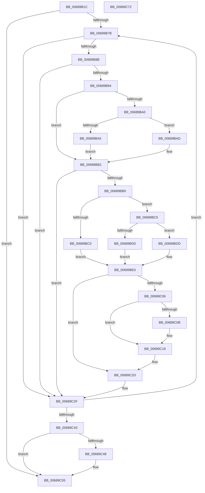

# MiZeroAndFlushAweLazyPtes

- RVA: `0x00689B1C`–`0x00689C73` (길이 `343` bytes)
- VA: `0x0000000140689B1C`
- 실행 섹션: `.text`
- PDB 이름 있음: `예`; PDB Function 태그: `아니요`
- unwind 정보 RVA: `0x0008C20C`
- 디코드: `96`개 명령, `343/343` bytes 표시
- 미해석 바이트: `0` (있으면 어셈블리에 `.byte`로 보존)

> 이 문서는 커널 이미지의 기계어와 PDB 기호를 분석해 생성했습니다. 4번과 5번은 함수 원형과 자료형을 바이너리 사용 방식에서 추정한 C 해석이며 원본 소스 복구 결과는 아닙니다.

## 1. Dependencies

- 직접 호출 지점: **7**; 고유 호출 대상: **7**
- 직접 호출자로 확인된 함수: **1**
- RIP 상대 이미지 참조: **2**

### Outgoing calls
- `0x00689B57` → [MiSetPteTimeStamp](../45/MiSetPteTimeStamp_function_00456C90.md) (function, `0x00456C90`)
- `0x00689BC7` → [MiCompareTbFlushTimeStamp](../31/MiCompareTbFlushTimeStamp_function_0031ADE4.md) (function, `0x0031ADE4`)
- `0x00689BFC` → [MiWriteAweClusterPte](../4E/MiWriteAweClusterPte_function_004E16A8.md) (function, `0x004E16A8`)
- `0x00689C11` → [MiGetAweFlushList](MiGetAweFlushList_function_00688D34.md) (function, `0x00688D34`)
- `0x00689C28` → [MiInsertAweFlushList](MiInsertAweFlushList_function_00688FEC.md) (function, `0x00688FEC`)
- `0x00689C4B` → [MiFlushTbList](../31/MiFlushTbList_function_00311FC0.md) (function, `0x00311FC0`)
- `0x00689C50` → [MiReleaseProcessorFlushList](../31/MiReleaseProcessorFlushList_function_00313C70.md) (function, `0x00313C70`)

### Direct callers
- [MiWriteAwePtes](../4C/MiWriteAwePtes_function_004C51E0.md) at `0x004C5825`

### Static image references
- `0x00689B3E` → RVA `0x00010880` (`.rdata`; read)
- `0x00689B94` → RVA `0x00E2DC80` (`.data`; read)

## 2. Other-region calls and transfers

- 다른 실행 섹션으로 향하는 call: **0**
- 별도 외부 분기/꼬리 이동을 확인하지 못했습니다.

## 3. Assembly (complete function range)

```asm
00689B1C  48 89 5C 24 08                  mov qword ptr [rsp + 8], rbx
00689B21  48 89 6C 24 10                  mov qword ptr [rsp + 0x10], rbp
00689B26  48 89 74 24 18                  mov qword ptr [rsp + 0x18], rsi
00689B2B  57                              push rdi
00689B2C  41 54                           push r12
00689B2E  41 55                           push r13
00689B30  41 56                           push r14
00689B32  41 57                           push r15
00689B34  48 83 EC 30                     sub rsp, 0x30
00689B38  48 8B F2                        mov rsi, rdx
00689B3B  4C 8B F9                        mov r15, rcx
00689B3E  48 8B 0D 3B 6D 98 FF            mov rcx, qword ptr [rip - 0x6792c5]
00689B45  48 81 E6 00 F0 FF FF            and rsi, 0xfffffffffffff000
00689B4C  33 D2                           xor edx, edx
00689B4E  33 ED                           xor ebp, ebp
00689B50  4C 8D AE 00 10 00 00            lea r13, [rsi + 0x1000]
00689B57  E8 34 D1 DC FF                  call 0x140456c90
00689B5C  48 8B F8                        mov rdi, rax
00689B5F  45 33 E4                        xor r12d, r12d
00689B62  48 81 E7 1F FF FF FF            and rdi, 0xffffffffffffff1f
00689B69  33 D2                           xor edx, edx
00689B6B  48 81 CF 00 03 00 00            or rdi, 0x300
00689B72  49 3B F5                        cmp rsi, r13
00689B75  0F 83 DA 00 00 00               jae 0x140689c55
00689B7B  48 8B 1E                        mov rbx, qword ptr [rsi]
00689B7E  48 F7 C3 01 08 00 00            test rbx, 0x801
00689B85  0F 85 A4 00 00 00               jne 0x140689c2f
00689B8B  48 85 DB                        test rbx, rbx
00689B8E  0F 84 9B 00 00 00               je 0x140689c2f
00689B94  48 8B 05 E5 40 7A 00            mov rax, qword ptr [rip + 0x7a40e5]
00689B9B  48 85 C0                        test rax, rax
00689B9E  74 11                           je 0x140689bb1
00689BA0  F6 C3 10                        test bl, 0x10
00689BA3  75 08                           jne 0x140689bad
00689BA5  48 F7 D0                        not rax
00689BA8  48 23 D8                        and rbx, rax
00689BAB  EB 04                           jmp 0x140689bb1
00689BAD  48 83 E3 EF                     and rbx, 0xffffffffffffffef
00689BB1  48 C1 EB 20                     shr rbx, 0x20
00689BB5  85 DB                           test ebx, ebx
00689BB7  74 76                           je 0x140689c2f
00689BB9  45 33 F6                        xor r14d, r14d
00689BBC  3B DA                           cmp ebx, edx
00689BBE  75 05                           jne 0x140689bc5
00689BC0  45 8B F4                        mov r14d, r12d
00689BC3  EB 1B                           jmp 0x140689be0
00689BC5  8B CB                           mov ecx, ebx
00689BC7  E8 18 12 C9 FF                  call 0x14031ade4
00689BCC  84 C0                           test al, al
00689BCE  74 0D                           je 0x140689bdd
00689BD0  B8 01 00 00 00                  mov eax, 1
00689BD5  44 8B E0                        mov r12d, eax
00689BD8  44 8B F0                        mov r14d, eax
00689BDB  EB 03                           jmp 0x140689be0
00689BDD  45 33 E4                        xor r12d, r12d
00689BE0  49 8B 87 A0 00 00 00            mov rax, qword ptr [r15 + 0xa0]
00689BE7  41 B9 06 00 00 00               mov r9d, 6
00689BED  49 8B 4F 28                     mov rcx, qword ptr [r15 + 0x28]
00689BF1  4C 8B C7                        mov r8, rdi
00689BF4  48 8B D6                        mov rdx, rsi
00689BF7  48 89 44 24 20                  mov qword ptr [rsp + 0x20], rax
00689BFC  E8 A7 7A E5 FF                  call 0x1404e16a8
00689C01  45 85 F6                        test r14d, r14d
00689C04  74 27                           je 0x140689c2d
00689C06  48 85 ED                        test rbp, rbp
00689C09  75 0E                           jne 0x140689c19
00689C0B  8D 55 40                        lea edx, [rbp + 0x40]
00689C0E  49 8B CF                        mov rcx, r15
00689C11  E8 1E F1 FF FF                  call 0x140688d34
00689C16  48 8B E8                        mov rbp, rax
00689C19  41 B9 40 00 00 00               mov r9d, 0x40
00689C1F  4C 8B C6                        mov r8, rsi
00689C22  48 8B D5                        mov rdx, rbp
00689C25  49 8B CF                        mov rcx, r15
00689C28  E8 BF F3 FF FF                  call 0x140688fec
00689C2D  8B D3                           mov edx, ebx
00689C2F  49 8B 8F A0 00 00 00            mov rcx, qword ptr [r15 + 0xa0]
00689C36  48 8D 34 CE                     lea rsi, [rsi + rcx*8]
00689C3A  49 3B F5                        cmp rsi, r13
00689C3D  0F 82 38 FF FF FF               jb 0x140689b7b
00689C43  48 85 ED                        test rbp, rbp
00689C46  74 0D                           je 0x140689c55
00689C48  48 8B CD                        mov rcx, rbp
00689C4B  E8 70 83 C8 FF                  call 0x140311fc0
00689C50  E8 1B A0 C8 FF                  call 0x140313c70
00689C55  48 8B 5C 24 60                  mov rbx, qword ptr [rsp + 0x60]
00689C5A  48 8B 6C 24 68                  mov rbp, qword ptr [rsp + 0x68]
00689C5F  48 8B 74 24 70                  mov rsi, qword ptr [rsp + 0x70]
00689C64  48 83 C4 30                     add rsp, 0x30
00689C68  41 5F                           pop r15
00689C6A  41 5E                           pop r14
00689C6C  41 5D                           pop r13
00689C6E  41 5C                           pop r12
00689C70  5F                              pop rdi
00689C71  C3                              ret
00689C72  CC                              int3
```

## 4. C-style interpretation (structured pseudocode)

```c
__int64 __fastcall MiZeroAndFlushAweLazyPtes(__int64 a1, __int64 a2)
{
    __int64 result;
    __int64 v_r12;
    __int64 v_r14;
    __int64 v_rbp;
    __int64 v_rbx;
    __int64 v_rdi;
    __int64 v_rsi;
    __int64 v_rsp;
    unsigned __int64 v_stack_m38;
    unsigned __int64 v_stack_p10;
    unsigned __int64 v_stack_p18;
    unsigned __int64 v_stack_p8;

    v_stack_p8 = v_rbx;
    v_stack_p10 = v_rbp;
    v_stack_p18 = v_rsi;
    v_rsp = (v_rsp) - (48);
    v_rsi = (a2) & (0xFFFFFFFFFFFFF000ULL);
    a2 = 0;
    v_rbp = 0;
    result = MiSetPteTimeStamp(*(unsigned __int64 *)(v_rip - 6787781), a2, a3, a4);
    v_r12 = 0;
    v_rdi = (result) & (-225);
    a2 = 0;
    v_rdi = (v_rdi) | (768);
    if (v_rsi >= (v_rsi + 4096)) goto loc_00689C55;
loc_00689B7B:
    if (((*(unsigned __int64 *)(v_rsi)) & (0x801ULL)) != 0) goto loc_00689C2F;
    if (*(unsigned __int64 *)(v_rsi) == 0) goto loc_00689C2F;
    if (*(unsigned __int64 *)(v_rip + 8012005) == 0) goto loc_00689BB1;
    if ((((unsigned __int8)(*(unsigned __int64 *)(v_rsi))) & (16)) != 0) goto loc_00689BAD;
    result = ~(*(unsigned __int64 *)(v_rip + 8012005));
    v_rbx = (*(unsigned __int64 *)(v_rsi)) & (result);
    goto loc_00689BB1;
loc_00689BAD:
    v_rbx = (v_rbx) & (-17);
loc_00689BB1:
    v_rbx = (v_rbx) >> (32);
    if ((unsigned int)(v_rbx) == 0) goto loc_00689C2F;
    v_r14 = 0;
    if (((unsigned int)(v_rbx)) != 0) goto loc_00689BC5;
    goto loc_00689BE0;
loc_00689BC5:
    result = MiCompareTbFlushTimeStamp((unsigned int)((unsigned int)(v_rbx)), a2, a3, a4);
    if ((unsigned __int8)(result) == 0) goto loc_00689BDD;
    goto loc_00689BE0;
loc_00689BDD:
    v_r12 = 0;
loc_00689BE0:
    v_stack_m38 = *(unsigned __int64 *)(a1 + 160);
    result = MiWriteAweClusterPte(*(unsigned __int64 *)(a1 + 40), v_rsi, v_rdi, 6);
    if (1 == 0) goto loc_00689C2D;
    if (0 == 0) {
        a2 = v_rbp + 64;
        a1 = a1;
        result = MiGetAweFlushList(a1, a2, v_rdi, 6);
        v_rbp = result;
    }
    result = MiInsertAweFlushList(a1, v_rbp, v_rsi, 64);
loc_00689C2D:
loc_00689C2F:
    if ((v_rsi + *(unsigned __int64 *)(a1 + 160) * 8) < (v_rsi + 4096)) goto loc_00689B7B;
    if (v_rbp != 0) {
        a1 = v_rbp;
        result = MiFlushTbList(a1, (unsigned int)((unsigned int)(v_rbx)), v_rsi, 64);
        result = MiReleaseProcessorFlushList(a1, (unsigned int)((unsigned int)(v_rbx)), v_rsi, 64);
    }
    v_rsp = (v_rsp) + (48);
    return result;
}
```

## 5. (Beta) C Style

```c
int64_t MiZeroAndFlushAweLazyPtes(void *Arg1, void *Arg2)
{
    uint8_t *arg1 = (uint8_t *)Arg1;
    uint8_t *arg2 = (uint8_t *)Arg2;

    int64_t result;
    int64_t local_r12;
    int64_t local_r14;
    int64_t local_rbp;
    int64_t local_rbx;
    int64_t local_rdi;
    int64_t local_rsi;
    int64_t local_rsp;
    uint64_t v_stack_m38;
    uint64_t v_stack_p10;
    uint64_t v_stack_p18;
    uint64_t v_stack_p8;

    v_stack_p8 = local_rbx;
    v_stack_p10 = local_rbp;
    v_stack_p18 = local_rsi;
    local_rsp = (local_rsp) - (48);
    local_rsi = (Arg2) & (0xFFFFFFFFFFFFF000ULL);
    Arg2 = 0;
    local_rbp = 0;
    result = MiSetPteTimeStamp(*(uint64_t *)(v_rip - 0x6792C5), Arg2, a3, a4);
    local_r12 = 0;
    local_rdi = (result) & (-225);
    Arg2 = 0;
    local_rdi = (local_rdi) | (768);
    if (local_rsi >= (local_rsi + 4096)) goto loc_00689C55;
loc_00689B7B:
    if (((*(uint64_t *)(local_rsi)) & (0x801ULL)) != 0) goto loc_00689C2F;
    if (*(uint64_t *)(local_rsi) == 0) goto loc_00689C2F;
    if (*(uint64_t *)(v_rip + 0x7A40E5) == 0) goto loc_00689BB1;
    if ((((uint8_t)(*(uint64_t *)(local_rsi))) & (16)) != 0) goto loc_00689BAD;
    result = ~(*(uint64_t *)(v_rip + 0x7A40E5));
    local_rbx = (*(uint64_t *)(local_rsi)) & (result);
    goto loc_00689BB1;
loc_00689BAD:
    local_rbx = (local_rbx) & (-17);
loc_00689BB1:
    local_rbx = (local_rbx) >> (32);
    if ((uint32_t)(local_rbx) == 0) goto loc_00689C2F;
    local_r14 = 0;
    if (((uint32_t)(local_rbx)) != 0) goto loc_00689BC5;
    goto loc_00689BE0;
loc_00689BC5:
    result = MiCompareTbFlushTimeStamp((uint32_t)((uint32_t)(local_rbx)), Arg2, a3, a4);
    if ((uint8_t)(result) == 0) goto loc_00689BDD;
    goto loc_00689BE0;
loc_00689BDD:
    local_r12 = 0;
loc_00689BE0:
    v_stack_m38 = *(uint64_t *)(arg1 + 0xA0);
    result = MiWriteAweClusterPte(*(uint64_t *)(arg1 + 0x28), local_rsi, local_rdi, 6);
    if (1 == 0) goto loc_00689C2D;
    if (0 == 0) {
        Arg2 = local_rbp + 64;
        Arg1 = Arg1;
        result = MiGetAweFlushList(Arg1, Arg2, local_rdi, 6);
        local_rbp = result;
    }
    result = MiInsertAweFlushList(Arg1, local_rbp, local_rsi, 64);
loc_00689C2D:
loc_00689C2F:
    if ((local_rsi + *(uint64_t *)(arg1 + 0xA0) * 8) < (local_rsi + 4096)) goto loc_00689B7B;
    if (local_rbp != 0) {
        Arg1 = local_rbp;
        result = MiFlushTbList(Arg1, (uint32_t)((uint32_t)(local_rbx)), local_rsi, 64);
        result = MiReleaseProcessorFlushList(Arg1, (uint32_t)((uint32_t)(local_rbx)), local_rsi, 64);
    }
    local_rsp = (local_rsp) + (48);
    return result;
}
```

### 관측된 메모리 오프셋

구조체 형식이 확인되지 않은 접근은 인자 기준의 오프셋으로만 기록했습니다.

| 기준 인자 | 오프셋 표현 | 폭 (bit) | 접근 |
|---|---:|---:|---|
| `Arg1` | `+ 0x28` | `64` | `R` |
| `Arg1` | `+ 0xA0` | `64` | `R` |
| `Arg2` | `+ 0x1000` | `64` | `R` |

## 6. Execution-region graph

[열기: 2D/3D 그래프와 함수 탐색 컨트롤 패널](../../../control-panel.html?section=text&rva=0x00689B1C&view=graph)

- 2D 그래프는 위에서 아래로 흐르고, 3D 그래프는 빈 공간을 드래그해 회전합니다. Shift+드래그는 이동, 휠은 확대·축소, 함수 노드 선택은 대상 보고서 이동입니다.

### Static fallback


