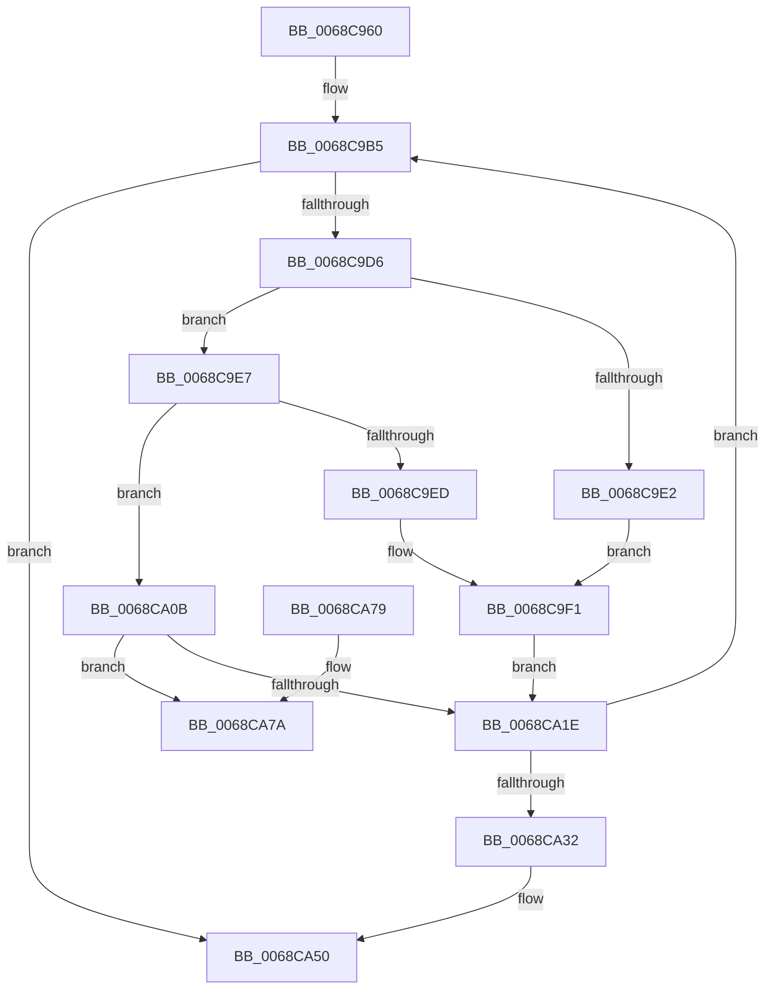

# MiZeroHugeRangeWorker

- RVA: `0x0068C960`–`0x0068CA9D` (길이 `317` bytes)
- VA: `0x000000014068C960`
- 실행 섹션: `.text`
- PDB 이름 있음: `예`; PDB Function 태그: `아니요`
- unwind 정보 RVA: `0x000D8E30`
- 디코드: `86`개 명령, `317/317` bytes 표시
- 미해석 바이트: `0` (있으면 어셈블리에 `.byte`로 보존)

> 이 문서는 커널 이미지의 기계어와 PDB 기호를 분석해 생성했습니다. 4번과 5번은 함수 원형과 자료형을 바이너리 사용 방식에서 추정한 C 해석이며 원본 소스 복구 결과는 아닙니다.

## 1. Dependencies

- 직접 호출 지점: **11**; 고유 호출 대상: **9**
- 직접 호출자로 확인된 함수: **0**
- RIP 상대 이미지 참조: **0**

### Outgoing calls
- `0x0068C990` → [MiZeroMoveToProcessor](../2C/MiZeroMoveToProcessor_function_002C73BC.md) (function, `0x002C73BC`)
- `0x0068C9A7` → [ExAcquireSpinLockExclusive](../24/ExAcquireSpinLockExclusive_function_00248690.md) (function, `0x00248690`)
- `0x0068C9BF` → [RtlFindClearBitsAndSet](../3E/RtlFindClearBitsAndSet_function_003E0CD0.md) (function, `0x003E0CD0`)
- `0x0068C9CC` → [MiReleaseSpinLockExclusive](../24/MiReleaseSpinLockExclusive_function_002482C0.md) (function, `0x002482C0`)
- `0x0068CA04` → [MiFillMemory](../2C/MiFillMemory_function_002C7BD0.md) (function, `0x002C7BD0`)
- `0x0068CA14` → [RtlCompareMemoryUlong](../6B/RtlCompareMemoryUlong_function_006BA6F0.md) (function, `0x006BA6F0`)
- `0x0068CA21` → [ExAcquireSpinLockExclusive](../24/ExAcquireSpinLockExclusive_function_00248690.md) (function, `0x00248690`)
- `0x0068CA3D` → [MiReleaseSpinLockExclusive](../24/MiReleaseSpinLockExclusive_function_002482C0.md) (function, `0x002482C0`)
- `0x0068CA4B` → [KeSignalGate](../2C/KeSignalGate_function_002C748C.md) (function, `0x002C748C`)
- `0x0068CA55` → [MiRevertProcessorMove](../2C/MiRevertProcessorMove_function_002C7420.md) (function, `0x002C7420`)
- `0x0068CA97` → [KeBugCheckEx](../4F/KeBugCheckEx_function_004FD660.md) (function, `0x004FD660`)

### Direct callers
- 이 함수 시작 RVA로 연결되는 직접 call은 확인되지 않았습니다. 간접 호출은 완전히 역산할 수 없습니다.

### Static image references
- 디코드된 RIP-relative 메모리 참조가 없습니다.

## 2. Other-region calls and transfers

- 다른 실행 섹션으로 향하는 call: **0**
- 별도 외부 분기/꼬리 이동을 확인하지 못했습니다.

## 3. Assembly (complete function range)

```asm
0068C960  48 8B C4                        mov rax, rsp
0068C963  48 89 58 08                     mov qword ptr [rax + 8], rbx
0068C967  48 89 68 10                     mov qword ptr [rax + 0x10], rbp
0068C96B  48 89 70 18                     mov qword ptr [rax + 0x18], rsi
0068C96F  48 89 78 20                     mov qword ptr [rax + 0x20], rdi
0068C973  41 55                           push r13
0068C975  41 56                           push r14
0068C977  41 57                           push r15
0068C979  48 83 EC 50                     sub rsp, 0x50
0068C97D  48 8B 71 20                     mov rsi, qword ptr [rcx + 0x20]
0068C981  48 8D 50 C8                     lea rdx, [rax - 0x38]
0068C985  0F 57 C0                        xorps xmm0, xmm0
0068C988  0F 11 40 C8                     movups xmmword ptr [rax - 0x38], xmm0
0068C98C  0F 11 40 D8                     movups xmmword ptr [rax - 0x28], xmm0
0068C990  E8 27 AA C3 FF                  call 0x1402c73bc
0068C995  48 8B 9E 98 00 00 00            mov rbx, qword ptr [rsi + 0x98]
0068C99C  44 8B 73 68                     mov r14d, dword ptr [rbx + 0x68]
0068C9A0  48 8D 6B 60                     lea rbp, [rbx + 0x60]
0068C9A4  48 8B CD                        mov rcx, rbp
0068C9A7  E8 E4 BC BB FF                  call 0x140248690
0068C9AC  44 8A F8                        mov r15b, al
0068C9AF  41 BD 00 00 20 00               mov r13d, 0x200000
0068C9B5  45 33 C0                        xor r8d, r8d
0068C9B8  48 8B CB                        mov rcx, rbx
0068C9BB  41 8D 50 01                     lea edx, [r8 + 1]
0068C9BF  E8 0C 43 D5 FF                  call 0x1403e0cd0
0068C9C4  41 8A D7                        mov dl, r15b
0068C9C7  48 8B CD                        mov rcx, rbp
0068C9CA  8B F8                           mov edi, eax
0068C9CC  E8 EF B8 BB FF                  call 0x1402482c0
0068C9D1  83 FF FF                        cmp edi, -1
0068C9D4  74 7A                           je 0x14068ca50
0068C9D6  C1 E7 15                        shl edi, 0x15
0068C9D9  48 03 7B 50                     add rdi, qword ptr [rbx + 0x50]
0068C9DD  45 85 F6                        test r14d, r14d
0068C9E0  75 05                           jne 0x14068c9e7
0068C9E2  45 33 C9                        xor r9d, r9d
0068C9E5  EB 0A                           jmp 0x14068c9f1
0068C9E7  41 83 FE 01                     cmp r14d, 1
0068C9EB  75 1E                           jne 0x14068ca0b
0068C9ED  49 83 C9 FF                     or r9, 0xffffffffffffffff
0068C9F1  48 8B 4C 24 40                  mov rcx, qword ptr [rsp + 0x40]
0068C9F6  4D 8B C5                        mov r8, r13
0068C9F9  48 8B D7                        mov rdx, rdi
0068C9FC  C7 44 24 20 01 00 00 00         mov dword ptr [rsp + 0x20], 1
0068CA04  E8 C7 B1 C3 FF                  call 0x1402c7bd0
0068CA09  EB 13                           jmp 0x14068ca1e
0068CA0B  45 33 C0                        xor r8d, r8d
0068CA0E  49 8B D5                        mov rdx, r13
0068CA11  48 8B CF                        mov rcx, rdi
0068CA14  E8 D7 DC 02 00                  call 0x1406ba6f0
0068CA19  49 3B C5                        cmp rax, r13
0068CA1C  75 5C                           jne 0x14068ca7a
0068CA1E  48 8B CD                        mov rcx, rbp
0068CA21  E8 6A BC BB FF                  call 0x140248690
0068CA26  FF 43 64                        inc dword ptr [rbx + 0x64]
0068CA29  81 7B 64 00 02 00 00            cmp dword ptr [rbx + 0x64], 0x200
0068CA30  75 83                           jne 0x14068c9b5
0068CA32  F0 83 66 6C 00                  lock and dword ptr [rsi + 0x6c], 0
0068CA37  41 8A D7                        mov dl, r15b
0068CA3A  48 8B CD                        mov rcx, rbp
0068CA3D  E8 7E B8 BB FF                  call 0x1402482c0
0068CA42  48 8D 4E 78                     lea rcx, [rsi + 0x78]
0068CA46  BA 01 00 00 00                  mov edx, 1
0068CA4B  E8 3C AA C3 FF                  call 0x1402c748c
0068CA50  48 8D 4C 24 30                  lea rcx, [rsp + 0x30]
0068CA55  E8 C6 A9 C3 FF                  call 0x1402c7420
0068CA5A  4C 8D 5C 24 50                  lea r11, [rsp + 0x50]
0068CA5F  49 8B 5B 20                     mov rbx, qword ptr [r11 + 0x20]
0068CA63  49 8B 6B 28                     mov rbp, qword ptr [r11 + 0x28]
0068CA67  49 8B 73 30                     mov rsi, qword ptr [r11 + 0x30]
0068CA6B  49 8B 7B 38                     mov rdi, qword ptr [r11 + 0x38]
0068CA6F  49 8B E3                        mov rsp, r11
0068CA72  41 5F                           pop r15
0068CA74  41 5E                           pop r14
0068CA76  41 5D                           pop r13
0068CA78  C3                              ret
0068CA79  CC                              int3
0068CA7A  48 8B 53 50                     mov rdx, qword ptr [rbx + 0x50]
0068CA7E  B9 27 01 00 00                  mov ecx, 0x127
0068CA83  4C 8B 43 58                     mov r8, qword ptr [rbx + 0x58]
0068CA87  48 2B C2                        sub rax, rdx
0068CA8A  48 C7 44 24 20 00 00 00 40      mov qword ptr [rsp + 0x20], 0x40000000
0068CA93  4C 8D 0C 07                     lea r9, [rdi + rax]
0068CA97  E8 C4 0B E7 FF                  call 0x1404fd660
0068CA9C  CC                              int3
```

## 4. C-style interpretation (structured pseudocode)

```c
__int64 __fastcall MiZeroHugeRangeWorker(__int64 a1, __int64 a2, int a3, int a4)
{
    __int64 result;
    __int64 v_rdi;
    __int64 v_rsp;
    unsigned __int64 v_stack_m18;
    unsigned __int64 v_stack_m28;
    unsigned __int64 v_stack_m30;
    unsigned __int64 v_stack_m38;
    unsigned int v_stack_m48;

    *(unsigned __int64 *)(v_rsp + 8) = v_rbx;
    *(unsigned __int64 *)(v_rsp + 16) = v_rbp;
    *(unsigned __int64 *)(v_rsp + 24) = v_rsi;
    *(unsigned __int64 *)(v_rsp + 32) = v_rdi;
    v_rsp = (v_rsp) - (80);
    *(unsigned __int64 *)(v_rsp - 56) = v_xmm0;
    *(unsigned __int64 *)(v_rsp - 40) = v_xmm0;
    result = MiZeroMoveToProcessor(a1, v_rsp - 56, a3, a4);
    result = ExAcquireSpinLockExclusive(*(unsigned __int64 *)(*(unsigned __int64 *)(a1 + 32) + 152) + 96, v_rsp - 56, a3, a4);
loc_0068C9B5:
    a3 = 0;
    result = RtlFindClearBitsAndSet(*(unsigned __int64 *)(*(unsigned __int64 *)(a1 + 32) + 152), a3 + 1, a3, a4);
    result = MiReleaseSpinLockExclusive(*(unsigned __int64 *)(*(unsigned __int64 *)(a1 + 32) + 152) + 96, (unsigned __int8)((unsigned __int8)(result)), a3, a4);
    if (((unsigned int)((unsigned int)((unsigned int)(result)))) == -1) goto loc_0068CA50;
    v_rdi = (unsigned int)(((unsigned int)((unsigned int)(result))) << (21));
    v_rdi = (v_rdi) + (*(unsigned __int64 *)(*(unsigned __int64 *)(*(unsigned __int64 *)(a1 + 32) + 152) + 80));
    if ((unsigned int)((unsigned int)(*(unsigned int *)(*(unsigned __int64 *)(*(unsigned __int64 *)(a1 + 32) + 152) + 104))) != 0) goto loc_0068C9E7;
    a4 = 0;
    goto loc_0068C9F1;
loc_0068C9E7:
    if (((unsigned int)((unsigned int)(*(unsigned int *)(*(unsigned __int64 *)(*(unsigned __int64 *)(a1 + 32) + 152) + 104)))) != 1) goto loc_0068CA0B;
    a4 = (a4) | (-1);
loc_0068C9F1:
    v_stack_m48 = 1;
    result = MiFillMemory(v_stack_m28, v_rdi, (unsigned int)(0x200000ULL), a4);
    goto loc_0068CA1E;
loc_0068CA0B:
    a3 = 0;
    result = RtlCompareMemoryUlong(v_rdi, (unsigned int)(0x200000ULL), a3, a4);
    if (result != ((unsigned int)(0x200000ULL))) goto loc_0068CA7A;
loc_0068CA1E:
    result = ExAcquireSpinLockExclusive(*(unsigned __int64 *)(*(unsigned __int64 *)(a1 + 32) + 152) + 96, (unsigned int)(0x200000ULL), a3, a4);
    if ((*(unsigned int *)(*(unsigned __int64 *)(*(unsigned __int64 *)(a1 + 32) + 152) + 100)) != 512) goto loc_0068C9B5;
    result = MiReleaseSpinLockExclusive(*(unsigned __int64 *)(*(unsigned __int64 *)(a1 + 32) + 152) + 96, (unsigned __int8)((unsigned __int8)(result)), a3, a4);
    result = KeSignalGate(*(unsigned __int64 *)(a1 + 32) + 120, 1, a3, a4);
loc_0068CA50:
    result = MiRevertProcessorMove(v_stack_m38, 1, a3, a4);
    return result;
loc_0068CA7A:
    result = (result) - (*(unsigned __int64 *)(*(unsigned __int64 *)(v_stack_m18 + 32) + 80));
    v_stack_m30 = 0x40000000ULL;
    result = KeBugCheckEx(295, *(unsigned __int64 *)(*(unsigned __int64 *)(v_stack_m18 + 32) + 80), *(unsigned __int64 *)(*(unsigned __int64 *)(v_stack_m18 + 32) + 88), *(unsigned __int64 *)(v_stack_m18 + 56) + result * 1);
    return result;
}
```

## 5. (Beta) C Style

```c
int64_t MiZeroHugeRangeWorker(void *Arg1, int64_t Arg2, int32_t Arg3, int32_t Arg4)
{
    uint8_t *arg1 = (uint8_t *)Arg1;

    int64_t result;
    int64_t local_rdi;
    int64_t local_rsp;
    uint64_t v_stack_m18;
    uint64_t v_stack_m28;
    uint64_t v_stack_m30;
    uint64_t v_stack_m38;
    uint32_t v_stack_m48;

    *(uint64_t *)(local_rsp + 0x8) = local_rbx;
    *(uint64_t *)(local_rsp + 0x10) = local_rbp;
    *(uint64_t *)(local_rsp + 0x18) = local_rsi;
    *(uint64_t *)(local_rsp + 0x20) = local_rdi;
    local_rsp = (local_rsp) - (80);
    *(uint64_t *)(local_rsp - 0x38) = v_xmm0;
    *(uint64_t *)(local_rsp - 0x28) = v_xmm0;
    result = MiZeroMoveToProcessor(Arg1, local_rsp - 56, Arg3, Arg4);
    result = ExAcquireSpinLockExclusive(*(uint64_t *)(*(uint64_t *)(arg1 + 0x20) + 0x98) + 96, local_rsp - 56, Arg3, Arg4);
loc_0068C9B5:
    Arg3 = 0;
    result = RtlFindClearBitsAndSet(*(uint64_t *)(*(uint64_t *)(arg1 + 0x20) + 0x98), Arg3 + 1, Arg3, Arg4);
    result = MiReleaseSpinLockExclusive(*(uint64_t *)(*(uint64_t *)(arg1 + 0x20) + 0x98) + 96, (uint8_t)((uint8_t)(result)), Arg3, Arg4);
    if (((uint32_t)((uint32_t)((uint32_t)(result)))) == -1) goto loc_0068CA50;
    local_rdi = (uint32_t)(((uint32_t)((uint32_t)(result))) << (21));
    local_rdi = (local_rdi) + (*(uint64_t *)(*(uint64_t *)(*(uint64_t *)(arg1 + 0x20) + 0x98) + 0x50));
    if ((uint32_t)((uint32_t)(*(uint32_t *)(*(uint64_t *)(*(uint64_t *)(arg1 + 0x20) + 0x98) + 0x68))) != 0) goto loc_0068C9E7;
    Arg4 = 0;
    goto loc_0068C9F1;
loc_0068C9E7:
    if (((uint32_t)((uint32_t)(*(uint32_t *)(*(uint64_t *)(*(uint64_t *)(arg1 + 0x20) + 0x98) + 0x68)))) != 1) goto loc_0068CA0B;
    Arg4 = (Arg4) | (-1);
loc_0068C9F1:
    v_stack_m48 = 1;
    result = MiFillMemory(v_stack_m28, local_rdi, (uint32_t)(0x200000ULL), Arg4);
    goto loc_0068CA1E;
loc_0068CA0B:
    Arg3 = 0;
    result = RtlCompareMemoryUlong(local_rdi, (uint32_t)(0x200000ULL), Arg3, Arg4);
    if (result != ((uint32_t)(0x200000ULL))) goto loc_0068CA7A;
loc_0068CA1E:
    result = ExAcquireSpinLockExclusive(*(uint64_t *)(*(uint64_t *)(arg1 + 0x20) + 0x98) + 96, (uint32_t)(0x200000ULL), Arg3, Arg4);
    if ((*(uint32_t *)(*(uint64_t *)(*(uint64_t *)(arg1 + 0x20) + 0x98) + 0x64)) != 512) goto loc_0068C9B5;
    result = MiReleaseSpinLockExclusive(*(uint64_t *)(*(uint64_t *)(arg1 + 0x20) + 0x98) + 96, (uint8_t)((uint8_t)(result)), Arg3, Arg4);
    result = KeSignalGate(*(uint64_t *)(arg1 + 0x20) + 120, 1, Arg3, Arg4);
loc_0068CA50:
    result = MiRevertProcessorMove(v_stack_m38, 1, Arg3, Arg4);
    return result;
loc_0068CA7A:
    result = (result) - (*(uint64_t *)(*(uint64_t *)(v_stack_m18 + 0x20) + 0x50));
    v_stack_m30 = 0x40000000ULL;
    result = KeBugCheckEx(295, *(uint64_t *)(*(uint64_t *)(v_stack_m18 + 0x20) + 0x50), *(uint64_t *)(*(uint64_t *)(v_stack_m18 + 0x20) + 0x58), *(uint64_t *)(v_stack_m18 + 0x38) + result * 1);
    return result;
}
```

### 관측된 메모리 오프셋

구조체 형식이 확인되지 않은 접근은 인자 기준의 오프셋으로만 기록했습니다.

| 기준 인자 | 오프셋 표현 | 폭 (bit) | 접근 |
|---|---:|---:|---|
| `Arg1` | `+ 0x20` | `64` | `R` |

## 6. Execution-region graph

[열기: 2D/3D 그래프와 함수 탐색 컨트롤 패널](../../../control-panel.html?section=text&rva=0x0068C960&view=graph)

- 2D 그래프는 위에서 아래로 흐르고, 3D 그래프는 빈 공간을 드래그해 회전합니다. Shift+드래그는 이동, 휠은 확대·축소, 함수 노드 선택은 대상 보고서 이동입니다.

### Static fallback


