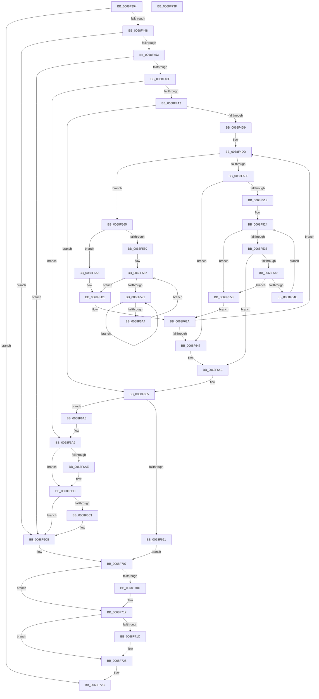

# MmAllocateSecureKernelPages

- RVA: `0x0068F394`–`0x0068F740` (길이 `940` bytes)
- VA: `0x000000014068F394`
- 실행 섹션: `.text`
- PDB 이름 있음: `예`; PDB Function 태그: `아니요`
- unwind 정보 RVA: `0x000D9000`
- 디코드: `251`개 명령, `940/940` bytes 표시
- 미해석 바이트: `0` (있으면 어셈블리에 `.byte`로 보존)

> 이 문서는 커널 이미지의 기계어와 PDB 기호를 분석해 생성했습니다. 4번과 5번은 함수 원형과 자료형을 바이너리 사용 방식에서 추정한 C 해석이며 원본 소스 복구 결과는 아닙니다.

## 1. Dependencies

- 직접 호출 지점: **17**; 고유 호출 대상: **16**
- 직접 호출자로 확인된 함수: **1**
- RIP 상대 이미지 참조: **2**

### Outgoing calls
- `0x0068F3F5` → [MiInitializePageColorBase](../32/MiInitializePageColorBase_function_00320410.md) (function, `0x00320410`)
- `0x0068F437` → [MiPartitionObjectToPartition](../3E/MiPartitionObjectToPartition_function_003EAB0C.md) (function, `0x003EAB0C`)
- `0x0068F462` → [MiAcquireNonPagedResources](../28/MiAcquireNonPagedResources_function_00286C60.md) (function, `0x00286C60`)
- `0x0068F491` → [MiAllocatePool](../35/MiAllocatePool_function_0035B540.md) (function, `0x0035B540`)
- `0x0068F501` → [MiGetSlabPage](../37/MiGetSlabPage_function_00376FBC.md) (function, `0x00376FBC`)
- `0x0068F52F` → [MiReplenishSlabAllocator](../37/MiReplenishSlabAllocator_function_003788E4.md) (function, `0x003788E4`)
- `0x0068F595` → [KeYieldProcessorEx](../3F/KeYieldProcessorEx_function_003FBD00.md) (function, `0x003FBD00`)
- `0x0068F5A9` → [MiLockPageInline](../31/MiLockPageInline_function_0031A340.md) (function, `0x0031A340`)
- `0x0068F5C9` → [MiInitializeMdlPfn](../2C/MiInitializeMdlPfn_function_002C9670.md) (function, `0x002C9670`)
- `0x0068F5D1` → [MiIsPfnFromChargedSlabAllocation](../2A/MiIsPfnFromChargedSlabAllocation_function_002A2968.md) (function, `0x002A2968`)
- `0x0068F5EB` → [MiUpdatePageFileHighInPte](../36/MiUpdatePageFileHighInPte_function_0036D840.md) (function, `0x0036D840`)
- `0x0068F5FB` → [MiUnlockPage](../31/MiUnlockPage_function_0031A3E0.md) (function, `0x0031A3E0`)
- `0x0068F6B4` → [MiReleaseNonPagedResources](../32/MiReleaseNonPagedResources_function_0032299C.md) (function, `0x0032299C`)
- `0x0068F6C6` → [ExFreePoolWithTag](../../poolcode/B8/ExFreePoolWithTag_function_00B82870.md) (function, `0x00B82870`)
- `0x0068F6FF` → [MmAllocatePartitionNodePagesForMdlEx](../3E/MmAllocatePartitionNodePagesForMdlEx_function_003EA960.md) (function, `0x003EA960`)
- `0x0068F712` → [MiReleaseNonPagedResources](../32/MiReleaseNonPagedResources_function_0032299C.md) (function, `0x0032299C`)
- `0x0068F723` → [PsDereferencePartition](../34/PsDereferencePartition_function_00342E70.md) (function, `0x00342E70`)

### Direct callers
- [PspIumAllocatePhysicalPages](../5E/PspIumAllocatePhysicalPages_function_005E4574.md) at `0x005E45BA`

### Static image references
- `0x0068F40A` → RVA `0x00000000` (`image boundary/outside`; read)
- `0x0068F5B1` → RVA `0x00010880` (`.rdata`; read)

## 2. Other-region calls and transfers

- 다른 실행 섹션으로 향하는 call: **1**
  - `0x0068F6C6` → [ExFreePoolWithTag](../../poolcode/B8/ExFreePoolWithTag_function_00B82870.md) (`.text` → `POOLCODE`)
- 별도 외부 분기/꼬리 이동을 확인하지 못했습니다.

## 3. Assembly (complete function range)

```asm
0068F394  48 8B C4                        mov rax, rsp
0068F397  44 89 48 20                     mov dword ptr [rax + 0x20], r9d
0068F39B  44 89 40 18                     mov dword ptr [rax + 0x18], r8d
0068F39F  48 89 50 10                     mov qword ptr [rax + 0x10], rdx
0068F3A3  48 89 48 08                     mov qword ptr [rax + 8], rcx
0068F3A7  55                              push rbp
0068F3A8  53                              push rbx
0068F3A9  56                              push rsi
0068F3AA  57                              push rdi
0068F3AB  41 54                           push r12
0068F3AD  41 55                           push r13
0068F3AF  41 56                           push r14
0068F3B1  41 57                           push r15
0068F3B3  48 8D 68 A9                     lea rbp, [rax - 0x57]
0068F3B7  48 81 EC 98 00 00 00            sub rsp, 0x98
0068F3BE  48 8B 45 7F                     mov rax, qword ptr [rbp + 0x7f]
0068F3C2  33 DB                           xor ebx, ebx
0068F3C4  0F 57 C0                        xorps xmm0, xmm0
0068F3C7  88 5D BF                        mov byte ptr [rbp - 0x41], bl
0068F3CA  4C 8B F2                        mov r14, rdx
0068F3CD  48 89 5D D7                     mov qword ptr [rbp - 0x29], rbx
0068F3D1  4C 8B E9                        mov r13, rcx
0068F3D4  89 18                           mov dword ptr [rax], ebx
0068F3D6  0F 11 45 FF                     movups xmmword ptr [rbp - 1], xmm0
0068F3DA  44 0F 20 C0                     mov rax, cr8
0068F3DE  4C 8D 4D FF                     lea r9, [rbp - 1]
0068F3E2  48 89 45 E7                     mov qword ptr [rbp - 0x19], rax
0068F3E6  44 8B C3                        mov r8d, ebx
0068F3E9  48 89 5D DF                     mov qword ptr [rbp - 0x21], rbx
0068F3ED  8D 53 03                        lea edx, [rbx + 3]
0068F3F0  33 C9                           xor ecx, ecx
0068F3F2  44 8B E3                        mov r12d, ebx
0068F3F5  E8 16 10 C9 FF                  call 0x140320410
0068F3FA  4C 8B 4D FF                     mov r9, qword ptr [rbp - 1]
0068F3FE  8D 43 01                        lea eax, [rbx + 1]
0068F401  F0 41 0F C1 01                  lock xadd dword ptr [r9], eax
0068F406  4C 8B 45 07                     mov r8, qword ptr [rbp + 7]
0068F40A  4C 8D 0D EF 0B 97 FF            lea r9, [rip - 0x68f411]
0068F411  33 D2                           xor edx, edx
0068F413  49 8B C8                        mov rcx, r8
0068F416  48 C1 E9 10                     shr rcx, 0x10
0068F41A  83 E1 03                        and ecx, 3
0068F41D  41 F7 B4 89 C0 DC E2 00         div dword ptr [r9 + rcx*4 + 0xe2dcc0]
0068F425  49 8B CD                        mov rcx, r13
0068F428  41 33 D0                        xor edx, r8d
0068F42B  0F B6 FA                        movzx edi, dl
0068F42E  33 D2                           xor edx, edx
0068F430  41 33 F8                        xor edi, r8d
0068F433  4C 8D 45 BF                     lea r8, [rbp - 0x41]
0068F437  E8 D0 B6 D5 FF                  call 0x1403eab0c
0068F43C  4C 8B E8                        mov r13, rax
0068F43F  48 85 C0                        test rax, rax
0068F442  0F 84 E3 02 00 00               je 0x14068f72b
0068F448  8B 40 04                        mov eax, dword ptr [rax + 4]
0068F44B  A8 08                           test al, 8
0068F44D  0F 84 78 02 00 00               je 0x14068f6cb
0068F453  41 B9 02 00 00 00               mov r9d, 2
0068F459  45 33 C0                        xor r8d, r8d
0068F45C  49 8B D6                        mov rdx, r14
0068F45F  49 8B CD                        mov rcx, r13
0068F462  E8 F9 77 BF FF                  call 0x140286c60
0068F467  85 C0                           test eax, eax
0068F469  0F 88 5C 02 00 00               js 0x14068f6cb
0068F46F  4A 8D 34 F5 00 00 00 00         lea rsi, [r14*8]
0068F477  4C 89 75 EF                     mov qword ptr [rbp - 0x11], r14
0068F47B  48 8D 56 30                     lea rdx, [rsi + 0x30]
0068F47F  48 89 75 C7                     mov qword ptr [rbp - 0x39], rsi
0068F483  B9 40 00 00 00                  mov ecx, 0x40
0068F488  41 B8 4D 6D 64 69               mov r8d, 0x69646d4d
0068F48E  4D 8B E6                        mov r12, r14
0068F491  E8 AA C0 CC FF                  call 0x14035b540
0068F496  4C 8B F8                        mov r15, rax
0068F499  48 85 C0                        test rax, rax
0068F49C  0F 84 07 02 00 00               je 0x14068f6a9
0068F4A2  B9 16 00 00 00                  mov ecx, 0x16
0068F4A7  C7 45 C3 40 00 00 00            mov dword ptr [rbp - 0x3d], 0x40
0068F4AE  44 8D 41 EC                     lea r8d, [rcx - 0x14]
0068F4B2  44 38 45 E7                     cmp byte ptr [rbp - 0x19], r8b
0068F4B6  44 8D 49 F0                     lea r9d, [rcx - 0x10]
0068F4BA  41 0F 45 C9                     cmovne ecx, r9d
0068F4BE  48 83 C0 30                     add rax, 0x30
0068F4C2  89 4D D3                        mov dword ptr [rbp - 0x2d], ecx
0068F4C5  4C 8B F0                        mov r14, rax
0068F4C8  48 8D 14 06                     lea rdx, [rsi + rax]
0068F4CC  48 89 55 F7                     mov qword ptr [rbp - 9], rdx
0068F4D0  48 3B C2                        cmp rax, rdx
0068F4D3  0F 83 7C 01 00 00               jae 0x14068f655
0068F4D9  48 63 45 6F                     movsxd rax, dword ptr [rbp + 0x6f]
0068F4DD  48 8D 55 D7                     lea rdx, [rbp - 0x29]
0068F4E1  89 5C 24 28                     mov dword ptr [rsp + 0x28], ebx
0068F4E5  44 8B C9                        mov r9d, ecx
0068F4E8  48 89 54 24 20                  mov qword ptr [rsp + 0x20], rdx
0068F4ED  48 8D 0D 0C 0B 97 FF            lea rcx, [rip - 0x68f4f4]
0068F4F4  44 8B C7                        mov r8d, edi
0068F4F7  8B 94 81 A8 AF 03 00            mov edx, dword ptr [rcx + rax*4 + 0x3afa8]
0068F4FE  49 8B CD                        mov rcx, r13
0068F501  E8 B6 7A CE FF                  call 0x140376fbc
0068F506  49 89 06                        mov qword ptr [r14], rax
0068F509  48 83 F8 FF                     cmp rax, -1
0068F50D  75 56                           jne 0x14068f565
0068F50F  48 39 5D D7                     cmp qword ptr [rbp - 0x29], rbx
0068F513  0F 84 2E 01 00 00               je 0x14068f647
0068F519  48 8B C6                        mov rax, rsi
0068F51C  48 C1 F8 03                     sar rax, 3
0068F520  48 89 45 C7                     mov qword ptr [rbp - 0x39], rax
0068F524  44 8B 45 C3                     mov r8d, dword ptr [rbp - 0x3d]
0068F528  48 8B D0                        mov rdx, rax
0068F52B  48 8B 4D D7                     mov rcx, qword ptr [rbp - 0x29]
0068F52F  E8 B0 93 CE FF                  call 0x1403788e4
0068F534  85 C0                           test eax, eax
0068F536  75 20                           jne 0x14068f558
0068F538  49 8D 47 30                     lea rax, [r15 + 0x30]
0068F53C  4C 3B F0                        cmp r14, rax
0068F53F  0F 85 06 01 00 00               jne 0x14068f64b
0068F545  8B 45 C3                        mov eax, dword ptr [rbp - 0x3d]
0068F548  A8 40                           test al, 0x40
0068F54A  74 0C                           je 0x14068f558
0068F54C  83 E0 BF                        and eax, 0xffffffbf
0068F54F  89 45 C3                        mov dword ptr [rbp - 0x3d], eax
0068F552  48 8B 45 C7                     mov rax, qword ptr [rbp - 0x39]
0068F556  EB CC                           jmp 0x14068f524
0068F558  49 83 EE 08                     sub r14, 8
0068F55C  48 83 C6 08                     add rsi, 8
0068F560  E9 C5 00 00 00                  jmp 0x14068f62a
0068F565  4C 8D 24 40                     lea r12, [rax + rax*2]
0068F569  49 C1 E4 04                     shl r12, 4
0068F56D  48 B8 00 00 00 00 00 DE FF FF   movabs rax, 0xffffde0000000000
0068F577  4C 03 E0                        add r12, rax
0068F57A  80 7D E7 02                     cmp byte ptr [rbp - 0x19], 2
0068F57E  75 26                           jne 0x14068f5a6
0068F580  C6 45 77 11                     mov byte ptr [rbp + 0x77], 0x11
0068F584  89 5D CF                        mov dword ptr [rbp - 0x31], ebx
0068F587  F0 49 0F BA 6C 24 18 3F         lock bts qword ptr [r12 + 0x18], 0x3f
0068F58F  73 20                           jae 0x14068f5b1
0068F591  48 8D 4D CF                     lea rcx, [rbp - 0x31]
0068F595  E8 66 C7 D6 FF                  call 0x1403fbd00
0068F59A  49 8B 44 24 18                  mov rax, qword ptr [r12 + 0x18]
0068F59F  48 85 C0                        test rax, rax
0068F5A2  78 ED                           js 0x14068f591
0068F5A4  EB E1                           jmp 0x14068f587
0068F5A6  49 8B CC                        mov rcx, r12
0068F5A9  E8 92 AD C8 FF                  call 0x14031a340
0068F5AE  88 45 77                        mov byte ptr [rbp + 0x77], al
0068F5B1  48 8B 0D C8 12 98 FF            mov rcx, qword ptr [rip - 0x67ed38]
0068F5B8  BA 00 02 00 00                  mov edx, 0x200
0068F5BD  49 89 1C 24                     mov qword ptr [r12], rbx
0068F5C1  49 89 4C 24 10                  mov qword ptr [r12 + 0x10], rcx
0068F5C6  49 8B CC                        mov rcx, r12
0068F5C9  E8 A2 A0 C3 FF                  call 0x1402c9670
0068F5CE  49 8B CC                        mov rcx, r12
0068F5D1  E8 92 33 C1 FF                  call 0x1402a2968
0068F5D6  49 8B 4C 24 10                  mov rcx, qword ptr [r12 + 0x10]
0068F5DB  8B D0                           mov edx, eax
0068F5DD  F7 DA                           neg edx
0068F5DF  8B F0                           mov esi, eax
0068F5E1  48 1B D2                        sbb rdx, rdx
0068F5E4  83 E2 04                        and edx, 4
0068F5E7  48 83 C2 03                     add rdx, 3
0068F5EB  E8 50 E2 CD FF                  call 0x14036d840
0068F5F0  8A 55 77                        mov dl, byte ptr [rbp + 0x77]
0068F5F3  49 8B CC                        mov rcx, r12
0068F5F6  49 89 44 24 10                  mov qword ptr [r12 + 0x10], rax
0068F5FB  E8 E0 AD C8 FF                  call 0x14031a3e0
0068F600  4C 8B 65 EF                     mov r12, qword ptr [rbp - 0x11]
0068F604  85 F6                           test esi, esi
0068F606  48 8B 4D DF                     mov rcx, qword ptr [rbp - 0x21]
0068F60A  48 8B 75 C7                     mov rsi, qword ptr [rbp - 0x39]
0068F60E  49 8D 44 24 FF                  lea rax, [r12 - 1]
0068F613  49 0F 45 C4                     cmovne rax, r12
0068F617  4C 8B E0                        mov r12, rax
0068F61A  48 89 45 EF                     mov qword ptr [rbp - 0x11], rax
0068F61E  48 8D 41 01                     lea rax, [rcx + 1]
0068F622  48 0F 45 C1                     cmovne rax, rcx
0068F626  48 89 45 DF                     mov qword ptr [rbp - 0x21], rax
0068F62A  8B 4D D3                        mov ecx, dword ptr [rbp - 0x2d]
0068F62D  48 83 EE 08                     sub rsi, 8
0068F631  48 63 45 6F                     movsxd rax, dword ptr [rbp + 0x6f]
0068F635  49 83 C6 08                     add r14, 8
0068F639  48 89 75 C7                     mov qword ptr [rbp - 0x39], rsi
0068F63D  4C 3B 75 F7                     cmp r14, qword ptr [rbp - 9]
0068F641  0F 82 96 FE FF FF               jb 0x14068f4dd
0068F647  49 8D 47 30                     lea rax, [r15 + 0x30]
0068F64B  41 B8 02 00 00 00               mov r8d, 2
0068F651  45 8D 48 04                     lea r9d, [r8 + 4]
0068F655  4C 2B F0                        sub r14, rax
0068F658  49 C1 FE 03                     sar r14, 3
0068F65C  4D 85 F6                        test r14, r14
0068F65F  74 44                           je 0x14068f6a5
0068F661  49 C1 E6 0C                     shl r14, 0xc
0068F665  49 8B C6                        mov rax, r14
0068F668  49 89 1F                        mov qword ptr [r15], rbx
0068F66B  48 C1 E8 0C                     shr rax, 0xc
0068F66F  66 41 03 C1                     add ax, r9w
0068F673  49 89 5F 20                     mov qword ptr [r15 + 0x20], rbx
0068F677  66 C1 E0 03                     shl ax, 3
0068F67B  66 41 89 47 08                  mov word ptr [r15 + 8], ax
0068F680  48 8B 45 DF                     mov rax, qword ptr [rbp - 0x21]
0068F684  41 89 5F 2C                     mov dword ptr [r15 + 0x2c], ebx
0068F688  45 89 77 28                     mov dword ptr [r15 + 0x28], r14d
0068F68C  66 45 89 47 0A                  mov word ptr [r15 + 0xa], r8w
0068F691  F0 49 01 85 E8 4C 00 00         lock add qword ptr [r13 + 0x4ce8], rax
0068F699  48 8B 45 7F                     mov rax, qword ptr [rbp + 0x7f]
0068F69D  C7 00 01 00 00 00               mov dword ptr [rax], 1
0068F6A3  EB 62                           jmp 0x14068f707
0068F6A5  4C 8B 75 67                     mov r14, qword ptr [rbp + 0x67]
0068F6A9  4D 85 E4                        test r12, r12
0068F6AC  74 0E                           je 0x14068f6bc
0068F6AE  49 8B D4                        mov rdx, r12
0068F6B1  49 8B CD                        mov rcx, r13
0068F6B4  E8 E3 32 C9 FF                  call 0x14032299c
0068F6B9  4C 8B E3                        mov r12, rbx
0068F6BC  4D 85 FF                        test r15, r15
0068F6BF  74 0A                           je 0x14068f6cb
0068F6C1  33 D2                           xor edx, edx
0068F6C3  49 8B CF                        mov rcx, r15
0068F6C6  E8 A5 31 4F 00                  call 0x140b82870
0068F6CB  48 8B 45 5F                     mov rax, qword ptr [rbp + 0x5f]
0068F6CF  4C 8B C3                        mov r8, rbx
0068F6D2  48 89 44 24 38                  mov qword ptr [rsp + 0x38], rax
0068F6D7  48 83 CA FF                     or rdx, 0xffffffffffffffff
0068F6DB  C1 EF 09                        shr edi, 9
0068F6DE  48 8B CB                        mov rcx, rbx
0068F6E1  83 E7 3F                        and edi, 0x3f
0068F6E4  49 C1 E6 0C                     shl r14, 0xc
0068F6E8  C7 44 24 30 01 02 00 00         mov dword ptr [rsp + 0x30], 0x201
0068F6F0  4D 8B CE                        mov r9, r14
0068F6F3  89 7C 24 28                     mov dword ptr [rsp + 0x28], edi
0068F6F7  C7 44 24 20 01 00 00 00         mov dword ptr [rsp + 0x20], 1
0068F6FF  E8 5C B2 D5 FF                  call 0x1403ea960
0068F704  4C 8B F8                        mov r15, rax
0068F707  4D 85 E4                        test r12, r12
0068F70A  74 0B                           je 0x14068f717
0068F70C  49 8B D4                        mov rdx, r12
0068F70F  49 8B CD                        mov rcx, r13
0068F712  E8 85 32 C9 FF                  call 0x14032299c
0068F717  38 5D BF                        cmp byte ptr [rbp - 0x41], bl
0068F71A  74 0C                           je 0x14068f728
0068F71C  49 8B 8D B8 00 00 00            mov rcx, qword ptr [r13 + 0xb8]
0068F723  E8 48 37 CB FF                  call 0x140342e70
0068F728  49 8B C7                        mov rax, r15
0068F72B  48 81 C4 98 00 00 00            add rsp, 0x98
0068F732  41 5F                           pop r15
0068F734  41 5E                           pop r14
0068F736  41 5D                           pop r13
0068F738  41 5C                           pop r12
0068F73A  5F                              pop rdi
0068F73B  5E                              pop rsi
0068F73C  5B                              pop rbx
0068F73D  5D                              pop rbp
0068F73E  C3                              ret
0068F73F  CC                              int3
```

## 4. C-style interpretation (structured pseudocode)

```c
__int64 __fastcall MmAllocateSecureKernelPages(__int64 a1, __int64 a2, int a3, int a4)
{
    __int64 result;
    __int64 v_r12;
    __int64 v_r14;
    __int64 v_rbx;
    __int64 v_rdi;
    __int64 v_rsi;
    __int64 v_rsp;
    unsigned __int64 v_stack_mA0;
    unsigned int v_stack_mA8;
    unsigned int v_stack_mB0;
    unsigned __int64 v_stack_mB8;

    *(unsigned int *)(v_rsp + 32) = a4;
    *(unsigned int *)(v_rsp + 24) = a3;
    *(unsigned __int64 *)(v_rsp + 16) = a2;
    *(unsigned __int64 *)(v_rsp + 8) = a1;
    v_rsp = (v_rsp) - (152);
    v_rbx = 0;
    *(unsigned __int8 *)(v_rsp - 87 - 65) = 0;
    *(unsigned __int64 *)(v_rsp - 87 - 41) = 0;
    *(unsigned int *)(*(unsigned __int64 *)(v_rsp - 87 + 127)) = 0;
    *(unsigned __int64 *)(v_rsp - 87 - 1) = v_xmm0;
    *(unsigned __int64 *)(v_rsp - 87 - 25) = v_cr8;
    *(unsigned __int64 *)(v_rsp - 87 - 33) = 0;
    a1 = 0;
    result = MiInitializePageColorBase(a1, v_rbx + 3, 0, v_rsp - 87 - 1);
    a2 = 0;
    a1 = (*(unsigned __int64 *)(v_rsp - 87 + 7)) >> (16);
    a1 = (unsigned int)((a1) & (3));
    a2 = (unsigned int)((a2) ^ ((unsigned int)(*(unsigned __int64 *)(v_rsp - 87 + 7))));
    a2 = 0;
    v_rdi = (unsigned int)(((unsigned __int8)(a2)) ^ ((unsigned int)(*(unsigned __int64 *)(v_rsp - 87 + 7))));
    result = MiPartitionObjectToPartition(a1, a2, v_rsp - 87 - 65, v_rip - 6878225);
    if (result == 0) goto loc_0068F72B;
    if ((((unsigned __int8)((unsigned int)(*(unsigned int *)(result + 4)))) & (8)) == 0) goto loc_0068F6CB;
    a3 = 0;
    result = MiAcquireNonPagedResources(result, 0, a3, 2);
    if (sign_flag) goto loc_0068F6CB;
    *(unsigned __int64 *)(v_rsp - 87 - 17) = 0;
    *(unsigned __int64 *)(v_rsp - 87 - 57) = a2 * 8;
    result = MiAllocatePool(64, a2 * 8 + 48, (unsigned int)(0x69646D4DULL), 2);
    if (result == 0) goto loc_0068F6A9;
    *(unsigned int *)(v_rsp - 87 - 61) = 64;
    a1 = 22;
    if ((*(unsigned __int8 *)(v_rsp - 87 - 25)) != ((unsigned __int8)(22 - 20))) { a1 = (unsigned int)(22 - 16); }
    result = (result) + (48);
    *(unsigned int *)(v_rsp - 87 - 45) = (unsigned int)(a1);
    *(unsigned __int64 *)(v_rsp - 87 - 9) = a2 * 8 + result * 1;
    if (result >= (a2 * 8 + result * 1)) goto loc_0068F655;
loc_0068F4DD:
    v_stack_mB0 = 0;
    v_stack_mB8 = v_rsp - 87 - 41;
    result = MiGetSlabPage(result, (unsigned int)(*(unsigned int *)(v_rip - 6878452 + (int)(*(unsigned int *)(v_rsp - 87 + 111)) * 4 + 241576)), (unsigned int)((unsigned int)(v_rdi)), (unsigned int)((unsigned int)(a1)));
    *(unsigned __int64 *)(result) = result;
    if (result != -1) goto loc_0068F565;
    if ((*(unsigned __int64 *)(v_rsp - 87 - 41)) == 0) goto loc_0068F647;
    result = (a2 * 8) >> (3);
    *(unsigned __int64 *)(v_rsp - 87 - 57) = result;
loc_0068F524:
    result = MiReplenishSlabAllocator(*(unsigned __int64 *)(v_rsp - 87 - 41), result, (unsigned int)(*(unsigned int *)(v_rsp - 87 - 61)), (unsigned int)((unsigned int)(a1)));
    if ((unsigned int)(result) != 0) goto loc_0068F558;
    if (result != (result + 48)) goto loc_0068F64B;
    if ((((unsigned __int8)((unsigned int)(*(unsigned int *)(v_rsp - 87 - 61)))) & (64)) == 0) goto loc_0068F558;
    result = (unsigned int)(((unsigned int)(*(unsigned int *)(v_rsp - 87 - 61))) & (0xFFFFFFBFULL));
    *(unsigned int *)(v_rsp - 87 - 61) = (unsigned int)(result);
    goto loc_0068F524;
loc_0068F558:
    v_r14 = (result) - (8);
    v_rsi = (a2 * 8) + (8);
    goto loc_0068F62A;
loc_0068F565:
    v_r12 = (*(unsigned __int64 *)(v_rsp - 87 - 57) + *(unsigned __int64 *)(v_rsp - 87 - 57) * 2) << (4);
    v_r12 = (v_r12) + (*(unsigned __int64 *)(v_rsp - 87 - 57));
    if ((*(unsigned __int8 *)(v_rsp - 87 - 25)) != 2) goto loc_0068F5A6;
    *(unsigned __int8 *)(v_rsp - 87 + 119) = 17;
    *(unsigned int *)(v_rsp - 87 - 49) = 0;
loc_0068F587:
    if ((*(unsigned __int8 *)(v_rsp - 87 - 25)) >= 2) goto loc_0068F5B1;
loc_0068F591:
    result = KeYieldProcessorEx(v_rsp - 87 - 49, result, (unsigned int)(*(unsigned int *)(v_rsp - 87 - 61)), (unsigned int)((unsigned int)(a1)));
    if (sign_flag) goto loc_0068F591;
    goto loc_0068F587;
loc_0068F5A6:
    result = MiLockPageInline(v_r12, result, (unsigned int)(*(unsigned int *)(v_rsp - 87 - 61)), (unsigned int)((unsigned int)(a1)));
    *(unsigned __int8 *)(v_rsp - 87 + 119) = (unsigned __int8)(result);
loc_0068F5B1:
    *(unsigned __int64 *)(v_r12) = 0;
    *(unsigned __int64 *)(v_r12 + 16) = *(unsigned __int64 *)(v_rip - 6810936);
    result = MiInitializeMdlPfn(v_r12, 512, (unsigned int)(*(unsigned int *)(v_rsp - 87 - 61)), (unsigned int)((unsigned int)(a1)));
    result = MiIsPfnFromChargedSlabAllocation(v_r12, 512, (unsigned int)(*(unsigned int *)(v_rsp - 87 - 61)), (unsigned int)((unsigned int)(a1)));
    a2 = (unsigned int)(-((unsigned int)((unsigned int)(result))));
    a2 = (unsigned int)((a2) & (4));
    a2 = (a2) + (3);
    result = MiUpdatePageFileHighInPte(*(unsigned __int64 *)(v_r12 + 16), a2, (unsigned int)(*(unsigned int *)(v_rsp - 87 - 61)), (unsigned int)((unsigned int)(a1)));
    *(unsigned __int64 *)(v_r12 + 16) = result;
    result = MiUnlockPage(v_r12, *(unsigned __int8 *)(v_rsp - 87 + 119), (unsigned int)(*(unsigned int *)(v_rsp - 87 - 61)), (unsigned int)((unsigned int)(a1)));
    result = *(unsigned __int64 *)(v_rsp - 87 - 17) - 1;
    if ((unsigned int)((unsigned int)((unsigned int)(result))) != 0) { result = *(unsigned __int64 *)(v_rsp - 87 - 17); }
    *(unsigned __int64 *)(v_rsp - 87 - 17) = result;
    result = *(unsigned __int64 *)(v_rsp - 87 - 33) + 1;
    if ((unsigned int)((unsigned int)((unsigned int)(result))) != 0) { result = *(unsigned __int64 *)(v_rsp - 87 - 33); }
    *(unsigned __int64 *)(v_rsp - 87 - 33) = result;
loc_0068F62A:
    v_rsi = (*(unsigned __int64 *)(v_rsp - 87 - 57)) - (8);
    v_r14 = (v_r14) + (8);
    *(unsigned __int64 *)(v_rsp - 87 - 57) = v_rsi;
    if (v_r14 < (*(unsigned __int64 *)(v_rsp - 87 - 9))) goto loc_0068F4DD;
loc_0068F647:
loc_0068F64B:
loc_0068F655:
    v_r14 = (v_r14) - (result + 48);
    v_r14 = (v_r14) >> (3);
    if (v_r14 == 0) goto loc_0068F6A5;
    v_r14 = (v_r14) << (12);
    *(unsigned __int64 *)(result) = 0;
    result = (v_r14) >> (12);
    result = (unsigned __int16)((result) + ((unsigned __int16)(2 + 4)));
    *(unsigned __int64 *)(result + 32) = 0;
    result = (unsigned __int16)((result) << (3));
    *(unsigned __int16 *)(result + 8) = (unsigned __int16)(result);
    *(unsigned int *)(result + 44) = 0;
    *(unsigned int *)(result + 40) = (unsigned int)(v_r14);
    *(unsigned __int16 *)(result + 10) = 2;
    *(unsigned int *)(*(unsigned __int64 *)(v_rsp - 87 + 127)) = 1;
    goto loc_0068F707;
loc_0068F6A5:
loc_0068F6A9:
    result = *(unsigned __int64 *)(v_rsp - 87 + 127);
    v_r12 = result;
    if (result != 0) {
        a2 = result;
        a1 = result;
        result = MiReleaseNonPagedResources(a1, a2, 2, 2 + 4);
        v_r12 = 0;
    }
    if (result != 0) {
        a2 = 0;
        a1 = result;
        result = ExFreePoolWithTag(a1, a2, 2, 2 + 4);
    }
    v_stack_mA0 = *(unsigned __int64 *)(v_rsp - 87 + 95);
    a2 = (a2) | (-1);
    v_rdi = (unsigned int)((v_rdi) >> (9));
    v_rdi = (unsigned int)((v_rdi) & (63));
    v_r14 = (*(unsigned __int64 *)(v_rsp - 87 + 103)) << (12);
    v_stack_mA8 = 513;
    v_stack_mB0 = (unsigned int)(v_rdi);
    v_stack_mB8 = 1;
    result = MmAllocatePartitionNodePagesForMdlEx(0, a2, 0, v_r14);
loc_0068F707:
    if (v_r12 != 0) {
        a2 = v_r12;
        a1 = result;
        result = MiReleaseNonPagedResources(a1, a2, 0, v_r14);
    }
    if ((*(unsigned __int8 *)(v_rsp - 87 - 65)) != 0) {
        a1 = *(unsigned __int64 *)(result + 184);
        result = PsDereferencePartition(a1, a2, 0, v_r14);
    }
loc_0068F72B:
    v_rsp = (v_rsp) + (152);
    return result;
}
```

## 5. (Beta) C Style

```c
int64_t MmAllocateSecureKernelPages(int64_t Arg1, int64_t Arg2, int32_t Arg3, int32_t Arg4)
{
    int64_t result;
    int64_t local_r12;
    int64_t local_r14;
    int64_t local_rbx;
    int64_t local_rdi;
    int64_t local_rsi;
    int64_t local_rsp;
    uint64_t v_stack_mA0;
    uint32_t v_stack_mA8;
    uint32_t v_stack_mB0;
    uint64_t v_stack_mB8;

    *(uint32_t *)(local_rsp + 0x20) = Arg4;
    *(uint32_t *)(local_rsp + 0x18) = Arg3;
    *(uint64_t *)(local_rsp + 0x10) = Arg2;
    *(uint64_t *)(local_rsp + 0x8) = Arg1;
    local_rsp = (local_rsp) - (152);
    local_rbx = 0;
    *(uint8_t *)(local_rsp - 0x57 - 0x41) = 0;
    *(uint64_t *)(local_rsp - 0x57 - 0x29) = 0;
    *(uint32_t *)(*(uint64_t *)(local_rsp - 0x57 + 0x7F)) = 0;
    *(uint64_t *)(local_rsp - 0x57 - 0x1) = v_xmm0;
    *(uint64_t *)(local_rsp - 0x57 - 0x19) = v_cr8;
    *(uint64_t *)(local_rsp - 0x57 - 0x21) = 0;
    Arg1 = 0;
    result = MiInitializePageColorBase(Arg1, local_rbx + 3, 0, local_rsp - 87 - 1);
    Arg2 = 0;
    Arg1 = (*(uint64_t *)(local_rsp - 0x57 + 0x7)) >> (16);
    Arg1 = (uint32_t)((Arg1) & (3));
    Arg2 = (uint32_t)((Arg2) ^ ((uint32_t)(*(uint64_t *)(local_rsp - 0x57 + 0x7))));
    Arg2 = 0;
    local_rdi = (uint32_t)(((uint8_t)(Arg2)) ^ ((uint32_t)(*(uint64_t *)(local_rsp - 0x57 + 0x7))));
    result = MiPartitionObjectToPartition(Arg1, Arg2, local_rsp - 87 - 65, v_rip - 6878225);
    if (result == 0) goto loc_0068F72B;
    if ((((uint8_t)((uint32_t)(*(uint32_t *)(result + 0x4)))) & (8)) == 0) goto loc_0068F6CB;
    Arg3 = 0;
    result = MiAcquireNonPagedResources(result, 0, Arg3, 2);
    if (sign_flag) goto loc_0068F6CB;
    *(uint64_t *)(local_rsp - 0x57 - 0x11) = 0;
    *(uint64_t *)(local_rsp - 0x57 - 0x39) = Arg2 * 8;
    result = MiAllocatePool(64, Arg2 * 8 + 48, (uint32_t)(0x69646D4DULL), 2);
    if (result == 0) goto loc_0068F6A9;
    *(uint32_t *)(local_rsp - 0x57 - 0x3D) = 64;
    Arg1 = 22;
    if ((*(uint8_t *)(local_rsp - 0x57 - 0x19)) != ((uint8_t)(22 - 20))) { Arg1 = (uint32_t)(22 - 16); }
    result = (result) + (48);
    *(uint32_t *)(local_rsp - 0x57 - 0x2D) = (uint32_t)(Arg1);
    *(uint64_t *)(local_rsp - 0x57 - 0x9) = Arg2 * 8 + result * 1;
    if (result >= (Arg2 * 8 + result * 1)) goto loc_0068F655;
loc_0068F4DD:
    v_stack_mB0 = 0;
    v_stack_mB8 = local_rsp - 87 - 41;
    result = MiGetSlabPage(result, (uint32_t)(*(uint32_t *)(v_rip - 0x68F4F4 + (int32_t)(*(uint32_t *)(local_rsp - 0x57 + 0x6F)) * 4 + 0x3AFA8)), (uint32_t)((uint32_t)(local_rdi)), (uint32_t)((uint32_t)(Arg1)));
    *(uint64_t *)(result) = result;
    if (result != -1) goto loc_0068F565;
    if ((*(uint64_t *)(local_rsp - 0x57 - 0x29)) == 0) goto loc_0068F647;
    result = (Arg2 * 8) >> (3);
    *(uint64_t *)(local_rsp - 0x57 - 0x39) = result;
loc_0068F524:
    result = MiReplenishSlabAllocator(*(uint64_t *)(local_rsp - 0x57 - 0x29), result, (uint32_t)(*(uint32_t *)(local_rsp - 0x57 - 0x3D)), (uint32_t)((uint32_t)(Arg1)));
    if ((uint32_t)(result) != 0) goto loc_0068F558;
    if (result != (result + 48)) goto loc_0068F64B;
    if ((((uint8_t)((uint32_t)(*(uint32_t *)(local_rsp - 0x57 - 0x3D)))) & (64)) == 0) goto loc_0068F558;
    result = (uint32_t)(((uint32_t)(*(uint32_t *)(local_rsp - 0x57 - 0x3D))) & (0xFFFFFFBFULL));
    *(uint32_t *)(local_rsp - 0x57 - 0x3D) = (uint32_t)(result);
    goto loc_0068F524;
loc_0068F558:
    local_r14 = (result) - (8);
    local_rsi = (Arg2 * 8) + (8);
    goto loc_0068F62A;
loc_0068F565:
    local_r12 = (*(uint64_t *)(local_rsp - 0x57 - 0x39) + *(uint64_t *)(local_rsp - 0x57 - 0x39) * 2) << (4);
    local_r12 = (local_r12) + (*(uint64_t *)(local_rsp - 0x57 - 0x39));
    if ((*(uint8_t *)(local_rsp - 0x57 - 0x19)) != 2) goto loc_0068F5A6;
    *(uint8_t *)(local_rsp - 0x57 + 0x77) = 17;
    *(uint32_t *)(local_rsp - 0x57 - 0x31) = 0;
loc_0068F587:
    if ((*(uint8_t *)(local_rsp - 0x57 - 0x19)) >= 2) goto loc_0068F5B1;
loc_0068F591:
    result = KeYieldProcessorEx(local_rsp - 87 - 49, result, (uint32_t)(*(uint32_t *)(local_rsp - 0x57 - 0x3D)), (uint32_t)((uint32_t)(Arg1)));
    if (sign_flag) goto loc_0068F591;
    goto loc_0068F587;
loc_0068F5A6:
    result = MiLockPageInline(local_r12, result, (uint32_t)(*(uint32_t *)(local_rsp - 0x57 - 0x3D)), (uint32_t)((uint32_t)(Arg1)));
    *(uint8_t *)(local_rsp - 0x57 + 0x77) = (uint8_t)(result);
loc_0068F5B1:
    *(uint64_t *)(local_r12) = 0;
    *(uint64_t *)(local_r12 + 0x10) = *(uint64_t *)(v_rip - 0x67ED38);
    result = MiInitializeMdlPfn(local_r12, 512, (uint32_t)(*(uint32_t *)(local_rsp - 0x57 - 0x3D)), (uint32_t)((uint32_t)(Arg1)));
    result = MiIsPfnFromChargedSlabAllocation(local_r12, 512, (uint32_t)(*(uint32_t *)(local_rsp - 0x57 - 0x3D)), (uint32_t)((uint32_t)(Arg1)));
    Arg2 = (uint32_t)(-((uint32_t)((uint32_t)(result))));
    Arg2 = (uint32_t)((Arg2) & (4));
    Arg2 = (Arg2) + (3);
    result = MiUpdatePageFileHighInPte(*(uint64_t *)(local_r12 + 0x10), Arg2, (uint32_t)(*(uint32_t *)(local_rsp - 0x57 - 0x3D)), (uint32_t)((uint32_t)(Arg1)));
    *(uint64_t *)(local_r12 + 0x10) = result;
    result = MiUnlockPage(local_r12, *(uint8_t *)(local_rsp - 0x57 + 0x77), (uint32_t)(*(uint32_t *)(local_rsp - 0x57 - 0x3D)), (uint32_t)((uint32_t)(Arg1)));
    result = *(uint64_t *)(local_rsp - 0x57 - 0x11) - 1;
    if ((uint32_t)((uint32_t)((uint32_t)(result))) != 0) { result = *(uint64_t *)(local_rsp - 0x57 - 0x11); }
    *(uint64_t *)(local_rsp - 0x57 - 0x11) = result;
    result = *(uint64_t *)(local_rsp - 0x57 - 0x21) + 1;
    if ((uint32_t)((uint32_t)((uint32_t)(result))) != 0) { result = *(uint64_t *)(local_rsp - 0x57 - 0x21); }
    *(uint64_t *)(local_rsp - 0x57 - 0x21) = result;
loc_0068F62A:
    local_rsi = (*(uint64_t *)(local_rsp - 0x57 - 0x39)) - (8);
    local_r14 = (local_r14) + (8);
    *(uint64_t *)(local_rsp - 0x57 - 0x39) = local_rsi;
    if (local_r14 < (*(uint64_t *)(local_rsp - 0x57 - 0x9))) goto loc_0068F4DD;
loc_0068F647:
loc_0068F64B:
loc_0068F655:
    local_r14 = (local_r14) - (result + 48);
    local_r14 = (local_r14) >> (3);
    if (local_r14 == 0) goto loc_0068F6A5;
    local_r14 = (local_r14) << (12);
    *(uint64_t *)(result) = 0;
    result = (local_r14) >> (12);
    result = (uint16_t)((result) + ((uint16_t)(2 + 4)));
    *(uint64_t *)(result + 0x20) = 0;
    result = (uint16_t)((result) << (3));
    *(uint16_t *)(result + 0x8) = (uint16_t)(result);
    *(uint32_t *)(result + 0x2C) = 0;
    *(uint32_t *)(result + 0x28) = (uint32_t)(local_r14);
    *(uint16_t *)(result + 0xA) = 2;
    *(uint32_t *)(*(uint64_t *)(local_rsp - 0x57 + 0x7F)) = 1;
    goto loc_0068F707;
loc_0068F6A5:
loc_0068F6A9:
    result = *(uint64_t *)(local_rsp - 0x57 + 0x7F);
    local_r12 = result;
    if (result != 0) {
        Arg2 = result;
        Arg1 = result;
        result = MiReleaseNonPagedResources(Arg1, Arg2, 2, 2 + 4);
        local_r12 = 0;
    }
    if (result != 0) {
        Arg2 = 0;
        Arg1 = result;
        result = ExFreePoolWithTag(Arg1, Arg2, 2, 2 + 4);
    }
    v_stack_mA0 = *(uint64_t *)(local_rsp - 0x57 + 0x5F);
    Arg2 = (Arg2) | (-1);
    local_rdi = (uint32_t)((local_rdi) >> (9));
    local_rdi = (uint32_t)((local_rdi) & (63));
    local_r14 = (*(uint64_t *)(local_rsp - 0x57 + 0x67)) << (12);
    v_stack_mA8 = 513;
    v_stack_mB0 = (uint32_t)(local_rdi);
    v_stack_mB8 = 1;
    result = MmAllocatePartitionNodePagesForMdlEx(0, Arg2, 0, local_r14);
loc_0068F707:
    if (local_r12 != 0) {
        Arg2 = local_r12;
        Arg1 = result;
        result = MiReleaseNonPagedResources(Arg1, Arg2, 0, local_r14);
    }
    if ((*(uint8_t *)(local_rsp - 0x57 - 0x41)) != 0) {
        Arg1 = *(uint64_t *)(result + 0xB8);
        result = PsDereferencePartition(Arg1, Arg2, 0, local_r14);
    }
loc_0068F72B:
    local_rsp = (local_rsp) + (152);
    return result;
}
```

## 6. Execution-region graph

[열기: 2D/3D 그래프와 함수 탐색 컨트롤 패널](../../../control-panel.html?section=text&rva=0x0068F394&view=graph)

- 2D 그래프는 위에서 아래로 흐르고, 3D 그래프는 빈 공간을 드래그해 회전합니다. Shift+드래그는 이동, 휠은 확대·축소, 함수 노드 선택은 대상 보고서 이동입니다.

### Static fallback


