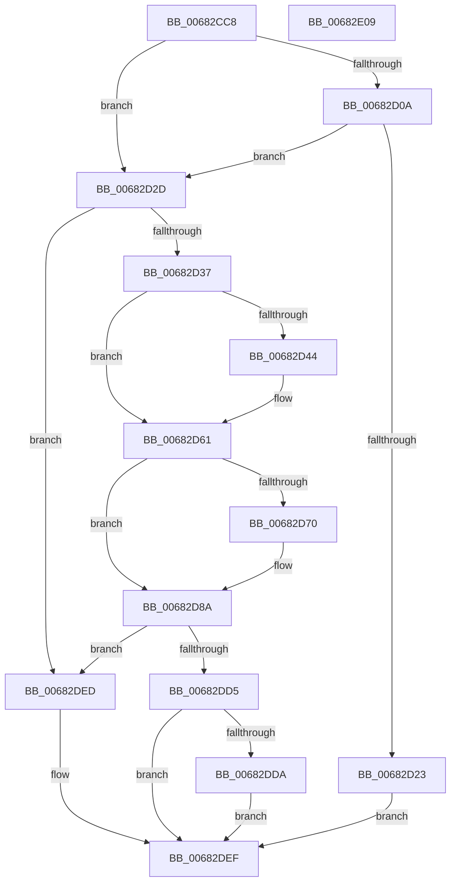

# MmAllocateSecurePoolMemory

- RVA: `0x00682CC8`–`0x00682E0A` (길이 `322` bytes)
- VA: `0x0000000140682CC8`
- 실행 섹션: `.text`
- PDB 이름 있음: `예`; PDB Function 태그: `아니요`
- unwind 정보 RVA: `0x000D83BC`
- 디코드: `89`개 명령, `322/322` bytes 표시
- 미해석 바이트: `0` (있으면 어셈블리에 `.byte`로 보존)

> 이 문서는 커널 이미지의 기계어와 PDB 기호를 분석해 생성했습니다. 4번과 5번은 함수 원형과 자료형을 바이너리 사용 방식에서 추정한 C 해석이며 원본 소스 복구 결과는 아닙니다.

## 1. Dependencies

- 직접 호출 지점: **9**; 고유 호출 대상: **8**
- 직접 호출자로 확인된 함수: **1**
- RIP 상대 이미지 참조: **0**

### Outgoing calls
- `0x00682CFD` → [memset](../6C/memset_function_006C6C40.md) (function, `0x006C6C40`)
- `0x00682D16` → [MiReservePoolMemory](../3B/MiReservePoolMemory_function_003B4AD8.md) (function, `0x003B4AD8`)
- `0x00682D3A` → [MiGetSystemRegionType](../28/MiGetSystemRegionType_function_0028EC80.md) (function, `0x0028EC80`)
- `0x00682D5B` → [KeBugCheckEx](../4F/KeBugCheckEx_function_004FD660.md) (function, `0x004FD660`)
- `0x00682D67` → [MiIsSystemVaAllocated](../67/MiIsSystemVaAllocated_function_0067F9FC.md) (function, `0x0067F9FC`)
- `0x00682D84` → [KeBugCheckEx](../4F/KeBugCheckEx_function_004FD660.md) (function, `0x004FD660`)
- `0x00682DC0` → [MiInitializePoolCommitPacket](../32/MiInitializePoolCommitPacket_function_00328DD0.md) (function, `0x00328DD0`)
- `0x00682DCA` → [MiCommitPoolMemory](../32/MiCommitPoolMemory_function_00329520.md) (function, `0x00329520`)
- `0x00682DE6` → [MmFreeSecurePoolMemory](MmFreeSecurePoolMemory_function_00682E10.md) (function, `0x00682E10`)

### Direct callers
- [PspIumAllocateSecurePool](../5E/PspIumAllocateSecurePool_function_005E4698.md) at `0x005E4843`

### Static image references
- 디코드된 RIP-relative 메모리 참조가 없습니다.

## 2. Other-region calls and transfers

- 다른 실행 섹션으로 향하는 call: **0**
- 별도 외부 분기/꼬리 이동을 확인하지 못했습니다.

## 3. Assembly (complete function range)

```asm
00682CC8  48 8B C4                        mov rax, rsp
00682CCB  48 89 58 18                     mov qword ptr [rax + 0x18], rbx
00682CCF  48 89 68 20                     mov qword ptr [rax + 0x20], rbp
00682CD3  48 89 50 10                     mov qword ptr [rax + 0x10], rdx
00682CD7  48 89 48 08                     mov qword ptr [rax + 8], rcx
00682CDB  56                              push rsi
00682CDC  57                              push rdi
00682CDD  41 56                           push r14
00682CDF  48 81 EC B0 00 00 00            sub rsp, 0xb0
00682CE6  48 8B FA                        mov rdi, rdx
00682CE9  41 8B E8                        mov ebp, r8d
00682CEC  33 D2                           xor edx, edx
00682CEE  48 8B D9                        mov rbx, rcx
00682CF1  48 8D 4C 24 40                  lea rcx, [rsp + 0x40]
00682CF6  4D 8B F1                        mov r14, r9
00682CF9  44 8D 42 68                     lea r8d, [rdx + 0x68]
00682CFD  E8 3E 3F 04 00                  call 0x1406c6c40
00682D02  33 F6                           xor esi, esi
00682D04  0F BA E5 0D                     bt ebp, 0xd
00682D08  73 23                           jae 0x140682d2d
00682D0A  45 33 C9                        xor r9d, r9d
00682D0D  8D 56 0E                        lea edx, [rsi + 0xe]
00682D10  4C 8B C7                        mov r8, rdi
00682D13  48 8B CB                        mov rcx, rbx
00682D16  E8 BD 1D D3 FF                  call 0x1403b4ad8
00682D1B  48 8B F0                        mov rsi, rax
00682D1E  48 85 C0                        test rax, rax
00682D21  75 0A                           jne 0x140682d2d
00682D23  BB 17 00 00 C0                  mov ebx, 0xc0000017
00682D28  E9 C2 00 00 00                  jmp 0x140682def
00682D2D  0F BA E5 0C                     bt ebp, 0xc
00682D31  0F 83 B6 00 00 00               jae 0x140682ded
00682D37  48 8B CB                        mov rcx, rbx
00682D3A  E8 41 BF C0 FF                  call 0x14028ec80
00682D3F  83 F8 0E                        cmp eax, 0xe
00682D42  74 1D                           je 0x140682d61
00682D44  48 98                           cdqe
00682D46  4C 8B CF                        mov r9, rdi
00682D49  4C 8B C3                        mov r8, rbx
00682D4C  48 89 44 24 20                  mov qword ptr [rsp + 0x20], rax
00682D51  BA 80 15 05 00                  mov edx, 0x51580
00682D56  B9 1A 00 00 00                  mov ecx, 0x1a
00682D5B  E8 00 A9 E7 FF                  call 0x1404fd660
00682D60  CC                              int3
00682D61  4C 8B C7                        mov r8, rdi
00682D64  48 8B D3                        mov rdx, rbx
00682D67  E8 90 CC FF FF                  call 0x14067f9fc
00682D6C  85 C0                           test eax, eax
00682D6E  75 1A                           jne 0x140682d8a
00682D70  48 83 64 24 20 00               and qword ptr [rsp + 0x20], 0
00682D76  8D 48 1A                        lea ecx, [rax + 0x1a]
00682D79  4C 8B CF                        mov r9, rdi
00682D7C  4C 8B C3                        mov r8, rbx
00682D7F  BA 81 15 05 00                  mov edx, 0x51581
00682D84  E8 D7 A8 E7 FF                  call 0x1404fd660
00682D89  CC                              int3
00682D8A  48 8D 44 24 40                  lea rax, [rsp + 0x40]
00682D8F  41 B9 02 00 00 00               mov r9d, 2
00682D95  48 89 44 24 38                  mov qword ptr [rsp + 0x38], rax
00682D9A  48 8D 94 24 D8 00 00 00         lea rdx, [rsp + 0xd8]
00682DA2  4C 89 74 24 30                  mov qword ptr [rsp + 0x30], r14
00682DA7  48 8D 8C 24 D0 00 00 00         lea rcx, [rsp + 0xd0]
00682DAF  83 64 24 28 00                  and dword ptr [rsp + 0x28], 0
00682DB4  44 8B C5                        mov r8d, ebp
00682DB7  48 C7 44 24 20 40 00 00 00      mov qword ptr [rsp + 0x20], 0x40
00682DC0  E8 0B 60 CA FF                  call 0x140328dd0
00682DC5  48 8D 4C 24 40                  lea rcx, [rsp + 0x40]
00682DCA  E8 51 67 CA FF                  call 0x140329520
00682DCF  8B D8                           mov ebx, eax
00682DD1  85 C0                           test eax, eax
00682DD3  79 18                           jns 0x140682ded
00682DD5  48 85 F6                        test rsi, rsi
00682DD8  74 15                           je 0x140682def
00682DDA  41 B8 00 80 00 00               mov r8d, 0x8000
00682DE0  48 8B D7                        mov rdx, rdi
00682DE3  48 8B CE                        mov rcx, rsi
00682DE6  E8 25 00 00 00                  call 0x140682e10
00682DEB  EB 02                           jmp 0x140682def
00682DED  33 DB                           xor ebx, ebx
00682DEF  4C 8D 9C 24 B0 00 00 00         lea r11, [rsp + 0xb0]
00682DF7  8B C3                           mov eax, ebx
00682DF9  49 8B 5B 30                     mov rbx, qword ptr [r11 + 0x30]
00682DFD  49 8B 6B 38                     mov rbp, qword ptr [r11 + 0x38]
00682E01  49 8B E3                        mov rsp, r11
00682E04  41 5E                           pop r14
00682E06  5F                              pop rdi
00682E07  5E                              pop rsi
00682E08  C3                              ret
00682E09  CC                              int3
```

## 4. C-style interpretation (structured pseudocode)

```c
__int64 __fastcall MmAllocateSecurePoolMemory(__int64 a1, __int64 a2, int a3, __int64 a4)
{
    __int64 result;
    __int64 v_rbx;
    __int64 v_rsi;
    __int64 v_rsp;
    unsigned __int64 v_stack_m18;
    unsigned __int64 v_stack_m88;
    unsigned __int64 v_stack_m90;
    unsigned __int64 v_stack_m98;
    unsigned int v_stack_mA0;
    unsigned __int64 v_stack_mA8;
    unsigned __int64 v_stack_p10;
    unsigned __int64 v_stack_p8;

    *(unsigned __int64 *)(v_rsp + 24) = v_rbx;
    *(unsigned __int64 *)(v_rsp + 32) = v_rbp;
    *(unsigned __int64 *)(v_rsp + 16) = a2;
    *(unsigned __int64 *)(v_rsp + 8) = a1;
    v_rsp = (v_rsp) - (176);
    a2 = 0;
    result = memset(v_stack_m88, a2, a2 + 104, a4);
    v_rsi = 0;
    if (condition_is_above_or_equal) goto loc_00682D2D;
    a4 = 0;
    result = MiReservePoolMemory(a1, v_rsi + 14, 0, a4);
    if (result != 0) goto loc_00682D2D;
    goto loc_00682DEF;
loc_00682D2D:
    if (condition_is_above_or_equal) goto loc_00682DED;
    result = MiGetSystemRegionType((unsigned int)(0xC0000017ULL), v_rsi + 14, 0, a4);
    if (((unsigned int)(result)) != 14) {
        a4 = 0;
        a3 = (unsigned int)(0xC0000017ULL);
        v_stack_mA8 = result;
        a2 = 0x51580ULL;
        a1 = 26;
        result = KeBugCheckEx(a1, a2, a3, a4);
    }
    result = MiIsSystemVaAllocated(a1, (unsigned int)(0xC0000017ULL), a2, a4);
    if ((unsigned int)(result) == 0) {
        a1 = result + 26;
        a4 = a2;
        a3 = (unsigned int)(0xC0000017ULL);
        a2 = 0x51581ULL;
        result = KeBugCheckEx(a1, a2, a3, a4);
    }
    v_stack_m90 = v_stack_m88;
    v_stack_m98 = a4;
    v_stack_mA8 = 64;
    result = MiInitializePoolCommitPacket(v_stack_p8, v_stack_p10, (unsigned int)((unsigned int)((unsigned int)(a3))), 2);
    result = MiCommitPoolMemory(v_stack_m88, v_stack_p10, (unsigned int)((unsigned int)((unsigned int)(a3))), 2);
    if (!sign_flag) goto loc_00682DED;
    if (result == 0) goto loc_00682DEF;
    result = MmFreeSecurePoolMemory(result, a2, (unsigned int)(0x8000ULL), 2);
    goto loc_00682DEF;
loc_00682DED:
    v_rbx = 0;
loc_00682DEF:
    return 0;
}
```

## 5. (Beta) C Style

```c
int64_t MmAllocateSecurePoolMemory(int64_t Arg1, int64_t Arg2, int32_t Arg3, int64_t Arg4)
{
    int64_t result;
    int64_t local_rbx;
    int64_t local_rsi;
    int64_t local_rsp;
    uint64_t v_stack_m18;
    uint64_t v_stack_m88;
    uint64_t v_stack_m90;
    uint64_t v_stack_m98;
    uint32_t v_stack_mA0;
    uint64_t v_stack_mA8;
    uint64_t v_stack_p10;
    uint64_t v_stack_p8;

    *(uint64_t *)(local_rsp + 0x18) = local_rbx;
    *(uint64_t *)(local_rsp + 0x20) = local_rbp;
    *(uint64_t *)(local_rsp + 0x10) = Arg2;
    *(uint64_t *)(local_rsp + 0x8) = Arg1;
    local_rsp = (local_rsp) - (176);
    Arg2 = 0;
    result = memset(v_stack_m88, Arg2, Arg2 + 104, Arg4);
    local_rsi = 0;
    if (condition_is_above_or_equal) goto loc_00682D2D;
    Arg4 = 0;
    result = MiReservePoolMemory(Arg1, local_rsi + 14, 0, Arg4);
    if (result != 0) goto loc_00682D2D;
    goto loc_00682DEF;
loc_00682D2D:
    if (condition_is_above_or_equal) goto loc_00682DED;
    result = MiGetSystemRegionType((uint32_t)(0xC0000017ULL), local_rsi + 14, 0, Arg4);
    if (((uint32_t)(result)) != 14) {
        Arg4 = 0;
        Arg3 = (uint32_t)(0xC0000017ULL);
        v_stack_mA8 = result;
        Arg2 = 0x51580ULL;
        Arg1 = 26;
        result = KeBugCheckEx(Arg1, Arg2, Arg3, Arg4);
    }
    result = MiIsSystemVaAllocated(Arg1, (uint32_t)(0xC0000017ULL), Arg2, Arg4);
    if ((uint32_t)(result) == 0) {
        Arg1 = result + 26;
        Arg4 = Arg2;
        Arg3 = (uint32_t)(0xC0000017ULL);
        Arg2 = 0x51581ULL;
        result = KeBugCheckEx(Arg1, Arg2, Arg3, Arg4);
    }
    v_stack_m90 = v_stack_m88;
    v_stack_m98 = Arg4;
    v_stack_mA8 = 64;
    result = MiInitializePoolCommitPacket(v_stack_p8, v_stack_p10, (uint32_t)((uint32_t)((uint32_t)(Arg3))), 2);
    result = MiCommitPoolMemory(v_stack_m88, v_stack_p10, (uint32_t)((uint32_t)((uint32_t)(Arg3))), 2);
    if (!sign_flag) goto loc_00682DED;
    if (result == 0) goto loc_00682DEF;
    result = MmFreeSecurePoolMemory(result, Arg2, (uint32_t)(0x8000ULL), 2);
    goto loc_00682DEF;
loc_00682DED:
    local_rbx = 0;
loc_00682DEF:
    return 0;
}
```

## 6. Execution-region graph

[열기: 2D/3D 그래프와 함수 탐색 컨트롤 패널](../../../control-panel.html?section=text&rva=0x00682CC8&view=graph)

- 2D 그래프는 위에서 아래로 흐르고, 3D 그래프는 빈 공간을 드래그해 회전합니다. Shift+드래그는 이동, 휠은 확대·축소, 함수 노드 선택은 대상 보고서 이동입니다.

### Static fallback


