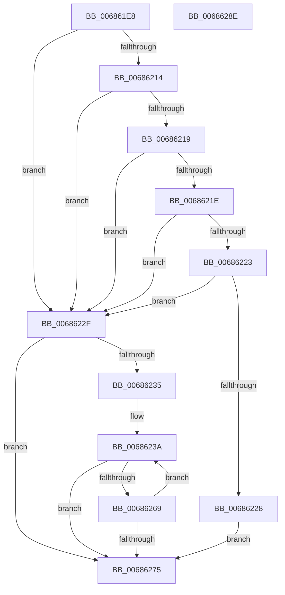

# MmDbgCopyMemory

- RVA: `0x006861E8`–`0x0068628F` (길이 `167` bytes)
- VA: `0x00000001406861E8`
- 실행 섹션: `.text`
- PDB 이름 있음: `예`; PDB Function 태그: `아니요`
- unwind 정보 RVA: `0x00084C9C`
- 디코드: `57`개 명령, `167/167` bytes 표시
- 미해석 바이트: `0` (있으면 어셈블리에 `.byte`로 보존)

> 이 문서는 커널 이미지의 기계어와 PDB 기호를 분석해 생성했습니다. 4번과 5번은 함수 원형과 자료형을 바이너리 사용 방식에서 추정한 C 해석이며 원본 소스 복구 결과는 아닙니다.

## 1. Dependencies

- 직접 호출 지점: **1**; 고유 호출 대상: **1**
- 직접 호출자로 확인된 함수: **5**
- RIP 상대 이미지 참조: **0**

### Outgoing calls
- `0x00686260` → [MiDbgCopyMemory](MiDbgCopyMemory_function_00684A18.md) (function, `0x00684A18`)

### Direct callers
- [KiTpWriteMemory](../5C/KiTpWriteMemory_function_005CAB94.md) at `0x005CAC23`
- [KiTpWriteMemory](../5C/KiTpWriteMemory_function_005CAB94.md) at `0x005CAC4E`
- [KiTpWriteMemory](../5C/KiTpWriteMemory_function_005CAB94.md) at `0x005CAC6D`
- [KdpReadPhysicalMemory](../../pagekd/B8/KdpReadPhysicalMemory_function_00B877D8.md) at `0x00B87888`
- [KdpSearchMemory](../../pagekd/B8/KdpSearchMemory_function_00B87EF4.md) at `0x00B87FE4`
- [KdpSearchMemory](../../pagekd/B8/KdpSearchMemory_function_00B87EF4.md) at `0x00B88050`
- [KdpSearchPhysicalPage](../../pagekd/B8/KdpSearchPhysicalPage_function_00B880E8.md) at `0x00B88162`
- [KdpSearchPhysicalPage](../../pagekd/B8/KdpSearchPhysicalPage_function_00B880E8.md) at `0x00B8823C`
- [KdpCopyMemoryChunks](../../pagekd/B8/KdpCopyMemoryChunks_function_00B8AACC.md) at `0x00B8AB50`

### Static image references
- 디코드된 RIP-relative 메모리 참조가 없습니다.

## 2. Other-region calls and transfers

- 다른 실행 섹션으로 향하는 call: **0**
- 별도 외부 분기/꼬리 이동을 확인하지 못했습니다.

## 3. Assembly (complete function range)

```asm
006861E8  48 89 5C 24 08                  mov qword ptr [rsp + 8], rbx
006861ED  48 89 6C 24 10                  mov qword ptr [rsp + 0x10], rbp
006861F2  48 89 74 24 18                  mov qword ptr [rsp + 0x18], rsi
006861F7  57                              push rdi
006861F8  41 56                           push r14
006861FA  41 57                           push r15
006861FC  48 83 EC 30                     sub rsp, 0x30
00686200  45 8B F1                        mov r14d, r9d
00686203  41 8B D8                        mov ebx, r8d
00686206  48 8B EA                        mov rbp, rdx
00686209  48 8B F1                        mov rsi, rcx
0068620C  41 8B C1                        mov eax, r9d
0068620F  45 85 C9                        test r9d, r9d
00686212  74 1B                           je 0x14068622f
00686214  83 E8 01                        sub eax, 1
00686217  74 16                           je 0x14068622f
00686219  83 E8 01                        sub eax, 1
0068621C  74 11                           je 0x14068622f
0068621E  83 E8 02                        sub eax, 2
00686221  74 0C                           je 0x14068622f
00686223  83 F8 04                        cmp eax, 4
00686226  74 07                           je 0x14068622f
00686228  B8 02 00 00 80                  mov eax, 0x80000002
0068622D  EB 46                           jmp 0x140686275
0068622F  33 C0                           xor eax, eax
00686231  85 DB                           test ebx, ebx
00686233  74 40                           je 0x140686275
00686235  44 8B 7C 24 70                  mov r15d, dword ptr [rsp + 0x70]
0068623A  8B C6                           mov eax, esi
0068623C  44 89 7C 24 20                  mov dword ptr [rsp + 0x20], r15d
00686241  25 FF 0F 00 00                  and eax, 0xfff
00686246  B9 00 10 00 00                  mov ecx, 0x1000
0068624B  2B C8                           sub ecx, eax
0068624D  8B FB                           mov edi, ebx
0068624F  3B CB                           cmp ecx, ebx
00686251  45 8B CE                        mov r9d, r14d
00686254  48 8B D5                        mov rdx, rbp
00686257  0F 46 F9                        cmovbe edi, ecx
0068625A  48 8B CE                        mov rcx, rsi
0068625D  44 8B C7                        mov r8d, edi
00686260  E8 B3 E7 FF FF                  call 0x140684a18
00686265  85 C0                           test eax, eax
00686267  78 0C                           js 0x140686275
00686269  8B CF                           mov ecx, edi
0068626B  48 03 F1                        add rsi, rcx
0068626E  48 03 E9                        add rbp, rcx
00686271  2B DF                           sub ebx, edi
00686273  75 C5                           jne 0x14068623a
00686275  48 8B 5C 24 50                  mov rbx, qword ptr [rsp + 0x50]
0068627A  48 8B 6C 24 58                  mov rbp, qword ptr [rsp + 0x58]
0068627F  48 8B 74 24 60                  mov rsi, qword ptr [rsp + 0x60]
00686284  48 83 C4 30                     add rsp, 0x30
00686288  41 5F                           pop r15
0068628A  41 5E                           pop r14
0068628C  5F                              pop rdi
0068628D  C3                              ret
0068628E  CC                              int3
```

## 4. C-style interpretation (structured pseudocode)

```c
__int64 __fastcall MmDbgCopyMemory(__int64 a1, __int64 a2, int a3, int a4, unsigned int a5)
{
    __int64 result;
    __int64 v_rbp;
    __int64 v_rbx;
    __int64 v_rdi;
    __int64 v_rsi;
    __int64 v_rsp;
    unsigned int v_stack_m28;
    unsigned __int64 v_stack_p10;
    unsigned __int64 v_stack_p18;
    unsigned __int64 v_stack_p8;

    v_stack_p8 = v_rbx;
    v_stack_p10 = v_rbp;
    v_stack_p18 = v_rsi;
    v_rsp = (v_rsp) - (48);
    if (a4 == 0) goto loc_0068622F;
    result = (unsigned int)(((unsigned int)(a4)) - (1));
    if (condition_is_equal) goto loc_0068622F;
    result = (unsigned int)((result) - (1));
    if (condition_is_equal) goto loc_0068622F;
    result = (unsigned int)((result) - (2));
    if (condition_is_equal) goto loc_0068622F;
    if (((unsigned int)(result)) == 4) goto loc_0068622F;
    goto loc_00686275;
loc_0068622F:
    result = 0;
    if ((unsigned int)((unsigned int)(a3)) == 0) goto loc_00686275;
loc_0068623A:
    v_stack_m28 = (unsigned int)((unsigned int)(a5));
    result = (unsigned int)(((unsigned int)((unsigned int)(a1))) & (0xFFFULL));
    a1 = (unsigned int)(((unsigned int)(0x1000ULL)) - ((unsigned int)(result)));
    v_rdi = (unsigned int)((unsigned int)((unsigned int)(a3)));
    if (((unsigned int)(a1)) <= ((unsigned int)((unsigned int)(a3)))) { v_rdi = (unsigned int)(a1); }
    result = MiDbgCopyMemory(a1, a2, (unsigned int)((unsigned int)(v_rdi)), (unsigned int)((unsigned int)((unsigned int)(a4))));
    if (sign_flag) goto loc_00686275;
    v_rsi = (a1) + ((unsigned int)((unsigned int)(v_rdi)));
    v_rbp = (a2) + ((unsigned int)((unsigned int)(v_rdi)));
    v_rbx = (unsigned int)(((unsigned int)(a3)) - ((unsigned int)(v_rdi)));
    if (condition_is_not_equal) goto loc_0068623A;
loc_00686275:
    v_rsp = (v_rsp) + (48);
    return result;
}
```

## 5. (Beta) C Style

```c
int64_t MmDbgCopyMemory(int64_t Arg1, int64_t Arg2, int32_t Arg3, int32_t Arg4, uint32_t Arg5)
{
    int64_t result;
    int64_t local_rbp;
    int64_t local_rbx;
    int64_t local_rdi;
    int64_t local_rsi;
    int64_t local_rsp;
    uint32_t v_stack_m28;
    uint64_t v_stack_p10;
    uint64_t v_stack_p18;
    uint64_t v_stack_p8;

    v_stack_p8 = local_rbx;
    v_stack_p10 = local_rbp;
    v_stack_p18 = local_rsi;
    local_rsp = (local_rsp) - (48);
    if (Arg4 == 0) goto loc_0068622F;
    result = (uint32_t)(((uint32_t)(Arg4)) - (1));
    if (condition_is_equal) goto loc_0068622F;
    result = (uint32_t)((result) - (1));
    if (condition_is_equal) goto loc_0068622F;
    result = (uint32_t)((result) - (2));
    if (condition_is_equal) goto loc_0068622F;
    if (((uint32_t)(result)) == 4) goto loc_0068622F;
    goto loc_00686275;
loc_0068622F:
    result = 0;
    if ((uint32_t)((uint32_t)(Arg3)) == 0) goto loc_00686275;
loc_0068623A:
    v_stack_m28 = (uint32_t)((uint32_t)(Arg5));
    result = (uint32_t)(((uint32_t)((uint32_t)(Arg1))) & (0xFFFULL));
    Arg1 = (uint32_t)(((uint32_t)(0x1000ULL)) - ((uint32_t)(result)));
    local_rdi = (uint32_t)((uint32_t)((uint32_t)(Arg3)));
    if (((uint32_t)(Arg1)) <= ((uint32_t)((uint32_t)(Arg3)))) { local_rdi = (uint32_t)(Arg1); }
    result = MiDbgCopyMemory(Arg1, Arg2, (uint32_t)((uint32_t)(local_rdi)), (uint32_t)((uint32_t)((uint32_t)(Arg4))));
    if (sign_flag) goto loc_00686275;
    local_rsi = (Arg1) + ((uint32_t)((uint32_t)(local_rdi)));
    local_rbp = (Arg2) + ((uint32_t)((uint32_t)(local_rdi)));
    local_rbx = (uint32_t)(((uint32_t)(Arg3)) - ((uint32_t)(local_rdi)));
    if (condition_is_not_equal) goto loc_0068623A;
loc_00686275:
    local_rsp = (local_rsp) + (48);
    return result;
}
```

## 6. Execution-region graph

[열기: 2D/3D 그래프와 함수 탐색 컨트롤 패널](../../../control-panel.html?section=text&rva=0x006861E8&view=graph)

- 2D 그래프는 위에서 아래로 흐르고, 3D 그래프는 빈 공간을 드래그해 회전합니다. Shift+드래그는 이동, 휠은 확대·축소, 함수 노드 선택은 대상 보고서 이동입니다.

### Static fallback


