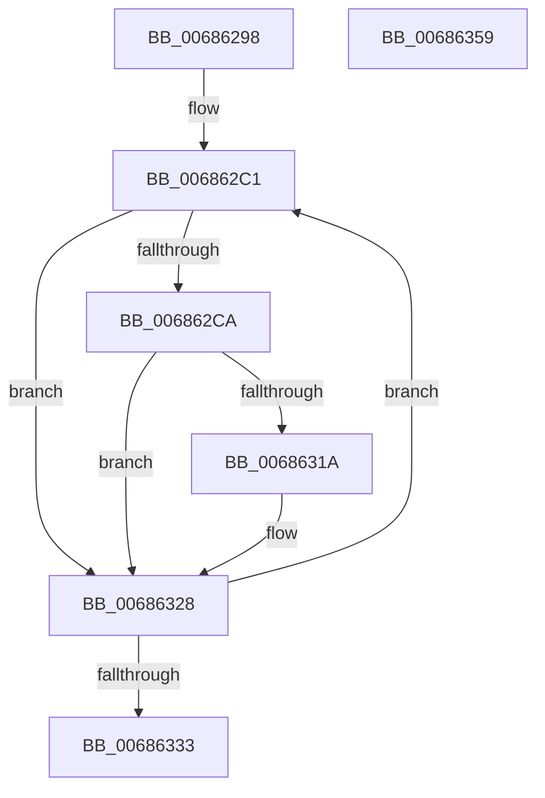

# MmDbgMarkPfnModifiedWorker

- RVA: `0x00686298`–`0x0068635A` (길이 `194` bytes)
- VA: `0x0000000140686298`
- 실행 섹션: `.text`
- PDB 이름 있음: `예`; PDB Function 태그: `아니요`
- unwind 정보 RVA: `0x0005FEF8`
- 디코드: `56`개 명령, `194/194` bytes 표시
- 미해석 바이트: `0` (있으면 어셈블리에 `.byte`로 보존)

> 이 문서는 커널 이미지의 기계어와 PDB 기호를 분석해 생성했습니다. 4번과 5번은 함수 원형과 자료형을 바이너리 사용 방식에서 추정한 C 해석이며 원본 소스 복구 결과는 아닙니다.

## 1. Dependencies

- 직접 호출 지점: **6**; 고유 호출 대상: **6**
- 직접 호출자로 확인된 함수: **1**
- RIP 상대 이미지 참조: **2**

### Outgoing calls
- `0x006862D6` → [MiLockPageInline](../31/MiLockPageInline_function_0031A340.md) (function, `0x0031A340`)
- `0x006862E1` → [MiCaptureDirtyBitToPfn](../37/MiCaptureDirtyBitToPfn_function_00370DD0.md) (function, `0x00370DD0`)
- `0x006862EC` → [MiRemoveLockedPageChargeAndDecRef](../24/MiRemoveLockedPageChargeAndDecRef_function_002459D0.md) (function, `0x002459D0`)
- `0x00686310` → [MiUnlockPage](../31/MiUnlockPage_function_0031A3E0.md) (function, `0x0031A3E0`)
- `0x00686323` → [MiReleasePageFileInfo](../28/MiReleasePageFileInfo_function_00283FD0.md) (function, `0x00283FD0`)
- `0x00686335` → [MiCompactDebuggerPatchTable](MiCompactDebuggerPatchTable_function_006844C0.md) (function, `0x006844C0`)

### Direct callers
- [ExpDebuggerWorker](../../pagekd/B8/ExpDebuggerWorker_function_00B89F70.md) at `0x00B8A00D`

### Static image references
- `0x006862B5` → RVA `0x00E302E8` (`.data`; read)
- `0x006862F8` → RVA `0x00E30088` (`.data`; read)

## 2. Other-region calls and transfers

- 다른 실행 섹션으로 향하는 call: **0**
- 별도 외부 분기/꼬리 이동을 확인하지 못했습니다.

## 3. Assembly (complete function range)

```asm
00686298  48 8B C4                        mov rax, rsp
0068629B  48 89 58 08                     mov qword ptr [rax + 8], rbx
0068629F  48 89 68 10                     mov qword ptr [rax + 0x10], rbp
006862A3  48 89 70 18                     mov qword ptr [rax + 0x18], rsi
006862A7  48 89 78 20                     mov qword ptr [rax + 0x20], rdi
006862AB  41 54                           push r12
006862AD  41 56                           push r14
006862AF  41 57                           push r15
006862B1  48 83 EC 20                     sub rsp, 0x20
006862B5  4C 8D 25 2C A0 7A 00            lea r12, [rip + 0x7aa02c]
006862BC  33 F6                           xor esi, esi
006862BE  4D 8B F4                        mov r14, r12
006862C1  49 8B 2E                        mov rbp, qword ptr [r14]
006862C4  40 F6 C5 01                     test bpl, 1
006862C8  74 5E                           je 0x140686328
006862CA  33 C0                           xor eax, eax
006862CC  48 FF CD                        dec rbp
006862CF  49 87 04 F4                     xchg qword ptr [r12 + rsi*8], rax
006862D3  48 8B CD                        mov rcx, rbp
006862D6  E8 65 40 C9 FF                  call 0x14031a340
006862DB  48 8B CD                        mov rcx, rbp
006862DE  40 8A F8                        mov dil, al
006862E1  E8 EA AA CE FF                  call 0x140370dd0
006862E6  48 8B CD                        mov rcx, rbp
006862E9  48 8B D8                        mov rbx, rax
006862EC  E8 DF F6 BB FF                  call 0x1402459d0
006862F1  48 8B 55 28                     mov rdx, qword ptr [rbp + 0x28]
006862F5  48 8B CD                        mov rcx, rbp
006862F8  4C 8B 05 89 9D 7A 00            mov r8, qword ptr [rip + 0x7a9d89]
006862FF  48 C1 EA 2B                     shr rdx, 0x2b
00686303  81 E2 FF 03 00 00               and edx, 0x3ff
00686309  4D 8B 3C D0                     mov r15, qword ptr [r8 + rdx*8]
0068630D  40 8A D7                        mov dl, dil
00686310  E8 CB 40 C9 FF                  call 0x14031a3e0
00686315  48 85 DB                        test rbx, rbx
00686318  74 0E                           je 0x140686328
0068631A  45 33 C0                        xor r8d, r8d
0068631D  48 8B D3                        mov rdx, rbx
00686320  49 8B CF                        mov rcx, r15
00686323  E8 A8 DC BF FF                  call 0x140283fd0
00686328  FF C6                           inc esi
0068632A  49 83 C6 08                     add r14, 8
0068632E  83 FE 20                        cmp esi, 0x20
00686331  72 8E                           jb 0x1406862c1
00686333  33 C9                           xor ecx, ecx
00686335  E8 86 E1 FF FF                  call 0x1406844c0
0068633A  48 8B 5C 24 40                  mov rbx, qword ptr [rsp + 0x40]
0068633F  48 8B 6C 24 48                  mov rbp, qword ptr [rsp + 0x48]
00686344  48 8B 74 24 50                  mov rsi, qword ptr [rsp + 0x50]
00686349  48 8B 7C 24 58                  mov rdi, qword ptr [rsp + 0x58]
0068634E  48 83 C4 20                     add rsp, 0x20
00686352  41 5F                           pop r15
00686354  41 5E                           pop r14
00686356  41 5C                           pop r12
00686358  C3                              ret
00686359  CC                              int3
```

## 4. C-style interpretation (structured pseudocode)

```c
__int64 __fastcall MmDbgMarkPfnModifiedWorker(void)
{
    __int64 result;
    __int64 v_r14;
    __int64 v_rbp;
    __int64 v_rsi;
    __int64 v_rsp;
    unsigned __int64 v_stack_p10;
    unsigned __int64 v_stack_p18;
    unsigned __int64 v_stack_p20;
    unsigned __int64 v_stack_p8;

    *(unsigned __int64 *)(v_rsp + 8) = v_rbx;
    *(unsigned __int64 *)(v_rsp + 16) = v_rbp;
    *(unsigned __int64 *)(v_rsp + 24) = v_rsi;
    *(unsigned __int64 *)(v_rsp + 32) = v_rdi;
    v_rsp = (v_rsp) - (32);
    v_rsi = 0;
loc_006862C1:
    if ((((unsigned __int8)(*(unsigned __int64 *)(v_rip + 8036396))) & (1)) == 0) goto loc_00686328;
    result = 0;
    v_rbp = (*(unsigned __int64 *)(v_rip + 8036396)) - 1;
    result = MiLockPageInline(v_rbp, a2, a3, a4);
    result = MiCaptureDirtyBitToPfn(v_rbp, a2, a3, a4);
    result = MiRemoveLockedPageChargeAndDecRef(v_rbp, a2, a3, a4);
    a2 = (*(unsigned __int64 *)(v_rbp + 40)) >> (43);
    a2 = (unsigned int)((a2) & (0x3FFULL));
    result = MiUnlockPage(v_rbp, (unsigned __int8)((unsigned __int8)(result)), *(unsigned __int64 *)(v_rip + 8035721), a4);
    if (result != 0) {
        a3 = 0;
        a2 = result;
        a1 = *(unsigned __int64 *)(*(unsigned __int64 *)(v_rip + 8035721) + a2 * 8);
        result = MiReleasePageFileInfo(a1, a2, a3, a4);
    }
    v_rsi = (unsigned int)((v_rsi) + 1);
    v_r14 = (v_rip + 8036396) + (8);
    if (((unsigned int)(v_rsi)) < 32) goto loc_006862C1;
    a1 = 0;
    result = MiCompactDebuggerPatchTable(a1, a2, a3, a4);
    v_rsp = (v_rsp) + (32);
    return result;
}
```

## 5. (Beta) C Style

```c
void MmDbgMarkPfnModifiedWorker(void)
{
    int64_t result;
    int64_t local_r14;
    int64_t local_rbp;
    int64_t local_rsi;
    int64_t local_rsp;
    uint64_t v_stack_p10;
    uint64_t v_stack_p18;
    uint64_t v_stack_p20;
    uint64_t v_stack_p8;

    *(uint64_t *)(local_rsp + 0x8) = local_rbx;
    *(uint64_t *)(local_rsp + 0x10) = local_rbp;
    *(uint64_t *)(local_rsp + 0x18) = local_rsi;
    *(uint64_t *)(local_rsp + 0x20) = local_rdi;
    local_rsp = (local_rsp) - (32);
    local_rsi = 0;
loc_006862C1:
    if ((((uint8_t)(*(uint64_t *)(v_rip + 0x7AA02C))) & (1)) == 0) goto loc_00686328;
    result = 0;
    local_rbp = (*(uint64_t *)(v_rip + 0x7AA02C)) - 1;
    result = MiLockPageInline(local_rbp, a2, a3, a4);
    result = MiCaptureDirtyBitToPfn(local_rbp, a2, a3, a4);
    result = MiRemoveLockedPageChargeAndDecRef(local_rbp, a2, a3, a4);
    a2 = (*(uint64_t *)(local_rbp + 0x28)) >> (43);
    a2 = (uint32_t)((a2) & (0x3FFULL));
    result = MiUnlockPage(local_rbp, (uint8_t)((uint8_t)(result)), *(uint64_t *)(v_rip + 0x7A9D89), a4);
    if (result != 0) {
        a3 = 0;
        a2 = result;
        a1 = *(uint64_t *)(*(uint64_t *)(v_rip + 0x7A9D89) + a2 * 8);
        result = MiReleasePageFileInfo(a1, a2, a3, a4);
    }
    local_rsi = (uint32_t)((local_rsi) + 1);
    local_r14 = (v_rip + 8036396) + (8);
    if (((uint32_t)(local_rsi)) < 32) goto loc_006862C1;
    a1 = 0;
    result = MiCompactDebuggerPatchTable(a1, a2, a3, a4);
    local_rsp = (local_rsp) + (32);
    return result;
}
```

## 6. Execution-region graph

[열기: 2D/3D 그래프와 함수 탐색 컨트롤 패널](../../../control-panel.html?section=text&rva=0x00686298&view=graph)

- 2D 그래프는 위에서 아래로 흐르고, 3D 그래프는 빈 공간을 드래그해 회전합니다. Shift+드래그는 이동, 휠은 확대·축소, 함수 노드 선택은 대상 보고서 이동입니다.

### Static fallback


