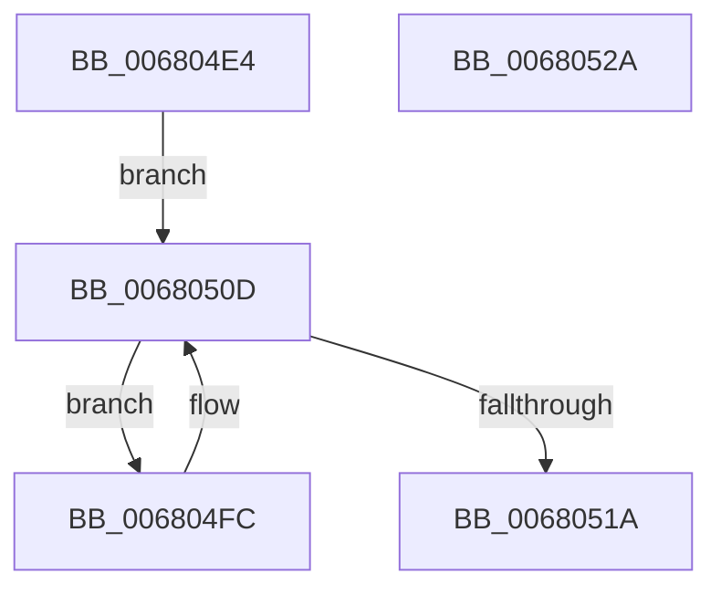

# MmFlushAllPagesEx

- RVA: `0x006804E4`–`0x0068052B` (길이 `71` bytes)
- VA: `0x00000001406804E4`
- 실행 섹션: `.text`
- PDB 이름 있음: `예`; PDB Function 태그: `아니요`
- unwind 정보 RVA: `0x00060BC4`
- 디코드: `23`개 명령, `71/71` bytes 표시
- 미해석 바이트: `0` (있으면 어셈블리에 `.byte`로 보존)

> 이 문서는 커널 이미지의 기계어와 PDB 기호를 분석해 생성했습니다. 4번과 5번은 함수 원형과 자료형을 바이너리 사용 방식에서 추정한 C 해석이며 원본 소스 복구 결과는 아닙니다.

## 1. Dependencies

- 직접 호출 지점: **2**; 고유 호출 대상: **2**
- 직접 호출자로 확인된 함수: **1**
- RIP 상대 이미지 참조: **0**

### Outgoing calls
- `0x00680505` → [MiFlushAllPages](../3B/MiFlushAllPages_function_003BD294.md) (function, `0x003BD294`)
- `0x0068050D` → [PsGetNextPartition](../3B/PsGetNextPartition_function_003B9D5C.md) (function, `0x003B9D5C`)

### Direct callers
- [sub_00B8053E](../../pagelk/B8/Unknown_function_00B8053E.md) at `0x00B80616`

### Static image references
- 디코드된 RIP-relative 메모리 참조가 없습니다.

## 2. Other-region calls and transfers

- 다른 실행 섹션으로 향하는 call: **0**
- 별도 외부 분기/꼬리 이동을 확인하지 못했습니다.

## 3. Assembly (complete function range)

```asm
006804E4  48 89 5C 24 08                  mov qword ptr [rsp + 8], rbx
006804E9  48 89 74 24 10                  mov qword ptr [rsp + 0x10], rsi
006804EE  57                              push rdi
006804EF  48 83 EC 20                     sub rsp, 0x20
006804F3  40 8A F1                        mov sil, cl
006804F6  8B FA                           mov edi, edx
006804F8  33 C9                           xor ecx, ecx
006804FA  EB 11                           jmp 0x14068050d
006804FC  48 8B 0B                        mov rcx, qword ptr [rbx]
006804FF  44 8B C7                        mov r8d, edi
00680502  40 8A D6                        mov dl, sil
00680505  E8 8A CD D3 FF                  call 0x1403bd294
0068050A  48 8B CB                        mov rcx, rbx
0068050D  E8 4A 98 D3 FF                  call 0x1403b9d5c
00680512  48 8B D8                        mov rbx, rax
00680515  48 85 C0                        test rax, rax
00680518  75 E2                           jne 0x1406804fc
0068051A  48 8B 5C 24 30                  mov rbx, qword ptr [rsp + 0x30]
0068051F  48 8B 74 24 38                  mov rsi, qword ptr [rsp + 0x38]
00680524  48 83 C4 20                     add rsp, 0x20
00680528  5F                              pop rdi
00680529  C3                              ret
0068052A  CC                              int3
```

## 4. C-style interpretation (structured pseudocode)

```c
__int64 __fastcall MmFlushAllPagesEx(int a1, int a2)
{
    __int64 result;
    __int64 v_rsp;
    unsigned __int64 v_stack_p10;
    unsigned __int64 v_stack_p8;

    v_stack_p8 = v_rbx;
    v_stack_p10 = v_rsi;
    v_rsp = (v_rsp) - (32);
    a1 = 0;
    goto loc_0068050D;
loc_006804FC:
    result = MiFlushAllPages(*(unsigned __int64 *)(v_rbx), (unsigned __int8)((unsigned __int8)(a1)), (unsigned int)((unsigned int)((unsigned int)(a2))), a4);
loc_0068050D:
    result = PsGetNextPartition(v_rbx, (unsigned __int8)((unsigned __int8)(a1)), (unsigned int)((unsigned int)((unsigned int)(a2))), a4);
    if (result != 0) goto loc_006804FC;
    v_rsp = (v_rsp) + (32);
    return result;
}
```

## 5. (Beta) C Style

```c
int64_t MmFlushAllPagesEx(int32_t Arg1, int32_t Arg2)
{
    int64_t result;
    int64_t local_rsp;
    uint64_t v_stack_p10;
    uint64_t v_stack_p8;

    v_stack_p8 = local_rbx;
    v_stack_p10 = local_rsi;
    local_rsp = (local_rsp) - (32);
    Arg1 = 0;
    goto loc_0068050D;
loc_006804FC:
    result = MiFlushAllPages(*(uint64_t *)(local_rbx), (uint8_t)((uint8_t)(Arg1)), (uint32_t)((uint32_t)((uint32_t)(Arg2))), a4);
loc_0068050D:
    result = PsGetNextPartition(local_rbx, (uint8_t)((uint8_t)(Arg1)), (uint32_t)((uint32_t)((uint32_t)(Arg2))), a4);
    if (result != 0) goto loc_006804FC;
    local_rsp = (local_rsp) + (32);
    return result;
}
```

## 6. Execution-region graph

[열기: 2D/3D 그래프와 함수 탐색 컨트롤 패널](../../../control-panel.html?section=text&rva=0x006804E4&view=graph)

- 2D 그래프는 위에서 아래로 흐르고, 3D 그래프는 빈 공간을 드래그해 회전합니다. Shift+드래그는 이동, 휠은 확대·축소, 함수 노드 선택은 대상 보고서 이동입니다.

### Static fallback


