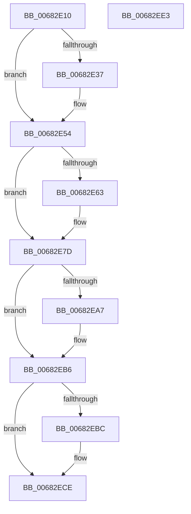

# MmFreeSecurePoolMemory

- RVA: `0x00682E10`–`0x00682EE4` (길이 `212` bytes)
- VA: `0x0000000140682E10`
- 실행 섹션: `.text`
- PDB 이름 있음: `예`; PDB Function 태그: `아니요`
- unwind 정보 RVA: `0x00066400`
- 디코드: `60`개 명령, `212/212` bytes 표시
- 미해석 바이트: `0` (있으면 어셈블리에 `.byte`로 보존)

> 이 문서는 커널 이미지의 기계어와 PDB 기호를 분석해 생성했습니다. 4번과 5번은 함수 원형과 자료형을 바이너리 사용 방식에서 추정한 C 해석이며 원본 소스 복구 결과는 아닙니다.

## 1. Dependencies

- 직접 호출 지점: **7**; 고유 호출 대상: **6**
- 직접 호출자로 확인된 함수: **2**
- RIP 상대 이미지 참조: **0**

### Outgoing calls
- `0x00682E2D` → [MiGetSystemRegionType](../28/MiGetSystemRegionType_function_0028EC80.md) (function, `0x0028EC80`)
- `0x00682E4E` → [KeBugCheckEx](../4F/KeBugCheckEx_function_004FD660.md) (function, `0x004FD660`)
- `0x00682E5A` → [MiIsSystemVaAllocated](../67/MiIsSystemVaAllocated_function_0067F9FC.md) (function, `0x0067F9FC`)
- `0x00682E77` → [KeBugCheckEx](../4F/KeBugCheckEx_function_004FD660.md) (function, `0x004FD660`)
- `0x00682E9D` → [MiClearNonPagedPtes](../2C/MiClearNonPagedPtes_function_002C17A0.md) (function, `0x002C17A0`)
- `0x00682EB1` → [MiCountSystemPool](../45/MiCountSystemPool_function_0045C444.md) (function, `0x0045C444`)
- `0x00682EC9` → [MiReturnSystemVa](../23/MiReturnSystemVa_function_002394C4.md) (function, `0x002394C4`)

### Direct callers
- [MmAllocateSecurePoolMemory](MmAllocateSecurePoolMemory_function_00682CC8.md) at `0x00682DE6`
- [sub_006F88AE](../6F/Unknown_function_006F88AE.md) at `0x006F8F0C`

### Static image references
- 디코드된 RIP-relative 메모리 참조가 없습니다.

## 2. Other-region calls and transfers

- 다른 실행 섹션으로 향하는 call: **0**
- 별도 외부 분기/꼬리 이동을 확인하지 못했습니다.

## 3. Assembly (complete function range)

```asm
00682E10  48 89 5C 24 08                  mov qword ptr [rsp + 8], rbx
00682E15  48 89 6C 24 10                  mov qword ptr [rsp + 0x10], rbp
00682E1A  48 89 74 24 18                  mov qword ptr [rsp + 0x18], rsi
00682E1F  57                              push rdi
00682E20  48 83 EC 30                     sub rsp, 0x30
00682E24  41 8B E8                        mov ebp, r8d
00682E27  48 8B FA                        mov rdi, rdx
00682E2A  48 8B D9                        mov rbx, rcx
00682E2D  E8 4E BE C0 FF                  call 0x14028ec80
00682E32  83 F8 0E                        cmp eax, 0xe
00682E35  74 1D                           je 0x140682e54
00682E37  48 98                           cdqe
00682E39  4C 8B CF                        mov r9, rdi
00682E3C  4C 8B C3                        mov r8, rbx
00682E3F  48 89 44 24 20                  mov qword ptr [rsp + 0x20], rax
00682E44  BA 82 15 05 00                  mov edx, 0x51582
00682E49  B9 1A 00 00 00                  mov ecx, 0x1a
00682E4E  E8 0D A8 E7 FF                  call 0x1404fd660
00682E53  CC                              int3
00682E54  4C 8B C7                        mov r8, rdi
00682E57  48 8B D3                        mov rdx, rbx
00682E5A  E8 9D CB FF FF                  call 0x14067f9fc
00682E5F  85 C0                           test eax, eax
00682E61  75 1A                           jne 0x140682e7d
00682E63  48 83 64 24 20 00               and qword ptr [rsp + 0x20], 0
00682E69  8D 48 1A                        lea ecx, [rax + 0x1a]
00682E6C  4C 8B CF                        mov r9, rdi
00682E6F  4C 8B C3                        mov r8, rbx
00682E72  BA 83 15 05 00                  mov edx, 0x51583
00682E77  E8 E4 A7 E7 FF                  call 0x1404fd660
00682E7C  CC                              int3
00682E7D  8B F5                           mov esi, ebp
00682E7F  48 8B D7                        mov rdx, rdi
00682E82  0F BA EE 0E                     bts esi, 0xe
00682E86  41 B9 03 00 00 00               mov r9d, 3
00682E8C  0F BA E5 0F                     bt ebp, 0xf
00682E90  48 8B CB                        mov rcx, rbx
00682E93  0F 43 F5                        cmovae esi, ebp
00682E96  48 C1 EA 0C                     shr rdx, 0xc
00682E9A  44 8B C6                        mov r8d, esi
00682E9D  E8 FE E8 C3 FF                  call 0x1402c17a0
00682EA2  48 85 C0                        test rax, rax
00682EA5  74 0F                           je 0x140682eb6
00682EA7  45 33 C0                        xor r8d, r8d
00682EAA  48 8B D0                        mov rdx, rax
00682EAD  41 8D 48 0E                     lea ecx, [r8 + 0xe]
00682EB1  E8 8E 95 DD FF                  call 0x14045c444
00682EB6  0F BA E6 0F                     bt esi, 0xf
00682EBA  73 12                           jae 0x140682ece
00682EBC  48 8D 14 3B                     lea rdx, [rbx + rdi]
00682EC0  41 B8 0E 00 00 00               mov r8d, 0xe
00682EC6  48 8B CB                        mov rcx, rbx
00682EC9  E8 F6 65 BB FF                  call 0x1402394c4
00682ECE  48 8B 5C 24 40                  mov rbx, qword ptr [rsp + 0x40]
00682ED3  48 8B 6C 24 48                  mov rbp, qword ptr [rsp + 0x48]
00682ED8  48 8B 74 24 50                  mov rsi, qword ptr [rsp + 0x50]
00682EDD  48 83 C4 30                     add rsp, 0x30
00682EE1  5F                              pop rdi
00682EE2  C3                              ret
00682EE3  CC                              int3
```

## 4. C-style interpretation (structured pseudocode)

```c
__int64 __fastcall MmFreeSecurePoolMemory(__int64 a1, __int64 a2, int a3)
{
    __int64 result;
    __int64 v_rsi;
    __int64 v_rsp;
    unsigned __int64 v_stack_m18;
    unsigned __int64 v_stack_p10;
    unsigned __int64 v_stack_p18;
    unsigned __int64 v_stack_p8;

    v_stack_p8 = v_rbx;
    v_stack_p10 = v_rbp;
    v_stack_p18 = v_rsi;
    v_rsp = (v_rsp) - (48);
    result = MiGetSystemRegionType(a1, a2, a3, a4);
    if (((unsigned int)(result)) != 14) {
        a4 = a2;
        a3 = a1;
        v_stack_m18 = result;
        a2 = 0x51582ULL;
        a1 = 26;
        result = KeBugCheckEx(a1, a2, a3, a4);
    }
    result = MiIsSystemVaAllocated(a1, a1, a2, a4);
    if ((unsigned int)(result) == 0) {
        a1 = result + 26;
        a4 = a2;
        a3 = a1;
        a2 = 0x51583ULL;
        result = KeBugCheckEx(a1, a2, a3, a4);
    }
    v_rsi = (unsigned int)((unsigned int)((unsigned int)(a3)));
    if (condition_is_above_or_equal) { v_rsi = (unsigned int)((unsigned int)(a3)); }
    a2 = (a2) >> (12);
    result = MiClearNonPagedPtes(a1, a2, (unsigned int)((unsigned int)(v_rsi)), 3);
    if (result != 0) {
        a3 = 0;
        a2 = result;
        a1 = a3 + 14;
        result = MiCountSystemPool(a1, a2, a3, 3);
    }
    if (!(condition_is_above_or_equal)) {
        a2 = a1 + a2 * 1;
        a3 = 14;
        a1 = a1;
        result = MiReturnSystemVa(a1, a2, a3, 3);
    }
    v_rsp = (v_rsp) + (48);
    return result;
}
```

## 5. (Beta) C Style

```c
int64_t MmFreeSecurePoolMemory(void *Arg1, int64_t Arg2, int32_t Arg3)
{
    uint8_t *arg1 = (uint8_t *)Arg1;

    int64_t result;
    int64_t local_rsi;
    int64_t local_rsp;
    uint64_t v_stack_m18;
    uint64_t v_stack_p10;
    uint64_t v_stack_p18;
    uint64_t v_stack_p8;

    v_stack_p8 = local_rbx;
    v_stack_p10 = local_rbp;
    v_stack_p18 = local_rsi;
    local_rsp = (local_rsp) - (48);
    result = MiGetSystemRegionType(Arg1, Arg2, Arg3, a4);
    if (((uint32_t)(result)) != 14) {
        a4 = Arg2;
        Arg3 = Arg1;
        v_stack_m18 = result;
        Arg2 = 0x51582ULL;
        Arg1 = 26;
        result = KeBugCheckEx(Arg1, Arg2, Arg3, a4);
    }
    result = MiIsSystemVaAllocated(Arg1, Arg1, Arg2, a4);
    if ((uint32_t)(result) == 0) {
        Arg1 = result + 26;
        a4 = Arg2;
        Arg3 = Arg1;
        Arg2 = 0x51583ULL;
        result = KeBugCheckEx(Arg1, Arg2, Arg3, a4);
    }
    local_rsi = (uint32_t)((uint32_t)((uint32_t)(Arg3)));
    if (condition_is_above_or_equal) { local_rsi = (uint32_t)((uint32_t)(Arg3)); }
    Arg2 = (Arg2) >> (12);
    result = MiClearNonPagedPtes(Arg1, Arg2, (uint32_t)((uint32_t)(local_rsi)), 3);
    if (result != 0) {
        Arg3 = 0;
        Arg2 = result;
        Arg1 = Arg3 + 14;
        result = MiCountSystemPool(Arg1, Arg2, Arg3, 3);
    }
    if (!(condition_is_above_or_equal)) {
        Arg2 = Arg1 + Arg2 * 1;
        Arg3 = 14;
        Arg1 = Arg1;
        result = MiReturnSystemVa(Arg1, Arg2, Arg3, 3);
    }
    local_rsp = (local_rsp) + (48);
    return result;
}
```

### 관측된 메모리 오프셋

구조체 형식이 확인되지 않은 접근은 인자 기준의 오프셋으로만 기록했습니다.

| 기준 인자 | 오프셋 표현 | 폭 (bit) | 접근 |
|---|---:|---:|---|
| `Arg1` | `+ 0x0 + rdi*1` | `64` | `R` |

## 6. Execution-region graph

[열기: 2D/3D 그래프와 함수 탐색 컨트롤 패널](../../../control-panel.html?section=text&rva=0x00682E10&view=graph)

- 2D 그래프는 위에서 아래로 흐르고, 3D 그래프는 빈 공간을 드래그해 회전합니다. Shift+드래그는 이동, 휠은 확대·축소, 함수 노드 선택은 대상 보고서 이동입니다.

### Static fallback


