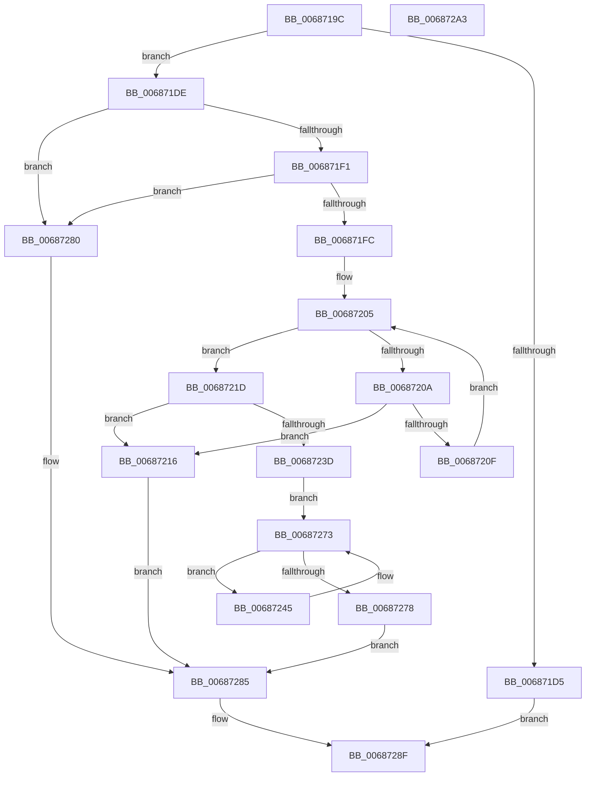

# MmGetEnclaveModuleList

- RVA: `0x0068719C`–`0x006872A4` (길이 `264` bytes)
- VA: `0x000000014068719C`
- 실행 섹션: `.text`
- PDB 이름 있음: `예`; PDB Function 태그: `아니요`
- unwind 정보 RVA: `0x000D88F0`
- 디코드: `80`개 명령, `264/264` bytes 표시
- 미해석 바이트: `0` (있으면 어셈블리에 `.byte`로 보존)

> 이 문서는 커널 이미지의 기계어와 PDB 기호를 분석해 생성했습니다. 4번과 5번은 함수 원형과 자료형을 바이너리 사용 방식에서 추정한 C 해석이며 원본 소스 복구 결과는 아닙니다.

## 1. Dependencies

- 직접 호출 지점: **3**; 고유 호출 대상: **3**
- 직접 호출자로 확인된 함수: **1**
- RIP 상대 이미지 참조: **0**

### Outgoing calls
- `0x006871C8` → [MiObtainReferencedVadEx](../31/MiObtainReferencedVadEx_function_00316690.md) (function, `0x00316690`)
- `0x00687230` → [MiAllocatePool](../35/MiAllocatePool_function_0035B540.md) (function, `0x0035B540`)
- `0x00687288` → [MiUnlockAndDereferenceVadShared](../2A/MiUnlockAndDereferenceVadShared_function_002AEF10.md) (function, `0x002AEF10`)

### Direct callers
- [PsGetProcessEnclaveModuleInfo](../4C/PsGetProcessEnclaveModuleInfo_function_004CA2E0.md) at `0x004CA491`

### Static image references
- 디코드된 RIP-relative 메모리 참조가 없습니다.

## 2. Other-region calls and transfers

- 다른 실행 섹션으로 향하는 call: **0**
- 별도 외부 분기/꼬리 이동을 확인하지 못했습니다.

## 3. Assembly (complete function range)

```asm
0068719C  48 8B C4                        mov rax, rsp
0068719F  48 89 58 08                     mov qword ptr [rax + 8], rbx
006871A3  48 89 70 18                     mov qword ptr [rax + 0x18], rsi
006871A7  57                              push rdi
006871A8  41 56                           push r14
006871AA  41 57                           push r15
006871AC  48 83 EC 20                     sub rsp, 0x20
006871B0  33 DB                           xor ebx, ebx
006871B2  4D 8B F0                        mov r14, r8
006871B5  48 89 1A                        mov qword ptr [rdx], rbx
006871B8  4C 8B FA                        mov r15, rdx
006871BB  41 89 18                        mov dword ptr [r8], ebx
006871BE  4C 8D 40 10                     lea r8, [rax + 0x10]
006871C2  89 58 10                        mov dword ptr [rax + 0x10], ebx
006871C5  8D 53 02                        lea edx, [rbx + 2]
006871C8  E8 C3 F4 C8 FF                  call 0x140316690
006871CD  48 8B F8                        mov rdi, rax
006871D0  48 85 C0                        test rax, rax
006871D3  75 09                           jne 0x1406871de
006871D5  8B 44 24 48                     mov eax, dword ptr [rsp + 0x48]
006871D9  E9 B1 00 00 00                  jmp 0x14068728f
006871DE  8B 40 30                        mov eax, dword ptr [rax + 0x30]
006871E1  25 00 00 20 0C                  and eax, 0xc200000
006871E6  3D 00 00 20 08                  cmp eax, 0x8200000
006871EB  0F 85 8F 00 00 00               jne 0x140687280
006871F1  8B 47 40                        mov eax, dword ptr [rdi + 0x40]
006871F4  A8 01                           test al, 1
006871F6  0F 85 84 00 00 00               jne 0x140687280
006871FC  48 8D 77 50                     lea rsi, [rdi + 0x50]
00687200  8B C3                           mov eax, ebx
00687202  48 8B 0E                        mov rcx, qword ptr [rsi]
00687205  48 3B CE                        cmp rcx, rsi
00687208  74 13                           je 0x14068721d
0068720A  83 F8 FF                        cmp eax, -1
0068720D  74 07                           je 0x140687216
0068720F  48 8B 09                        mov rcx, qword ptr [rcx]
00687212  FF C0                           inc eax
00687214  EB EF                           jmp 0x140687205
00687216  BB 9A 00 00 C0                  mov ebx, 0xc000009a
0068721B  EB 68                           jmp 0x140687285
0068721D  48 8D 14 40                     lea rdx, [rax + rax*2]
00687221  B9 00 01 00 00                  mov ecx, 0x100
00687226  48 C1 E2 03                     shl rdx, 3
0068722A  41 B8 56 45 4D 4C               mov r8d, 0x4c4d4556
00687230  E8 0B 43 CD FF                  call 0x14035b540
00687235  4C 8B C0                        mov r8, rax
00687238  48 85 C0                        test rax, rax
0068723B  74 D9                           je 0x140687216
0068723D  48 8B 16                        mov rdx, qword ptr [rsi]
00687240  44 8B CB                        mov r9d, ebx
00687243  EB 2E                           jmp 0x140687273
00687245  41 8B C1                        mov eax, r9d
00687248  41 FF C1                        inc r9d
0068724B  48 8D 0C 40                     lea rcx, [rax + rax*2]
0068724F  48 8B 42 10                     mov rax, qword ptr [rdx + 0x10]
00687253  49 89 04 C8                     mov qword ptr [r8 + rcx*8], rax
00687257  48 8B 42 18                     mov rax, qword ptr [rdx + 0x18]
0068725B  49 89 44 C8 08                  mov qword ptr [r8 + rcx*8 + 8], rax
00687260  8B 42 24                        mov eax, dword ptr [rdx + 0x24]
00687263  41 89 44 C8 10                  mov dword ptr [r8 + rcx*8 + 0x10], eax
00687268  8B 42 28                        mov eax, dword ptr [rdx + 0x28]
0068726B  41 89 44 C8 14                  mov dword ptr [r8 + rcx*8 + 0x14], eax
00687270  48 8B 12                        mov rdx, qword ptr [rdx]
00687273  48 3B D6                        cmp rdx, rsi
00687276  75 CD                           jne 0x140687245
00687278  4D 89 07                        mov qword ptr [r15], r8
0068727B  45 89 0E                        mov dword ptr [r14], r9d
0068727E  EB 05                           jmp 0x140687285
00687280  BB 18 00 00 C0                  mov ebx, 0xc0000018
00687285  48 8B CF                        mov rcx, rdi
00687288  E8 83 7C C2 FF                  call 0x1402aef10
0068728D  8B C3                           mov eax, ebx
0068728F  48 8B 5C 24 40                  mov rbx, qword ptr [rsp + 0x40]
00687294  48 8B 74 24 50                  mov rsi, qword ptr [rsp + 0x50]
00687299  48 83 C4 20                     add rsp, 0x20
0068729D  41 5F                           pop r15
0068729F  41 5E                           pop r14
006872A1  5F                              pop rdi
006872A2  C3                              ret
006872A3  CC                              int3
```

## 4. C-style interpretation (structured pseudocode)

```c
__int64 __fastcall MmGetEnclaveModuleList(__int64 a1, __int64 a2, __int64 a3)
{
    __int64 result;
    __int64 v_rbx;
    __int64 v_rsp;
    unsigned int v_stack_p10;
    unsigned __int64 v_stack_p18;
    unsigned __int64 v_stack_p8;

    *(unsigned __int64 *)(v_rsp + 8) = v_rbx;
    *(unsigned __int64 *)(v_rsp + 24) = v_rsi;
    v_rsp = (v_rsp) - (32);
    v_rbx = 0;
    *(unsigned __int64 *)(a2) = 0;
    *(unsigned int *)(a3) = 0;
    *(unsigned int *)(v_rsp + 16) = 0;
    result = MiObtainReferencedVadEx(a1, v_rbx + 2, v_rsp + 16, a4);
    if (result != 0) goto loc_006871DE;
    goto loc_0068728F;
loc_006871DE:
    result = (unsigned int)(((unsigned int)(*(unsigned int *)((unsigned int)(v_stack_p10) + 48))) & (0xC200000ULL));
    if (((unsigned int)(result)) != 0x8200000ULL) goto loc_00687280;
    if ((((unsigned __int8)((unsigned int)(*(unsigned int *)(result + 64)))) & (1)) != 0) goto loc_00687280;
loc_00687205:
    if ((*(unsigned __int64 *)(result + 80)) == (result + 80)) goto loc_0068721D;
    if (0 == -1) goto loc_00687216;
    result = (unsigned int)((0) + 1);
    goto loc_00687205;
loc_00687216:
    goto loc_00687285;
loc_0068721D:
    a2 = (result + result * 2) << (3);
    result = MiAllocatePool(256, a2, (unsigned int)(0x4C4D4556ULL), a4);
    if (result == 0) goto loc_00687216;
    goto loc_00687273;
loc_00687245:
    a4 = (unsigned int)(((unsigned int)((unsigned int)((unsigned int)(0xC000009AULL)))) + 1);
    *(unsigned __int64 *)(result + (unsigned int)((unsigned int)((unsigned int)((unsigned int)((unsigned int)(0xC000009AULL))))) + (unsigned int)((unsigned int)((unsigned int)((unsigned int)((unsigned int)(0xC000009AULL))))) * 2 * 8) = *(unsigned __int64 *)(*(unsigned __int64 *)(result + 80) + 16);
    *(unsigned __int64 *)(result + (unsigned int)((unsigned int)((unsigned int)((unsigned int)((unsigned int)(0xC000009AULL))))) + (unsigned int)((unsigned int)((unsigned int)((unsigned int)((unsigned int)(0xC000009AULL))))) * 2 * 8 + 8) = *(unsigned __int64 *)(*(unsigned __int64 *)(result + 80) + 24);
    *(unsigned int *)(result + (unsigned int)((unsigned int)((unsigned int)((unsigned int)((unsigned int)(0xC000009AULL))))) + (unsigned int)((unsigned int)((unsigned int)((unsigned int)((unsigned int)(0xC000009AULL))))) * 2 * 8 + 16) = (unsigned int)((unsigned int)(*(unsigned int *)(*(unsigned __int64 *)(result + 80) + 36)));
    *(unsigned int *)(result + (unsigned int)((unsigned int)((unsigned int)((unsigned int)((unsigned int)(0xC000009AULL))))) + (unsigned int)((unsigned int)((unsigned int)((unsigned int)((unsigned int)(0xC000009AULL))))) * 2 * 8 + 20) = (unsigned int)((unsigned int)(*(unsigned int *)(*(unsigned __int64 *)(result + 80) + 40)));
loc_00687273:
    if ((*(unsigned __int64 *)(*(unsigned __int64 *)(result + 80))) != (result + 80)) goto loc_00687245;
    *(unsigned __int64 *)(a2) = result;
    *(unsigned int *)(a3) = (unsigned int)(a4);
    goto loc_00687285;
loc_00687280:
loc_00687285:
    result = MiUnlockAndDereferenceVadShared(result, *(unsigned __int64 *)(*(unsigned __int64 *)(result + 80)), result, a4);
loc_0068728F:
    v_rsp = (v_rsp) + (32);
    return (unsigned int)((unsigned int)((unsigned int)(0xC0000018ULL)));
}
```

## 5. (Beta) C Style

```c
int64_t MmGetEnclaveModuleList(int64_t Arg1, void *Arg2, void *Arg3)
{
    uint8_t *arg2 = (uint8_t *)Arg2;
    uint8_t *arg3 = (uint8_t *)Arg3;

    int64_t result;
    int64_t local_rbx;
    int64_t local_rsp;
    uint32_t v_stack_p10;
    uint64_t v_stack_p18;
    uint64_t v_stack_p8;

    *(uint64_t *)(local_rsp + 0x8) = local_rbx;
    *(uint64_t *)(local_rsp + 0x18) = local_rsi;
    local_rsp = (local_rsp) - (32);
    local_rbx = 0;
    *(uint64_t *)(arg2) = 0;
    *(uint32_t *)(arg3) = 0;
    *(uint32_t *)(local_rsp + 0x10) = 0;
    result = MiObtainReferencedVadEx(Arg1, local_rbx + 2, local_rsp + 16, a4);
    if (result != 0) goto loc_006871DE;
    goto loc_0068728F;
loc_006871DE:
    result = (uint32_t)(((uint32_t)(*(uint32_t *)((uint32_t)(v_stack_p10) + 0x30))) & (0xC200000ULL));
    if (((uint32_t)(result)) != 0x8200000ULL) goto loc_00687280;
    if ((((uint8_t)((uint32_t)(*(uint32_t *)(result + 0x40)))) & (1)) != 0) goto loc_00687280;
loc_00687205:
    if ((*(uint64_t *)(result + 0x50)) == (result + 80)) goto loc_0068721D;
    if (0 == -1) goto loc_00687216;
    result = (uint32_t)((0) + 1);
    goto loc_00687205;
loc_00687216:
    goto loc_00687285;
loc_0068721D:
    Arg2 = (result + result * 2) << (3);
    result = MiAllocatePool(256, Arg2, (uint32_t)(0x4C4D4556ULL), a4);
    if (result == 0) goto loc_00687216;
    goto loc_00687273;
loc_00687245:
    a4 = (uint32_t)(((uint32_t)((uint32_t)((uint32_t)(0xC000009AULL)))) + 1);
    *(uint64_t *)(result + (uint32_t)((uint32_t)((uint32_t)((uint32_t)((uint32_t)(0xC000009AULL))))) + (uint32_t)((uint32_t)((uint32_t)((uint32_t)((uint32_t)(0xC000009AULL))))) * 2 * 8) = *(uint64_t *)(*(uint64_t *)(result + 0x50) + 0x10);
    *(uint64_t *)(result + (uint32_t)((uint32_t)((uint32_t)((uint32_t)((uint32_t)(0xC000009AULL))))) + (uint32_t)((uint32_t)((uint32_t)((uint32_t)((uint32_t)(0xC000009AULL))))) * 2 * 8 + 0x8) = *(uint64_t *)(*(uint64_t *)(result + 0x50) + 0x18);
    *(uint32_t *)(result + (uint32_t)((uint32_t)((uint32_t)((uint32_t)((uint32_t)(0xC000009AULL))))) + (uint32_t)((uint32_t)((uint32_t)((uint32_t)((uint32_t)(0xC000009AULL))))) * 2 * 8 + 0x10) = (uint32_t)((uint32_t)(*(uint32_t *)(*(uint64_t *)(result + 0x50) + 0x24)));
    *(uint32_t *)(result + (uint32_t)((uint32_t)((uint32_t)((uint32_t)((uint32_t)(0xC000009AULL))))) + (uint32_t)((uint32_t)((uint32_t)((uint32_t)((uint32_t)(0xC000009AULL))))) * 2 * 8 + 0x14) = (uint32_t)((uint32_t)(*(uint32_t *)(*(uint64_t *)(result + 0x50) + 0x28)));
loc_00687273:
    if ((*(uint64_t *)(*(uint64_t *)(result + 0x50))) != (result + 80)) goto loc_00687245;
    *(uint64_t *)(arg2) = result;
    *(uint32_t *)(arg3) = (uint32_t)(a4);
    goto loc_00687285;
loc_00687280:
loc_00687285:
    result = MiUnlockAndDereferenceVadShared(result, *(uint64_t *)(*(uint64_t *)(result + 0x50)), result, a4);
loc_0068728F:
    local_rsp = (local_rsp) + (32);
    return (uint32_t)((uint32_t)((uint32_t)(0xC0000018ULL)));
}
```

### 관측된 메모리 오프셋

구조체 형식이 확인되지 않은 접근은 인자 기준의 오프셋으로만 기록했습니다.

| 기준 인자 | 오프셋 표현 | 폭 (bit) | 접근 |
|---|---:|---:|---|
| `Arg2` | `+ 0x0` | `64` | `W` |
| `Arg3` | `+ 0x0` | `32` | `W` |

## 6. Execution-region graph

[열기: 2D/3D 그래프와 함수 탐색 컨트롤 패널](../../../control-panel.html?section=text&rva=0x0068719C&view=graph)

- 2D 그래프는 위에서 아래로 흐르고, 3D 그래프는 빈 공간을 드래그해 회전합니다. Shift+드래그는 이동, 휠은 확대·축소, 함수 노드 선택은 대상 보고서 이동입니다.

### Static fallback


