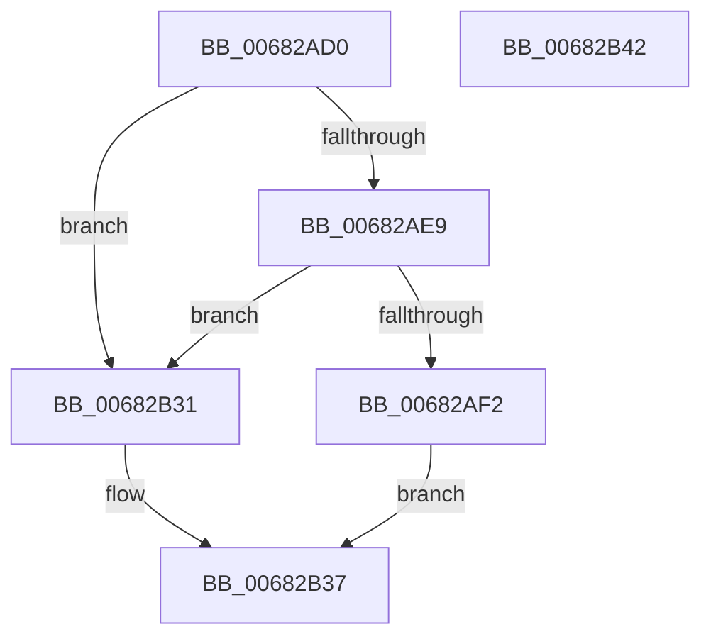

# MmGetImageRetpolineCodePage

- RVA: `0x00682AD0`–`0x00682B43` (길이 `115` bytes)
- VA: `0x0000000140682AD0`
- 실행 섹션: `.text`
- PDB 이름 있음: `예`; PDB Function 태그: `아니요`
- unwind 정보 RVA: `0x0005CAAC`
- 디코드: `32`개 명령, `115/115` bytes 표시
- 미해석 바이트: `0` (있으면 어셈블리에 `.byte`로 보존)

> 이 문서는 커널 이미지의 기계어와 PDB 기호를 분석해 생성했습니다. 4번과 5번은 함수 원형과 자료형을 바이너리 사용 방식에서 추정한 C 해석이며 원본 소스 복구 결과는 아닙니다.

## 1. Dependencies

- 직접 호출 지점: **3**; 고유 호출 대상: **3**
- 직접 호출자로 확인된 함수: **0**
- RIP 상대 이미지 참조: **5**

### Outgoing calls
- `0x00682AF2` → [MmLockLoadedModuleListShared](../2F/MmLockLoadedModuleListShared_function_002F21E4.md) (function, `0x002F21E4`)
- `0x00682AFD` → [MmFindDataTableEntryByAddress](../2A/MmFindDataTableEntryByAddress_function_002A3C0C.md) (function, `0x002A3C0C`)
- `0x00682B1B` → [MmUnlockLoadedModuleListShared](../2F/MmUnlockLoadedModuleListShared_function_002F2230.md) (function, `0x002F2230`)

### Direct callers
- 이 함수 시작 RVA로 연결되는 직접 call은 확인되지 않았습니다. 간접 호출은 완전히 역산할 수 없습니다.

### Static image references
- `0x00682ADA` → RVA `0x00FC6B28` (`ALMOSTRO`; read)
- `0x00682AE9` → RVA `0x00FC6B98` (`ALMOSTRO`; read)
- `0x00682B02` → RVA `0x00E375B0` (`.data`; read)
- `0x00682B08` → RVA `0x00E375AC` (`.data`; read)
- `0x00682B20` → RVA `0x00E2D83C` (`.data`; read)

## 2. Other-region calls and transfers

- 다른 실행 섹션으로 향하는 call: **0**
- 별도 외부 분기/꼬리 이동을 확인하지 못했습니다.

## 3. Assembly (complete function range)

```asm
00682AD0  48 89 5C 24 08                  mov qword ptr [rsp + 8], rbx
00682AD5  57                              push rdi
00682AD6  48 83 EC 20                     sub rsp, 0x20
00682ADA  48 3B 0D 47 40 94 00            cmp rcx, qword ptr [rip + 0x944047]
00682AE1  48 8B FA                        mov rdi, rdx
00682AE4  48 8B D9                        mov rbx, rcx
00682AE7  74 48                           je 0x140682b31
00682AE9  48 3B 0D A8 40 94 00            cmp rcx, qword ptr [rip + 0x9440a8]
00682AF0  74 3F                           je 0x140682b31
00682AF2  E8 ED F6 C6 FF                  call 0x1402f21e4
00682AF7  48 8B CB                        mov rcx, rbx
00682AFA  44 8A D8                        mov r11b, al
00682AFD  E8 0A 11 C2 FF                  call 0x1402a3c0c
00682B02  8B 1D A8 4A 7B 00               mov ebx, dword ptr [rip + 0x7b4aa8]
00682B08  03 1D 9E 4A 7B 00               add ebx, dword ptr [rip + 0x7b4a9e]
00682B0E  8B 48 40                        mov ecx, dword ptr [rax + 0x40]
00682B11  48 03 D9                        add rbx, rcx
00682B14  41 8A CB                        mov cl, r11b
00682B17  48 03 58 30                     add rbx, qword ptr [rax + 0x30]
00682B1B  E8 10 F7 C6 FF                  call 0x1402f2230
00682B20  8B 0D 16 AD 7A 00               mov ecx, dword ptr [rip + 0x7aad16]
00682B26  48 8B C3                        mov rax, rbx
00682B29  C1 E1 0C                        shl ecx, 0xc
00682B2C  48 89 0F                        mov qword ptr [rdi], rcx
00682B2F  EB 06                           jmp 0x140682b37
00682B31  48 83 22 00                     and qword ptr [rdx], 0
00682B35  33 C0                           xor eax, eax
00682B37  48 8B 5C 24 30                  mov rbx, qword ptr [rsp + 0x30]
00682B3C  48 83 C4 20                     add rsp, 0x20
00682B40  5F                              pop rdi
00682B41  C3                              ret
00682B42  CC                              int3
```

## 4. C-style interpretation (structured pseudocode)

```c
__int64 __fastcall MmGetImageRetpolineCodePage(__int64 a1, __int64 a2)
{
    __int64 result;
    __int64 v_rbx;
    __int64 v_rsp;
    unsigned __int64 v_stack_p8;

    v_stack_p8 = v_rbx;
    v_rsp = (v_rsp) - (32);
    if (a1 == (*(unsigned __int64 *)(v_rip + 9715783))) goto loc_00682B31;
    if (a1 == (*(unsigned __int64 *)(v_rip + 9715880))) goto loc_00682B31;
    result = MmLockLoadedModuleListShared(a1, a2, a3, a4);
    result = MmFindDataTableEntryByAddress(a1, a2, a3, a4);
    v_rbx = (unsigned int)(((unsigned int)(*(unsigned int *)(v_rip + 8080040))) + (*(unsigned int *)(v_rip + 8080030)));
    v_rbx = (v_rbx) + ((unsigned int)(*(unsigned int *)(result + 64)));
    v_rbx = (v_rbx) + (*(unsigned __int64 *)(result + 48));
    result = MmUnlockLoadedModuleListShared((unsigned __int8)((unsigned __int8)(result)), a2, a3, a4);
    a1 = (unsigned int)(((unsigned int)(*(unsigned int *)(v_rip + 8039702))) << (12));
    *(unsigned __int64 *)(a2) = a1;
    goto loc_00682B37;
loc_00682B31:
    result = 0;
loc_00682B37:
    v_rsp = (v_rsp) + (32);
    return result;
}
```

## 5. (Beta) C Style

```c
int64_t MmGetImageRetpolineCodePage(int64_t Arg1, void *Arg2)
{
    uint8_t *arg2 = (uint8_t *)Arg2;

    int64_t result;
    int64_t local_rbx;
    int64_t local_rsp;
    uint64_t v_stack_p8;

    v_stack_p8 = local_rbx;
    local_rsp = (local_rsp) - (32);
    if (Arg1 == (*(uint64_t *)(v_rip + 0x944047))) goto loc_00682B31;
    if (Arg1 == (*(uint64_t *)(v_rip + 0x9440A8))) goto loc_00682B31;
    result = MmLockLoadedModuleListShared(Arg1, Arg2, a3, a4);
    result = MmFindDataTableEntryByAddress(Arg1, Arg2, a3, a4);
    local_rbx = (uint32_t)(((uint32_t)(*(uint32_t *)(v_rip + 0x7B4AA8))) + (*(uint32_t *)(v_rip + 0x7B4A9E)));
    local_rbx = (local_rbx) + ((uint32_t)(*(uint32_t *)(result + 0x40)));
    local_rbx = (local_rbx) + (*(uint64_t *)(result + 0x30));
    result = MmUnlockLoadedModuleListShared((uint8_t)((uint8_t)(result)), Arg2, a3, a4);
    Arg1 = (uint32_t)(((uint32_t)(*(uint32_t *)(v_rip + 0x7AAD16))) << (12));
    *(uint64_t *)(arg2) = Arg1;
    goto loc_00682B37;
loc_00682B31:
    result = 0;
loc_00682B37:
    local_rsp = (local_rsp) + (32);
    return result;
}
```

### 관측된 메모리 오프셋

구조체 형식이 확인되지 않은 접근은 인자 기준의 오프셋으로만 기록했습니다.

| 기준 인자 | 오프셋 표현 | 폭 (bit) | 접근 |
|---|---:|---:|---|
| `Arg2` | `+ 0x0` | `64` | `R/W` |
| `Arg2` | `+ 0x0` | `64` | `W` |

## 6. Execution-region graph

[열기: 2D/3D 그래프와 함수 탐색 컨트롤 패널](../../../control-panel.html?section=text&rva=0x00682AD0&view=graph)

- 2D 그래프는 위에서 아래로 흐르고, 3D 그래프는 빈 공간을 드래그해 회전합니다. Shift+드래그는 이동, 휠은 확대·축소, 함수 노드 선택은 대상 보고서 이동입니다.

### Static fallback


