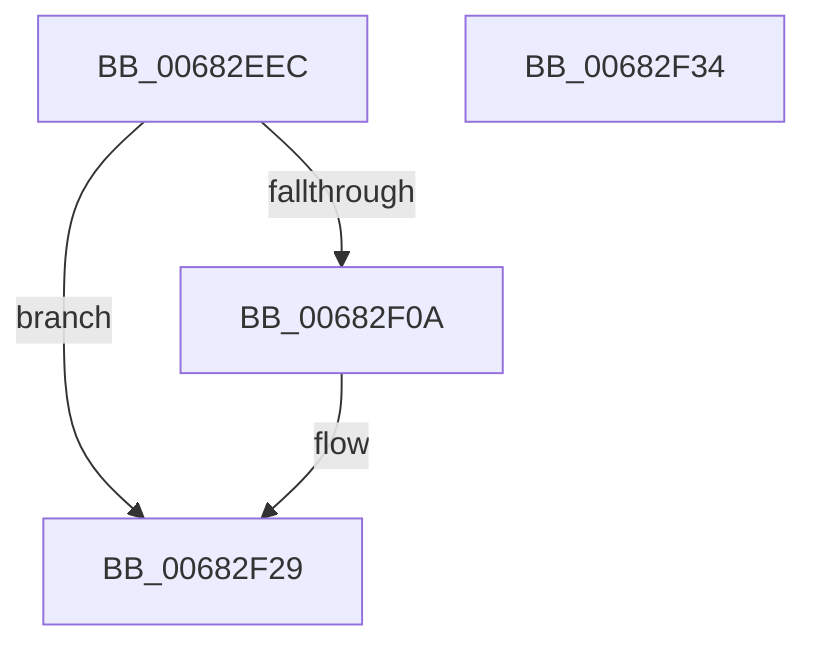

# MmIsNonPagedPoolNx

- RVA: `0x00682EEC`–`0x00682F35` (길이 `73` bytes)
- VA: `0x0000000140682EEC`
- 실행 섹션: `.text`
- PDB 이름 있음: `예`; PDB Function 태그: `아니요`
- unwind 정보 RVA: `0x000DB714`
- 디코드: `18`개 명령, `73/73` bytes 표시
- 미해석 바이트: `0` (있으면 어셈블리에 `.byte`로 보존)

> 이 문서는 커널 이미지의 기계어와 PDB 기호를 분석해 생성했습니다. 4번과 5번은 함수 원형과 자료형을 바이너리 사용 방식에서 추정한 C 해석이며 원본 소스 복구 결과는 아닙니다.

## 1. Dependencies

- 직접 호출 지점: **0**; 고유 호출 대상: **0**
- 직접 호출자로 확인된 함수: **1**
- RIP 상대 이미지 참조: **0**

### Outgoing calls
- 직접 디코드된 call 명령이 없습니다.

### Direct callers
- [EtwTracePool](../2E/EtwTracePool_function_002ECEEC.md) at `0x002ED045`

### Static image references
- 디코드된 RIP-relative 메모리 참조가 없습니다.

## 2. Other-region calls and transfers

- 다른 실행 섹션으로 향하는 call: **0**
- 별도 외부 분기/꼬리 이동을 확인하지 못했습니다.

## 3. Assembly (complete function range)

```asm
00682EEC  48 8B C1                        mov rax, rcx
00682EEF  48 C1 E8 12                     shr rax, 0x12
00682EF3  25 F8 FF FF 3F                  and eax, 0x3ffffff8
00682EF8  48 BA 00 00 00 40 FB F6 FF FF   movabs rdx, 0xfffff6fb40000000
00682F02  48 8B 04 10                     mov rax, qword ptr [rax + rdx]
00682F06  84 C0                           test al, al
00682F08  78 1F                           js 0x140682f29
00682F0A  48 C1 E9 09                     shr rcx, 9
00682F0E  48 B8 F8 FF FF FF 7F 00 00 00   movabs rax, 0x7ffffffff8
00682F18  48 23 C8                        and rcx, rax
00682F1B  48 B8 00 00 00 00 80 F6 FF FF   movabs rax, 0xfffff68000000000
00682F25  48 8B 04 01                     mov rax, qword ptr [rcx + rax]
00682F29  33 C9                           xor ecx, ecx
00682F2B  48 85 C0                        test rax, rax
00682F2E  0F 98 C1                        sets cl
00682F31  8B C1                           mov eax, ecx
00682F33  C3                              ret
00682F34  CC                              int3
```

## 4. C-style interpretation (structured pseudocode)

```c
__int64 __fastcall MmIsNonPagedPoolNx(__int64 a1)
{
    __int64 result;

    result = (a1) >> (18);
    result = (unsigned int)((result) & (0x3FFFFFF8ULL));
    result = *(unsigned __int64 *)(result + a2 * 1);
    if (!(sign_flag)) {
        a1 = (a1) >> (9);
        a1 = (a1) & (*(unsigned __int64 *)(result + a2 * 1));
        result = *(unsigned __int64 *)(a1 + *(unsigned __int64 *)(result + a2 * 1) * 1);
    }
    a1 = 0;
    a1 = (sign_flag) ? 1 : 0;
    return (unsigned int)((unsigned int)(a1));
}
```

## 5. (Beta) C Style

```c
int64_t MmIsNonPagedPoolNx(int64_t Arg1)
{
    int64_t result;

    result = (Arg1) >> (18);
    result = (uint32_t)((result) & (0x3FFFFFF8ULL));
    result = *(uint64_t *)(result + a2 * 1);
    if (!(sign_flag)) {
        Arg1 = (Arg1) >> (9);
        Arg1 = (Arg1) & (*(uint64_t *)(result + a2 * 1));
        result = *(uint64_t *)(Arg1 + *(uint64_t *)(result + a2 * 1) * 1);
    }
    Arg1 = 0;
    Arg1 = (sign_flag) ? 1 : 0;
    return (uint32_t)((uint32_t)(Arg1));
}
```

## 6. Execution-region graph

[열기: 2D/3D 그래프와 함수 탐색 컨트롤 패널](../../../control-panel.html?section=text&rva=0x00682EEC&view=graph)

- 2D 그래프는 위에서 아래로 흐르고, 3D 그래프는 빈 공간을 드래그해 회전합니다. Shift+드래그는 이동, 휠은 확대·축소, 함수 노드 선택은 대상 보고서 이동입니다.

### Static fallback


