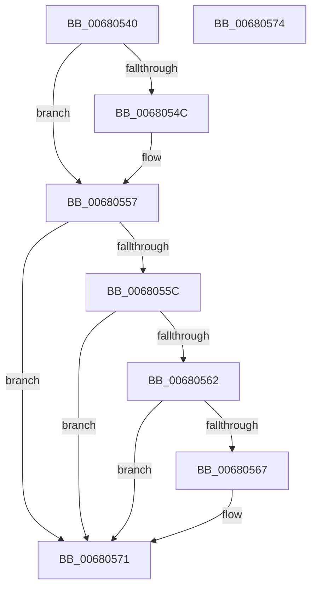

# MmLowPowerEpochCallback

- RVA: `0x00680540`–`0x00680575` (길이 `53` bytes)
- VA: `0x0000000140680540`
- 실행 섹션: `.text`
- PDB 이름 있음: `예`; PDB Function 태그: `아니요`
- unwind 정보 RVA: `0x000DB714`
- 디코드: `16`개 명령, `53/53` bytes 표시
- 미해석 바이트: `0` (있으면 어셈블리에 `.byte`로 보존)

> 이 문서는 커널 이미지의 기계어와 PDB 기호를 분석해 생성했습니다. 4번과 5번은 함수 원형과 자료형을 바이너리 사용 방식에서 추정한 C 해석이며 원본 소스 복구 결과는 아닙니다.

## 1. Dependencies

- 직접 호출 지점: **0**; 고유 호출 대상: **0**
- 직접 호출자로 확인된 함수: **0**
- RIP 상대 이미지 참조: **3**

### Outgoing calls
- 직접 디코드된 call 명령이 없습니다.

### Direct callers
- 이 함수 시작 RVA로 연결되는 직접 call은 확인되지 않았습니다. 간접 호출은 완전히 역산할 수 없습니다.

### Static image references
- `0x00680540` → RVA `0x0001C740` (`.rdata`; read)
- `0x0068054C` → RVA `0x0001C748` (`.rdata`; read)
- `0x0068056A` → RVA `0x00E30141` (`.data`; write)

## 2. Other-region calls and transfers

- 다른 실행 섹션으로 향하는 call: **0**
- 별도 외부 분기/꼬리 이동을 확인하지 못했습니다.

## 3. Assembly (complete function range)

```asm
00680540  4C 8B 0D F9 C1 99 FF            mov r9, qword ptr [rip - 0x663e07]
00680547  4C 2B 09                        sub r9, qword ptr [rcx]
0068054A  75 0B                           jne 0x140680557
0068054C  4C 8B 0D F5 C1 99 FF            mov r9, qword ptr [rip - 0x663e0b]
00680553  4C 2B 49 08                     sub r9, qword ptr [rcx + 8]
00680557  4D 85 C9                        test r9, r9
0068055A  75 15                           jne 0x140680571
0068055C  41 83 F8 04                     cmp r8d, 4
00680560  75 0F                           jne 0x140680571
00680562  48 85 D2                        test rdx, rdx
00680565  74 0A                           je 0x140680571
00680567  44 39 0A                        cmp dword ptr [rdx], r9d
0068056A  0F 95 05 D0 FB 7A 00            setne byte ptr [rip + 0x7afbd0]
00680571  33 C0                           xor eax, eax
00680573  C3                              ret
00680574  CC                              int3
```

## 4. C-style interpretation (structured pseudocode)

```c
__int64 __fastcall MmLowPowerEpochCallback(__int64 a1, __int64 a2, int a3)
{
    __int64 result;

    a4 = (*(unsigned __int64 *)(v_rip - 6700551)) - (*(unsigned __int64 *)(a1));
    if (!(condition_is_not_equal)) {
        a4 = *(unsigned __int64 *)(v_rip - 6700555);
        a4 = (a4) - (*(unsigned __int64 *)(a1 + 8));
    }
    if (a4 != 0) goto loc_00680571;
    if (a3 != 4) goto loc_00680571;
    if (a2 != 0) {
    }
    result = 0;
    return result;
}
```

## 5. (Beta) C Style

```c
int64_t MmLowPowerEpochCallback(void *Arg1, int64_t Arg2, int32_t Arg3)
{
    uint8_t *arg1 = (uint8_t *)Arg1;

    int64_t result;

    a4 = (*(uint64_t *)(v_rip - 0x663E07)) - (*(uint64_t *)(arg1));
    if (!(condition_is_not_equal)) {
        a4 = *(uint64_t *)(v_rip - 0x663E0B);
        a4 = (a4) - (*(uint64_t *)(arg1 + 0x8));
    }
    if (a4 != 0) goto loc_00680571;
    if (Arg3 != 4) goto loc_00680571;
    if (Arg2 != 0) {
    }
    result = 0;
    return result;
}
```

### 관측된 메모리 오프셋

구조체 형식이 확인되지 않은 접근은 인자 기준의 오프셋으로만 기록했습니다.

| 기준 인자 | 오프셋 표현 | 폭 (bit) | 접근 |
|---|---:|---:|---|
| `Arg1` | `+ 0x0` | `64` | `R` |
| `Arg1` | `+ 0x8` | `64` | `R` |

## 6. Execution-region graph

[열기: 2D/3D 그래프와 함수 탐색 컨트롤 패널](../../../control-panel.html?section=text&rva=0x00680540&view=graph)

- 2D 그래프는 위에서 아래로 흐르고, 3D 그래프는 빈 공간을 드래그해 회전합니다. Shift+드래그는 이동, 휠은 확대·축소, 함수 노드 선택은 대상 보고서 이동입니다.

### Static fallback


