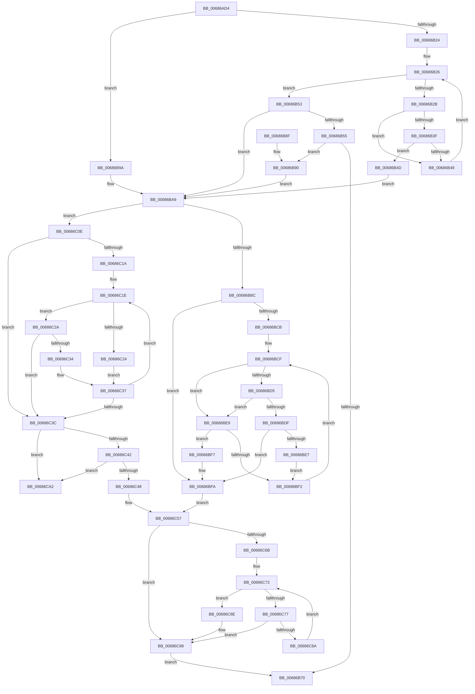

# MmManageFaultRange

- RVA: `0x00686AD4`–`0x00686CBD` (길이 `489` bytes)
- VA: `0x0000000140686AD4`
- 실행 섹션: `.text`
- PDB 이름 있음: `예`; PDB Function 태그: `아니요`
- unwind 정보 RVA: `0x000D8850`
- 디코드: `144`개 명령, `489/489` bytes 표시
- 미해석 바이트: `0` (있으면 어셈블리에 `.byte`로 보존)

> 이 문서는 커널 이미지의 기계어와 PDB 기호를 분석해 생성했습니다. 4번과 5번은 함수 원형과 자료형을 바이너리 사용 방식에서 추정한 C 해석이며 원본 소스 복구 결과는 아닙니다.

## 1. Dependencies

- 직접 호출 지점: **7**; 고유 호출 대상: **7**
- 직접 호출자로 확인된 함수: **1**
- RIP 상대 이미지 참조: **3**

### Outgoing calls
- `0x00686B63` → [MiAllocatePool](../35/MiAllocatePool_function_0035B540.md) (function, `0x0035B540`)
- `0x00686BB0` → [ExAcquireSpinLockExclusive](../24/ExAcquireSpinLockExclusive_function_00248690.md) (function, `0x00248690`)
- `0x00686C04` → [RtlAvlInsertNodeEx](../26/RtlAvlInsertNodeEx_function_00265790.md) (function, `0x00265790`)
- `0x00686C52` → [RtlAvlRemoveNode](../29/RtlAvlRemoveNode_function_00296650.md) (function, `0x00296650`)
- `0x00686C61` → [MiReleaseSpinLockExclusive](../24/MiReleaseSpinLockExclusive_function_002482C0.md) (function, `0x002482C0`)
- `0x00686C93` → [ExFreePoolWithTag](../../poolcode/B8/ExFreePoolWithTag_function_00B82870.md) (function, `0x00B82870`)
- `0x00686CB7` → [KeBugCheckEx](../4F/KeBugCheckEx_function_004FD660.md) (function, `0x004FD660`)

### Direct callers
- [RtlpEnvRegisterFaultRange](../60/RtlpEnvRegisterFaultRange_function_00605864.md) at `0x0060586E`

### Static image references
- `0x00686AFA` → RVA `0x00E2CB40` (`.data`; read)
- `0x00686BA9` → RVA `0x00E2CB70` (`.data`; read)
- `0x00686BBC` → RVA `0x00E2CB78` (`.data`; read)

## 2. Other-region calls and transfers

- 다른 실행 섹션으로 향하는 call: **1**
  - `0x00686C93` → [ExFreePoolWithTag](../../poolcode/B8/ExFreePoolWithTag_function_00B82870.md) (`.text` → `POOLCODE`)
- 별도 외부 분기/꼬리 이동을 확인하지 못했습니다.

## 3. Assembly (complete function range)

```asm
00686AD4  4C 8B DC                        mov r11, rsp
00686AD7  49 89 5B 08                     mov qword ptr [r11 + 8], rbx
00686ADB  49 89 6B 10                     mov qword ptr [r11 + 0x10], rbp
00686ADF  49 89 73 18                     mov qword ptr [r11 + 0x18], rsi
00686AE3  49 89 7B 20                     mov qword ptr [r11 + 0x20], rdi
00686AE7  41 54                           push r12
00686AE9  41 56                           push r14
00686AEB  41 57                           push r15
00686AED  48 83 EC 60                     sub rsp, 0x60
00686AF1  0F 57 C0                        xorps xmm0, xmm0
00686AF4  4C 8D 71 FF                     lea r14, [rcx - 1]
00686AF8  33 C0                           xor eax, eax
00686AFA  4C 8D 05 3F 60 7A 00            lea r8, [rip + 0x7a603f]
00686B01  33 FF                           xor edi, edi
00686B03  4C 03 F2                        add r14, rdx
00686B06  41 8B D9                        mov ebx, r9d
00686B09  4C 8B FA                        mov r15, rdx
00686B0C  48 8B E9                        mov rbp, rcx
00686B0F  8B F7                           mov esi, edi
00686B11  0F 11 44 24 30                  movups xmmword ptr [rsp + 0x30], xmm0
00686B16  0F 11 44 24 40                  movups xmmword ptr [rsp + 0x40], xmm0
00686B1B  49 89 43 D8                     mov qword ptr [r11 - 0x28], rax
00686B1F  83 E3 01                        and ebx, 1
00686B22  74 76                           je 0x140686b9a
00686B24  8B D7                           mov edx, edi
00686B26  83 FA 02                        cmp edx, 2
00686B29  73 28                           jae 0x140686b53
00686B2B  8B C2                           mov eax, edx
00686B2D  48 8D 70 02                     lea rsi, [rax + 2]
00686B31  48 8D 34 B0                     lea rsi, [rax + rsi*4]
00686B35  49 8D 34 F0                     lea rsi, [r8 + rsi*8]
00686B39  48 39 7E 18                     cmp qword ptr [rsi + 0x18], rdi
00686B3D  75 0A                           jne 0x140686b49
00686B3F  33 C0                           xor eax, eax
00686B41  F0 48 0F B1 6E 18               lock cmpxchg qword ptr [rsi + 0x18], rbp
00686B47  74 04                           je 0x140686b4d
00686B49  FF C2                           inc edx
00686B4B  EB D9                           jmp 0x140686b26
00686B4D  4C 89 76 20                     mov qword ptr [rsi + 0x20], r14
00686B51  EB 56                           jmp 0x140686ba9
00686B53  75 54                           jne 0x140686ba9
00686B55  BA 28 00 00 00                  mov edx, 0x28
00686B5A  41 B8 4D 69 41 76               mov r8d, 0x7641694d
00686B60  8D 4A 18                        lea ecx, [rdx + 0x18]
00686B63  E8 D8 49 CD FF                  call 0x14035b540
00686B68  48 8B F0                        mov rsi, rax
00686B6B  48 85 C0                        test rax, rax
00686B6E  75 20                           jne 0x140686b90
00686B70  4C 8D 5C 24 60                  lea r11, [rsp + 0x60]
00686B75  49 8B 5B 20                     mov rbx, qword ptr [r11 + 0x20]
00686B79  49 8B 6B 28                     mov rbp, qword ptr [r11 + 0x28]
00686B7D  49 8B 73 30                     mov rsi, qword ptr [r11 + 0x30]
00686B81  49 8B 7B 38                     mov rdi, qword ptr [r11 + 0x38]
00686B85  49 8B E3                        mov rsp, r11
00686B88  41 5F                           pop r15
00686B8A  41 5E                           pop r14
00686B8C  41 5C                           pop r12
00686B8E  C3                              ret
00686B8F  CC                              int3
00686B90  48 89 68 18                     mov qword ptr [rax + 0x18], rbp
00686B94  4C 89 70 20                     mov qword ptr [rax + 0x20], r14
00686B98  EB 0F                           jmp 0x140686ba9
00686B9A  48 89 6C 24 48                  mov qword ptr [rsp + 0x48], rbp
00686B9F  48 8D 74 24 30                  lea rsi, [rsp + 0x30]
00686BA4  4C 89 74 24 50                  mov qword ptr [rsp + 0x50], r14
00686BA9  48 8D 0D C0 5F 7A 00            lea rcx, [rip + 0x7a5fc0]
00686BB0  E8 DB 1A BC FF                  call 0x140248690
00686BB5  44 8A E0                        mov r12b, al
00686BB8  85 DB                           test ebx, ebx
00686BBA  74 52                           je 0x140686c0e
00686BBC  48 8B 15 B5 5F 7A 00            mov rdx, qword ptr [rip + 0x7a5fb5]
00686BC3  44 8A C7                        mov r8b, dil
00686BC6  48 85 D2                        test rdx, rdx
00686BC9  74 2F                           je 0x140686bfa
00686BCB  48 8B 4E 18                     mov rcx, qword ptr [rsi + 0x18]
00686BCF  48 3B 4A 20                     cmp rcx, qword ptr [rdx + 0x20]
00686BD3  77 14                           ja 0x140686be9
00686BD5  48 8B 42 18                     mov rax, qword ptr [rdx + 0x18]
00686BD9  48 39 46 20                     cmp qword ptr [rsi + 0x20], rax
00686BDD  73 0A                           jae 0x140686be9
00686BDF  48 8B 02                        mov rax, qword ptr [rdx]
00686BE2  48 85 C0                        test rax, rax
00686BE5  74 13                           je 0x140686bfa
00686BE7  EB 09                           jmp 0x140686bf2
00686BE9  48 8B 42 08                     mov rax, qword ptr [rdx + 8]
00686BED  48 85 C0                        test rax, rax
00686BF0  74 05                           je 0x140686bf7
00686BF2  48 8B D0                        mov rdx, rax
00686BF5  EB D8                           jmp 0x140686bcf
00686BF7  41 B0 01                        mov r8b, 1
00686BFA  4C 8B CE                        mov r9, rsi
00686BFD  48 8D 0D 74 5F 7A 00            lea rcx, [rip + 0x7a5f74]
00686C04  E8 87 EB BD FF                  call 0x140265790
00686C09  48 8B DF                        mov rbx, rdi
00686C0C  EB 49                           jmp 0x140686c57
00686C0E  48 8B 1D 63 5F 7A 00            mov rbx, qword ptr [rip + 0x7a5f63]
00686C15  48 85 DB                        test rbx, rbx
00686C18  74 22                           je 0x140686c3c
00686C1A  48 8B 4E 18                     mov rcx, qword ptr [rsi + 0x18]
00686C1E  48 3B 4B 20                     cmp rcx, qword ptr [rbx + 0x20]
00686C22  76 06                           jbe 0x140686c2a
00686C24  48 8B 5B 08                     mov rbx, qword ptr [rbx + 8]
00686C28  EB 0D                           jmp 0x140686c37
00686C2A  48 8B 43 18                     mov rax, qword ptr [rbx + 0x18]
00686C2E  48 39 46 20                     cmp qword ptr [rsi + 0x20], rax
00686C32  73 08                           jae 0x140686c3c
00686C34  48 8B 1B                        mov rbx, qword ptr [rbx]
00686C37  48 85 DB                        test rbx, rbx
00686C3A  75 E2                           jne 0x140686c1e
00686C3C  48 39 6B 18                     cmp qword ptr [rbx + 0x18], rbp
00686C40  75 60                           jne 0x140686ca2
00686C42  4C 39 73 20                     cmp qword ptr [rbx + 0x20], r14
00686C46  75 5A                           jne 0x140686ca2
00686C48  48 8B D3                        mov rdx, rbx
00686C4B  48 8D 0D 26 5F 7A 00            lea rcx, [rip + 0x7a5f26]
00686C52  E8 F9 F9 C0 FF                  call 0x140296650
00686C57  41 8A D4                        mov dl, r12b
00686C5A  48 8D 0D 0F 5F 7A 00            lea rcx, [rip + 0x7a5f0f]
00686C61  E8 5A 16 BC FF                  call 0x1402482c0
00686C66  48 85 DB                        test rbx, rbx
00686C69  74 2D                           je 0x140686c98
00686C6B  48 8D 15 CE 5E 7A 00            lea rdx, [rip + 0x7a5ece]
00686C72  83 FF 02                        cmp edi, 2
00686C75  73 17                           jae 0x140686c8e
00686C77  8B C7                           mov eax, edi
00686C79  48 8D 04 80                     lea rax, [rax + rax*4]
00686C7D  48 8D 40 08                     lea rax, [rax + 8]
00686C81  48 8D 04 C2                     lea rax, [rdx + rax*8]
00686C85  48 3B D8                        cmp rbx, rax
00686C88  74 0E                           je 0x140686c98
00686C8A  FF C7                           inc edi
00686C8C  EB E4                           jmp 0x140686c72
00686C8E  33 D2                           xor edx, edx
00686C90  48 8B CB                        mov rcx, rbx
00686C93  E8 D8 BB 4F 00                  call 0x140b82870
00686C98  B8 01 00 00 00                  mov eax, 1
00686C9D  E9 CE FE FF FF                  jmp 0x140686b70
00686CA2  4C 8B CD                        mov r9, rbp
00686CA5  4C 89 7C 24 20                  mov qword ptr [rsp + 0x20], r15
00686CAA  4C 8B C3                        mov r8, rbx
00686CAD  BA 31 52 00 00                  mov edx, 0x5231
00686CB2  B9 1A 00 00 00                  mov ecx, 0x1a
00686CB7  E8 A4 69 E7 FF                  call 0x1404fd660
00686CBC  CC                              int3
```

## 4. C-style interpretation (structured pseudocode)

```c
__int64 __fastcall MmManageFaultRange(__int64 a1, __int64 a2, __int64 a3, int a4)
{
    __int64 result;
    __int64 v_r14;
    __int64 v_rbx;
    __int64 v_rdi;
    __int64 v_rsp;
    unsigned __int64 v_stack_m10;
    unsigned __int64 v_stack_m18;
    unsigned __int64 v_stack_m30;
    unsigned __int64 v_stack_m38;
    unsigned __int64 v_stack_m40;
    unsigned __int64 v_stack_m48;

    *(unsigned __int64 *)(v_rsp + 8) = v_rbx;
    *(unsigned __int64 *)(v_rsp + 16) = v_rbp;
    *(unsigned __int64 *)(v_rsp + 24) = v_rsi;
    *(unsigned __int64 *)(v_rsp + 32) = v_rdi;
    v_rsp = (v_rsp) - (96);
    result = 0;
    v_rdi = 0;
    v_r14 = (a1 - 1) + (a2);
    v_stack_m48 = v_xmm0;
    v_stack_m38 = v_xmm0;
    *(unsigned __int64 *)(v_rsp - 40) = 0;
    v_rbx = (unsigned int)(((unsigned int)(a4)) & (1));
    if (condition_is_equal) goto loc_00686B9A;
loc_00686B26:
    if (0 >= 2) goto loc_00686B53;
    if ((*(unsigned __int64 *)(v_rip + 8020031 + 0 + 0 + 2 * 4 * 8 + 24)) != 0) goto loc_00686B49;
    result = 0;
    if (condition_is_equal) goto loc_00686B4D;
loc_00686B49:
    a2 = (unsigned int)((0) + 1);
    goto loc_00686B26;
loc_00686B4D:
    *(unsigned __int64 *)(v_rip + 8020031 + 0 + 0 + 2 * 4 * 8 + 32) = v_r14;
    goto loc_00686BA9;
loc_00686B53:
    if (condition_is_not_equal) goto loc_00686BA9;
    result = MiAllocatePool(40 + 24, 40, (unsigned int)(0x7641694DULL), a4);
    if (result != 0) goto loc_00686B90;
loc_00686B70:
    return result;
loc_00686B90:
    *(unsigned __int64 *)(result + 24) = *(unsigned __int64 *)(v_stack_m18 + 40);
    *(unsigned __int64 *)(result + 32) = v_r14;
    goto loc_00686BA9;
loc_00686B9A:
    v_stack_m18 = *(unsigned __int64 *)(v_stack_m18 + 40);
    v_stack_m10 = v_r14;
loc_00686BA9:
    result = ExAcquireSpinLockExclusive(v_rip + 8019904, 40, (unsigned int)(0x7641694DULL), a4);
    if ((unsigned int)(*(unsigned __int64 *)(v_stack_m18 + 32)) == 0) goto loc_00686C0E;
    if (*(unsigned __int64 *)(v_rip + 8019893) == 0) goto loc_00686BFA;
loc_00686BCF:
    if ((*(unsigned __int64 *)(v_stack_m30 + 24)) > (*(unsigned __int64 *)(*(unsigned __int64 *)(v_rip + 8019893) + 32))) goto loc_00686BE9;
    if ((*(unsigned __int64 *)(v_stack_m30 + 32)) >= (*(unsigned __int64 *)(*(unsigned __int64 *)(v_rip + 8019893) + 24))) goto loc_00686BE9;
    if (*(unsigned __int64 *)(*(unsigned __int64 *)(v_rip + 8019893)) == 0) goto loc_00686BFA;
    goto loc_00686BF2;
loc_00686BE9:
    if (*(unsigned __int64 *)(*(unsigned __int64 *)(v_rip + 8019893) + 8) == 0) goto loc_00686BF7;
loc_00686BF2:
    goto loc_00686BCF;
loc_00686BF7:
loc_00686BFA:
    result = RtlAvlInsertNodeEx(v_rip + 8019828, *(unsigned __int64 *)(*(unsigned __int64 *)(v_rip + 8019893) + 8), 1, v_stack_m30);
    goto loc_00686C57;
loc_00686C0E:
    if (*(unsigned __int64 *)(v_rip + 8019811) == 0) goto loc_00686C3C;
loc_00686C1E:
    if ((*(unsigned __int64 *)(v_stack_m30 + 24)) <= (*(unsigned __int64 *)(*(unsigned __int64 *)(v_rip + 8019811) + 32))) goto loc_00686C2A;
    goto loc_00686C37;
loc_00686C2A:
    if ((*(unsigned __int64 *)(v_stack_m30 + 32)) >= (*(unsigned __int64 *)(*(unsigned __int64 *)(*(unsigned __int64 *)(v_rip + 8019811) + 8) + 24))) goto loc_00686C3C;
loc_00686C37:
    if (*(unsigned __int64 *)(*(unsigned __int64 *)(*(unsigned __int64 *)(v_rip + 8019811) + 8)) != 0) goto loc_00686C1E;
loc_00686C3C:
    if ((*(unsigned __int64 *)(*(unsigned __int64 *)(*(unsigned __int64 *)(*(unsigned __int64 *)(v_rip + 8019811) + 8)) + 24)) != (*(unsigned __int64 *)(v_stack_m18 + 40))) goto loc_00686CA2;
    if ((*(unsigned __int64 *)(*(unsigned __int64 *)(*(unsigned __int64 *)(*(unsigned __int64 *)(v_rip + 8019811) + 8)) + 32)) != v_r14) goto loc_00686CA2;
    result = RtlAvlRemoveNode(v_rip + 8019750, *(unsigned __int64 *)(*(unsigned __int64 *)(*(unsigned __int64 *)(v_rip + 8019811) + 8)), 1, v_stack_m30);
loc_00686C57:
    result = MiReleaseSpinLockExclusive(v_rip + 8019727, (unsigned __int8)((unsigned __int8)(result)), 1, v_stack_m30);
    if (*(unsigned __int64 *)(*(unsigned __int64 *)(*(unsigned __int64 *)(v_rip + 8019811) + 8)) == 0) goto loc_00686C98;
loc_00686C72:
    if (((unsigned int)(*(unsigned __int64 *)(v_stack_m18 + 56))) >= 2) goto loc_00686C8E;
    if ((*(unsigned __int64 *)(*(unsigned __int64 *)(*(unsigned __int64 *)(v_rip + 8019811) + 8))) == (v_rip + 8019662 + (unsigned int)((unsigned int)(*(unsigned __int64 *)(v_stack_m18 + 56))) + (unsigned int)((unsigned int)(*(unsigned __int64 *)(v_stack_m18 + 56))) * 4 + 8 * 8)) goto loc_00686C98;
    v_rdi = (unsigned int)((*(unsigned __int64 *)(v_stack_m18 + 56)) + 1);
    goto loc_00686C72;
loc_00686C8E:
    a2 = 0;
    result = ExFreePoolWithTag(*(unsigned __int64 *)(*(unsigned __int64 *)(*(unsigned __int64 *)(v_rip + 8019811) + 8)), a2, 1, v_stack_m30);
loc_00686C98:
    goto loc_00686B70;
loc_00686CA2:
    v_stack_m40 = 0;
    result = KeBugCheckEx(26, (unsigned int)(0x5231ULL), *(unsigned __int64 *)(*(unsigned __int64 *)(*(unsigned __int64 *)(v_rip + 8019811) + 8)), *(unsigned __int64 *)(v_stack_m18 + 40));
    return result;
}
```

## 5. (Beta) C Style

```c
int64_t MmManageFaultRange(void *Arg1, int64_t Arg2, int64_t Arg3, int32_t Arg4)
{
    uint8_t *arg1 = (uint8_t *)Arg1;

    int64_t result;
    int64_t local_r14;
    int64_t local_rbx;
    int64_t local_rdi;
    int64_t local_rsp;
    uint64_t v_stack_m10;
    uint64_t v_stack_m18;
    uint64_t v_stack_m30;
    uint64_t v_stack_m38;
    uint64_t v_stack_m40;
    uint64_t v_stack_m48;

    *(uint64_t *)(local_rsp + 0x8) = local_rbx;
    *(uint64_t *)(local_rsp + 0x10) = local_rbp;
    *(uint64_t *)(local_rsp + 0x18) = local_rsi;
    *(uint64_t *)(local_rsp + 0x20) = local_rdi;
    local_rsp = (local_rsp) - (96);
    result = 0;
    local_rdi = 0;
    local_r14 = (Arg1 - 1) + (Arg2);
    v_stack_m48 = v_xmm0;
    v_stack_m38 = v_xmm0;
    *(uint64_t *)(local_rsp - 0x28) = 0;
    local_rbx = (uint32_t)(((uint32_t)(Arg4)) & (1));
    if (condition_is_equal) goto loc_00686B9A;
loc_00686B26:
    if (0 >= 2) goto loc_00686B53;
    if ((*(uint64_t *)(v_rip + 0x7A603F + 0x0 + 0x0 + 0x2 * 4 * 8 + 0x18)) != 0) goto loc_00686B49;
    result = 0;
    if (condition_is_equal) goto loc_00686B4D;
loc_00686B49:
    Arg2 = (uint32_t)((0) + 1);
    goto loc_00686B26;
loc_00686B4D:
    *(uint64_t *)(v_rip + 0x7A603F + 0x0 + 0x0 + 0x2 * 4 * 8 + 0x20) = local_r14;
    goto loc_00686BA9;
loc_00686B53:
    if (condition_is_not_equal) goto loc_00686BA9;
    result = MiAllocatePool(40 + 24, 40, (uint32_t)(0x7641694DULL), Arg4);
    if (result != 0) goto loc_00686B90;
loc_00686B70:
    return result;
loc_00686B90:
    *(uint64_t *)(result + 0x18) = *(uint64_t *)(v_stack_m18 + 0x28);
    *(uint64_t *)(result + 0x20) = local_r14;
    goto loc_00686BA9;
loc_00686B9A:
    v_stack_m18 = *(uint64_t *)(v_stack_m18 + 0x28);
    v_stack_m10 = local_r14;
loc_00686BA9:
    result = ExAcquireSpinLockExclusive(v_rip + 8019904, 40, (uint32_t)(0x7641694DULL), Arg4);
    if ((uint32_t)(*(uint64_t *)(v_stack_m18 + 0x20)) == 0) goto loc_00686C0E;
    if (*(uint64_t *)(v_rip + 0x7A5FB5) == 0) goto loc_00686BFA;
loc_00686BCF:
    if ((*(uint64_t *)(v_stack_m30 + 0x18)) > (*(uint64_t *)(*(uint64_t *)(v_rip + 0x7A5FB5) + 0x20))) goto loc_00686BE9;
    if ((*(uint64_t *)(v_stack_m30 + 0x20)) >= (*(uint64_t *)(*(uint64_t *)(v_rip + 0x7A5FB5) + 0x18))) goto loc_00686BE9;
    if (*(uint64_t *)(*(uint64_t *)(v_rip + 0x7A5FB5)) == 0) goto loc_00686BFA;
    goto loc_00686BF2;
loc_00686BE9:
    if (*(uint64_t *)(*(uint64_t *)(v_rip + 0x7A5FB5) + 0x8) == 0) goto loc_00686BF7;
loc_00686BF2:
    goto loc_00686BCF;
loc_00686BF7:
loc_00686BFA:
    result = RtlAvlInsertNodeEx(v_rip + 8019828, *(uint64_t *)(*(uint64_t *)(v_rip + 0x7A5FB5) + 0x8), 1, v_stack_m30);
    goto loc_00686C57;
loc_00686C0E:
    if (*(uint64_t *)(v_rip + 0x7A5F63) == 0) goto loc_00686C3C;
loc_00686C1E:
    if ((*(uint64_t *)(v_stack_m30 + 0x18)) <= (*(uint64_t *)(*(uint64_t *)(v_rip + 0x7A5F63) + 0x20))) goto loc_00686C2A;
    goto loc_00686C37;
loc_00686C2A:
    if ((*(uint64_t *)(v_stack_m30 + 0x20)) >= (*(uint64_t *)(*(uint64_t *)(*(uint64_t *)(v_rip + 0x7A5F63) + 0x8) + 0x18))) goto loc_00686C3C;
loc_00686C37:
    if (*(uint64_t *)(*(uint64_t *)(*(uint64_t *)(v_rip + 0x7A5F63) + 0x8)) != 0) goto loc_00686C1E;
loc_00686C3C:
    if ((*(uint64_t *)(*(uint64_t *)(*(uint64_t *)(*(uint64_t *)(v_rip + 0x7A5F63) + 0x8)) + 0x18)) != (*(uint64_t *)(v_stack_m18 + 0x28))) goto loc_00686CA2;
    if ((*(uint64_t *)(*(uint64_t *)(*(uint64_t *)(*(uint64_t *)(v_rip + 0x7A5F63) + 0x8)) + 0x20)) != local_r14) goto loc_00686CA2;
    result = RtlAvlRemoveNode(v_rip + 8019750, *(uint64_t *)(*(uint64_t *)(*(uint64_t *)(v_rip + 0x7A5F63) + 0x8)), 1, v_stack_m30);
loc_00686C57:
    result = MiReleaseSpinLockExclusive(v_rip + 8019727, (uint8_t)((uint8_t)(result)), 1, v_stack_m30);
    if (*(uint64_t *)(*(uint64_t *)(*(uint64_t *)(v_rip + 0x7A5F63) + 0x8)) == 0) goto loc_00686C98;
loc_00686C72:
    if (((uint32_t)(*(uint64_t *)(v_stack_m18 + 0x38))) >= 2) goto loc_00686C8E;
    if ((*(uint64_t *)(*(uint64_t *)(*(uint64_t *)(v_rip + 0x7A5F63) + 0x8))) == (v_rip + 8019662 + (uint32_t)((uint32_t)(*(uint64_t *)(v_stack_m18 + 0x38))) + (uint32_t)((uint32_t)(*(uint64_t *)(v_stack_m18 + 0x38))) * 4 + 8 * 8)) goto loc_00686C98;
    local_rdi = (uint32_t)((*(uint64_t *)(v_stack_m18 + 0x38)) + 1);
    goto loc_00686C72;
loc_00686C8E:
    Arg2 = 0;
    result = ExFreePoolWithTag(*(uint64_t *)(*(uint64_t *)(*(uint64_t *)(v_rip + 0x7A5F63) + 0x8)), Arg2, 1, v_stack_m30);
loc_00686C98:
    goto loc_00686B70;
loc_00686CA2:
    v_stack_m40 = 0;
    result = KeBugCheckEx(26, (uint32_t)(0x5231ULL), *(uint64_t *)(*(uint64_t *)(*(uint64_t *)(v_rip + 0x7A5F63) + 0x8)), *(uint64_t *)(v_stack_m18 + 0x28));
    return result;
}
```

### 관측된 메모리 오프셋

구조체 형식이 확인되지 않은 접근은 인자 기준의 오프셋으로만 기록했습니다.

| 기준 인자 | 오프셋 표현 | 폭 (bit) | 접근 |
|---|---:|---:|---|
| `Arg1` | `- 0x1` | `64` | `R` |

## 6. Execution-region graph

[열기: 2D/3D 그래프와 함수 탐색 컨트롤 패널](../../../control-panel.html?section=text&rva=0x00686AD4&view=graph)

- 2D 그래프는 위에서 아래로 흐르고, 3D 그래프는 빈 공간을 드래그해 회전합니다. Shift+드래그는 이동, 휠은 확대·축소, 함수 노드 선택은 대상 보고서 이동입니다.

### Static fallback


