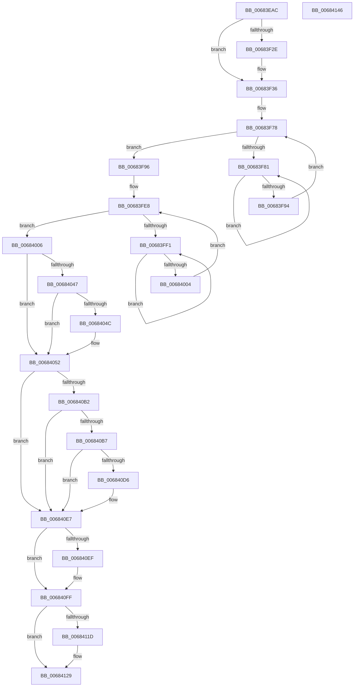

# MmMapDriverTablePage

- RVA: `0x00683EAC`–`0x00684147` (길이 `667` bytes)
- VA: `0x0000000140683EAC`
- 실행 섹션: `.text`
- PDB 이름 있음: `예`; PDB Function 태그: `아니요`
- unwind 정보 RVA: `0x0006F230`
- 디코드: `173`개 명령, `667/667` bytes 표시
- 미해석 바이트: `0` (있으면 어셈블리에 `.byte`로 보존)

> 이 문서는 커널 이미지의 기계어와 PDB 기호를 분석해 생성했습니다. 4번과 5번은 함수 원형과 자료형을 바이너리 사용 방식에서 추정한 C 해석이며 원본 소스 복구 결과는 아닙니다.

## 1. Dependencies

- 직접 호출 지점: **18**; 고유 호출 대상: **17**
- 직접 호출자로 확인된 함수: **1**
- RIP 상대 이미지 참조: **3**

### Outgoing calls
- `0x00683EE4` → [MiGetAnyMultiplexedVm](../44/MiGetAnyMultiplexedVm_function_00448BD0.md) (function, `0x00448BD0`)
- `0x00683F31` → [KiRaiseIrqlProcessIrqlFlags](../4F/KiRaiseIrqlProcessIrqlFlags_function_004F56FC.md) (function, `0x004F56FC`)
- `0x00683F39` → [MiLockWorkingSetSharedAtDpc](../23/MiLockWorkingSetSharedAtDpc_function_00239574.md) (function, `0x00239574`)
- `0x00683F44` → [MiLockNestedPageTable](../23/MiLockNestedPageTable_function_0023E890.md) (function, `0x0023E890`)
- `0x00683F4C` → [MI_READ_PTE_LOCK_FREE](../28/MI_READ_PTE_LOCK_FREE_function_002828A0.md) (function, `0x002828A0`)
- `0x00683F86` → [KeYieldProcessorEx](../3F/KeYieldProcessorEx_function_003FBD00.md) (function, `0x003FBD00`)
- `0x00683FB0` → [MiSetPfnModified](../36/MiSetPfnModified_function_00362960.md) (function, `0x00362960`)
- `0x00683FB8` → [MiGetContainingPageTable](../34/MiGetContainingPageTable_function_003467F0.md) (function, `0x003467F0`)
- `0x00683FC6` → [MiSetPfnContainingFrame](../36/MiSetPfnContainingFrame_function_00363FC0.md) (function, `0x00363FC0`)
- `0x00683FF6` → [KeYieldProcessorEx](../3F/KeYieldProcessorEx_function_003FBD00.md) (function, `0x003FBD00`)
- `0x0068405A` → [MiMakeDemandZeroPte](../33/MiMakeDemandZeroPte_function_00337A00.md) (function, `0x00337A00`)
- `0x0068406A` → [MiUpdatePageFileHighInPte](../36/MiUpdatePageFileHighInPte_function_0036D840.md) (function, `0x0036D840`)
- `0x0068409F` → [MiMakeValidPte](../2C/MiMakeValidPte_function_002C5590.md) (function, `0x002C5590`)
- `0x006840E2` → [MiCheckLinearProtectedPteAccessedBit](../29/MiCheckLinearProtectedPteAccessedBit_function_00292D80.md) (function, `0x00292D80`)
- `0x006840FA` → [MiIncreaseUsedPtes](../24/MiIncreaseUsedPtes_function_00243630.md) (function, `0x00243630`)
- `0x00684105` → [MiUnlockPageTable](../21/MiUnlockPageTable_function_00216EC0.md) (function, `0x00216EC0`)
- `0x0068410F` → [MiUnlockWorkingSetShared](../27/MiUnlockWorkingSetShared_function_0027D690.md) (function, `0x0027D690`)
- `0x00684124` → [KiLowerIrqlProcessIrqlFlags](../4F/KiLowerIrqlProcessIrqlFlags_function_004F5698.md) (function, `0x004F5698`)

### Direct callers
- [sub_006F88AE](../6F/Unknown_function_006F88AE.md) at `0x006F8D4D`

### Static image references
- `0x00683F25` → RVA `0x00FC6D20` (`ALMOSTRO`; read)
- `0x00684037` → RVA `0x00E2DC80` (`.data`; read)
- `0x006840A4` → RVA `0x00FC6A88` (`ALMOSTRO`; read)

## 2. Other-region calls and transfers

- 다른 실행 섹션으로 향하는 call: **0**
- 별도 외부 분기/꼬리 이동을 확인하지 못했습니다.

## 3. Assembly (complete function range)

```asm
00683EAC  48 89 5C 24 10                  mov qword ptr [rsp + 0x10], rbx
00683EB1  4C 89 44 24 18                  mov qword ptr [rsp + 0x18], r8
00683EB6  55                              push rbp
00683EB7  56                              push rsi
00683EB8  57                              push rdi
00683EB9  41 54                           push r12
00683EBB  41 55                           push r13
00683EBD  41 56                           push r14
00683EBF  41 57                           push r15
00683EC1  48 83 EC 20                     sub rsp, 0x20
00683EC5  BB 01 00 00 00                  mov ebx, 1
00683ECA  4C 8B F1                        mov r14, rcx
00683ECD  8B C3                           mov eax, ebx
00683ECF  4C 8B EA                        mov r13, rdx
00683ED2  8D 4B 02                        lea ecx, [rbx + 2]
00683ED5  8D 53 01                        lea edx, [rbx + 1]
00683ED8  44 3B CA                        cmp r9d, edx
00683EDB  0F 45 C1                        cmovne eax, ecx
00683EDE  8B CB                           mov ecx, ebx
00683EE0  89 44 24 78                     mov dword ptr [rsp + 0x78], eax
00683EE4  E8 E7 4C DC FF                  call 0x140448bd0
00683EE9  4C 8B E0                        mov r12, rax
00683EEC  49 C1 EE 09                     shr r14, 9
00683EF0  48 B8 F8 FF FF FF 7F 00 00 00   movabs rax, 0x7ffffffff8
00683EFA  49 B8 00 00 00 00 80 F6 FF FF   movabs r8, 0xfffff68000000000
00683F04  4C 23 F0                        and r14, rax
00683F07  49 8B C8                        mov rcx, r8
00683F0A  4C 03 F1                        add r14, rcx
00683F0D  49 8B EE                        mov rbp, r14
00683F10  48 C1 ED 09                     shr rbp, 9
00683F14  48 23 E8                        and rbp, rax
00683F17  49 8B C0                        mov rax, r8
00683F1A  48 03 E8                        add rbp, rax
00683F1D  45 0F 20 C7                     mov r15, cr8
00683F21  44 0F 22 C2                     mov cr8, rdx
00683F25  83 3D F4 2D 94 00 00            cmp dword ptr [rip + 0x942df4], 0
00683F2C  74 08                           je 0x140683f36
00683F2E  41 8A CF                        mov cl, r15b
00683F31  E8 C6 17 E7 FF                  call 0x1404f56fc
00683F36  49 8B CC                        mov rcx, r12
00683F39  E8 36 56 BB FF                  call 0x140239574
00683F3E  48 8B D5                        mov rdx, rbp
00683F41  49 8B CC                        mov rcx, r12
00683F44  E8 47 A9 BB FF                  call 0x14023e890
00683F49  49 8B CE                        mov rcx, r14
00683F4C  E8 4F E9 BF FF                  call 0x1402828a0
00683F51  4A 8D 34 6D 00 00 00 00         lea rsi, [r13*2]
00683F59  48 8B F8                        mov rdi, rax
00683F5C  49 03 F5                        add rsi, r13
00683F5F  48 B8 00 00 00 00 00 DE FF FF   movabs rax, 0xffffde0000000000
00683F69  48 C1 E6 04                     shl rsi, 4
00683F6D  48 8B C0                        mov rax, rax
00683F70  48 03 F0                        add rsi, rax
00683F73  83 64 24 70 00                  and dword ptr [rsp + 0x70], 0
00683F78  F0 48 0F BA 6E 18 3F            lock bts qword ptr [rsi + 0x18], 0x3f
00683F7F  73 15                           jae 0x140683f96
00683F81  48 8D 4C 24 70                  lea rcx, [rsp + 0x70]
00683F86  E8 75 7D D7 FF                  call 0x1403fbd00
00683F8B  48 8B 46 18                     mov rax, qword ptr [rsi + 0x18]
00683F8F  48 85 C0                        test rax, rax
00683F92  78 ED                           js 0x140683f81
00683F94  EB E2                           jmp 0x140683f78
00683F96  48 8B 46 18                     mov rax, qword ptr [rsi + 0x18]
00683F9A  48 B9 FF FF FF FF FF FF FF BF   movabs rcx, 0xbfffffffffffffff
00683FA4  48 23 C1                        and rax, rcx
00683FA7  8B D3                           mov edx, ebx
00683FA9  48 8B CE                        mov rcx, rsi
00683FAC  48 89 46 18                     mov qword ptr [rsi + 0x18], rax
00683FB0  E8 AB E9 CD FF                  call 0x140362960
00683FB5  49 8B CE                        mov rcx, r14
00683FB8  E8 33 28 CC FF                  call 0x1403467f0
00683FBD  48 8B D0                        mov rdx, rax
00683FC0  48 8B CE                        mov rcx, rsi
00683FC3  48 8B D8                        mov rbx, rax
00683FC6  E8 F5 FF CD FF                  call 0x140363fc0
00683FCB  48 8D 1C 5B                     lea rbx, [rbx + rbx*2]
00683FCF  48 B8 00 00 00 00 00 DE FF FF   movabs rax, 0xffffde0000000000
00683FD9  48 C1 E3 04                     shl rbx, 4
00683FDD  48 8B C0                        mov rax, rax
00683FE0  48 03 D8                        add rbx, rax
00683FE3  83 64 24 60 00                  and dword ptr [rsp + 0x60], 0
00683FE8  F0 48 0F BA 6B 18 3F            lock bts qword ptr [rbx + 0x18], 0x3f
00683FEF  73 15                           jae 0x140684006
00683FF1  48 8D 4C 24 60                  lea rcx, [rsp + 0x60]
00683FF6  E8 05 7D D7 FF                  call 0x1403fbd00
00683FFB  48 8B 43 18                     mov rax, qword ptr [rbx + 0x18]
00683FFF  48 85 C0                        test rax, rax
00684002  78 ED                           js 0x140683ff1
00684004  EB E2                           jmp 0x140683fe8
00684006  48 8B 43 18                     mov rax, qword ptr [rbx + 0x18]
0068400A  49 B9 FF FF FF FF FF FF FF 7F   movabs r9, 0x7fffffffffffffff
00684014  48 8D 48 01                     lea rcx, [rax + 1]
00684018  48 8B D1                        mov rdx, rcx
0068401B  48 33 D0                        xor rdx, rax
0068401E  48 B8 00 00 00 00 00 00 00 C0   movabs rax, 0xc000000000000000
00684028  48 23 D0                        and rdx, rax
0068402B  48 33 D1                        xor rdx, rcx
0068402E  48 89 53 18                     mov qword ptr [rbx + 0x18], rdx
00684032  F0 4C 21 4B 18                  lock and qword ptr [rbx + 0x18], r9
00684037  48 8B 05 42 9C 7A 00            mov rax, qword ptr [rip + 0x7a9c42]
0068403E  48 8B 56 10                     mov rdx, qword ptr [rsi + 0x10]
00684042  48 85 C0                        test rax, rax
00684045  74 0B                           je 0x140684052
00684047  F6 C2 10                        test dl, 0x10
0068404A  75 06                           jne 0x140684052
0068404C  48 F7 D0                        not rax
0068404F  48 23 D0                        and rdx, rax
00684052  44 8B 44 24 78                  mov r8d, dword ptr [rsp + 0x78]
00684057  41 8B C8                        mov ecx, r8d
0068405A  E8 A1 39 CB FF                  call 0x140337a00
0068405F  48 8B C8                        mov rcx, rax
00684062  48 C1 EA 20                     shr rdx, 0x20
00684066  48 89 46 10                     mov qword ptr [rsi + 0x10], rax
0068406A  E8 D1 97 CE FF                  call 0x14036d840
0068406F  48 89 46 10                     mov qword ptr [rsi + 0x10], rax
00684073  4C 89 76 08                     mov qword ptr [rsi + 8], r14
00684077  8B 46 20                        mov eax, dword ptr [rsi + 0x20]
0068407A  89 44 24 78                     mov dword ptr [rsp + 0x78], eax
0068407E  B8 01 00 00 00                  mov eax, 1
00684083  66 01 44 24 78                  add word ptr [rsp + 0x78], ax
00684088  8B 44 24 78                     mov eax, dword ptr [rsp + 0x78]
0068408C  89 46 20                        mov dword ptr [rsi + 0x20], eax
0068408F  F0 4C 21 4E 18                  lock and qword ptr [rsi + 0x18], r9
00684094  41 0F BA E8 1D                  bts r8d, 0x1d
00684099  49 8B D5                        mov rdx, r13
0068409C  49 8B CE                        mov rcx, r14
0068409F  E8 EC 14 C4 FF                  call 0x1402c5590
006840A4  48 0F BA 25 DB 29 94 00 24      bt qword ptr [rip + 0x9429db], 0x24
006840AD  48 8B D8                        mov rbx, rax
006840B0  73 35                           jae 0x1406840e7
006840B2  F6 C3 20                        test bl, 0x20
006840B5  75 30                           jne 0x1406840e7
006840B7  48 B8 00 00 00 00 80 F6 FF FF   movabs rax, 0xfffff68000000000
006840C1  48 8B C0                        mov rax, rax
006840C4  48 B9 00 00 00 00 40 00 00 00   movabs rcx, 0x4000000000
006840CE  48 03 C1                        add rax, rcx
006840D1  4C 3B F0                        cmp r14, rax
006840D4  72 11                           jb 0x1406840e7
006840D6  41 B8 80 00 00 00               mov r8d, 0x80
006840DC  48 8B D3                        mov rdx, rbx
006840DF  49 8B CE                        mov rcx, r14
006840E2  E8 99 EC C0 FF                  call 0x140292d80
006840E7  49 89 1E                        mov qword ptr [r14], rbx
006840EA  48 85 FF                        test rdi, rdi
006840ED  75 10                           jne 0x1406840ff
006840EF  44 8D 4F 02                     lea r9d, [rdi + 2]
006840F3  48 8B D5                        mov rdx, rbp
006840F6  44 8D 47 01                     lea r8d, [rdi + 1]
006840FA  E8 31 F5 BB FF                  call 0x140243630
006840FF  48 8B D5                        mov rdx, rbp
00684102  49 8B CC                        mov rcx, r12
00684105  E8 B6 2D B9 FF                  call 0x140216ec0
0068410A  B2 11                           mov dl, 0x11
0068410C  49 8B CC                        mov rcx, r12
0068410F  E8 7C 95 BF FF                  call 0x14027d690
00684114  83 3D 05 2C 94 00 00            cmp dword ptr [rip + 0x942c05], 0
0068411B  74 0C                           je 0x140684129
0068411D  44 0F 20 C1                     mov rcx, cr8
00684121  41 8A D7                        mov dl, r15b
00684124  E8 6F 15 E7 FF                  call 0x1404f5698
00684129  41 0F B6 C7                     movzx eax, r15b
0068412D  44 0F 22 C0                     mov cr8, rax
00684131  48 8B 5C 24 68                  mov rbx, qword ptr [rsp + 0x68]
00684136  48 83 C4 20                     add rsp, 0x20
0068413A  41 5F                           pop r15
0068413C  41 5E                           pop r14
0068413E  41 5D                           pop r13
00684140  41 5C                           pop r12
00684142  5F                              pop rdi
00684143  5E                              pop rsi
00684144  5D                              pop rbp
00684145  C3                              ret
00684146  CC                              int3
```

## 4. C-style interpretation (structured pseudocode)

```c
__int64 __fastcall MmMapDriverTablePage(__int64 a1, __int64 a2, __int64 a3, int a4)
{
    __int64 result;
    __int64 v_r14;
    __int64 v_rbp;
    __int64 v_rbx;
    __int64 v_rsi;
    __int64 v_rsp;
    unsigned __int64 v_stack_p10;
    unsigned __int64 v_stack_p18;
    unsigned int v_stack_p20;
    unsigned int v_stack_p8;

    v_stack_p10 = v_rbx;
    v_stack_p18 = a3;
    v_rsp = (v_rsp) - (32);
    result = 1;
    if (a4 != ((unsigned int)(1 + 1))) { result = (unsigned int)(1 + 2); }
    v_stack_p20 = (unsigned int)(result);
    result = MiGetAnyMultiplexedVm(1, 1 + 1, a3, a4);
    v_r14 = (a1) >> (9);
    v_r14 = (v_r14) & (result);
    v_r14 = (v_r14) + (a3);
    v_rbp = (v_r14) >> (9);
    v_rbp = (v_rbp) & (result);
    v_rbp = (v_rbp) + (a3);
    result = a3;
    if ((*(unsigned int *)(v_rip + 9711092)) != 0) {
        a1 = (unsigned __int8)(v_cr8);
        result = KiRaiseIrqlProcessIrqlFlags(a1, 1 + 1, a3, a4);
    }
    result = MiLockWorkingSetSharedAtDpc(result, 1 + 1, a3, a4);
    result = MiLockNestedPageTable(result, v_rbp, a3, a4);
    result = MI_READ_PTE_LOCK_FREE(v_r14, v_rbp, a3, a4);
    v_rsi = (a2 * 2) + (a2);
    v_rsi = (v_rsi) << (4);
    v_rsi = (v_rsi) + (result);
loc_00683F78:
    if (condition_is_above_or_equal) goto loc_00683F96;
loc_00683F81:
    result = KeYieldProcessorEx(v_stack_p18, v_rbp, a3, a4);
    if (sign_flag) goto loc_00683F81;
    goto loc_00683F78;
loc_00683F96:
    result = (*(unsigned __int64 *)(v_rsi + 24)) & (v_stack_p18);
    *(unsigned __int64 *)(v_rsi + 24) = result;
    result = MiSetPfnModified(v_rsi, 1, a3, a4);
    result = MiGetContainingPageTable(v_r14, 1, a3, a4);
    result = MiSetPfnContainingFrame(v_rsi, result, a3, a4);
    v_rbx = (result + result * 2) << (4);
    v_rbx = (v_rbx) + (result);
loc_00683FE8:
    if (condition_is_above_or_equal) goto loc_00684006;
loc_00683FF1:
    result = KeYieldProcessorEx(v_stack_p8, result, a3, a4);
    if (sign_flag) goto loc_00683FF1;
    goto loc_00683FE8;
loc_00684006:
    a2 = (*(unsigned __int64 *)(v_rbx + 24) + 1) ^ (*(unsigned __int64 *)(v_rbx + 24));
    a2 = (a2) & (*(unsigned __int64 *)(v_rbx + 24));
    a2 = (a2) ^ (*(unsigned __int64 *)(v_rbx + 24) + 1);
    *(unsigned __int64 *)(v_rbx + 24) = a2;
    if (*(unsigned __int64 *)(v_rip + 8035394) == 0) goto loc_00684052;
    result = *(unsigned __int64 *)(v_rip + 8035394);
    if ((((unsigned __int8)(*(unsigned __int64 *)(v_rsi + 16))) & (16)) == 0) {
        result = ~(*(unsigned __int64 *)(v_rip + 8035394));
        a2 = (*(unsigned __int64 *)(v_rsi + 16)) & (result);
    }
    result = MiMakeDemandZeroPte((unsigned int)((unsigned int)((unsigned int)(v_stack_p20))), a2, (unsigned int)(v_stack_p20), a4);
    a2 = (a2) >> (32);
    *(unsigned __int64 *)(v_rsi + 16) = result;
    result = MiUpdatePageFileHighInPte(result, a2, (unsigned int)(v_stack_p20), a4);
    *(unsigned __int64 *)(v_rsi + 16) = result;
    *(unsigned __int64 *)(v_rsi + 8) = v_r14;
    v_stack_p20 = (unsigned int)((unsigned int)(*(unsigned int *)(v_rsi + 32)));
    *(unsigned int *)(v_rsi + 32) = (unsigned int)((unsigned int)(v_stack_p20));
    result = MiMakeValidPte(v_r14, a2, (unsigned int)(v_stack_p20), a4);
    if (condition_is_above_or_equal) goto loc_006840E7;
    if ((((unsigned __int8)(result)) & (32)) != 0) goto loc_006840E7;
    result = (result) + (v_r14);
    if (v_r14 >= result) {
        a3 = 128;
        a2 = result;
        a1 = v_r14;
        result = MiCheckLinearProtectedPteAccessedBit(a1, a2, a3, a4);
    }
    *(unsigned __int64 *)(v_r14) = result;
    if (result == 0) {
        a4 = result + 2;
        a2 = v_rbp;
        a3 = result + 1;
        result = MiIncreaseUsedPtes(a1, a2, a3, a4);
    }
    result = MiUnlockPageTable(result, v_rbp, a3, a4);
    result = MiUnlockWorkingSetShared(result, 17, a3, a4);
    if ((*(unsigned int *)(v_rip + 9710597)) != 0) {
        a1 = 1 + 1;
        a2 = (unsigned __int8)(v_cr8);
        result = KiLowerIrqlProcessIrqlFlags(a1, a2, a3, a4);
    }
    v_rsp = (v_rsp) + (32);
    return (unsigned __int8)(v_cr8);
}
```

## 5. (Beta) C Style

```c
int64_t MmMapDriverTablePage(int64_t Arg1, int64_t Arg2, int64_t Arg3, int32_t Arg4)
{
    int64_t result;
    int64_t local_r14;
    int64_t local_rbp;
    int64_t local_rbx;
    int64_t local_rsi;
    int64_t local_rsp;
    uint64_t v_stack_p10;
    uint64_t v_stack_p18;
    uint32_t v_stack_p20;
    uint32_t v_stack_p8;

    v_stack_p10 = local_rbx;
    v_stack_p18 = Arg3;
    local_rsp = (local_rsp) - (32);
    result = 1;
    if (Arg4 != ((uint32_t)(1 + 1))) { result = (uint32_t)(1 + 2); }
    v_stack_p20 = (uint32_t)(result);
    result = MiGetAnyMultiplexedVm(1, 1 + 1, Arg3, Arg4);
    local_r14 = (Arg1) >> (9);
    local_r14 = (local_r14) & (result);
    local_r14 = (local_r14) + (Arg3);
    local_rbp = (local_r14) >> (9);
    local_rbp = (local_rbp) & (result);
    local_rbp = (local_rbp) + (Arg3);
    result = Arg3;
    if ((*(uint32_t *)(v_rip + 0x942DF4)) != 0) {
        Arg1 = (uint8_t)(v_cr8);
        result = KiRaiseIrqlProcessIrqlFlags(Arg1, 1 + 1, Arg3, Arg4);
    }
    result = MiLockWorkingSetSharedAtDpc(result, 1 + 1, Arg3, Arg4);
    result = MiLockNestedPageTable(result, local_rbp, Arg3, Arg4);
    result = MI_READ_PTE_LOCK_FREE(local_r14, local_rbp, Arg3, Arg4);
    local_rsi = (Arg2 * 2) + (Arg2);
    local_rsi = (local_rsi) << (4);
    local_rsi = (local_rsi) + (result);
loc_00683F78:
    if (condition_is_above_or_equal) goto loc_00683F96;
loc_00683F81:
    result = KeYieldProcessorEx(v_stack_p18, local_rbp, Arg3, Arg4);
    if (sign_flag) goto loc_00683F81;
    goto loc_00683F78;
loc_00683F96:
    result = (*(uint64_t *)(local_rsi + 0x18)) & (v_stack_p18);
    *(uint64_t *)(local_rsi + 0x18) = result;
    result = MiSetPfnModified(local_rsi, 1, Arg3, Arg4);
    result = MiGetContainingPageTable(local_r14, 1, Arg3, Arg4);
    result = MiSetPfnContainingFrame(local_rsi, result, Arg3, Arg4);
    local_rbx = (result + result * 2) << (4);
    local_rbx = (local_rbx) + (result);
loc_00683FE8:
    if (condition_is_above_or_equal) goto loc_00684006;
loc_00683FF1:
    result = KeYieldProcessorEx(v_stack_p8, result, Arg3, Arg4);
    if (sign_flag) goto loc_00683FF1;
    goto loc_00683FE8;
loc_00684006:
    Arg2 = (*(uint64_t *)(local_rbx + 0x18) + 1) ^ (*(uint64_t *)(local_rbx + 0x18));
    Arg2 = (Arg2) & (*(uint64_t *)(local_rbx + 0x18));
    Arg2 = (Arg2) ^ (*(uint64_t *)(local_rbx + 0x18) + 1);
    *(uint64_t *)(local_rbx + 0x18) = Arg2;
    if (*(uint64_t *)(v_rip + 0x7A9C42) == 0) goto loc_00684052;
    result = *(uint64_t *)(v_rip + 0x7A9C42);
    if ((((uint8_t)(*(uint64_t *)(local_rsi + 0x10))) & (16)) == 0) {
        result = ~(*(uint64_t *)(v_rip + 0x7A9C42));
        Arg2 = (*(uint64_t *)(local_rsi + 0x10)) & (result);
    }
    result = MiMakeDemandZeroPte((uint32_t)((uint32_t)((uint32_t)(v_stack_p20))), Arg2, (uint32_t)(v_stack_p20), Arg4);
    Arg2 = (Arg2) >> (32);
    *(uint64_t *)(local_rsi + 0x10) = result;
    result = MiUpdatePageFileHighInPte(result, Arg2, (uint32_t)(v_stack_p20), Arg4);
    *(uint64_t *)(local_rsi + 0x10) = result;
    *(uint64_t *)(local_rsi + 0x8) = local_r14;
    v_stack_p20 = (uint32_t)((uint32_t)(*(uint32_t *)(local_rsi + 0x20)));
    *(uint32_t *)(local_rsi + 0x20) = (uint32_t)((uint32_t)(v_stack_p20));
    result = MiMakeValidPte(local_r14, Arg2, (uint32_t)(v_stack_p20), Arg4);
    if (condition_is_above_or_equal) goto loc_006840E7;
    if ((((uint8_t)(result)) & (32)) != 0) goto loc_006840E7;
    result = (result) + (local_r14);
    if (local_r14 >= result) {
        Arg3 = 128;
        Arg2 = result;
        Arg1 = local_r14;
        result = MiCheckLinearProtectedPteAccessedBit(Arg1, Arg2, Arg3, Arg4);
    }
    *(uint64_t *)(local_r14) = result;
    if (result == 0) {
        Arg4 = result + 2;
        Arg2 = local_rbp;
        Arg3 = result + 1;
        result = MiIncreaseUsedPtes(Arg1, Arg2, Arg3, Arg4);
    }
    result = MiUnlockPageTable(result, local_rbp, Arg3, Arg4);
    result = MiUnlockWorkingSetShared(result, 17, Arg3, Arg4);
    if ((*(uint32_t *)(v_rip + 0x942C05)) != 0) {
        Arg1 = 1 + 1;
        Arg2 = (uint8_t)(v_cr8);
        result = KiLowerIrqlProcessIrqlFlags(Arg1, Arg2, Arg3, Arg4);
    }
    local_rsp = (local_rsp) + (32);
    return (uint8_t)(v_cr8);
}
```

## 6. Execution-region graph

[열기: 2D/3D 그래프와 함수 탐색 컨트롤 패널](../../../control-panel.html?section=text&rva=0x00683EAC&view=graph)

- 2D 그래프는 위에서 아래로 흐르고, 3D 그래프는 빈 공간을 드래그해 회전합니다. Shift+드래그는 이동, 휠은 확대·축소, 함수 노드 선택은 대상 보고서 이동입니다.

### Static fallback


