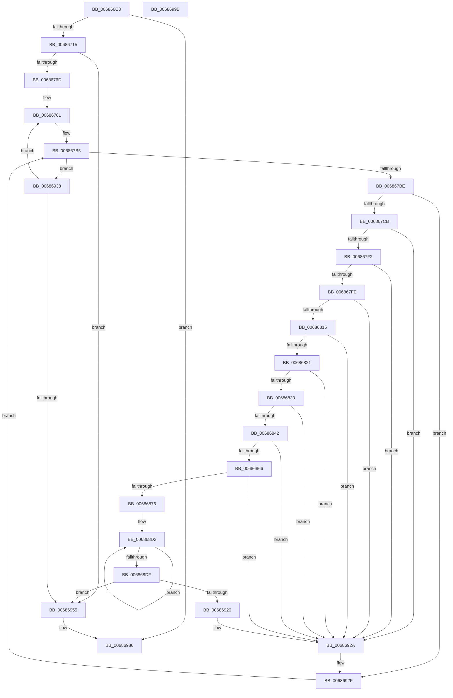

# MmReadProcessPageTables

- RVA: `0x006866C8`–`0x0068699C` (길이 `724` bytes)
- VA: `0x00000001406866C8`
- 실행 섹션: `.text`
- PDB 이름 있음: `예`; PDB Function 태그: `아니요`
- unwind 정보 RVA: `0x00068D9C`
- 디코드: `171`개 명령, `724/724` bytes 표시
- 미해석 바이트: `0` (있으면 어셈블리에 `.byte`로 보존)

> 이 문서는 커널 이미지의 기계어와 PDB 기호를 분석해 생성했습니다. 4번과 5번은 함수 원형과 자료형을 바이너리 사용 방식에서 추정한 C 해석이며 원본 소스 복구 결과는 아닙니다.

## 1. Dependencies

- 직접 호출 지점: **6**; 고유 호출 대상: **4**
- 직접 호출자로 확인된 함수: **1**
- RIP 상대 이미지 참조: **4**

### Outgoing calls
- `0x006866EB` → [MiMakeValidPte](../2C/MiMakeValidPte_function_002C5590.md) (function, `0x002C5590`)
- `0x00686705` → [ExTryAcquireSpinLockSharedAtDpcLevel](../41/ExTryAcquireSpinLockSharedAtDpcLevel_function_00410A80.md) (function, `0x00410A80`)
- `0x00686758` → [MiFlushSingleTbEntry](../28/MiFlushSingleTbEntry_function_0028E730.md) (function, `0x0028E730`)
- `0x006868C5` → [MiFlushSingleTbEntry](../28/MiFlushSingleTbEntry_function_0028E730.md) (function, `0x0028E730`)
- `0x00686970` → [MiFlushSingleTbEntry](../28/MiFlushSingleTbEntry_function_0028E730.md) (function, `0x0028E730`)
- `0x0068697C` → [ExReleaseSpinLockSharedFromDpcLevel](../24/ExReleaseSpinLockSharedFromDpcLevel_function_0024A590.md) (function, `0x0024A590`)

### Direct callers
- [KiMonitorCacheErrata](../5C/KiMonitorCacheErrata_function_005C4E90.md) at `0x005C4F97`

### Static image references
- `0x006866FE` → RVA `0x00E38DC8` (`.data`; read)
- `0x00686730` → RVA `0x00010880` (`.rdata`; read)
- `0x0068675D` → RVA `0x00FC6B88` (`ALMOSTRO`; read)
- `0x006868DF` → RVA `0x00FC6D28` (`ALMOSTRO`; read)

## 2. Other-region calls and transfers

- 다른 실행 섹션으로 향하는 call: **0**
- 별도 외부 분기/꼬리 이동을 확인하지 못했습니다.

## 3. Assembly (complete function range)

```asm
006866C8  48 89 5C 24 18                  mov qword ptr [rsp + 0x18], rbx
006866CD  48 89 4C 24 08                  mov qword ptr [rsp + 8], rcx
006866D2  55                              push rbp
006866D3  56                              push rsi
006866D4  57                              push rdi
006866D5  41 54                           push r12
006866D7  41 55                           push r13
006866D9  41 56                           push r14
006866DB  41 57                           push r15
006866DD  48 83 EC 20                     sub rsp, 0x20
006866E1  33 D2                           xor edx, edx
006866E3  33 C9                           xor ecx, ecx
006866E5  41 B8 04 00 00 A0               mov r8d, 0xa0000004
006866EB  E8 A0 EE C3 FF                  call 0x1402c5590
006866F0  65 4C 8B 2C 25 20 00 00 00      mov r13, qword ptr gs:[0x20]
006866F9  48 8B F8                        mov rdi, rax
006866FC  0F 09                           wbinvd
006866FE  48 8D 0D C3 26 7B 00            lea rcx, [rip + 0x7b26c3]
00686705  E8 76 A3 D8 FF                  call 0x140410a80
0068670A  45 33 F6                        xor r14d, r14d
0068670D  85 C0                           test eax, eax
0068670F  0F 84 71 02 00 00               je 0x140686986
00686715  49 8B 85 38 88 00 00            mov rax, qword ptr [r13 + 0x8838]
0068671C  4C 8B B8 50 01 00 00            mov r15, qword ptr [rax + 0x150]
00686723  48 B8 00 00 00 00 80 F6 FF FF   movabs rax, 0xfffff68000000000
0068672D  4C 8B E0                        mov r12, rax
00686730  48 8B 1D 49 A1 98 FF            mov rbx, qword ptr [rip - 0x675eb7]
00686737  49 8B EF                        mov rbp, r15
0068673A  49 87 1F                        xchg qword ptr [r15], rbx
0068673D  48 C1 E5 19                     shl rbp, 0x19
00686741  41 B8 01 00 00 00               mov r8d, 1
00686747  49 C1 E4 19                     shl r12, 0x19
0068674B  83 CA FF                        or edx, 0xffffffff
0068674E  49 2B EC                        sub rbp, r12
00686751  48 C1 FD 10                     sar rbp, 0x10
00686755  48 8B CD                        mov rcx, rbp
00686758  E8 D3 7F C0 FF                  call 0x14028e730
0068675D  48 8B 15 24 04 94 00            mov rdx, qword ptr [rip + 0x940424]
00686764  44 39 32                        cmp dword ptr [rdx], r14d
00686767  0F 86 E8 01 00 00               jbe 0x140686955
0068676D  49 B9 00 00 00 00 00 DE FF FF   movabs r9, 0xffffde0000000000
00686777  49 B8 FF FF FF FF FF F6 FF FF   movabs r8, 0xfffff6ffffffffff
00686781  41 8B C6                        mov eax, r14d
00686784  48 03 C0                        add rax, rax
00686787  48 8B 4C C2 10                  mov rcx, qword ptr [rdx + rax*8 + 0x10]
0068678C  48 8B 54 C2 18                  mov rdx, qword ptr [rdx + rax*8 + 0x18]
00686791  48 03 D1                        add rdx, rcx
00686794  48 8D 34 49                     lea rsi, [rcx + rcx*2]
00686798  48 C1 E6 04                     shl rsi, 4
0068679C  49 8B C1                        mov rax, r9
0068679F  48 8D 0C 52                     lea rcx, [rdx + rdx*2]
006867A3  48 03 F0                        add rsi, rax
006867A6  48 C1 E1 04                     shl rcx, 4
006867AA  49 8B C1                        mov rax, r9
006867AD  48 03 C8                        add rcx, rax
006867B0  48 89 4C 24 68                  mov qword ptr [rsp + 0x68], rcx
006867B5  48 3B F1                        cmp rsi, rcx
006867B8  0F 83 7A 01 00 00               jae 0x140686938
006867BE  8A 46 22                        mov al, byte ptr [rsi + 0x22]
006867C1  24 07                           and al, 7
006867C3  3C 06                           cmp al, 6
006867C5  0F 85 64 01 00 00               jne 0x14068692f
006867CB  48 8B 4E 08                     mov rcx, qword ptr [rsi + 8]
006867CF  48 B8 00 00 00 00 00 00 00 80   movabs rax, 0x8000000000000000
006867D9  48 0B C8                        or rcx, rax
006867DC  48 BA 00 00 00 00 80 F6 FF FF   movabs rdx, 0xfffff68000000000
006867E6  48 8B C2                        mov rax, rdx
006867E9  48 3B C8                        cmp rcx, rax
006867EC  0F 82 38 01 00 00               jb 0x14068692a
006867F2  49 8B C0                        mov rax, r8
006867F5  48 3B C8                        cmp rcx, rax
006867F8  0F 87 2C 01 00 00               ja 0x14068692a
006867FE  48 C1 E1 19                     shl rcx, 0x19
00686802  49 2B CC                        sub rcx, r12
00686805  48 C1 F9 10                     sar rcx, 0x10
00686809  48 8B C2                        mov rax, rdx
0068680C  48 3B C8                        cmp rcx, rax
0068680F  0F 82 15 01 00 00               jb 0x14068692a
00686815  49 8B C0                        mov rax, r8
00686818  48 3B C8                        cmp rcx, rax
0068681B  0F 87 09 01 00 00               ja 0x14068692a
00686821  48 8B 46 28                     mov rax, qword ptr [rsi + 0x28]
00686825  48 C1 E8 3C                     shr rax, 0x3c
00686829  24 07                           and al, 7
0068682B  3C 01                           cmp al, 1
0068682D  0F 84 F7 00 00 00               je 0x14068692a
00686833  48 8B 46 28                     mov rax, qword ptr [rsi + 0x28]
00686837  48 0F BA E0 28                  bt rax, 0x28
0068683C  0F 82 E8 00 00 00               jb 0x14068692a
00686842  48 8B 46 28                     mov rax, qword ptr [rsi + 0x28]
00686846  48 B9 FF FF FF FF FF 00 00 00   movabs rcx, 0xffffffffff
00686850  48 23 C1                        and rax, rcx
00686853  48 B9 FE FF FF FF 3F 00 00 00   movabs rcx, 0x3ffffffffe
0068685D  48 3B C1                        cmp rax, rcx
00686860  0F 84 C4 00 00 00               je 0x14068692a
00686866  8B 46 20                        mov eax, dword ptr [rsi + 0x20]
00686869  C1 E8 10                        shr eax, 0x10
0068686C  24 C0                           and al, 0xc0
0068686E  3C 40                           cmp al, 0x40
00686870  0F 85 B4 00 00 00               jne 0x14068692a
00686876  48 B9 28 00 00 00 00 DE FF FF   movabs rcx, 0xffffde0000000028
00686880  48 8B C6                        mov rax, rsi
00686883  41 B8 80 00 00 00               mov r8d, 0x80
00686889  48 2B C1                        sub rax, rcx
0068688C  83 CA FF                        or edx, 0xffffffff
0068688F  48 83 C0 28                     add rax, 0x28
00686893  48 B9 AB AA AA AA AA AA AA AA   movabs rcx, 0xaaaaaaaaaaaaaaab
0068689D  48 C1 F8 04                     sar rax, 4
006868A1  48 0F AF C1                     imul rax, rcx
006868A5  48 B9 FF 0F 00 00 00 00 F0 FF   movabs rcx, 0xfff0000000000fff
006868AF  48 C1 E0 0C                     shl rax, 0xc
006868B3  48 33 F8                        xor rdi, rax
006868B6  48 23 F9                        and rdi, rcx
006868B9  48 8B CD                        mov rcx, rbp
006868BC  48 33 F8                        xor rdi, rax
006868BF  48 8B C7                        mov rax, rdi
006868C2  49 87 07                        xchg qword ptr [r15], rax
006868C5  E8 66 7E C0 FF                  call 0x14028e730
006868CA  48 8B CD                        mov rcx, rbp
006868CD  BA 40 00 00 00                  mov edx, 0x40
006868D2  48 8B 01                        mov rax, qword ptr [rcx]
006868D5  48 8D 49 40                     lea rcx, [rcx + 0x40]
006868D9  48 83 EA 01                     sub rdx, 1
006868DD  75 F3                           jne 0x1406868d2
006868DF  48 8B 15 42 04 94 00            mov rdx, qword ptr [rip + 0x940442]
006868E6  48 83 C8 FF                     or rax, 0xffffffffffffffff
006868EA  41 8B 4D 24                     mov ecx, dword ptr [r13 + 0x24]
006868EE  48 83 C1 27                     add rcx, 0x27
006868F2  41 C7 85 A0 83 00 00 01 00 00 00  mov dword ptr [r13 + 0x83a0], 1
006868FD  48 03 C9                        add rcx, rcx
00686900  48 87 04 CA                     xchg qword ptr [rdx + rcx*8], rax
00686904  48 8B 4C 24 60                  mov rcx, qword ptr [rsp + 0x60]
00686909  8B 41 24                        mov eax, dword ptr [rcx + 0x24]
0068690C  48 83 C0 27                     add rax, 0x27
00686910  48 03 C0                        add rax, rax
00686913  48 8B 04 C2                     mov rax, qword ptr [rdx + rax*8]
00686917  49 85 85 C8 00 00 00            test qword ptr [r13 + 0xc8], rax
0068691E  75 35                           jne 0x140686955
00686920  49 B8 FF FF FF FF FF F6 FF FF   movabs r8, 0xfffff6ffffffffff
0068692A  48 8B 4C 24 68                  mov rcx, qword ptr [rsp + 0x68]
0068692F  48 83 C6 30                     add rsi, 0x30
00686933  E9 7D FE FF FF                  jmp 0x1406867b5
00686938  48 8B 15 49 02 94 00            mov rdx, qword ptr [rip + 0x940249]
0068693F  41 FF C6                        inc r14d
00686942  49 B9 00 00 00 00 00 DE FF FF   movabs r9, 0xffffde0000000000
0068694C  44 3B 32                        cmp r14d, dword ptr [rdx]
0068694F  0F 82 2C FE FF FF               jb 0x140686781
00686955  4C 8B C3                        mov r8, rbx
00686958  48 8B CD                        mov rcx, rbp
0068695B  4D 87 07                        xchg qword ptr [r15], r8
0068695E  80 E3 01                        and bl, 1
00686961  F6 DB                           neg bl
00686963  45 1B C0                        sbb r8d, r8d
00686966  83 CA FF                        or edx, 0xffffffff
00686969  41 83 E0 7F                     and r8d, 0x7f
0068696D  41 FF C0                        inc r8d
00686970  E8 BB 7D C0 FF                  call 0x14028e730
00686975  48 8D 0D 4C 24 7B 00            lea rcx, [rip + 0x7b244c]
0068697C  E8 0F 3C BC FF                  call 0x14024a590
00686981  B8 01 00 00 00                  mov eax, 1
00686986  48 8B 5C 24 70                  mov rbx, qword ptr [rsp + 0x70]
0068698B  48 83 C4 20                     add rsp, 0x20
0068698F  41 5F                           pop r15
00686991  41 5E                           pop r14
00686993  41 5D                           pop r13
00686995  41 5C                           pop r12
00686997  5F                              pop rdi
00686998  5E                              pop rsi
00686999  5D                              pop rbp
0068699A  C3                              ret
0068699B  CC                              int3
```

## 4. C-style interpretation (structured pseudocode)

```c
__int64 __fastcall MmReadProcessPageTables(__int64 a1, int a2)
{
    __int64 result;
    __int64 v_r12;
    __int64 v_r14;
    __int64 v_rbp;
    __int64 v_rbx;
    __int64 v_rdi;
    __int64 v_rsi;
    __int64 v_rsp;
    unsigned __int64 v_stack_p10;
    unsigned __int64 v_stack_p18;
    unsigned __int64 v_stack_p8;

    v_stack_p18 = v_rbx;
    v_stack_p8 = a1;
    v_rsp = (v_rsp) - (32);
    a2 = 0;
    a1 = 0;
    result = MiMakeValidPte(a1, a2, (unsigned int)(0xA0000004ULL), a4);
    result = ExTryAcquireSpinLockSharedAtDpcLevel(v_rip + 8070851, a2, (unsigned int)(0xA0000004ULL), a4);
    v_r14 = 0;
    if ((unsigned int)(result) == 0) goto loc_00686986;
    v_rbp = (*(unsigned __int64 *)(*(unsigned __int64 *)(*(unsigned __int64 *)(gs_base + (0 + 32)) + 34872) + 336)) << (25);
    v_r12 = (*(unsigned __int64 *)(*(unsigned __int64 *)(gs_base + (0 + 32)) + 34872)) << (25);
    a2 = (unsigned int)((a2) | (0xFFFFFFFFULL));
    v_rbp = (v_rbp) - (v_r12);
    v_rbp = (v_rbp) >> (16);
    result = MiFlushSingleTbEntry(v_rbp, a2, 1, a4);
    if ((*(unsigned int *)(*(unsigned __int64 *)(v_rip + 9700388))) <= 0) goto loc_00686955;
loc_00686781:
    result = (0) + (0);
    a2 = (*(unsigned __int64 *)(*(unsigned __int64 *)(v_rip + 9700388) + result * 8 + 24)) + (*(unsigned __int64 *)(*(unsigned __int64 *)(v_rip + 9700388) + result * 8 + 16));
    v_rsi = (*(unsigned __int64 *)(*(unsigned __int64 *)(v_rip + 9700388) + result * 8 + 16) + *(unsigned __int64 *)(*(unsigned __int64 *)(v_rip + 9700388) + result * 8 + 16) * 2) << (4);
    v_rsi = (v_rsi) + (a4);
    a1 = (a2 + a2 * 2) << (4);
    a1 = (a1) + (a4);
    v_stack_p10 = a1;
loc_006867B5:
    if (v_rsi >= a1) goto loc_00686938;
    result = (unsigned __int8)((*(unsigned __int8 *)(v_rsi + 34)) & (7));
    if (((unsigned __int8)(result)) != 6) goto loc_0068692F;
    a1 = (*(unsigned __int64 *)(v_rsi + 8)) | (result);
    if (a1 < a2) goto loc_0068692A;
    if (a1 > 1) goto loc_0068692A;
    a1 = (a1) << (25);
    a1 = (a1) - (v_r12);
    a1 = (a1) >> (16);
    if (a1 < a2) goto loc_0068692A;
    if (a1 > 1) goto loc_0068692A;
    result = (*(unsigned __int64 *)(v_rsi + 40)) >> (60);
    result = (unsigned __int8)((result) & (7));
    if (((unsigned __int8)(result)) == 1) goto loc_0068692A;
    if (((unsigned __int8)(result)) < 1) goto loc_0068692A;
    result = (*(unsigned __int64 *)(v_rsi + 40)) & (a1);
    if (result == a1) goto loc_0068692A;
    result = (unsigned int)(((unsigned int)(*(unsigned int *)(v_rsi + 32))) >> (16));
    result = (unsigned __int8)((result) & (192));
    if (((unsigned __int8)(result)) != 64) goto loc_0068692A;
    result = (v_rsi) - (a1);
    a2 = (unsigned int)((a2) | (0xFFFFFFFFULL));
    result = (result) + (40);
    result = (result) >> (4);
    result = (result) * (a1);
    result = (result) << (12);
    v_rdi = (result) ^ (result);
    v_rdi = (v_rdi) & (a1);
    v_rdi = (v_rdi) ^ (result);
    result = MiFlushSingleTbEntry(v_rbp, a2, 128, a4);
loc_006868D2:
    a2 = (64) - (1);
    if (condition_is_not_equal) goto loc_006868D2;
    result = (*(unsigned __int64 *)(v_rbp)) | (-1);
    a1 = ((unsigned int)(*(unsigned int *)(*(unsigned __int64 *)(gs_base + (0 + 32)) + 36))) + (39);
    *(unsigned int *)(*(unsigned __int64 *)(gs_base + (0 + 32)) + 33696) = 1;
    a1 = (a1) + (a1);
    result = ((unsigned int)(*(unsigned int *)(v_stack_p8 + 36))) + (39);
    result = (result) + (result);
    if (((*(unsigned __int64 *)(*(unsigned __int64 *)(gs_base + (0 + 32)) + 200)) & (*(unsigned __int64 *)(*(unsigned __int64 *)(v_rip + 9700418) + result * 8))) != 0) goto loc_00686955;
loc_0068692A:
loc_0068692F:
    v_rsi = (v_rsi) + (48);
    goto loc_006867B5;
loc_00686938:
    v_r14 = (unsigned int)((v_r14) + 1);
    if (((unsigned int)(v_r14)) < (*(unsigned int *)(*(unsigned __int64 *)(v_rip + 9699913)))) goto loc_00686781;
loc_00686955:
    v_rbx = (unsigned __int8)((*(unsigned __int64 *)(v_rip - 6774455)) & (1));
    v_rbx = (unsigned __int8)(-(v_rbx));
    a2 = (unsigned int)((*(unsigned __int64 *)(v_rip + 9699913)) | (0xFFFFFFFFULL));
    a3 = (unsigned int)((*(unsigned __int64 *)(v_rip - 6774455)) & (127));
    a3 = (unsigned int)((a3) + 1);
    result = MiFlushSingleTbEntry(v_rbp, a2, a3, a4);
    result = ExReleaseSpinLockSharedFromDpcLevel(v_rip + 8070220, a2, a3, a4);
loc_00686986:
    v_rsp = (v_rsp) + (32);
    return 1;
}
```

## 5. (Beta) C Style

```c
int64_t MmReadProcessPageTables(int64_t Arg1, int32_t Arg2)
{
    int64_t result;
    int64_t local_r12;
    int64_t local_r14;
    int64_t local_rbp;
    int64_t local_rbx;
    int64_t local_rdi;
    int64_t local_rsi;
    int64_t local_rsp;
    uint64_t v_stack_p10;
    uint64_t v_stack_p18;
    uint64_t v_stack_p8;

    v_stack_p18 = local_rbx;
    v_stack_p8 = Arg1;
    local_rsp = (local_rsp) - (32);
    Arg2 = 0;
    Arg1 = 0;
    result = MiMakeValidPte(Arg1, Arg2, (uint32_t)(0xA0000004ULL), a4);
    result = ExTryAcquireSpinLockSharedAtDpcLevel(v_rip + 8070851, Arg2, (uint32_t)(0xA0000004ULL), a4);
    local_r14 = 0;
    if ((uint32_t)(result) == 0) goto loc_00686986;
    local_rbp = (*(uint64_t *)(*(uint64_t *)(*(uint64_t *)(gs_base + (0 + 0x20)) + 0x8838) + 0x150)) << (25);
    local_r12 = (*(uint64_t *)(*(uint64_t *)(gs_base + (0 + 0x20)) + 0x8838)) << (25);
    Arg2 = (uint32_t)((Arg2) | (0xFFFFFFFFULL));
    local_rbp = (local_rbp) - (local_r12);
    local_rbp = (local_rbp) >> (16);
    result = MiFlushSingleTbEntry(local_rbp, Arg2, 1, a4);
    if ((*(uint32_t *)(*(uint64_t *)(v_rip + 0x940424))) <= 0) goto loc_00686955;
loc_00686781:
    result = (0) + (0);
    Arg2 = (*(uint64_t *)(*(uint64_t *)(v_rip + 0x940424) + result * 8 + 0x18)) + (*(uint64_t *)(*(uint64_t *)(v_rip + 0x940424) + result * 8 + 0x10));
    local_rsi = (*(uint64_t *)(*(uint64_t *)(v_rip + 0x940424) + result * 8 + 0x10) + *(uint64_t *)(*(uint64_t *)(v_rip + 0x940424) + result * 8 + 0x10) * 2) << (4);
    local_rsi = (local_rsi) + (a4);
    Arg1 = (Arg2 + Arg2 * 2) << (4);
    Arg1 = (Arg1) + (a4);
    v_stack_p10 = Arg1;
loc_006867B5:
    if (local_rsi >= Arg1) goto loc_00686938;
    result = (uint8_t)((*(uint8_t *)(local_rsi + 0x22)) & (7));
    if (((uint8_t)(result)) != 6) goto loc_0068692F;
    Arg1 = (*(uint64_t *)(local_rsi + 0x8)) | (result);
    if (Arg1 < Arg2) goto loc_0068692A;
    if (Arg1 > 1) goto loc_0068692A;
    Arg1 = (Arg1) << (25);
    Arg1 = (Arg1) - (local_r12);
    Arg1 = (Arg1) >> (16);
    if (Arg1 < Arg2) goto loc_0068692A;
    if (Arg1 > 1) goto loc_0068692A;
    result = (*(uint64_t *)(local_rsi + 0x28)) >> (60);
    result = (uint8_t)((result) & (7));
    if (((uint8_t)(result)) == 1) goto loc_0068692A;
    if (((uint8_t)(result)) < 1) goto loc_0068692A;
    result = (*(uint64_t *)(local_rsi + 0x28)) & (Arg1);
    if (result == Arg1) goto loc_0068692A;
    result = (uint32_t)(((uint32_t)(*(uint32_t *)(local_rsi + 0x20))) >> (16));
    result = (uint8_t)((result) & (192));
    if (((uint8_t)(result)) != 64) goto loc_0068692A;
    result = (local_rsi) - (Arg1);
    Arg2 = (uint32_t)((Arg2) | (0xFFFFFFFFULL));
    result = (result) + (40);
    result = (result) >> (4);
    result = (result) * (Arg1);
    result = (result) << (12);
    local_rdi = (result) ^ (result);
    local_rdi = (local_rdi) & (Arg1);
    local_rdi = (local_rdi) ^ (result);
    result = MiFlushSingleTbEntry(local_rbp, Arg2, 128, a4);
loc_006868D2:
    Arg2 = (64) - (1);
    if (condition_is_not_equal) goto loc_006868D2;
    result = (*(uint64_t *)(local_rbp)) | (-1);
    Arg1 = ((uint32_t)(*(uint32_t *)(*(uint64_t *)(gs_base + (0 + 0x20)) + 0x24))) + (39);
    *(uint32_t *)(*(uint64_t *)(gs_base + (0 + 0x20)) + 0x83A0) = 1;
    Arg1 = (Arg1) + (Arg1);
    result = ((uint32_t)(*(uint32_t *)(v_stack_p8 + 0x24))) + (39);
    result = (result) + (result);
    if (((*(uint64_t *)(*(uint64_t *)(gs_base + (0 + 0x20)) + 0xC8)) & (*(uint64_t *)(*(uint64_t *)(v_rip + 0x940442) + result * 8))) != 0) goto loc_00686955;
loc_0068692A:
loc_0068692F:
    local_rsi = (local_rsi) + (48);
    goto loc_006867B5;
loc_00686938:
    local_r14 = (uint32_t)((local_r14) + 1);
    if (((uint32_t)(local_r14)) < (*(uint32_t *)(*(uint64_t *)(v_rip + 0x940249)))) goto loc_00686781;
loc_00686955:
    local_rbx = (uint8_t)((*(uint64_t *)(v_rip - 0x675EB7)) & (1));
    local_rbx = (uint8_t)(-(local_rbx));
    Arg2 = (uint32_t)((*(uint64_t *)(v_rip + 0x940249)) | (0xFFFFFFFFULL));
    a3 = (uint32_t)((*(uint64_t *)(v_rip - 0x675EB7)) & (127));
    a3 = (uint32_t)((a3) + 1);
    result = MiFlushSingleTbEntry(local_rbp, Arg2, a3, a4);
    result = ExReleaseSpinLockSharedFromDpcLevel(v_rip + 8070220, Arg2, a3, a4);
loc_00686986:
    local_rsp = (local_rsp) + (32);
    return 1;
}
```

## 6. Execution-region graph

[열기: 2D/3D 그래프와 함수 탐색 컨트롤 패널](../../../control-panel.html?section=text&rva=0x006866C8&view=graph)

- 2D 그래프는 위에서 아래로 흐르고, 3D 그래프는 빈 공간을 드래그해 회전합니다. Shift+드래그는 이동, 휠은 확대·축소, 함수 노드 선택은 대상 보고서 이동입니다.

### Static fallback


