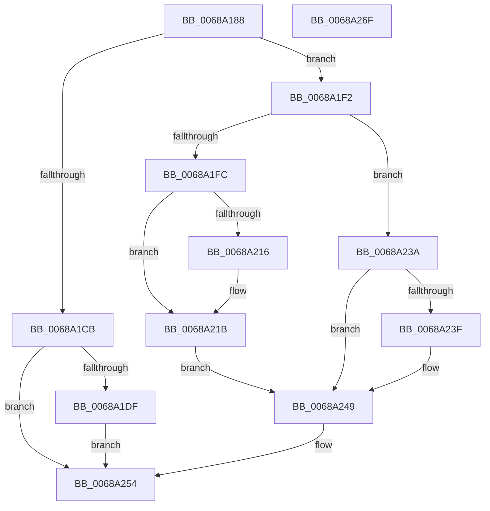

# MmSetAccessLogging

- RVA: `0x0068A188`–`0x0068A270` (길이 `232` bytes)
- VA: `0x000000014068A188`
- 실행 섹션: `.text`
- PDB 이름 있음: `예`; PDB Function 태그: `아니요`
- unwind 정보 RVA: `0x0005E6B4`
- 디코드: `60`개 명령, `232/232` bytes 표시
- 미해석 바이트: `0` (있으면 어셈블리에 `.byte`로 보존)

> 이 문서는 커널 이미지의 기계어와 PDB 기호를 분석해 생성했습니다. 4번과 5번은 함수 원형과 자료형을 바이너리 사용 방식에서 추정한 C 해석이며 원본 소스 복구 결과는 아닙니다.

## 1. Dependencies

- 직접 호출 지점: **5**; 고유 호출 대상: **4**
- 직접 호출자로 확인된 함수: **3**
- RIP 상대 이미지 참조: **0**

### Outgoing calls
- `0x0068A1B3` → [ExAcquireSpinLockExclusive](../24/ExAcquireSpinLockExclusive_function_00248690.md) (function, `0x00248690`)
- `0x0068A1D0` → [MiReleaseSpinLockExclusive](../24/MiReleaseSpinLockExclusive_function_002482C0.md) (function, `0x002482C0`)
- `0x0068A1EB` → [KeInsertQueueDpc](../20/KeInsertQueueDpc_function_00207C50.md) (function, `0x00207C50`)
- `0x0068A233` → [ExQueueWorkItemToPartition](../35/ExQueueWorkItemToPartition_function_00356E2C.md) (function, `0x00356E2C`)
- `0x0068A24F` → [MiReleaseSpinLockExclusive](../24/MiReleaseSpinLockExclusive_function_002482C0.md) (function, `0x002482C0`)

### Direct callers
- [PfTAccessTracingCleanup](../../pagelk/B6/PfTAccessTracingCleanup_function_00B6B8AC.md) at `0x00B6B8F9`
- [PfTAccessTracingStart](../../pagelk/B6/PfTAccessTracingStart_function_00B6B9F0.md) at `0x00B6BA39`
- [PfTSetTracingPriority](../../pagelk/B6/PfTSetTracingPriority_function_00B6BA6C.md) at `0x00B6BA9F`

### Static image references
- 디코드된 RIP-relative 메모리 참조가 없습니다.

## 2. Other-region calls and transfers

- 다른 실행 섹션으로 향하는 call: **0**
- 별도 외부 분기/꼬리 이동을 확인하지 못했습니다.

## 3. Assembly (complete function range)

```asm
0068A188  48 8B C4                        mov rax, rsp
0068A18B  48 89 58 08                     mov qword ptr [rax + 8], rbx
0068A18F  48 89 68 10                     mov qword ptr [rax + 0x10], rbp
0068A193  48 89 70 18                     mov qword ptr [rax + 0x18], rsi
0068A197  48 89 78 20                     mov qword ptr [rax + 0x20], rdi
0068A19B  41 56                           push r14
0068A19D  48 83 EC 20                     sub rsp, 0x20
0068A1A1  48 8B 31                        mov rsi, qword ptr [rcx]
0068A1A4  41 8B D8                        mov ebx, r8d
0068A1A7  8B FA                           mov edi, edx
0068A1A9  48 8D AE 80 44 00 00            lea rbp, [rsi + 0x4480]
0068A1B0  48 8B CD                        mov rcx, rbp
0068A1B3  E8 D8 E4 BB FF                  call 0x140248690
0068A1B8  89 BE 2C 44 00 00               mov dword ptr [rsi + 0x442c], edi
0068A1BE  44 8A F0                        mov r14b, al
0068A1C1  89 9E 30 44 00 00               mov dword ptr [rsi + 0x4430], ebx
0068A1C7  85 FF                           test edi, edi
0068A1C9  74 27                           je 0x14068a1f2
0068A1CB  8A D0                           mov dl, al
0068A1CD  48 8B CD                        mov rcx, rbp
0068A1D0  E8 EB E0 BB FF                  call 0x1402482c0
0068A1D5  48 83 BE 38 44 00 00 00         cmp qword ptr [rsi + 0x4438], 0
0068A1DD  75 75                           jne 0x14068a254
0068A1DF  48 8D 8E 40 44 00 00            lea rcx, [rsi + 0x4440]
0068A1E6  45 33 C0                        xor r8d, r8d
0068A1E9  33 D2                           xor edx, edx
0068A1EB  E8 60 DA B7 FF                  call 0x140207c50
0068A1F0  EB 62                           jmp 0x14068a254
0068A1F2  8B 86 28 44 00 00               mov eax, dword ptr [rsi + 0x4428]
0068A1F8  85 C0                           test eax, eax
0068A1FA  75 3E                           jne 0x14068a23a
0068A1FC  48 8B 8E B8 00 00 00            mov rcx, qword ptr [rsi + 0xb8]
0068A203  8D 50 01                        lea edx, [rax + 1]
0068A206  8B C2                           mov eax, edx
0068A208  F0 48 0F C1 41 28               lock xadd qword ptr [rcx + 0x28], rax
0068A20E  48 03 C2                        add rax, rdx
0068A211  48 3B C2                        cmp rax, rdx
0068A214  7F 05                           jg 0x14068a21b
0068A216  8D 4A 0D                        lea ecx, [rdx + 0xd]
0068A219  CD 29                           int 0x29
0068A21B  4C 8B 8E B8 00 00 00            mov r9, qword ptr [rsi + 0xb8]
0068A222  48 8D 8E 08 44 00 00            lea rcx, [rsi + 0x4408]
0068A229  41 83 C8 FF                     or r8d, 0xffffffff
0068A22D  89 96 28 44 00 00               mov dword ptr [rsi + 0x4428], edx
0068A233  E8 F4 CB CC FF                  call 0x140356e2c
0068A238  EB 0F                           jmp 0x14068a249
0068A23A  83 F8 02                        cmp eax, 2
0068A23D  75 0A                           jne 0x14068a249
0068A23F  C7 86 28 44 00 00 03 00 00 00   mov dword ptr [rsi + 0x4428], 3
0068A249  41 8A D6                        mov dl, r14b
0068A24C  48 8B CD                        mov rcx, rbp
0068A24F  E8 6C E0 BB FF                  call 0x1402482c0
0068A254  48 8B 5C 24 30                  mov rbx, qword ptr [rsp + 0x30]
0068A259  48 8B 6C 24 38                  mov rbp, qword ptr [rsp + 0x38]
0068A25E  48 8B 74 24 40                  mov rsi, qword ptr [rsp + 0x40]
0068A263  48 8B 7C 24 48                  mov rdi, qword ptr [rsp + 0x48]
0068A268  48 83 C4 20                     add rsp, 0x20
0068A26C  41 5E                           pop r14
0068A26E  C3                              ret
0068A26F  CC                              int3
```

## 4. C-style interpretation (structured pseudocode)

```c
__int64 __fastcall MmSetAccessLogging(__int64 a1, int a2, int a3)
{
    __int64 result;
    __int64 v_rsp;
    unsigned __int64 v_stack_p10;
    unsigned __int64 v_stack_p18;
    unsigned __int64 v_stack_p20;
    unsigned __int64 v_stack_p8;

    *(unsigned __int64 *)(v_rsp + 8) = v_rbx;
    *(unsigned __int64 *)(v_rsp + 16) = v_rbp;
    *(unsigned __int64 *)(v_rsp + 24) = v_rsi;
    *(unsigned __int64 *)(v_rsp + 32) = v_rdi;
    v_rsp = (v_rsp) - (32);
    result = ExAcquireSpinLockExclusive(*(unsigned __int64 *)(a1) + 17536, a2, a3, a4);
    *(unsigned int *)(*(unsigned __int64 *)(a1) + 17452) = (unsigned int)((unsigned int)(a2));
    *(unsigned int *)(*(unsigned __int64 *)(a1) + 17456) = (unsigned int)((unsigned int)(a3));
    if ((unsigned int)((unsigned int)(a2)) == 0) goto loc_0068A1F2;
    result = MiReleaseSpinLockExclusive(*(unsigned __int64 *)(a1) + 17536, (unsigned __int8)(result), a3, a4);
    if ((*(unsigned __int64 *)(*(unsigned __int64 *)(a1) + 17464)) != 0) goto loc_0068A254;
    a3 = 0;
    a2 = 0;
    result = KeInsertQueueDpc(*(unsigned __int64 *)(a1) + 17472, a2, a3, a4);
    goto loc_0068A254;
loc_0068A1F2:
    if ((unsigned int)((unsigned int)(*(unsigned int *)(*(unsigned __int64 *)(a1) + 17448))) != 0) goto loc_0068A23A;
    result = ((unsigned int)((unsigned int)((unsigned int)(*(unsigned int *)(*(unsigned __int64 *)(a1) + 17448)) + 1))) + ((unsigned int)(*(unsigned int *)(*(unsigned __int64 *)(a1) + 17448)) + 1);
    if (result <= ((unsigned int)(*(unsigned int *)(*(unsigned __int64 *)(a1) + 17448)) + 1)) {
        a1 = (unsigned int)(*(unsigned int *)(*(unsigned __int64 *)(a1) + 17448)) + 1 + 13;
    }
    a3 = (unsigned int)((a3) | (0xFFFFFFFFULL));
    *(unsigned int *)(*(unsigned __int64 *)(a1) + 17448) = (unsigned int)((unsigned int)(*(unsigned int *)(*(unsigned __int64 *)(a1) + 17448)) + 1);
    result = ExQueueWorkItemToPartition(*(unsigned __int64 *)(a1) + 17416, (unsigned int)(*(unsigned int *)(*(unsigned __int64 *)(a1) + 17448)) + 1, a3, *(unsigned __int64 *)(*(unsigned __int64 *)(a1) + 184));
    goto loc_0068A249;
loc_0068A23A:
    if (((unsigned int)(result)) == 2) {
        *(unsigned int *)(*(unsigned __int64 *)(a1) + 17448) = 3;
    }
    result = MiReleaseSpinLockExclusive(*(unsigned __int64 *)(a1) + 17536, (unsigned __int8)((unsigned __int8)(result)), a3, *(unsigned __int64 *)(*(unsigned __int64 *)(a1) + 184));
loc_0068A254:
    v_rsp = (v_rsp) + (32);
    return result;
}
```

## 5. (Beta) C Style

```c
int64_t MmSetAccessLogging(void *Arg1, int32_t Arg2, int32_t Arg3)
{
    uint8_t *arg1 = (uint8_t *)Arg1;

    int64_t result;
    int64_t local_rsp;
    uint64_t v_stack_p10;
    uint64_t v_stack_p18;
    uint64_t v_stack_p20;
    uint64_t v_stack_p8;

    *(uint64_t *)(local_rsp + 0x8) = local_rbx;
    *(uint64_t *)(local_rsp + 0x10) = local_rbp;
    *(uint64_t *)(local_rsp + 0x18) = local_rsi;
    *(uint64_t *)(local_rsp + 0x20) = local_rdi;
    local_rsp = (local_rsp) - (32);
    result = ExAcquireSpinLockExclusive(*(uint64_t *)(arg1) + 17536, Arg2, Arg3, a4);
    *(uint32_t *)(*(uint64_t *)(arg1) + 0x442C) = (uint32_t)((uint32_t)(Arg2));
    *(uint32_t *)(*(uint64_t *)(arg1) + 0x4430) = (uint32_t)((uint32_t)(Arg3));
    if ((uint32_t)((uint32_t)(Arg2)) == 0) goto loc_0068A1F2;
    result = MiReleaseSpinLockExclusive(*(uint64_t *)(arg1) + 17536, (uint8_t)(result), Arg3, a4);
    if ((*(uint64_t *)(*(uint64_t *)(arg1) + 0x4438)) != 0) goto loc_0068A254;
    Arg3 = 0;
    Arg2 = 0;
    result = KeInsertQueueDpc(*(uint64_t *)(arg1) + 17472, Arg2, Arg3, a4);
    goto loc_0068A254;
loc_0068A1F2:
    if ((uint32_t)((uint32_t)(*(uint32_t *)(*(uint64_t *)(arg1) + 0x4428))) != 0) goto loc_0068A23A;
    result = ((uint32_t)((uint32_t)((uint32_t)(*(uint32_t *)(*(uint64_t *)(arg1) + 0x4428)) + 1))) + ((uint32_t)(*(uint32_t *)(*(uint64_t *)(arg1) + 0x4428)) + 1);
    if (result <= ((uint32_t)(*(uint32_t *)(*(uint64_t *)(arg1) + 0x4428)) + 1)) {
        Arg1 = (uint32_t)(*(uint32_t *)(*(uint64_t *)(arg1) + 0x4428)) + 1 + 13;
    }
    Arg3 = (uint32_t)((Arg3) | (0xFFFFFFFFULL));
    *(uint32_t *)(*(uint64_t *)(arg1) + 0x4428) = (uint32_t)((uint32_t)(*(uint32_t *)(*(uint64_t *)(arg1) + 0x4428)) + 1);
    result = ExQueueWorkItemToPartition(*(uint64_t *)(arg1) + 17416, (uint32_t)(*(uint32_t *)(*(uint64_t *)(arg1) + 0x4428)) + 1, Arg3, *(uint64_t *)(*(uint64_t *)(arg1) + 0xB8));
    goto loc_0068A249;
loc_0068A23A:
    if (((uint32_t)(result)) == 2) {
        *(uint32_t *)(*(uint64_t *)(arg1) + 0x4428) = 3;
    }
    result = MiReleaseSpinLockExclusive(*(uint64_t *)(arg1) + 17536, (uint8_t)((uint8_t)(result)), Arg3, *(uint64_t *)(*(uint64_t *)(arg1) + 0xB8));
loc_0068A254:
    local_rsp = (local_rsp) + (32);
    return result;
}
```

### 관측된 메모리 오프셋

구조체 형식이 확인되지 않은 접근은 인자 기준의 오프셋으로만 기록했습니다.

| 기준 인자 | 오프셋 표현 | 폭 (bit) | 접근 |
|---|---:|---:|---|
| `Arg1` | `+ 0x0` | `64` | `R` |

## 6. Execution-region graph

[열기: 2D/3D 그래프와 함수 탐색 컨트롤 패널](../../../control-panel.html?section=text&rva=0x0068A188&view=graph)

- 2D 그래프는 위에서 아래로 흐르고, 3D 그래프는 빈 공간을 드래그해 회전합니다. Shift+드래그는 이동, 휠은 확대·축소, 함수 노드 선택은 대상 보고서 이동입니다.

### Static fallback


