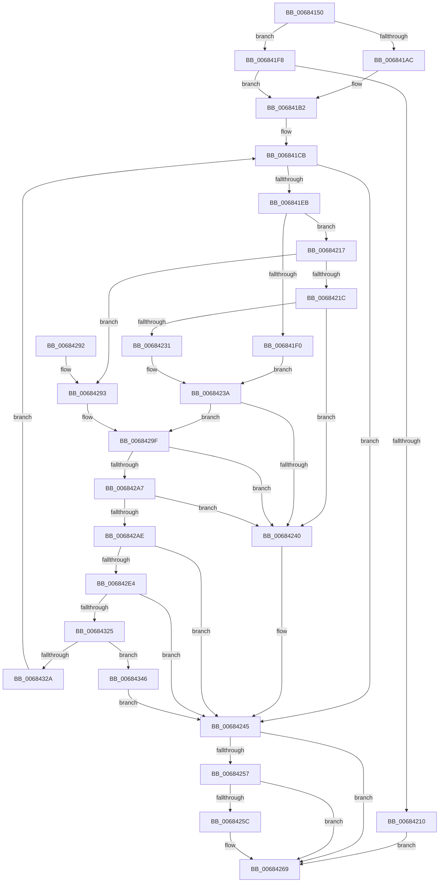

# MmWriteSystemImageTracepoint

- RVA: `0x00684150`–`0x00684350` (길이 `512` bytes)
- VA: `0x0000000140684150`
- 실행 섹션: `.text`
- PDB 이름 있음: `예`; PDB Function 태그: `아니요`
- unwind 정보 RVA: `0x000D868C`
- 디코드: `144`개 명령, `512/512` bytes 표시
- 미해석 바이트: `0` (있으면 어셈블리에 `.byte`로 보존)

> 이 문서는 커널 이미지의 기계어와 PDB 기호를 분석해 생성했습니다. 4번과 5번은 함수 원형과 자료형을 바이너리 사용 방식에서 추정한 C 해석이며 원본 소스 복구 결과는 아닙니다.

## 1. Dependencies

- 직접 호출 지점: **13**; 고유 호출 대상: **11**
- 직접 호출자로 확인된 함수: **1**
- RIP 상대 이미지 참조: **1**

### Outgoing calls
- `0x0068419C` → [memset](../6C/memset_function_006C6C40.md) (function, `0x006C6C40`)
- `0x006841BA` → [MiGetAnyMultiplexedVm](../44/MiGetAnyMultiplexedVm_function_00448BD0.md) (function, `0x00448BD0`)
- `0x006841D3` → [MiInitializeDriverPatchState](../../page/AB/MiInitializeDriverPatchState_function_00AB07A4.md) (function, `0x00AB07A4`)
- `0x006841E0` → [MiPrepareDriverPatchState](../../page/7F/MiPrepareDriverPatchState_function_007F8C8C.md) (function, `0x007F8C8C`)
- `0x00684200` → [MiLockLoadedDataTableEntry](../2A/MiLockLoadedDataTableEntry_function_002A38F4.md) (function, `0x002A38F4`)
- `0x00684227` → [RtlLookupFunctionEntry](../2F/RtlLookupFunctionEntry_function_002F2F30.md) (function, `0x002F2F30`)
- `0x0068424A` → [MiUnlockDriverPages](../../page/A4/MiUnlockDriverPages_function_00A4BA6C.md) (function, `0x00A4BA6C`)
- `0x00684264` → [MiUnlockLoadedDataTableEntry](../2A/MiUnlockLoadedDataTableEntry_function_002A385C.md) (function, `0x002A385C`)
- `0x00684272` → [_security_check_cookie](../6A/_security_check_cookie_function_006AC640.md) (function, `0x006AC640`)
- `0x006842D5` → [MiLockDriverPageRange](../67/MiLockDriverPageRange_function_00670160.md) (function, `0x00670160`)
- `0x006842EE` → [memset](../6C/memset_function_006C6C40.md) (function, `0x006C6C40`)
- `0x00684313` → [VslpEnterIumSecureMode](../23/VslpEnterIumSecureMode_function_00235E50.md) (function, `0x00235E50`)
- `0x0068432F` → [MiUnlockDriverPages](../../page/A4/MiUnlockDriverPages_function_00A4BA6C.md) (function, `0x00A4BA6C`)

### Direct callers
- [KiTpWriteBreakpoint](../5C/KiTpWriteBreakpoint_function_005CAB18.md) at `0x005CAB4B`

### Static image references
- `0x0068416C` → RVA `0x00E0A740` (`.data`; read)

## 2. Other-region calls and transfers

- 다른 실행 섹션으로 향하는 call: **4**
  - `0x006841D3` → [MiInitializeDriverPatchState](../../page/AB/MiInitializeDriverPatchState_function_00AB07A4.md) (`.text` → `PAGE`)
  - `0x006841E0` → [MiPrepareDriverPatchState](../../page/7F/MiPrepareDriverPatchState_function_007F8C8C.md) (`.text` → `PAGE`)
  - `0x0068424A` → [MiUnlockDriverPages](../../page/A4/MiUnlockDriverPages_function_00A4BA6C.md) (`.text` → `PAGE`)
  - `0x0068432F` → [MiUnlockDriverPages](../../page/A4/MiUnlockDriverPages_function_00A4BA6C.md) (`.text` → `PAGE`)
- 별도 외부 분기/꼬리 이동을 확인하지 못했습니다.

## 3. Assembly (complete function range)

```asm
00684150  48 89 5C 24 10                  mov qword ptr [rsp + 0x10], rbx
00684155  55                              push rbp
00684156  56                              push rsi
00684157  57                              push rdi
00684158  41 54                           push r12
0068415A  41 55                           push r13
0068415C  41 56                           push r14
0068415E  41 57                           push r15
00684160  48 8D 6C 24 C0                  lea rbp, [rsp - 0x40]
00684165  48 81 EC 40 01 00 00            sub rsp, 0x140
0068416C  48 8B 05 CD 65 78 00            mov rax, qword ptr [rip + 0x7865cd]
00684173  48 33 C4                        xor rax, rsp
00684176  48 89 45 30                     mov qword ptr [rbp + 0x30], rax
0068417A  40 8A F2                        mov sil, dl
0068417D  88 54 24 31                     mov byte ptr [rsp + 0x31], dl
00684181  33 D2                           xor edx, edx
00684183  44 88 44 24 30                  mov byte ptr [rsp + 0x30], r8b
00684188  49 8B D9                        mov rbx, r9
0068418B  4C 8B E9                        mov r13, rcx
0068418E  48 8D 4C 24 50                  lea rcx, [rsp + 0x50]
00684193  48 89 5C 24 48                  mov qword ptr [rsp + 0x48], rbx
00684198  44 8D 42 68                     lea r8d, [rdx + 0x68]
0068419C  E8 9F 2A 04 00                  call 0x1406c6c40
006841A1  48 83 64 24 38 00               and qword ptr [rsp + 0x38], 0
006841A7  48 85 DB                        test rbx, rbx
006841AA  74 4C                           je 0x1406841f8
006841AC  48 8B FB                        mov rdi, rbx
006841AF  48 8B D3                        mov rdx, rbx
006841B2  45 32 FF                        xor r15b, r15b
006841B5  B9 01 00 00 00                  mov ecx, 1
006841BA  E8 11 4A DC FF                  call 0x140448bd0
006841BF  48 8B D8                        mov rbx, rax
006841C2  48 89 44 24 40                  mov qword ptr [rsp + 0x40], rax
006841C7  4C 8D 62 40                     lea r12, [rdx + 0x40]
006841CB  48 8D 54 24 50                  lea rdx, [rsp + 0x50]
006841D0  48 8B CF                        mov rcx, rdi
006841D3  E8 CC C5 42 00                  call 0x140ab07a4
006841D8  48 8B D3                        mov rdx, rbx
006841DB  48 8D 4C 24 50                  lea rcx, [rsp + 0x50]
006841E0  E8 A7 4A 17 00                  call 0x1407f8c8c
006841E5  8B D8                           mov ebx, eax
006841E7  85 C0                           test eax, eax
006841E9  78 5A                           js 0x140684245
006841EB  45 84 FF                        test r15b, r15b
006841EE  74 27                           je 0x140684217
006841F0  45 8B 34 24                     mov r14d, dword ptr [r12]
006841F4  33 F6                           xor esi, esi
006841F6  EB 42                           jmp 0x14068423a
006841F8  BA 01 00 00 00                  mov edx, 1
006841FD  49 8B CD                        mov rcx, r13
00684200  E8 EF F6 C1 FF                  call 0x1402a38f4
00684205  48 8B F8                        mov rdi, rax
00684208  48 8B D0                        mov rdx, rax
0068420B  48 85 C0                        test rax, rax
0068420E  75 A2                           jne 0x1406841b2
00684210  BB 0D 00 00 C0                  mov ebx, 0xc000000d
00684215  EB 52                           jmp 0x140684269
00684217  40 84 F6                        test sil, sil
0068421A  74 77                           je 0x140684293
0068421C  45 33 C0                        xor r8d, r8d
0068421F  48 8D 54 24 38                  lea rdx, [rsp + 0x38]
00684224  49 8B CD                        mov rcx, r13
00684227  E8 04 ED C6 FF                  call 0x1402f2f30
0068422C  48 85 C0                        test rax, rax
0068422F  74 0F                           je 0x140684240
00684231  44 8B 70 04                     mov r14d, dword ptr [rax + 4]
00684235  8B 30                           mov esi, dword ptr [rax]
00684237  44 2B F6                        sub r14d, esi
0068423A  41 83 FE 01                     cmp r14d, 1
0068423E  73 5F                           jae 0x14068429f
00684240  BB 0D 00 00 C0                  mov ebx, 0xc000000d
00684245  48 8D 4C 24 50                  lea rcx, [rsp + 0x50]
0068424A  E8 1D 78 3C 00                  call 0x140a4ba6c
0068424F  48 83 7C 24 48 00               cmp qword ptr [rsp + 0x48], 0
00684255  75 12                           jne 0x140684269
00684257  48 85 FF                        test rdi, rdi
0068425A  74 0D                           je 0x140684269
0068425C  BA 01 00 00 00                  mov edx, 1
00684261  48 8B CF                        mov rcx, rdi
00684264  E8 F3 F5 C1 FF                  call 0x1402a385c
00684269  8B C3                           mov eax, ebx
0068426B  48 8B 4D 30                     mov rcx, qword ptr [rbp + 0x30]
0068426F  48 33 CC                        xor rcx, rsp
00684272  E8 C9 83 02 00                  call 0x1406ac640
00684277  48 8B 9C 24 88 01 00 00         mov rbx, qword ptr [rsp + 0x188]
0068427F  48 81 C4 40 01 00 00            add rsp, 0x140
00684286  41 5F                           pop r15
00684288  41 5E                           pop r14
0068428A  41 5D                           pop r13
0068428C  41 5C                           pop r12
0068428E  5F                              pop rdi
0068428F  5E                              pop rsi
00684290  5D                              pop rbp
00684291  C3                              ret
00684292  CC                              int3
00684293  41 8B F5                        mov esi, r13d
00684296  41 BE 01 00 00 00               mov r14d, 1
0068429C  2B 77 30                        sub esi, dword ptr [rdi + 0x30]
0068429F  41 8B 04 24                     mov eax, dword ptr [r12]
006842A3  3B F0                           cmp esi, eax
006842A5  73 99                           jae 0x140684240
006842A7  2B C6                           sub eax, esi
006842A9  41 3B C6                        cmp eax, r14d
006842AC  72 92                           jb 0x140684240
006842AE  48 83 64 24 20 00               and qword ptr [rsp + 0x20], 0
006842B4  44 8D 46 FF                     lea r8d, [rsi - 1]
006842B8  45 0F B6 CF                     movzx r9d, r15b
006842BC  48 8D 4C 24 50                  lea rcx, [rsp + 0x50]
006842C1  45 03 C6                        add r8d, r14d
006842C4  8B D6                           mov edx, esi
006842C6  41 C1 E8 0C                     shr r8d, 0xc
006842CA  C1 EA 0C                        shr edx, 0xc
006842CD  46 8D 0C 4D 01 00 00 00         lea r9d, [r9*2 + 1]
006842D5  E8 86 BE FE FF                  call 0x140670160
006842DA  8B D8                           mov ebx, eax
006842DC  85 C0                           test eax, eax
006842DE  0F 88 61 FF FF FF               js 0x140684245
006842E4  33 D2                           xor edx, edx
006842E6  48 8D 4D C0                     lea rcx, [rbp - 0x40]
006842EA  44 8D 42 68                     lea r8d, [rdx + 0x68]
006842EE  E8 4D 29 04 00                  call 0x1406c6c40
006842F3  8A 44 24 30                     mov al, byte ptr [rsp + 0x30]
006842F7  4C 8D 4D C0                     lea r9, [rbp - 0x40]
006842FB  BA 58 00 00 00                  mov edx, 0x58
00684300  88 45 D8                        mov byte ptr [rbp - 0x28], al
00684303  45 33 C0                        xor r8d, r8d
00684306  4C 89 6D C8                     mov qword ptr [rbp - 0x38], r13
0068430A  B1 02                           mov cl, 2
0068430C  89 75 D0                        mov dword ptr [rbp - 0x30], esi
0068430F  44 89 75 D4                     mov dword ptr [rbp - 0x2c], r14d
00684313  E8 38 1B BB FF                  call 0x140235e50
00684318  8B D8                           mov ebx, eax
0068431A  3D 2D 02 00 C0                  cmp eax, 0xc000022d
0068431F  0F 85 20 FF FF FF               jne 0x140684245
00684325  45 84 FF                        test r15b, r15b
00684328  75 1C                           jne 0x140684346
0068432A  48 8D 4C 24 50                  lea rcx, [rsp + 0x50]
0068432F  E8 38 77 3C 00                  call 0x140a4ba6c
00684334  48 8B 5C 24 40                  mov rbx, qword ptr [rsp + 0x40]
00684339  41 B7 01                        mov r15b, 1
0068433C  40 8A 74 24 31                  mov sil, byte ptr [rsp + 0x31]
00684341  E9 85 FE FF FF                  jmp 0x1406841cb
00684346  BB BB 00 00 C0                  mov ebx, 0xc00000bb
0068434B  E9 F5 FE FF FF                  jmp 0x140684245
```

## 4. C-style interpretation (structured pseudocode)

```c
__int64 __fastcall MmWriteSystemImageTracepoint(__int64 a1, int a2, unsigned __int8 a3, __int64 a4)
{
    __int64 result;
    __int64 v_r14;
    __int64 v_r15;
    __int64 v_rsi;
    __int64 v_rsp;
    unsigned __int64 v_stack_m128;
    unsigned __int64 v_stack_m130;
    unsigned __int64 v_stack_m138;
    unsigned __int64 v_stack_m140;
    unsigned __int8 v_stack_m147;
    unsigned __int8 v_stack_m148;
    unsigned __int64 v_stack_m48;
    unsigned __int64 v_stack_m78;
    unsigned __int8 v_stack_mA0;
    unsigned int v_stack_mA4;
    unsigned int v_stack_mA8;
    unsigned __int64 v_stack_mB0;
    unsigned __int64 v_stack_mB8;
    unsigned __int64 v_stack_p10;
    unsigned __int64 v_stack_p20;
    unsigned __int8 v_stack_p30;
    unsigned __int8 v_stack_p31;
    unsigned __int64 v_stack_p40;
    unsigned __int64 v_stack_p50;

    v_stack_p10 = v_rbx;
    v_rsp = (v_rsp) - (320);
    result = (*(unsigned __int64 *)(v_rip + 7890381)) ^ (v_rsp);
    v_stack_m48 = result;
    v_stack_m147 = (unsigned __int8)(a2);
    a2 = 0;
    v_stack_m148 = a3;
    v_stack_m130 = a4;
    result = memset(v_stack_m128, a2, a2 + 104, a4);
    if (a4 == 0) goto loc_006841F8;
loc_006841B2:
    v_r15 = 0;
    result = MiGetAnyMultiplexedVm(1, a4, a2 + 104, a4);
    v_stack_m138 = result;
loc_006841CB:
    result = MiInitializeDriverPatchState(a4, v_stack_m128, a2 + 104, a4);
    result = MiPrepareDriverPatchState(v_stack_m128, result, a2 + 104, a4);
    if (sign_flag) goto loc_00684245;
    if (0 == 0) goto loc_00684217;
    v_rsi = 0;
    goto loc_0068423A;
loc_006841F8:
    result = MiLockLoadedDataTableEntry(a1, 1, a2 + 104, a4);
    if (result != 0) goto loc_006841B2;
    goto loc_00684269;
loc_00684217:
    if (0 == 0) goto loc_00684293;
    a3 = 0;
    result = RtlLookupFunctionEntry(a1, v_stack_m140, a3, a4);
    if (result == 0) goto loc_00684240;
    v_r14 = (unsigned int)(((unsigned int)(*(unsigned int *)(result + 4))) - ((unsigned int)((unsigned int)(*(unsigned int *)(result)))));
loc_0068423A:
    if (((unsigned int)(v_r14)) >= 1) goto loc_0068429F;
loc_00684240:
loc_00684245:
    result = MiUnlockDriverPages(v_stack_m128, v_stack_m140, a3, a4);
    if (v_stack_m130 != 0) goto loc_00684269;
    if (result != 0) {
        a2 = 1;
        a1 = result;
        result = MiUnlockLoadedDataTableEntry(a1, a2, a3, a4);
    }
    a1 = (v_stack_m48) ^ (v_rsp);
    result = _security_check_cookie(a1, a2, a3, a4);
    v_rsp = (v_rsp) + (320);
    return result;
loc_00684293:
    v_rsi = (unsigned int)(((unsigned int)((unsigned int)(a1))) - (*(unsigned int *)(result + 48)));
loc_0068429F:
    if (((unsigned int)(v_rsi)) >= ((unsigned int)((unsigned int)(*(unsigned int *)(a4 + 64))))) goto loc_00684240;
    result = (unsigned int)(((unsigned int)(*(unsigned int *)(a4 + 64))) - ((unsigned int)(v_rsi)));
    if (((unsigned int)(result)) < 1) goto loc_00684240;
    a3 = (unsigned int)((v_rsi - 1) + (1));
    a3 = (unsigned int)((a3) >> (12));
    a2 = (unsigned int)(((unsigned int)((unsigned int)(v_rsi))) >> (12));
    result = MiLockDriverPageRange(v_stack_p50, a2, a3, 0 * 2 + 1);
    if (sign_flag) goto loc_00684245;
    a2 = 0;
    result = memset(v_stack_mB8, a2, a2 + 104, 0 * 2 + 1);
    v_stack_mA0 = (unsigned __int8)(v_stack_p30);
    a3 = 0;
    v_stack_mB0 = a1;
    v_stack_mA8 = (unsigned int)(v_rsi);
    v_stack_mA4 = 1;
    result = VslpEnterIumSecureMode(2, 88, a3, v_stack_mB8);
    if (((unsigned int)(result)) != 0xC000022DULL) goto loc_00684245;
    if (0 != 0) goto loc_00684346;
    result = MiUnlockDriverPages(v_stack_p50, 88, a3, v_stack_mB8);
    goto loc_006841CB;
loc_00684346:
    goto loc_00684245;
}
```

## 5. (Beta) C Style

```c
int64_t MmWriteSystemImageTracepoint(int64_t Arg1, int32_t Arg2, uint8_t Arg3, int64_t Arg4)
{
    int64_t result;
    int64_t local_r14;
    int64_t local_r15;
    int64_t local_rsi;
    int64_t local_rsp;
    uint64_t v_stack_m128;
    uint64_t v_stack_m130;
    uint64_t v_stack_m138;
    uint64_t v_stack_m140;
    uint8_t v_stack_m147;
    uint8_t v_stack_m148;
    uint64_t v_stack_m48;
    uint64_t v_stack_m78;
    uint8_t v_stack_mA0;
    uint32_t v_stack_mA4;
    uint32_t v_stack_mA8;
    uint64_t v_stack_mB0;
    uint64_t v_stack_mB8;
    uint64_t v_stack_p10;
    uint64_t v_stack_p20;
    uint8_t v_stack_p30;
    uint8_t v_stack_p31;
    uint64_t v_stack_p40;
    uint64_t v_stack_p50;

    v_stack_p10 = local_rbx;
    local_rsp = (local_rsp) - (320);
    result = (*(uint64_t *)(v_rip + 0x7865CD)) ^ (local_rsp);
    v_stack_m48 = result;
    v_stack_m147 = (uint8_t)(Arg2);
    Arg2 = 0;
    v_stack_m148 = Arg3;
    v_stack_m130 = Arg4;
    result = memset(v_stack_m128, Arg2, Arg2 + 104, Arg4);
    if (Arg4 == 0) goto loc_006841F8;
loc_006841B2:
    local_r15 = 0;
    result = MiGetAnyMultiplexedVm(1, Arg4, Arg2 + 104, Arg4);
    v_stack_m138 = result;
loc_006841CB:
    result = MiInitializeDriverPatchState(Arg4, v_stack_m128, Arg2 + 104, Arg4);
    result = MiPrepareDriverPatchState(v_stack_m128, result, Arg2 + 104, Arg4);
    if (sign_flag) goto loc_00684245;
    if (0 == 0) goto loc_00684217;
    local_rsi = 0;
    goto loc_0068423A;
loc_006841F8:
    result = MiLockLoadedDataTableEntry(Arg1, 1, Arg2 + 104, Arg4);
    if (result != 0) goto loc_006841B2;
    goto loc_00684269;
loc_00684217:
    if (0 == 0) goto loc_00684293;
    Arg3 = 0;
    result = RtlLookupFunctionEntry(Arg1, v_stack_m140, Arg3, Arg4);
    if (result == 0) goto loc_00684240;
    local_r14 = (uint32_t)(((uint32_t)(*(uint32_t *)(result + 0x4))) - ((uint32_t)((uint32_t)(*(uint32_t *)(result)))));
loc_0068423A:
    if (((uint32_t)(local_r14)) >= 1) goto loc_0068429F;
loc_00684240:
loc_00684245:
    result = MiUnlockDriverPages(v_stack_m128, v_stack_m140, Arg3, Arg4);
    if (v_stack_m130 != 0) goto loc_00684269;
    if (result != 0) {
        Arg2 = 1;
        Arg1 = result;
        result = MiUnlockLoadedDataTableEntry(Arg1, Arg2, Arg3, Arg4);
    }
    Arg1 = (v_stack_m48) ^ (local_rsp);
    result = _security_check_cookie(Arg1, Arg2, Arg3, Arg4);
    local_rsp = (local_rsp) + (320);
    return result;
loc_00684293:
    local_rsi = (uint32_t)(((uint32_t)((uint32_t)(Arg1))) - (*(uint32_t *)(result + 0x30)));
loc_0068429F:
    if (((uint32_t)(local_rsi)) >= ((uint32_t)((uint32_t)(*(uint32_t *)(Arg4 + 0x40))))) goto loc_00684240;
    result = (uint32_t)(((uint32_t)(*(uint32_t *)(Arg4 + 0x40))) - ((uint32_t)(local_rsi)));
    if (((uint32_t)(result)) < 1) goto loc_00684240;
    Arg3 = (uint32_t)((local_rsi - 1) + (1));
    Arg3 = (uint32_t)((Arg3) >> (12));
    Arg2 = (uint32_t)(((uint32_t)((uint32_t)(local_rsi))) >> (12));
    result = MiLockDriverPageRange(v_stack_p50, Arg2, Arg3, 0 * 2 + 1);
    if (sign_flag) goto loc_00684245;
    Arg2 = 0;
    result = memset(v_stack_mB8, Arg2, Arg2 + 104, 0 * 2 + 1);
    v_stack_mA0 = (uint8_t)(v_stack_p30);
    Arg3 = 0;
    v_stack_mB0 = Arg1;
    v_stack_mA8 = (uint32_t)(local_rsi);
    v_stack_mA4 = 1;
    result = VslpEnterIumSecureMode(2, 88, Arg3, v_stack_mB8);
    if (((uint32_t)(result)) != 0xC000022DULL) goto loc_00684245;
    if (0 != 0) goto loc_00684346;
    result = MiUnlockDriverPages(v_stack_p50, 88, Arg3, v_stack_mB8);
    goto loc_006841CB;
loc_00684346:
    goto loc_00684245;
}
```

## 6. Execution-region graph

[열기: 2D/3D 그래프와 함수 탐색 컨트롤 패널](../../../control-panel.html?section=text&rva=0x00684150&view=graph)

- 2D 그래프는 위에서 아래로 흐르고, 3D 그래프는 빈 공간을 드래그해 회전합니다. Shift+드래그는 이동, 휠은 확대·축소, 함수 노드 선택은 대상 보고서 이동입니다.

### Static fallback


