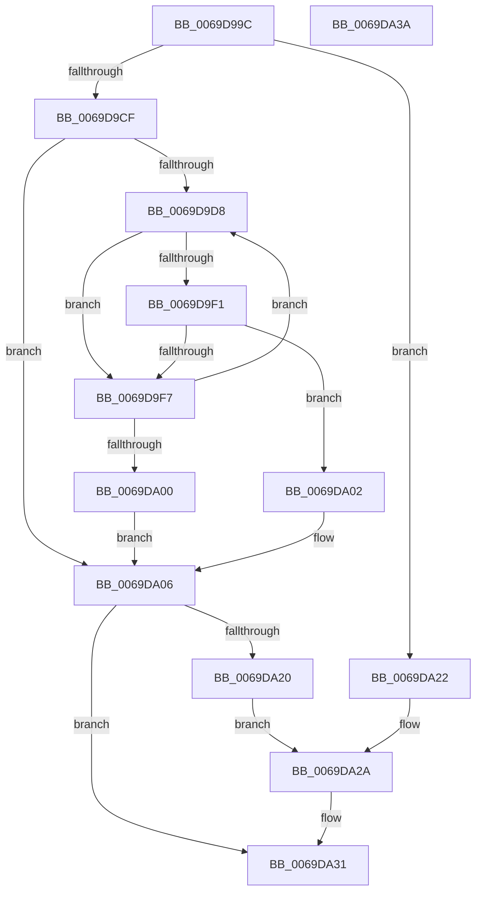

# AdtpBuildContextFromSecurityDescriptor

- RVA: `0x0069D99C`–`0x0069DA3B` (길이 `159` bytes)
- VA: `0x000000014069D99C`
- 실행 섹션: `.text`
- PDB 이름 있음: `예`; PDB Function 태그: `아니요`
- unwind 정보 RVA: `0x000BDEAC`
- 디코드: `53`개 명령, `159/159` bytes 표시
- 미해석 바이트: `0` (있으면 어셈블리에 `.byte`로 보존)

> 이 문서는 커널 이미지의 기계어와 PDB 기호를 분석해 생성했습니다. 4번과 5번은 함수 원형과 자료형을 바이너리 사용 방식에서 추정한 C 해석이며 원본 소스 복구 결과는 아닙니다.

## 1. Dependencies

- 직접 호출 지점: **3**; 고유 호출 대상: **3**
- 직접 호출자로 확인된 함수: **1**
- RIP 상대 이미지 참조: **0**

### Outgoing calls
- `0x0069D9C6` → [RtlGetSaclSecurityDescriptor](../../page/A3/RtlGetSaclSecurityDescriptor_function_00A36710.md) (function, `0x00A36710`)
- `0x0069D9E7` → [RtlFindAceByType](../41/RtlFindAceByType_function_00410AF0.md) (function, `0x00410AF0`)
- `0x0069DA17` → [SeRmReferenceFindCapName](../4D/SeRmReferenceFindCapName_function_004DDBA4.md) (function, `0x004DDBA4`)

### Direct callers
- [AdtpBuildAccessReasonAuditString](../40/AdtpBuildAccessReasonAuditString_function_0040EE04.md) at `0x0040EFD1`
- [AdtpBuildAccessReasonAuditString](../40/AdtpBuildAccessReasonAuditString_function_0040EE04.md) at `0x0040EFE6`

### Static image references
- 디코드된 RIP-relative 메모리 참조가 없습니다.

## 2. Other-region calls and transfers

- 다른 실행 섹션으로 향하는 call: **1**
  - `0x0069D9C6` → [RtlGetSaclSecurityDescriptor](../../page/A3/RtlGetSaclSecurityDescriptor_function_00A36710.md) (`.text` → `PAGE`)
- 별도 외부 분기/꼬리 이동을 확인하지 못했습니다.

## 3. Assembly (complete function range)

```asm
0069D99C  48 8B C4                        mov rax, rsp
0069D99F  53                              push rbx
0069D9A0  55                              push rbp
0069D9A1  56                              push rsi
0069D9A2  57                              push rdi
0069D9A3  48 83 EC 28                     sub rsp, 0x28
0069D9A7  48 83 60 20 00                  and qword ptr [rax + 0x20], 0
0069D9AC  4C 8D 48 10                     lea r9, [rax + 0x10]
0069D9B0  83 60 18 00                     and dword ptr [rax + 0x18], 0
0069D9B4  4C 8D 40 20                     lea r8, [rax + 0x20]
0069D9B8  48 8B DA                        mov rbx, rdx
0069D9BB  48 89 0A                        mov qword ptr [rdx], rcx
0069D9BE  48 8D 50 08                     lea rdx, [rax + 8]
0069D9C2  C6 40 08 00                     mov byte ptr [rax + 8], 0
0069D9C6  E8 45 8D 39 00                  call 0x140a36710
0069D9CB  85 C0                           test eax, eax
0069D9CD  78 53                           js 0x14069da22
0069D9CF  33 ED                           xor ebp, ebp
0069D9D1  40 38 6C 24 50                  cmp byte ptr [rsp + 0x50], bpl
0069D9D6  74 2E                           je 0x14069da06
0069D9D8  48 8B 4C 24 68                  mov rcx, qword ptr [rsp + 0x68]
0069D9DD  4C 8D 44 24 60                  lea r8, [rsp + 0x60]
0069D9E2  BA 13 00 00 00                  mov edx, 0x13
0069D9E7  E8 04 31 D7 FF                  call 0x140410af0
0069D9EC  48 85 C0                        test rax, rax
0069D9EF  74 06                           je 0x14069d9f7
0069D9F1  F6 40 01 08                     test byte ptr [rax + 1], 8
0069D9F5  74 0B                           je 0x14069da02
0069D9F7  FF 44 24 60                     inc dword ptr [rsp + 0x60]
0069D9FB  48 85 C0                        test rax, rax
0069D9FE  75 D8                           jne 0x14069d9d8
0069DA00  EB 04                           jmp 0x14069da06
0069DA02  48 8D 68 08                     lea rbp, [rax + 8]
0069DA06  48 8D 73 10                     lea rsi, [rbx + 0x10]
0069DA0A  48 8B CD                        mov rcx, rbp
0069DA0D  48 8D 7B 08                     lea rdi, [rbx + 8]
0069DA11  4C 8B C6                        mov r8, rsi
0069DA14  48 8B D7                        mov rdx, rdi
0069DA17  E8 88 01 E4 FF                  call 0x1404ddba4
0069DA1C  85 C0                           test eax, eax
0069DA1E  79 11                           jns 0x14069da31
0069DA20  EB 08                           jmp 0x14069da2a
0069DA22  48 8D 7B 08                     lea rdi, [rbx + 8]
0069DA26  48 8D 73 10                     lea rsi, [rbx + 0x10]
0069DA2A  83 27 00                        and dword ptr [rdi], 0
0069DA2D  48 83 26 00                     and qword ptr [rsi], 0
0069DA31  48 83 C4 28                     add rsp, 0x28
0069DA35  5F                              pop rdi
0069DA36  5E                              pop rsi
0069DA37  5D                              pop rbp
0069DA38  5B                              pop rbx
0069DA39  C3                              ret
0069DA3A  CC                              int3
```

## 4. C-style interpretation (structured pseudocode)

```c
__int64 __fastcall AdtpBuildContextFromSecurityDescriptor(__int64 a1, __int64 a2)
{
    __int64 result;
    __int64 v_rbp;
    __int64 v_rsp;
    unsigned __int64 v_stack_p18;
    unsigned __int64 v_stack_p20;
    unsigned __int8 v_stack_p8;

    v_rsp = (v_rsp) - (40);
    *(unsigned __int64 *)(a2) = a1;
    *(unsigned __int8 *)(v_rsp + 8) = 0;
    result = RtlGetSaclSecurityDescriptor(a1, v_rsp + 8, v_rsp + 32, v_rsp + 16);
    if (sign_flag) goto loc_0069DA22;
    v_rbp = 0;
    if (v_stack_p8 == 0) goto loc_0069DA06;
loc_0069D9D8:
    result = RtlFindAceByType(v_stack_p20, 19, v_stack_p18, v_rsp + 16);
    if (result == 0) goto loc_0069D9F7;
    if (((*(unsigned __int8 *)(result + 1)) & (8)) == 0) goto loc_0069DA02;
loc_0069D9F7:
    if (result != 0) goto loc_0069D9D8;
    goto loc_0069DA06;
loc_0069DA02:
loc_0069DA06:
    result = SeRmReferenceFindCapName(result + 8, a2 + 8, a2 + 16, v_rsp + 16);
    if (!sign_flag) goto loc_0069DA31;
    goto loc_0069DA2A;
loc_0069DA22:
loc_0069DA2A:
loc_0069DA31:
    v_rsp = (v_rsp) + (40);
    return result;
}
```

## 5. (Beta) C Style

```c
int64_t AdtpBuildContextFromSecurityDescriptor(int64_t Arg1, void *Arg2)
{
    uint8_t *arg2 = (uint8_t *)Arg2;

    int64_t result;
    int64_t local_rbp;
    int64_t local_rsp;
    uint64_t v_stack_p18;
    uint64_t v_stack_p20;
    uint8_t v_stack_p8;

    local_rsp = (local_rsp) - (40);
    *(uint64_t *)(arg2) = Arg1;
    *(uint8_t *)(local_rsp + 0x8) = 0;
    result = RtlGetSaclSecurityDescriptor(Arg1, local_rsp + 8, local_rsp + 32, local_rsp + 16);
    if (sign_flag) goto loc_0069DA22;
    local_rbp = 0;
    if (v_stack_p8 == 0) goto loc_0069DA06;
loc_0069D9D8:
    result = RtlFindAceByType(v_stack_p20, 19, v_stack_p18, local_rsp + 16);
    if (result == 0) goto loc_0069D9F7;
    if (((*(uint8_t *)(result + 0x1)) & (8)) == 0) goto loc_0069DA02;
loc_0069D9F7:
    if (result != 0) goto loc_0069D9D8;
    goto loc_0069DA06;
loc_0069DA02:
loc_0069DA06:
    result = SeRmReferenceFindCapName(result + 8, Arg2 + 8, Arg2 + 16, local_rsp + 16);
    if (!sign_flag) goto loc_0069DA31;
    goto loc_0069DA2A;
loc_0069DA22:
loc_0069DA2A:
loc_0069DA31:
    local_rsp = (local_rsp) + (40);
    return result;
}
```

### 관측된 메모리 오프셋

구조체 형식이 확인되지 않은 접근은 인자 기준의 오프셋으로만 기록했습니다.

| 기준 인자 | 오프셋 표현 | 폭 (bit) | 접근 |
|---|---:|---:|---|
| `Arg2` | `+ 0x0` | `32` | `R/W` |
| `Arg2` | `+ 0x0` | `64` | `R/W` |
| `Arg2` | `+ 0x0` | `64` | `W` |
| `Arg2` | `+ 0x8` | `64` | `R` |
| `Arg2` | `+ 0x10` | `64` | `R` |

## 6. Execution-region graph

[열기: 2D/3D 그래프와 함수 탐색 컨트롤 패널](../../../control-panel.html?section=text&rva=0x0069D99C&view=graph)

- 2D 그래프는 위에서 아래로 흐르고, 3D 그래프는 빈 공간을 드래그해 회전합니다. Shift+드래그는 이동, 휠은 확대·축소, 함수 노드 선택은 대상 보고서 이동입니다.

### Static fallback


