# AdtpBuildStagingReasonAuditStringInternal

- RVA: `0x0069DA44`–`0x0069DDE0` (길이 `924` bytes)
- VA: `0x000000014069DA44`
- 실행 섹션: `.text`
- PDB 이름 있음: `예`; PDB Function 태그: `아니요`
- unwind 정보 RVA: `0x000DA1A8`
- 디코드: `237`개 명령, `924/924` bytes 표시
- 미해석 바이트: `0` (있으면 어셈블리에 `.byte`로 보존)

> 이 문서는 커널 이미지의 기계어와 PDB 기호를 분석해 생성했습니다. 4번과 5번은 함수 원형과 자료형을 바이너리 사용 방식에서 추정한 C 해석이며 원본 소스 복구 결과는 아닙니다.

## 1. Dependencies

- 직접 호출 지점: **14**; 고유 호출 대상: **10**
- 직접 호출자로 확인된 함수: **1**
- RIP 상대 이미지 참조: **5**

### Outgoing calls
- `0x0069DAEB` → [AdtpPermissionBitPosition](AdtpPermissionBitPosition_function_0069DE84.md) (function, `0x0069DE84`)
- `0x0069DB1B` → [AdtpBuildAccessesString](../../page/A8/AdtpBuildAccessesString_function_00A8898C.md) (function, `0x00A8898C`)
- `0x0069DBEB` → [AdtpFormatPrefix](../40/AdtpFormatPrefix_function_0040F8E0.md) (function, `0x0040F8E0`)
- `0x0069DC75` → [StringCchPrintfExW](StringCchPrintfExW_function_0069DE98.md) (function, `0x0069DE98`)
- `0x0069DCB4` → [ExAllocatePool2](../../poolcode/B8/ExAllocatePool2_function_00B820F0.md) (function, `0x00B820F0`)
- `0x0069DCE3` → [RtlAppendUnicodeStringToString](../40/RtlAppendUnicodeStringToString_function_0040FA50.md) (function, `0x0040FA50`)
- `0x0069DCFB` → [RtlAppendUnicodeStringToString](../40/RtlAppendUnicodeStringToString_function_0040FA50.md) (function, `0x0040FA50`)
- `0x0069DD0C` → [RtlAppendUnicodeToString](../40/RtlAppendUnicodeToString_function_0040F990.md) (function, `0x0040F990`)
- `0x0069DD37` → [ExAllocatePool2](../../poolcode/B8/ExAllocatePool2_function_00B820F0.md) (function, `0x00B820F0`)
- `0x0069DD5C` → [memcpy](../6C/memcpy_function_006C6840.md) (function, `0x006C6840`)
- `0x0069DD76` → [memcpy](../6C/memcpy_function_006C6840.md) (function, `0x006C6840`)
- `0x0069DDAB` → [ExFreePoolWithTag](../../poolcode/B8/ExFreePoolWithTag_function_00B82870.md) (function, `0x00B82870`)
- `0x0069DDBC` → [ExFreePoolWithTag](../../poolcode/B8/ExFreePoolWithTag_function_00B82870.md) (function, `0x00B82870`)
- `0x0069DDCA` → [_security_check_cookie](../6A/_security_check_cookie_function_006AC640.md) (function, `0x006AC640`)

### Direct callers
- [AdtpBuildAccessReasonAuditString](../40/AdtpBuildAccessReasonAuditString_function_0040EE04.md) at `0x0040F059`
- [AdtpBuildAccessReasonAuditString](../40/AdtpBuildAccessReasonAuditString_function_0040EE04.md) at `0x0040F144`

### Static image references
- `0x0069DA59` → RVA `0x00E0A740` (`.data`; read)
- `0x0069DA91` → RVA `0x000419C8` (`.rdata`; read)
- `0x0069DA9C` → RVA `0x0001A748` (`.rdata`; read)
- `0x0069DABF` → RVA `0x000419C0` (`.rdata`; read)
- `0x0069DD00` → RVA `0x0001BEC8` (`.rdata`; read)

## 2. Other-region calls and transfers

- 다른 실행 섹션으로 향하는 call: **5**
  - `0x0069DB1B` → [AdtpBuildAccessesString](../../page/A8/AdtpBuildAccessesString_function_00A8898C.md) (`.text` → `PAGE`)
  - `0x0069DCB4` → [ExAllocatePool2](../../poolcode/B8/ExAllocatePool2_function_00B820F0.md) (`.text` → `POOLCODE`)
  - `0x0069DD37` → [ExAllocatePool2](../../poolcode/B8/ExAllocatePool2_function_00B820F0.md) (`.text` → `POOLCODE`)
  - `0x0069DDAB` → [ExFreePoolWithTag](../../poolcode/B8/ExFreePoolWithTag_function_00B82870.md) (`.text` → `POOLCODE`)
  - `0x0069DDBC` → [ExFreePoolWithTag](../../poolcode/B8/ExFreePoolWithTag_function_00B82870.md) (`.text` → `POOLCODE`)
- 별도 외부 분기/꼬리 이동을 확인하지 못했습니다.

## 3. Assembly (complete function range)

```asm
0069DA44  40 55                           push rbp
0069DA46  53                              push rbx
0069DA47  56                              push rsi
0069DA48  57                              push rdi
0069DA49  41 56                           push r14
0069DA4B  41 57                           push r15
0069DA4D  48 8D 6C 24 D8                  lea rbp, [rsp - 0x28]
0069DA52  48 81 EC 28 01 00 00            sub rsp, 0x128
0069DA59  48 8B 05 E0 CC 76 00            mov rax, qword ptr [rip + 0x76cce0]
0069DA60  48 33 C4                        xor rax, rsp
0069DA63  48 89 45 10                     mov qword ptr [rbp + 0x10], rax
0069DA67  48 8B 85 98 00 00 00            mov rax, qword ptr [rbp + 0x98]
0069DA6E  0F 57 C0                        xorps xmm0, xmm0
0069DA71  48 8B B5 90 00 00 00            mov rsi, qword ptr [rbp + 0x90]
0069DA78  4C 8B D1                        mov r10, rcx
0069DA7B  48 89 45 B0                     mov qword ptr [rbp - 0x50], rax
0069DA7F  0F 57 C9                        xorps xmm1, xmm1
0069DA82  48 8D 45 F0                     lea rax, [rbp - 0x10]
0069DA86  4C 89 4D A8                     mov qword ptr [rbp - 0x58], r9
0069DA8A  48 89 45 A0                     mov qword ptr [rbp - 0x60], rax
0069DA8E  45 33 C9                        xor r9d, r9d
0069DA91  0F B7 05 30 3F 9A FF            movzx eax, word ptr [rip - 0x65c0d0]
0069DA98  66 89 45 C0                     mov word ptr [rbp - 0x40], ax
0069DA9C  48 8D 05 A5 CC 97 FF            lea rax, [rip - 0x68335b]
0069DAA3  4C 89 44 24 58                  mov qword ptr [rsp + 0x58], r8
0069DAA8  44 8B 85 80 00 00 00            mov r8d, dword ptr [rbp + 0x80]
0069DAAF  45 8D 59 02                     lea r11d, [r9 + 2]
0069DAB3  0F 11 45 80                     movups xmmword ptr [rbp - 0x80], xmm0
0069DAB7  41 8B C8                        mov ecx, r8d
0069DABA  48 89 44 24 68                  mov qword ptr [rsp + 0x68], rax
0069DABF  F2 0F 10 05 F9 3E 9A FF         movsd xmm0, qword ptr [rip - 0x65c107]
0069DAC7  45 0F B7 FB                     movzx r15d, r11w
0069DACB  0F 11 4C 24 70                  movups xmmword ptr [rsp + 0x70], xmm1
0069DAD0  44 88 4C 24 50                  mov byte ptr [rsp + 0x50], r9b
0069DAD5  48 C7 45 98 00 00 1E 00         mov qword ptr [rbp - 0x68], 0x1e0000
0069DADD  F2 0F 11 45 B8                  movsd qword ptr [rbp - 0x48], xmm0
0069DAE2  48 C7 44 24 60 02 00 02 00      mov qword ptr [rsp + 0x60], 0x20002
0069DAEB  E8 94 03 00 00                  call 0x14069de84
0069DAF0  0F B6 D8                        movzx ebx, al
0069DAF3  49 8B CA                        mov rcx, r10
0069DAF6  48 8D 44 24 50                  lea rax, [rsp + 0x50]
0069DAFB  48 89 44 24 40                  mov qword ptr [rsp + 0x40], rax
0069DB00  48 8D 45 80                     lea rax, [rbp - 0x80]
0069DB04  4C 89 4C 24 38                  mov qword ptr [rsp + 0x38], r9
0069DB09  4C 89 4C 24 30                  mov qword ptr [rsp + 0x30], r9
0069DB0E  4C 89 4C 24 28                  mov qword ptr [rsp + 0x28], r9
0069DB13  45 8B CB                        mov r9d, r11d
0069DB16  48 89 44 24 20                  mov qword ptr [rsp + 0x20], rax
0069DB1B  E8 6C AE 3E 00                  call 0x140a8898c
0069DB20  8B F8                           mov edi, eax
0069DB22  85 C0                           test eax, eax
0069DB24  0F 88 6D 02 00 00               js 0x14069dd97
0069DB2A  8B 34 9E                        mov esi, dword ptr [rsi + rbx*4]
0069DB2D  8B DE                           mov ebx, esi
0069DB2F  0F B7 45 80                     movzx eax, word ptr [rbp - 0x80]
0069DB33  81 E3 00 00 FF 00               and ebx, 0xff0000
0069DB39  D1 E8                           shr eax, 1
0069DB3B  C1 EE 18                        shr esi, 0x18
0069DB3E  89 45 90                        mov dword ptr [rbp - 0x70], eax
0069DB41  83 E6 7F                        and esi, 0x7f
0069DB44  B8 00 00 20 00                  mov eax, 0x200000
0069DB49  3B D8                           cmp ebx, eax
0069DB4B  77 4E                           ja 0x14069db9b
0069DB4D  0F 84 80 00 00 00               je 0x14069dbd3
0069DB53  81 FB 00 00 01 00               cmp ebx, 0x10000
0069DB59  74 78                           je 0x14069dbd3
0069DB5B  81 FB 00 00 02 00               cmp ebx, 0x20000
0069DB61  74 78                           je 0x14069dbdb
0069DB63  81 FB 00 00 03 00               cmp ebx, 0x30000
0069DB69  74 28                           je 0x14069db93
0069DB6B  81 FB 00 00 05 00               cmp ebx, 0x50000
0069DB71  74 68                           je 0x14069dbdb
0069DB73  81 FB 00 00 06 00               cmp ebx, 0x60000
0069DB79  74 10                           je 0x14069db8b
0069DB7B  81 FB 00 00 07 00               cmp ebx, 0x70000
0069DB81  74 58                           je 0x14069dbdb
0069DB83  81 FB 00 00 10 00               cmp ebx, 0x100000
0069DB89  EB 3E                           jmp 0x14069dbc9
0069DB8B  41 BE 17 07 00 00               mov r14d, 0x717
0069DB91  EB 4E                           jmp 0x14069dbe1
0069DB93  41 BE 18 07 00 00               mov r14d, 0x718
0069DB99  EB 46                           jmp 0x14069dbe1
0069DB9B  81 FB 00 00 30 00               cmp ebx, 0x300000
0069DBA1  74 38                           je 0x14069dbdb
0069DBA3  81 FB 00 00 40 00               cmp ebx, 0x400000
0069DBA9  74 28                           je 0x14069dbd3
0069DBAB  81 FB 00 00 50 00               cmp ebx, 0x500000
0069DBB1  74 28                           je 0x14069dbdb
0069DBB3  81 FB 00 00 60 00               cmp ebx, 0x600000
0069DBB9  74 18                           je 0x14069dbd3
0069DBBB  81 FB 00 00 70 00               cmp ebx, 0x700000
0069DBC1  74 10                           je 0x14069dbd3
0069DBC3  81 FB 00 00 80 00               cmp ebx, 0x800000
0069DBC9  74 10                           je 0x14069dbdb
0069DBCB  41 BE 11 07 00 00               mov r14d, 0x711
0069DBD1  EB 0E                           jmp 0x14069dbe1
0069DBD3  41 BE 16 07 00 00               mov r14d, 0x716
0069DBD9  EB 06                           jmp 0x14069dbe1
0069DBDB  41 BE 15 07 00 00               mov r14d, 0x715
0069DBE1  45 33 C0                        xor r8d, r8d
0069DBE4  48 8D 4D 98                     lea rcx, [rbp - 0x68]
0069DBE8  41 8B D6                        mov edx, r14d
0069DBEB  E8 F0 1C D7 FF                  call 0x14040f8e0
0069DBF0  8B F8                           mov edi, eax
0069DBF2  85 C0                           test eax, eax
0069DBF4  0F 88 9D 01 00 00               js 0x14069dd97
0069DBFA  81 FB 00 00 03 00               cmp ebx, 0x30000
0069DC00  74 0D                           je 0x14069dc0f
0069DC02  48 8B 54 24 58                  mov rdx, qword ptr [rsp + 0x58]
0069DC07  81 FB 00 00 06 00               cmp ebx, 0x60000
0069DC0D  75 04                           jne 0x14069dc13
0069DC0F  48 8B 55 A8                     mov rdx, qword ptr [rbp - 0x58]
0069DC13  8B 42 08                        mov eax, dword ptr [rdx + 8]
0069DC16  33 FF                           xor edi, edi
0069DC18  85 C0                           test eax, eax
0069DC1A  74 25                           je 0x14069dc41
0069DC1C  3B F0                           cmp esi, eax
0069DC1E  72 0A                           jb 0x14069dc2a
0069DC20  BF 0D 00 00 C0                  mov edi, 0xc000000d
0069DC25  E9 6D 01 00 00                  jmp 0x14069dd97
0069DC2A  48 8B 42 10                     mov rax, qword ptr [rdx + 0x10]
0069DC2E  8B CE                           mov ecx, esi
0069DC30  48 03 C9                        add rcx, rcx
0069DC33  0F 10 04 C8                     movups xmm0, xmmword ptr [rax + rcx*8]
0069DC37  66 41 0F 7E C7                  movd r15d, xmm0
0069DC3C  0F 11 44 24 60                  movups xmmword ptr [rsp + 0x60], xmm0
0069DC41  B8 02 00 00 00                  mov eax, 2
0069DC46  66 44 3B F8                     cmp r15w, ax
0069DC4A  77 54                           ja 0x14069dca0
0069DC4C  45 33 C0                        xor r8d, r8d
0069DC4F  89 74 24 30                     mov dword ptr [rsp + 0x30], esi
0069DC53  48 8D 45 B8                     lea rax, [rbp - 0x48]
0069DC57  48 89 7C 24 58                  mov qword ptr [rsp + 0x58], rdi
0069DC5C  48 89 44 24 28                  mov qword ptr [rsp + 0x28], rax
0069DC61  4C 8D 4C 24 58                  lea r9, [rsp + 0x58]
0069DC66  48 8D 4D C8                     lea rcx, [rbp - 0x38]
0069DC6A  48 89 7C 24 20                  mov qword ptr [rsp + 0x20], rdi
0069DC6F  41 8D 58 14                     lea ebx, [r8 + 0x14]
0069DC73  8B D3                           mov edx, ebx
0069DC75  E8 1E 02 00 00                  call 0x14069de98
0069DC7A  85 C0                           test eax, eax
0069DC7C  78 22                           js 0x14069dca0
0069DC7E  8D 43 14                        lea eax, [rbx + 0x14]
0069DC81  66 2B 5C 24 58                  sub bx, word ptr [rsp + 0x58]
0069DC86  66 03 DB                        add bx, bx
0069DC89  66 89 44 24 62                  mov word ptr [rsp + 0x62], ax
0069DC8E  48 8D 45 C8                     lea rax, [rbp - 0x38]
0069DC92  66 89 5C 24 60                  mov word ptr [rsp + 0x60], bx
0069DC97  44 0F B7 FB                     movzx r15d, bx
0069DC9B  48 89 44 24 68                  mov qword ptr [rsp + 0x68], rax
0069DCA0  41 0F B7 DF                     movzx ebx, r15w
0069DCA4  B9 00 01 00 00                  mov ecx, 0x100
0069DCA9  83 C3 36                        add ebx, 0x36
0069DCAC  41 B8 53 65 41 6B               mov r8d, 0x6b416553
0069DCB2  8B D3                           mov edx, ebx
0069DCB4  E8 37 44 4E 00                  call 0x140b820f0
0069DCB9  48 89 44 24 78                  mov qword ptr [rsp + 0x78], rax
0069DCBE  48 85 C0                        test rax, rax
0069DCC1  75 0A                           jne 0x14069dccd
0069DCC3  BF 17 00 00 C0                  mov edi, 0xc0000017
0069DCC8  E9 CA 00 00 00                  jmp 0x14069dd97
0069DCCD  66 03 DB                        add bx, bx
0069DCD0  66 89 7C 24 70                  mov word ptr [rsp + 0x70], di
0069DCD5  48 8D 55 98                     lea rdx, [rbp - 0x68]
0069DCD9  66 89 5C 24 72                  mov word ptr [rsp + 0x72], bx
0069DCDE  48 8D 4C 24 70                  lea rcx, [rsp + 0x70]
0069DCE3  E8 68 1D D7 FF                  call 0x14040fa50
0069DCE8  41 81 FE 11 07 00 00            cmp r14d, 0x711
0069DCEF  74 0F                           je 0x14069dd00
0069DCF1  48 8D 54 24 60                  lea rdx, [rsp + 0x60]
0069DCF6  48 8D 4C 24 70                  lea rcx, [rsp + 0x70]
0069DCFB  E8 50 1D D7 FF                  call 0x14040fa50
0069DD00  48 8D 15 C1 E1 97 FF            lea rdx, [rip - 0x681e3f]
0069DD07  48 8D 4C 24 70                  lea rcx, [rsp + 0x70]
0069DD0C  E8 7F 1C D7 FF                  call 0x14040f990
0069DD11  44 0F B7 74 24 70               movzx r14d, word ptr [rsp + 0x70]
0069DD17  B9 00 01 00 00                  mov ecx, 0x100
0069DD1C  45 8B FE                        mov r15d, r14d
0069DD1F  41 B8 53 65 41 6B               mov r8d, 0x6b416553
0069DD25  41 D1 EF                        shr r15d, 1
0069DD28  8B F8                           mov edi, eax
0069DD2A  44 03 7D 90                     add r15d, dword ptr [rbp - 0x70]
0069DD2E  41 8D 77 01                     lea esi, [r15 + 1]
0069DD32  8B D6                           mov edx, esi
0069DD34  48 03 D2                        add rdx, rdx
0069DD37  E8 B4 43 4E 00                  call 0x140b820f0
0069DD3C  48 8B D8                        mov rbx, rax
0069DD3F  33 C0                           xor eax, eax
0069DD41  48 85 DB                        test rbx, rbx
0069DD44  0F 84 79 FF FF FF               je 0x14069dcc3
0069DD4A  66 39 45 80                     cmp word ptr [rbp - 0x80], ax
0069DD4E  74 11                           je 0x14069dd61
0069DD50  44 0F B7 45 80                  movzx r8d, word ptr [rbp - 0x80]
0069DD55  48 8B CB                        mov rcx, rbx
0069DD58  48 8B 55 88                     mov rdx, qword ptr [rbp - 0x78]
0069DD5C  E8 DF 8A 02 00                  call 0x1406c6840
0069DD61  66 45 85 F6                     test r14w, r14w
0069DD65  74 14                           je 0x14069dd7b
0069DD67  0F B7 4D 80                     movzx ecx, word ptr [rbp - 0x80]
0069DD6B  4D 8B C6                        mov r8, r14
0069DD6E  48 8B 54 24 78                  mov rdx, qword ptr [rsp + 0x78]
0069DD73  48 03 CB                        add rcx, rbx
0069DD76  E8 C5 8A 02 00                  call 0x1406c6840
0069DD7B  33 C9                           xor ecx, ecx
0069DD7D  66 42 89 0C 7B                  mov word ptr [rbx + r15*2], cx
0069DD82  66 03 F6                        add si, si
0069DD85  48 8B 4D B0                     mov rcx, qword ptr [rbp - 0x50]
0069DD89  8D 46 FE                        lea eax, [rsi - 2]
0069DD8C  66 89 01                        mov word ptr [rcx], ax
0069DD8F  66 89 71 02                     mov word ptr [rcx + 2], si
0069DD93  48 89 59 08                     mov qword ptr [rcx + 8], rbx
0069DD97  33 DB                           xor ebx, ebx
0069DD99  38 5C 24 50                     cmp byte ptr [rsp + 0x50], bl
0069DD9D  74 11                           je 0x14069ddb0
0069DD9F  48 39 5D 88                     cmp qword ptr [rbp - 0x78], rbx
0069DDA3  74 0B                           je 0x14069ddb0
0069DDA5  48 8B 4D 88                     mov rcx, qword ptr [rbp - 0x78]
0069DDA9  33 D2                           xor edx, edx
0069DDAB  E8 C0 4A 4E 00                  call 0x140b82870
0069DDB0  48 8B 4C 24 78                  mov rcx, qword ptr [rsp + 0x78]
0069DDB5  48 85 C9                        test rcx, rcx
0069DDB8  74 07                           je 0x14069ddc1
0069DDBA  33 D2                           xor edx, edx
0069DDBC  E8 AF 4A 4E 00                  call 0x140b82870
0069DDC1  8B C7                           mov eax, edi
0069DDC3  48 8B 4D 10                     mov rcx, qword ptr [rbp + 0x10]
0069DDC7  48 33 CC                        xor rcx, rsp
0069DDCA  E8 71 E8 00 00                  call 0x1406ac640
0069DDCF  48 81 C4 28 01 00 00            add rsp, 0x128
0069DDD6  41 5F                           pop r15
0069DDD8  41 5E                           pop r14
0069DDDA  5F                              pop rdi
0069DDDB  5E                              pop rsi
0069DDDC  5B                              pop rbx
0069DDDD  5D                              pop rbp
0069DDDE  C3                              ret
0069DDDF  CC                              int3
```

## 4. C-style interpretation (structured pseudocode)

```c
__int64 __fastcall AdtpBuildStagingReasonAuditStringInternal(__int64 a1, __int64 a2, __int64 a3, __int64 a4, unsigned int a5, __int64 a6, __int64 a7, __int64 a8)
{
    __int64 result;
    __int64 v_r15;
    __int64 v_rbx;
    __int64 v_rdi;
    __int64 v_rsi;
    __int64 v_rsp;
    unsigned __int64 v_stack_m100;
    unsigned __int8 v_stack_m108;
    unsigned __int64 v_stack_m118;
    unsigned __int64 v_stack_m120;
    unsigned __int64 v_stack_m128;
    unsigned __int64 v_stack_m130;
    unsigned __int64 v_stack_m138;
    unsigned __int64 v_stack_m48;
    unsigned __int64 v_stack_m58;
    unsigned __int64 v_stack_m68;
    unsigned __int64 v_stack_m90;
    unsigned __int16 v_stack_m98;
    unsigned __int64 v_stack_mA0;
    unsigned __int64 v_stack_mA8;
    unsigned __int64 v_stack_mB0;
    unsigned __int64 v_stack_mB8;
    unsigned __int64 v_stack_mC0;
    unsigned int v_stack_mC8;
    unsigned __int64 v_stack_mD0;
    unsigned __int64 v_stack_mD8;
    unsigned __int64 v_stack_mE0;
    unsigned __int16 v_stack_mE6;
    unsigned __int64 v_stack_mE8;
    unsigned __int64 v_stack_mF0;
    unsigned __int16 v_stack_mF6;
    unsigned __int64 v_stack_mF8;

    v_rsp = (v_rsp) - (296);
    result = (*(unsigned __int64 *)(v_rip + 7785696)) ^ (v_rsp);
    v_stack_m48 = result;
    v_stack_mA8 = a8;
    v_stack_mB0 = a4;
    v_stack_mB8 = v_stack_m68;
    a4 = 0;
    v_stack_m98 = (unsigned __int16)(*(unsigned __int16 *)(v_rip - 6668496));
    v_stack_m100 = a3;
    v_stack_mD8 = v_xmm0;
    v_stack_mF0 = v_rip - 6828891;
    v_stack_mE8 = v_xmm1;
    v_stack_m108 = 0;
    v_stack_mC0 = 0x1E0000ULL;
    v_stack_mA0 = v_xmm0;
    v_stack_mF8 = 0x20002ULL;
    result = AdtpPermissionBitPosition((unsigned int)((unsigned int)((unsigned int)(a5))), a2, (unsigned int)(a5), a4);
    v_stack_m118 = v_stack_m108;
    v_stack_m120 = 0;
    v_stack_m128 = 0;
    v_stack_m130 = 0;
    v_stack_m138 = v_stack_mD8;
    result = AdtpBuildAccessesString(a1, a2, (unsigned int)(a5), (unsigned int)((unsigned int)(a4 + 2)));
    if (sign_flag) goto loc_0069DD97;
    v_rbx = (unsigned int)(((unsigned int)((unsigned int)((unsigned int)(*(unsigned int *)(a7 + (unsigned __int8)(result) * 4))))) & (0xFF0000ULL));
    result = (unsigned int)((v_stack_mD8) >> (1));
    v_rsi = (unsigned int)(((unsigned int)(*(unsigned int *)(a7 + (unsigned __int8)(result) * 4))) >> (24));
    v_stack_mC8 = (unsigned int)(result);
    v_rsi = (unsigned int)((v_rsi) & (127));
    if (((unsigned int)(v_rbx)) > ((unsigned int)((unsigned int)(0x200000ULL)))) goto loc_0069DB9B;
    if (((unsigned int)(v_rbx)) == ((unsigned int)((unsigned int)(0x200000ULL)))) goto loc_0069DBD3;
    if (((unsigned int)(v_rbx)) == 0x10000ULL) goto loc_0069DBD3;
    if (((unsigned int)(v_rbx)) == 0x20000ULL) goto loc_0069DBDB;
    if (((unsigned int)(v_rbx)) == 0x30000ULL) goto loc_0069DB93;
    if (((unsigned int)(v_rbx)) == 0x50000ULL) goto loc_0069DBDB;
    if (((unsigned int)(v_rbx)) == 0x60000ULL) goto loc_0069DB8B;
    if (((unsigned int)(v_rbx)) == 0x70000ULL) goto loc_0069DBDB;
    goto loc_0069DBC9;
loc_0069DB8B:
    goto loc_0069DBE1;
loc_0069DB93:
    goto loc_0069DBE1;
loc_0069DB9B:
    if (((unsigned int)(v_rbx)) == 0x300000ULL) goto loc_0069DBDB;
    if (((unsigned int)(v_rbx)) == 0x400000ULL) goto loc_0069DBD3;
    if (((unsigned int)(v_rbx)) == 0x500000ULL) goto loc_0069DBDB;
    if (((unsigned int)(v_rbx)) == 0x600000ULL) goto loc_0069DBD3;
    if (((unsigned int)(v_rbx)) == 0x700000ULL) goto loc_0069DBD3;
loc_0069DBC9:
    if (((unsigned int)(v_rbx)) == 0x800000ULL) goto loc_0069DBDB;
    goto loc_0069DBE1;
loc_0069DBD3:
    goto loc_0069DBE1;
loc_0069DBDB:
loc_0069DBE1:
    a3 = 0;
    result = AdtpFormatPrefix(v_stack_mC0, (unsigned int)((unsigned int)((unsigned int)(0x715ULL))), a3, (unsigned int)((unsigned int)(a4 + 2)));
    if (sign_flag) goto loc_0069DD97;
    if (((unsigned int)(v_rbx)) == 0x30000ULL) goto loc_0069DC0F;
    if (((unsigned int)(v_rbx)) == 0x60000ULL) {
        a2 = v_stack_mB0;
    }
    v_rdi = 0;
    if ((unsigned int)((unsigned int)(*(unsigned int *)(a2 + 8))) == 0) goto loc_0069DC41;
    if (((unsigned int)(v_rsi)) < ((unsigned int)((unsigned int)(*(unsigned int *)(a2 + 8))))) goto loc_0069DC2A;
    goto loc_0069DD97;
loc_0069DC2A:
    a1 = ((unsigned int)((unsigned int)(v_rsi))) + ((unsigned int)((unsigned int)(v_rsi)));
    v_stack_mF8 = v_xmm0;
loc_0069DC41:
    if (((unsigned __int16)((unsigned __int16)(a4 + 2))) > 2) goto loc_0069DCA0;
    a3 = 0;
    v_stack_m128 = (unsigned int)(v_rsi);
    v_stack_m100 = (unsigned int)(0xC000000DULL);
    v_stack_m130 = v_stack_mA0;
    v_stack_m138 = (unsigned int)(0xC000000DULL);
    result = StringCchPrintfExW(v_stack_m90, (unsigned int)((unsigned int)(a3 + 20)), a3, v_stack_m100);
    v_rbx = a3 + 20;
    v_r15 = (unsigned __int16)(a4 + 2);
    if (!(sign_flag)) {
        result = a3 + 20 + 20;
        v_rbx = (unsigned __int16)((a3 + 20) - (v_stack_m100));
        v_rbx = (unsigned __int16)((v_rbx) + ((unsigned __int16)(v_rbx)));
        v_stack_mF6 = (unsigned __int16)(result);
        result = v_stack_m90;
        v_stack_mF8 = (unsigned __int16)(v_rbx);
        v_r15 = (unsigned __int16)(v_rbx);
        v_stack_mF0 = result;
    }
    v_rbx = (unsigned int)(((unsigned __int16)(v_r15)) + (54));
    result = ExAllocatePool2(256, (unsigned int)((unsigned int)(v_rbx)), (unsigned int)(0x6B416553ULL), v_stack_m100);
    v_stack_mE0 = result;
    if (result != 0) goto loc_0069DCCD;
loc_0069DCC3:
    goto loc_0069DD97;
loc_0069DCCD:
    v_rbx = (unsigned __int16)((v_rbx) + ((unsigned __int16)(v_rbx)));
    v_stack_mE8 = (unsigned __int16)((unsigned int)(0xC0000017ULL));
    v_stack_mE6 = (unsigned __int16)(v_rbx);
    result = RtlAppendUnicodeStringToString(v_stack_mE8, v_stack_mC0, (unsigned int)(0x6B416553ULL), v_stack_m100);
    if (((unsigned int)((unsigned int)(0x715ULL))) != 0x711ULL) {
        a2 = v_stack_mF8;
        a1 = v_stack_mE8;
        result = RtlAppendUnicodeStringToString(a1, a2, (unsigned int)(0x6B416553ULL), v_stack_m100);
    }
    result = RtlAppendUnicodeToString(v_stack_mE8, v_rip - 6823487, (unsigned int)(0x6B416553ULL), v_stack_m100);
    v_r15 = (unsigned int)(((unsigned int)((unsigned int)(v_stack_mE8))) >> (1));
    v_r15 = (unsigned int)((v_r15) + (v_stack_mC8));
    a2 = ((unsigned int)((unsigned int)(v_r15 + 1))) + ((unsigned int)((unsigned int)(v_r15 + 1)));
    result = ExAllocatePool2(256, a2, (unsigned int)(0x6B416553ULL), v_stack_m100);
    result = 0;
    if (0 == 0) goto loc_0069DCC3;
    if (v_stack_mD8 != 0) {
        a3 = v_stack_mD8;
        a1 = 0;
        a2 = v_stack_mD0;
        result = memcpy(a1, a2, a3, v_stack_m100);
    }
    if ((unsigned __int16)(v_stack_mE8) != 0) {
        a1 = v_stack_mD8;
        a3 = v_stack_mE8;
        a2 = v_stack_mE0;
        a1 = (a1) + (result);
        result = memcpy(a1, a2, a3, v_stack_m100);
    }
    a1 = 0;
    *(unsigned __int16 *)(result + v_r15 * 2) = 0;
    v_rsi = (unsigned __int16)((v_r15 + 1) + ((unsigned __int16)(v_r15 + 1)));
    *(unsigned __int16 *)(v_stack_mA8) = (unsigned __int16)(v_rsi - 2);
    *(unsigned __int16 *)(v_stack_mA8 + 2) = (unsigned __int16)(v_rsi);
    *(unsigned __int64 *)(v_stack_mA8 + 8) = result;
loc_0069DD97:
    v_rbx = 0;
    if (v_stack_m108 == 0) goto loc_0069DDB0;
    result = v_rsi - 2;
    if (v_stack_mD0 != 0) {
        a1 = v_stack_mD0;
        a2 = 0;
        result = ExFreePoolWithTag(a1, a2, a3, v_stack_m100);
    }
    if (v_stack_mE0 != 0) {
        a2 = 0;
        result = ExFreePoolWithTag(v_stack_mE0, a2, a3, v_stack_m100);
    }
    a1 = (v_stack_m48) ^ (v_rsp);
    result = _security_check_cookie(a1, a2, a3, v_stack_m100);
    v_rsp = (v_rsp) + (296);
    return result;
}
```

## 5. (Beta) C Style

```c
int64_t AdtpBuildStagingReasonAuditStringInternal(int64_t Arg1, int64_t Arg2, int64_t Arg3, int64_t Arg4, uint32_t Arg5, uint64_t Arg6, void *Arg7, int64_t Arg8)
{
    uint8_t *arg7 = (uint8_t *)Arg7;

    int64_t result;
    int64_t local_r15;
    int64_t local_rbx;
    int64_t local_rdi;
    int64_t local_rsi;
    int64_t local_rsp;
    uint64_t v_stack_m100;
    uint8_t v_stack_m108;
    uint64_t v_stack_m118;
    uint64_t v_stack_m120;
    uint64_t v_stack_m128;
    uint64_t v_stack_m130;
    uint64_t v_stack_m138;
    uint64_t v_stack_m48;
    uint64_t v_stack_m58;
    uint64_t v_stack_m68;
    uint64_t v_stack_m90;
    uint16_t v_stack_m98;
    uint64_t v_stack_mA0;
    uint64_t v_stack_mA8;
    uint64_t v_stack_mB0;
    uint64_t v_stack_mB8;
    uint64_t v_stack_mC0;
    uint32_t v_stack_mC8;
    uint64_t v_stack_mD0;
    uint64_t v_stack_mD8;
    uint64_t v_stack_mE0;
    uint16_t v_stack_mE6;
    uint64_t v_stack_mE8;
    uint64_t v_stack_mF0;
    uint16_t v_stack_mF6;
    uint64_t v_stack_mF8;

    local_rsp = (local_rsp) - (296);
    result = (*(uint64_t *)(v_rip + 0x76CCE0)) ^ (local_rsp);
    v_stack_m48 = result;
    v_stack_mA8 = Arg8;
    v_stack_mB0 = Arg4;
    v_stack_mB8 = v_stack_m68;
    Arg4 = 0;
    v_stack_m98 = (uint16_t)(*(uint16_t *)(v_rip - 0x65C0D0));
    v_stack_m100 = Arg3;
    v_stack_mD8 = v_xmm0;
    v_stack_mF0 = v_rip - 6828891;
    v_stack_mE8 = v_xmm1;
    v_stack_m108 = 0;
    v_stack_mC0 = 0x1E0000ULL;
    v_stack_mA0 = v_xmm0;
    v_stack_mF8 = 0x20002ULL;
    result = AdtpPermissionBitPosition((uint32_t)((uint32_t)((uint32_t)(Arg5))), Arg2, (uint32_t)(Arg5), Arg4);
    v_stack_m118 = v_stack_m108;
    v_stack_m120 = 0;
    v_stack_m128 = 0;
    v_stack_m130 = 0;
    v_stack_m138 = v_stack_mD8;
    result = AdtpBuildAccessesString(Arg1, Arg2, (uint32_t)(Arg5), (uint32_t)((uint32_t)(Arg4 + 2)));
    if (sign_flag) goto loc_0069DD97;
    local_rbx = (uint32_t)(((uint32_t)((uint32_t)((uint32_t)(*(uint32_t *)(arg7 + (uint8_t)(result) * 4))))) & (0xFF0000ULL));
    result = (uint32_t)((v_stack_mD8) >> (1));
    local_rsi = (uint32_t)(((uint32_t)(*(uint32_t *)(arg7 + (uint8_t)(result) * 4))) >> (24));
    v_stack_mC8 = (uint32_t)(result);
    local_rsi = (uint32_t)((local_rsi) & (127));
    if (((uint32_t)(local_rbx)) > ((uint32_t)((uint32_t)(0x200000ULL)))) goto loc_0069DB9B;
    if (((uint32_t)(local_rbx)) == ((uint32_t)((uint32_t)(0x200000ULL)))) goto loc_0069DBD3;
    if (((uint32_t)(local_rbx)) == 0x10000ULL) goto loc_0069DBD3;
    if (((uint32_t)(local_rbx)) == 0x20000ULL) goto loc_0069DBDB;
    if (((uint32_t)(local_rbx)) == 0x30000ULL) goto loc_0069DB93;
    if (((uint32_t)(local_rbx)) == 0x50000ULL) goto loc_0069DBDB;
    if (((uint32_t)(local_rbx)) == 0x60000ULL) goto loc_0069DB8B;
    if (((uint32_t)(local_rbx)) == 0x70000ULL) goto loc_0069DBDB;
    goto loc_0069DBC9;
loc_0069DB8B:
    goto loc_0069DBE1;
loc_0069DB93:
    goto loc_0069DBE1;
loc_0069DB9B:
    if (((uint32_t)(local_rbx)) == 0x300000ULL) goto loc_0069DBDB;
    if (((uint32_t)(local_rbx)) == 0x400000ULL) goto loc_0069DBD3;
    if (((uint32_t)(local_rbx)) == 0x500000ULL) goto loc_0069DBDB;
    if (((uint32_t)(local_rbx)) == 0x600000ULL) goto loc_0069DBD3;
    if (((uint32_t)(local_rbx)) == 0x700000ULL) goto loc_0069DBD3;
loc_0069DBC9:
    if (((uint32_t)(local_rbx)) == 0x800000ULL) goto loc_0069DBDB;
    goto loc_0069DBE1;
loc_0069DBD3:
    goto loc_0069DBE1;
loc_0069DBDB:
loc_0069DBE1:
    Arg3 = 0;
    result = AdtpFormatPrefix(v_stack_mC0, (uint32_t)((uint32_t)((uint32_t)(0x715ULL))), Arg3, (uint32_t)((uint32_t)(Arg4 + 2)));
    if (sign_flag) goto loc_0069DD97;
    if (((uint32_t)(local_rbx)) == 0x30000ULL) goto loc_0069DC0F;
    if (((uint32_t)(local_rbx)) == 0x60000ULL) {
        Arg2 = v_stack_mB0;
    }
    local_rdi = 0;
    if ((uint32_t)((uint32_t)(*(uint32_t *)(Arg2 + 0x8))) == 0) goto loc_0069DC41;
    if (((uint32_t)(local_rsi)) < ((uint32_t)((uint32_t)(*(uint32_t *)(Arg2 + 0x8))))) goto loc_0069DC2A;
    goto loc_0069DD97;
loc_0069DC2A:
    Arg1 = ((uint32_t)((uint32_t)(local_rsi))) + ((uint32_t)((uint32_t)(local_rsi)));
    v_stack_mF8 = v_xmm0;
loc_0069DC41:
    if (((uint16_t)((uint16_t)(Arg4 + 2))) > 2) goto loc_0069DCA0;
    Arg3 = 0;
    v_stack_m128 = (uint32_t)(local_rsi);
    v_stack_m100 = (uint32_t)(0xC000000DULL);
    v_stack_m130 = v_stack_mA0;
    v_stack_m138 = (uint32_t)(0xC000000DULL);
    result = StringCchPrintfExW(v_stack_m90, (uint32_t)((uint32_t)(Arg3 + 20)), Arg3, v_stack_m100);
    local_rbx = Arg3 + 20;
    local_r15 = (uint16_t)(Arg4 + 2);
    if (!(sign_flag)) {
        result = Arg3 + 20 + 20;
        local_rbx = (uint16_t)((Arg3 + 20) - (v_stack_m100));
        local_rbx = (uint16_t)((local_rbx) + ((uint16_t)(local_rbx)));
        v_stack_mF6 = (uint16_t)(result);
        result = v_stack_m90;
        v_stack_mF8 = (uint16_t)(local_rbx);
        local_r15 = (uint16_t)(local_rbx);
        v_stack_mF0 = result;
    }
    local_rbx = (uint32_t)(((uint16_t)(local_r15)) + (54));
    result = ExAllocatePool2(256, (uint32_t)((uint32_t)(local_rbx)), (uint32_t)(0x6B416553ULL), v_stack_m100);
    v_stack_mE0 = result;
    if (result != 0) goto loc_0069DCCD;
loc_0069DCC3:
    goto loc_0069DD97;
loc_0069DCCD:
    local_rbx = (uint16_t)((local_rbx) + ((uint16_t)(local_rbx)));
    v_stack_mE8 = (uint16_t)((uint32_t)(0xC0000017ULL));
    v_stack_mE6 = (uint16_t)(local_rbx);
    result = RtlAppendUnicodeStringToString(v_stack_mE8, v_stack_mC0, (uint32_t)(0x6B416553ULL), v_stack_m100);
    if (((uint32_t)((uint32_t)(0x715ULL))) != 0x711ULL) {
        Arg2 = v_stack_mF8;
        Arg1 = v_stack_mE8;
        result = RtlAppendUnicodeStringToString(Arg1, Arg2, (uint32_t)(0x6B416553ULL), v_stack_m100);
    }
    result = RtlAppendUnicodeToString(v_stack_mE8, v_rip - 6823487, (uint32_t)(0x6B416553ULL), v_stack_m100);
    local_r15 = (uint32_t)(((uint32_t)((uint32_t)(v_stack_mE8))) >> (1));
    local_r15 = (uint32_t)((local_r15) + (v_stack_mC8));
    Arg2 = ((uint32_t)((uint32_t)(local_r15 + 1))) + ((uint32_t)((uint32_t)(local_r15 + 1)));
    result = ExAllocatePool2(256, Arg2, (uint32_t)(0x6B416553ULL), v_stack_m100);
    result = 0;
    if (0 == 0) goto loc_0069DCC3;
    if (v_stack_mD8 != 0) {
        Arg3 = v_stack_mD8;
        Arg1 = 0;
        Arg2 = v_stack_mD0;
        result = memcpy(Arg1, Arg2, Arg3, v_stack_m100);
    }
    if ((uint16_t)(v_stack_mE8) != 0) {
        Arg1 = v_stack_mD8;
        Arg3 = v_stack_mE8;
        Arg2 = v_stack_mE0;
        Arg1 = (Arg1) + (result);
        result = memcpy(Arg1, Arg2, Arg3, v_stack_m100);
    }
    Arg1 = 0;
    *(uint16_t *)(result + local_r15 * 2) = 0;
    local_rsi = (uint16_t)((local_r15 + 1) + ((uint16_t)(local_r15 + 1)));
    *(uint16_t *)(v_stack_mA8) = (uint16_t)(local_rsi - 2);
    *(uint16_t *)(v_stack_mA8 + 0x2) = (uint16_t)(local_rsi);
    *(uint64_t *)(v_stack_mA8 + 0x8) = result;
loc_0069DD97:
    local_rbx = 0;
    if (v_stack_m108 == 0) goto loc_0069DDB0;
    result = local_rsi - 2;
    if (v_stack_mD0 != 0) {
        Arg1 = v_stack_mD0;
        Arg2 = 0;
        result = ExFreePoolWithTag(Arg1, Arg2, Arg3, v_stack_m100);
    }
    if (v_stack_mE0 != 0) {
        Arg2 = 0;
        result = ExFreePoolWithTag(v_stack_mE0, Arg2, Arg3, v_stack_m100);
    }
    Arg1 = (v_stack_m48) ^ (local_rsp);
    result = _security_check_cookie(Arg1, Arg2, Arg3, v_stack_m100);
    local_rsp = (local_rsp) + (296);
    return result;
}
```

### 관측된 메모리 오프셋

구조체 형식이 확인되지 않은 접근은 인자 기준의 오프셋으로만 기록했습니다.

| 기준 인자 | 오프셋 표현 | 폭 (bit) | 접근 |
|---|---:|---:|---|
| `Arg7` | `+ 0x0 + rbx*4` | `32` | `R` |

## 6. Execution-region graph

[열기: 2D/3D 그래프와 함수 탐색 컨트롤 패널](../../../control-panel.html?section=text&rva=0x0069DA44&view=graph)

- 2D 그래프는 위에서 아래로 흐르고, 3D 그래프는 빈 공간을 드래그해 회전합니다. Shift+드래그는 이동, 휠은 확대·축소, 함수 노드 선택은 대상 보고서 이동입니다.

### Static fallback

```mermaid
flowchart TD
  bb_0069DA44[BB_0069DA44]
  bb_0069DB2A[BB_0069DB2A]
  bb_0069DB4D[BB_0069DB4D]
  bb_0069DB53[BB_0069DB53]
  bb_0069DB5B[BB_0069DB5B]
  bb_0069DB63[BB_0069DB63]
  bb_0069DB6B[BB_0069DB6B]
  bb_0069DB73[BB_0069DB73]
  bb_0069DB7B[BB_0069DB7B]
  bb_0069DB83[BB_0069DB83]
  bb_0069DB8B[BB_0069DB8B]
  bb_0069DB93[BB_0069DB93]
  bb_0069DB9B[BB_0069DB9B]
  bb_0069DBA3[BB_0069DBA3]
  bb_0069DBAB[BB_0069DBAB]
  bb_0069DBB3[BB_0069DBB3]
  bb_0069DBBB[BB_0069DBBB]
  bb_0069DBC3[BB_0069DBC3]
  bb_0069DBC9[BB_0069DBC9]
  bb_0069DBCB[BB_0069DBCB]
  bb_0069DBD3[BB_0069DBD3]
  bb_0069DBDB[BB_0069DBDB]
  bb_0069DBE1[BB_0069DBE1]
  bb_0069DBFA[BB_0069DBFA]
  bb_0069DC02[BB_0069DC02]
  bb_0069DC0F[BB_0069DC0F]
  bb_0069DC13[BB_0069DC13]
  bb_0069DC1C[BB_0069DC1C]
  bb_0069DC20[BB_0069DC20]
  bb_0069DC2A[BB_0069DC2A]
  bb_0069DC41[BB_0069DC41]
  bb_0069DC4C[BB_0069DC4C]
  bb_0069DC7E[BB_0069DC7E]
  bb_0069DCA0[BB_0069DCA0]
  bb_0069DCC3[BB_0069DCC3]
  bb_0069DCCD[BB_0069DCCD]
  bb_0069DCF1[BB_0069DCF1]
  bb_0069DD00[BB_0069DD00]
  bb_0069DD4A[BB_0069DD4A]
  bb_0069DD50[BB_0069DD50]
  bb_0069DD61[BB_0069DD61]
  bb_0069DD67[BB_0069DD67]
  bb_0069DD7B[BB_0069DD7B]
  bb_0069DD97[BB_0069DD97]
  bb_0069DD9F[BB_0069DD9F]
  bb_0069DDA5[BB_0069DDA5]
  bb_0069DDB0[BB_0069DDB0]
  bb_0069DDBA[BB_0069DDBA]
  bb_0069DDC1[BB_0069DDC1]
  bb_0069DDDF[BB_0069DDDF]
  bb_0069DA44 -->|branch| bb_0069DD97
  bb_0069DA44 -->|fallthrough| bb_0069DB2A
  bb_0069DB2A -->|branch| bb_0069DB9B
  bb_0069DB2A -->|fallthrough| bb_0069DB4D
  bb_0069DB4D -->|branch| bb_0069DBD3
  bb_0069DB4D -->|fallthrough| bb_0069DB53
  bb_0069DB53 -->|branch| bb_0069DBD3
  bb_0069DB53 -->|fallthrough| bb_0069DB5B
  bb_0069DB5B -->|branch| bb_0069DBDB
  bb_0069DB5B -->|fallthrough| bb_0069DB63
  bb_0069DB63 -->|branch| bb_0069DB93
  bb_0069DB63 -->|fallthrough| bb_0069DB6B
  bb_0069DB6B -->|branch| bb_0069DBDB
  bb_0069DB6B -->|fallthrough| bb_0069DB73
  bb_0069DB73 -->|branch| bb_0069DB8B
  bb_0069DB73 -->|fallthrough| bb_0069DB7B
  bb_0069DB7B -->|branch| bb_0069DBDB
  bb_0069DB7B -->|fallthrough| bb_0069DB83
  bb_0069DB83 -->|branch| bb_0069DBC9
  bb_0069DB8B -->|branch| bb_0069DBE1
  bb_0069DB93 -->|branch| bb_0069DBE1
  bb_0069DB9B -->|branch| bb_0069DBDB
  bb_0069DB9B -->|fallthrough| bb_0069DBA3
  bb_0069DBA3 -->|branch| bb_0069DBD3
  bb_0069DBA3 -->|fallthrough| bb_0069DBAB
  bb_0069DBAB -->|branch| bb_0069DBDB
  bb_0069DBAB -->|fallthrough| bb_0069DBB3
  bb_0069DBB3 -->|branch| bb_0069DBD3
  bb_0069DBB3 -->|fallthrough| bb_0069DBBB
  bb_0069DBBB -->|branch| bb_0069DBD3
  bb_0069DBBB -->|fallthrough| bb_0069DBC3
  bb_0069DBC3 -->|flow| bb_0069DBC9
  bb_0069DBC9 -->|branch| bb_0069DBDB
  bb_0069DBC9 -->|fallthrough| bb_0069DBCB
  bb_0069DBCB -->|branch| bb_0069DBE1
  bb_0069DBD3 -->|branch| bb_0069DBE1
  bb_0069DBDB -->|flow| bb_0069DBE1
  bb_0069DBE1 -->|branch| bb_0069DD97
  bb_0069DBE1 -->|fallthrough| bb_0069DBFA
  bb_0069DBFA -->|branch| bb_0069DC0F
  bb_0069DBFA -->|fallthrough| bb_0069DC02
  bb_0069DC02 -->|branch| bb_0069DC13
  bb_0069DC02 -->|fallthrough| bb_0069DC0F
  bb_0069DC0F -->|flow| bb_0069DC13
  bb_0069DC13 -->|branch| bb_0069DC41
  bb_0069DC13 -->|fallthrough| bb_0069DC1C
  bb_0069DC1C -->|branch| bb_0069DC2A
  bb_0069DC1C -->|fallthrough| bb_0069DC20
  bb_0069DC20 -->|branch| bb_0069DD97
  bb_0069DC2A -->|flow| bb_0069DC41
  bb_0069DC41 -->|branch| bb_0069DCA0
  bb_0069DC41 -->|fallthrough| bb_0069DC4C
  bb_0069DC4C -->|branch| bb_0069DCA0
  bb_0069DC4C -->|fallthrough| bb_0069DC7E
  bb_0069DC7E -->|flow| bb_0069DCA0
  bb_0069DCA0 -->|branch| bb_0069DCCD
  bb_0069DCA0 -->|fallthrough| bb_0069DCC3
  bb_0069DCC3 -->|branch| bb_0069DD97
  bb_0069DCCD -->|branch| bb_0069DD00
  bb_0069DCCD -->|fallthrough| bb_0069DCF1
  bb_0069DCF1 -->|flow| bb_0069DD00
  bb_0069DD00 -->|branch| bb_0069DCC3
  bb_0069DD00 -->|fallthrough| bb_0069DD4A
  bb_0069DD4A -->|branch| bb_0069DD61
  bb_0069DD4A -->|fallthrough| bb_0069DD50
  bb_0069DD50 -->|flow| bb_0069DD61
  bb_0069DD61 -->|branch| bb_0069DD7B
  bb_0069DD61 -->|fallthrough| bb_0069DD67
  bb_0069DD67 -->|flow| bb_0069DD7B
  bb_0069DD7B -->|flow| bb_0069DD97
  bb_0069DD97 -->|branch| bb_0069DDB0
  bb_0069DD97 -->|fallthrough| bb_0069DD9F
  bb_0069DD9F -->|branch| bb_0069DDB0
  bb_0069DD9F -->|fallthrough| bb_0069DDA5
  bb_0069DDA5 -->|flow| bb_0069DDB0
  bb_0069DDB0 -->|branch| bb_0069DDC1
  bb_0069DDB0 -->|fallthrough| bb_0069DDBA
  bb_0069DDBA -->|flow| bb_0069DDC1
```


