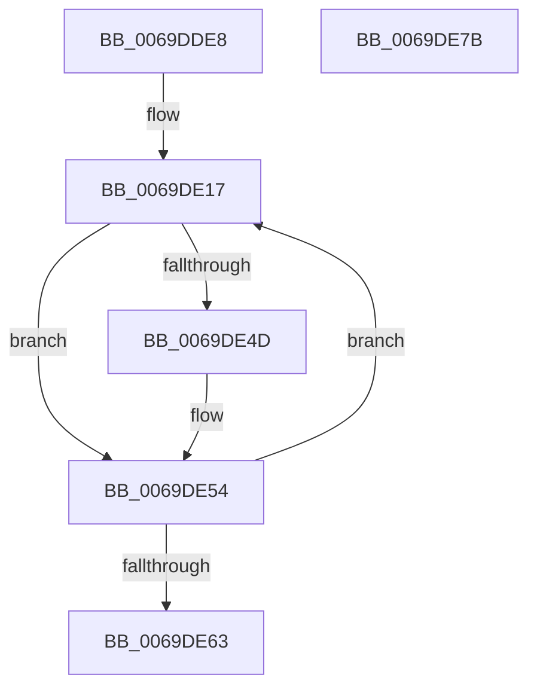

# AdtpDbInitializePrivilegeObject

- RVA: `0x0069DDE8`–`0x0069DE7C` (길이 `148` bytes)
- VA: `0x000000014069DDE8`
- 실행 섹션: `.text`
- PDB 이름 있음: `예`; PDB Function 태그: `아니요`
- unwind 정보 RVA: `0x000A85B0`
- 디코드: `38`개 명령, `148/148` bytes 표시
- 미해석 바이트: `0` (있으면 어셈블리에 `.byte`로 보존)

> 이 문서는 커널 이미지의 기계어와 PDB 기호를 분석해 생성했습니다. 4번과 5번은 함수 원형과 자료형을 바이너리 사용 방식에서 추정한 C 해석이며 원본 소스 복구 결과는 아닙니다.

## 1. Dependencies

- 직접 호출 지점: **1**; 고유 호출 대상: **1**
- 직접 호출자로 확인된 함수: **1**
- RIP 상대 이미지 참조: **4**

### Outgoing calls
- `0x0069DE3C` → [RtlInitUnicodeString](../42/RtlInitUnicodeString_function_0042A780.md) (function, `0x0042A780`)

### Direct callers
- [AdtpInitializeAuditingCommon](../../page/82/AdtpInitializeAuditingCommon_function_00823018.md) at `0x00823042`

### Static image references
- `0x0069DDFF` → RVA `0x00EF0A40` (`.data`; read)
- `0x0069DE06` → RVA `0x00EF0DA0` (`.data`; write)
- `0x0069DE0D` → RVA `0x0000C0E0` (`.rdata`; read)
- `0x0069DE44` → RVA `0x00EF0DA0` (`.data`; read)

## 2. Other-region calls and transfers

- 다른 실행 섹션으로 향하는 call: **0**
- 별도 외부 분기/꼬리 이동을 확인하지 못했습니다.

## 3. Assembly (complete function range)

```asm
0069DDE8  48 89 5C 24 10                  mov qword ptr [rsp + 0x10], rbx
0069DDED  48 89 74 24 18                  mov qword ptr [rsp + 0x18], rsi
0069DDF2  48 89 7C 24 20                  mov qword ptr [rsp + 0x20], rdi
0069DDF7  41 56                           push r14
0069DDF9  48 83 EC 20                     sub rsp, 0x20
0069DDFD  33 DB                           xor ebx, ebx
0069DDFF  4C 8D 35 3A 2C 85 00            lea r14, [rip + 0x852c3a]
0069DE06  66 89 1D 93 2F 85 00            mov word ptr [rip + 0x852f93], bx
0069DE0D  48 8D 35 CC E2 96 FF            lea rsi, [rip - 0x691d34]
0069DE14  49 8B FE                        mov rdi, r14
0069DE17  48 8B 16                        mov rdx, qword ptr [rsi]
0069DE1A  8D 43 02                        lea eax, [rbx + 2]
0069DE1D  48 98                           cdqe
0069DE1F  48 8D 0C 5B                     lea rcx, [rbx + rbx*2]
0069DE23  89 44 24 30                     mov dword ptr [rsp + 0x30], eax
0069DE27  49 8D 0C CE                     lea rcx, [r14 + rcx*8]
0069DE2B  48 C1 E8 20                     shr rax, 0x20
0069DE2F  89 44 24 34                     mov dword ptr [rsp + 0x34], eax
0069DE33  48 8B 44 24 30                  mov rax, qword ptr [rsp + 0x30]
0069DE38  48 89 47 10                     mov qword ptr [rdi + 0x10], rax
0069DE3C  E8 3F C9 D8 FF                  call 0x14042a780
0069DE41  0F B7 07                        movzx eax, word ptr [rdi]
0069DE44  66 39 05 55 2F 85 00            cmp word ptr [rip + 0x852f55], ax
0069DE4B  73 07                           jae 0x14069de54
0069DE4D  66 89 05 4C 2F 85 00            mov word ptr [rip + 0x852f4c], ax
0069DE54  FF C3                           inc ebx
0069DE56  48 83 C6 08                     add rsi, 8
0069DE5A  48 83 C7 18                     add rdi, 0x18
0069DE5E  83 FB 23                        cmp ebx, 0x23
0069DE61  72 B4                           jb 0x14069de17
0069DE63  48 8B 5C 24 38                  mov rbx, qword ptr [rsp + 0x38]
0069DE68  33 C0                           xor eax, eax
0069DE6A  48 8B 74 24 40                  mov rsi, qword ptr [rsp + 0x40]
0069DE6F  48 8B 7C 24 48                  mov rdi, qword ptr [rsp + 0x48]
0069DE74  48 83 C4 20                     add rsp, 0x20
0069DE78  41 5E                           pop r14
0069DE7A  C3                              ret
0069DE7B  CC                              int3
```

## 4. C-style interpretation (structured pseudocode)

```c
__int64 __fastcall AdtpDbInitializePrivilegeObject(void)
{
    __int64 result;
    __int64 v_rbx;
    __int64 v_rdi;
    __int64 v_rsi;
    __int64 v_rsp;
    unsigned __int64 v_stack_p10;
    unsigned __int64 v_stack_p18;
    unsigned __int64 v_stack_p20;
    unsigned int v_stack_p8;
    unsigned int v_stack_pC;

    v_stack_p10 = v_rbx;
    v_stack_p18 = v_rsi;
    v_stack_p20 = v_rdi;
    v_rsp = (v_rsp) - (32);
    v_rbx = 0;
    *(unsigned __int16 *)(v_rip + 8728467) = 0;
loc_0069DE17:
    v_stack_p8 = (unsigned int)(v_rbx + 2);
    result = (v_rbx + 2) >> (32);
    v_stack_pC = (unsigned int)(result);
    *(unsigned __int64 *)(v_rip + 8727610 + 16) = v_stack_p8;
    result = RtlInitUnicodeString(v_rip + 8727610 + v_rbx + v_rbx * 2 * 8, *(unsigned __int64 *)(v_rip - 6888756), a3, a4);
    if ((*(unsigned __int16 *)(v_rip + 8728405)) < ((unsigned __int16)(*(unsigned __int16 *)(v_rip + 8727610)))) {
        *(unsigned __int16 *)(v_rip + 8728396) = (unsigned __int16)(*(unsigned __int16 *)(v_rip + 8727610));
    }
    v_rbx = (unsigned int)((v_rbx) + 1);
    v_rsi = (v_rip - 6888756) + (8);
    v_rdi = (v_rip + 8727610) + (24);
    if (((unsigned int)(v_rbx)) < 35) goto loc_0069DE17;
    result = 0;
    v_rsp = (v_rsp) + (32);
    return result;
}
```

## 5. (Beta) C Style

```c
void AdtpDbInitializePrivilegeObject(void)
{
    int64_t result;
    int64_t local_rbx;
    int64_t local_rdi;
    int64_t local_rsi;
    int64_t local_rsp;
    uint64_t v_stack_p10;
    uint64_t v_stack_p18;
    uint64_t v_stack_p20;
    uint32_t v_stack_p8;
    uint32_t v_stack_pC;

    v_stack_p10 = local_rbx;
    v_stack_p18 = local_rsi;
    v_stack_p20 = local_rdi;
    local_rsp = (local_rsp) - (32);
    local_rbx = 0;
    *(uint16_t *)(v_rip + 0x852F93) = 0;
loc_0069DE17:
    v_stack_p8 = (uint32_t)(local_rbx + 2);
    result = (local_rbx + 2) >> (32);
    v_stack_pC = (uint32_t)(result);
    *(uint64_t *)(v_rip + 0x852C3A + 0x10) = v_stack_p8;
    result = RtlInitUnicodeString(v_rip + 8727610 + local_rbx + local_rbx * 2 * 8, *(uint64_t *)(v_rip - 0x691D34), a3, a4);
    if ((*(uint16_t *)(v_rip + 0x852F55)) < ((uint16_t)(*(uint16_t *)(v_rip + 0x852C3A)))) {
        *(uint16_t *)(v_rip + 0x852F4C) = (uint16_t)(*(uint16_t *)(v_rip + 0x852C3A));
    }
    local_rbx = (uint32_t)((local_rbx) + 1);
    local_rsi = (v_rip - 6888756) + (8);
    local_rdi = (v_rip + 8727610) + (24);
    if (((uint32_t)(local_rbx)) < 35) goto loc_0069DE17;
    result = 0;
    local_rsp = (local_rsp) + (32);
    return result;
}
```

## 6. Execution-region graph

[열기: 2D/3D 그래프와 함수 탐색 컨트롤 패널](../../../control-panel.html?section=text&rva=0x0069DDE8&view=graph)

- 2D 그래프는 위에서 아래로 흐르고, 3D 그래프는 빈 공간을 드래그해 회전합니다. Shift+드래그는 이동, 휠은 확대·축소, 함수 노드 선택은 대상 보고서 이동입니다.

### Static fallback


