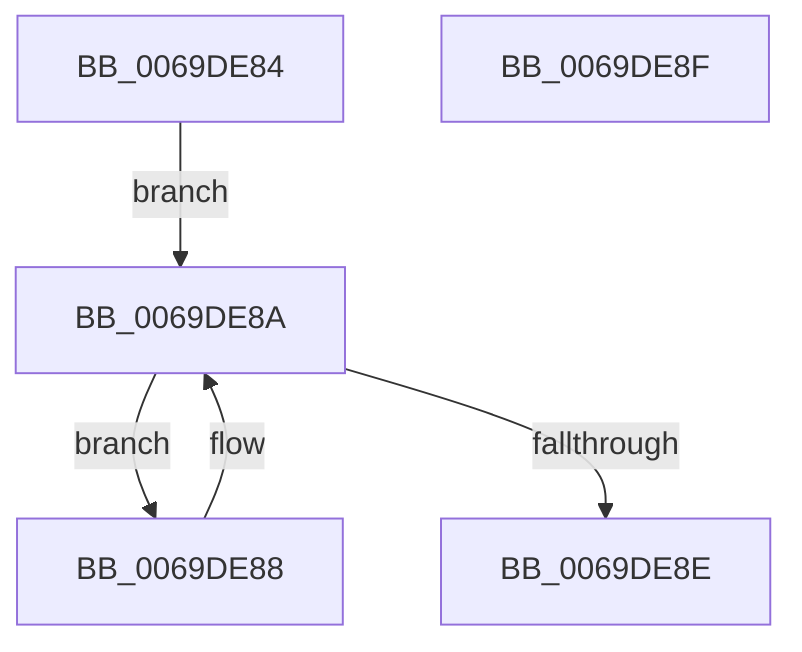

# AdtpPermissionBitPosition

- RVA: `0x0069DE84`–`0x0069DE90` (길이 `12` bytes)
- VA: `0x000000014069DE84`
- 실행 섹션: `.text`
- PDB 이름 있음: `예`; PDB Function 태그: `아니요`
- unwind 정보 RVA: `0x000DB714`
- 디코드: `7`개 명령, `12/12` bytes 표시
- 미해석 바이트: `0` (있으면 어셈블리에 `.byte`로 보존)

> 이 문서는 커널 이미지의 기계어와 PDB 기호를 분석해 생성했습니다. 4번과 5번은 함수 원형과 자료형을 바이너리 사용 방식에서 추정한 C 해석이며 원본 소스 복구 결과는 아닙니다.

## 1. Dependencies

- 직접 호출 지점: **0**; 고유 호출 대상: **0**
- 직접 호출자로 확인된 함수: **2**
- RIP 상대 이미지 참조: **0**

### Outgoing calls
- 직접 디코드된 call 명령이 없습니다.

### Direct callers
- [AdtpBuildAccessReasonAuditString](../40/AdtpBuildAccessReasonAuditString_function_0040EE04.md) at `0x0040F014`
- [AdtpBuildStagingReasonAuditStringInternal](AdtpBuildStagingReasonAuditStringInternal_function_0069DA44.md) at `0x0069DAEB`

### Static image references
- 디코드된 RIP-relative 메모리 참조가 없습니다.

## 2. Other-region calls and transfers

- 다른 실행 섹션으로 향하는 call: **0**
- 별도 외부 분기/꼬리 이동을 확인하지 못했습니다.

## 3. Assembly (complete function range)

```asm
0069DE84  32 C0                           xor al, al
0069DE86  EB 02                           jmp 0x14069de8a
0069DE88  FE C0                           inc al
0069DE8A  D1 E9                           shr ecx, 1
0069DE8C  75 FA                           jne 0x14069de88
0069DE8E  C3                              ret
0069DE8F  CC                              int3
```

## 4. C-style interpretation (structured pseudocode)

```c
__int64 __fastcall AdtpPermissionBitPosition(int a1)
{
    __int64 result;

    result = 0;
    goto loc_0069DE8A;
loc_0069DE88:
    result = (unsigned __int8)((result) + 1);
loc_0069DE8A:
    a1 = (unsigned int)((a1) >> (1));
    if (condition_is_not_equal) goto loc_0069DE88;
    return result;
}
```

## 5. (Beta) C Style

```c
int64_t AdtpPermissionBitPosition(int32_t Arg1)
{
    int64_t result;

    result = 0;
    goto loc_0069DE8A;
loc_0069DE88:
    result = (uint8_t)((result) + 1);
loc_0069DE8A:
    Arg1 = (uint32_t)((Arg1) >> (1));
    if (condition_is_not_equal) goto loc_0069DE88;
    return result;
}
```

## 6. Execution-region graph

[열기: 2D/3D 그래프와 함수 탐색 컨트롤 패널](../../../control-panel.html?section=text&rva=0x0069DE84&view=graph)

- 2D 그래프는 위에서 아래로 흐르고, 3D 그래프는 빈 공간을 드래그해 회전합니다. Shift+드래그는 이동, 휠은 확대·축소, 함수 노드 선택은 대상 보고서 이동입니다.

### Static fallback


