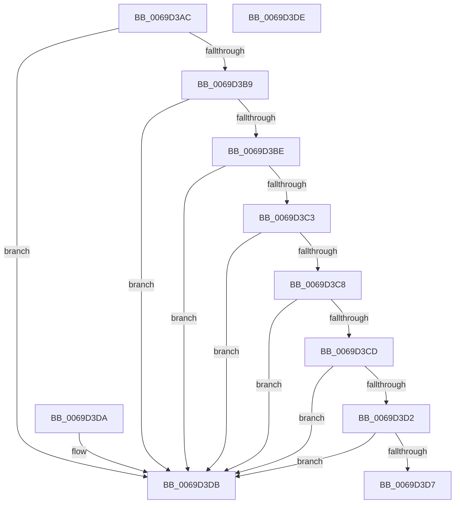

# AslpMemoryCheckBounds

- RVA: `0x0069D3AC`–`0x0069D3DF` (길이 `51` bytes)
- VA: `0x000000014069D3AC`
- 실행 섹션: `.text`
- PDB 이름 있음: `예`; PDB Function 태그: `아니요`
- unwind 정보 RVA: `0x000DB714`
- 디코드: `22`개 명령, `51/51` bytes 표시
- 미해석 바이트: `0` (있으면 어셈블리에 `.byte`로 보존)

> 이 문서는 커널 이미지의 기계어와 PDB 기호를 분석해 생성했습니다. 4번과 5번은 함수 원형과 자료형을 바이너리 사용 방식에서 추정한 C 해석이며 원본 소스 복구 결과는 아닙니다.

## 1. Dependencies

- 직접 호출 지점: **0**; 고유 호출 대상: **0**
- 직접 호출자로 확인된 함수: **3**
- RIP 상대 이미지 참조: **0**

### Outgoing calls
- 직접 디코드된 call 명령이 없습니다.

### Direct callers
- [AslpFileGetImageResourceDirectoryRoot](../../page/81/AslpFileGetImageResourceDirectoryRoot_function_0081F53C.md) at `0x0081F5C3`
- [AslpFileGetImageResourceDirectoryRoot](../../page/81/AslpFileGetImageResourceDirectoryRoot_function_0081F53C.md) at `0x0081F5F2`
- [AslpFileGetImageResourceDirectoryRoot](../../page/81/AslpFileGetImageResourceDirectoryRoot_function_0081F53C.md) at `0x0081F64F`
- [AslpFileGetImageResourceDirectoryRoot](../../page/81/AslpFileGetImageResourceDirectoryRoot_function_0081F53C.md) at `0x0081F69E`
- [AslpFileGetVersionBlockFromResourceRoot](../../page/81/AslpFileGetVersionBlockFromResourceRoot_function_0081FF98.md) at `0x0081FFFB`
- [AslpFileGetVersionBlockFromResourceRoot](../../page/81/AslpFileGetVersionBlockFromResourceRoot_function_0081FF98.md) at `0x00820041`
- [AslpFileGetVersionBlockFromResourceRoot](../../page/81/AslpFileGetVersionBlockFromResourceRoot_function_0081FF98.md) at `0x0082009E`
- [AslpFileGetVersionBlockFromResourceRoot](../../page/81/AslpFileGetVersionBlockFromResourceRoot_function_0081FF98.md) at `0x008200C8`
- [AslpFileGetVersionBlockFromResourceRoot](../../page/81/AslpFileGetVersionBlockFromResourceRoot_function_0081FF98.md) at `0x008200F9`
- [AslpFileGetVersionBlockFromResourceRoot](../../page/81/AslpFileGetVersionBlockFromResourceRoot_function_0081FF98.md) at `0x00820122`
- [AslpFileGetVersionBlockFromResourceRoot](../../page/81/AslpFileGetVersionBlockFromResourceRoot_function_0081FF98.md) at `0x00820164`
- [AslpFileGetVersionBlockFromResourceRoot](../../page/81/AslpFileGetVersionBlockFromResourceRoot_function_0081FF98.md) at `0x00820190`
- [AslpFileGetVersionBlockFromResourceRoot](../../page/81/AslpFileGetVersionBlockFromResourceRoot_function_0081FF98.md) at `0x008201C1`
- [AslpFileGetVersionBlockFromResourceRoot](../../page/81/AslpFileGetVersionBlockFromResourceRoot_function_0081FF98.md) at `0x008201DF`
- [AslpFileGetVersionBlockImageOnly](../../page/82/AslpFileGetVersionBlockImageOnly_function_00820260.md) at `0x0082042C`

### Static image references
- 디코드된 RIP-relative 메모리 참조가 없습니다.

## 2. Other-region calls and transfers

- 다른 실행 섹션으로 향하는 call: **0**
- 별도 외부 분기/꼬리 이동을 확인하지 못했습니다.

## 3. Assembly (complete function range)

```asm
0069D3AC  4C 8D 14 11                     lea r10, [rcx + rdx]
0069D3B0  4B 8D 04 08                     lea rax, [r8 + r9]
0069D3B4  49 3B C8                        cmp rcx, r8
0069D3B7  72 22                           jb 0x14069d3db
0069D3B9  49 3B CA                        cmp rcx, r10
0069D3BC  77 1D                           ja 0x14069d3db
0069D3BE  48 3B C8                        cmp rcx, rax
0069D3C1  77 18                           ja 0x14069d3db
0069D3C3  4D 3B D0                        cmp r10, r8
0069D3C6  72 13                           jb 0x14069d3db
0069D3C8  4C 3B D0                        cmp r10, rax
0069D3CB  77 0E                           ja 0x14069d3db
0069D3CD  4C 3B C0                        cmp r8, rax
0069D3D0  77 09                           ja 0x14069d3db
0069D3D2  49 3B D1                        cmp rdx, r9
0069D3D5  77 04                           ja 0x14069d3db
0069D3D7  B0 01                           mov al, 1
0069D3D9  C3                              ret
0069D3DA  CC                              int3
0069D3DB  32 C0                           xor al, al
0069D3DD  C3                              ret
0069D3DE  CC                              int3
```

## 4. C-style interpretation (structured pseudocode)

```c
__int64 __fastcall AslpMemoryCheckBounds(__int64 a1, __int64 a2, __int64 a3, __int64 a4)
{
    __int64 result;

    if (a1 < a3) goto loc_0069D3DB;
    if (a1 > (a1 + a2 * 1)) goto loc_0069D3DB;
    if (a1 > (a3 + a4 * 1)) goto loc_0069D3DB;
    if ((a1 + a2 * 1) < a3) goto loc_0069D3DB;
    if ((a1 + a2 * 1) > (a3 + a4 * 1)) goto loc_0069D3DB;
    if (a3 > (a3 + a4 * 1)) goto loc_0069D3DB;
    if (a2 > a4) goto loc_0069D3DB;
    return 1;
loc_0069D3DB:
    result = 0;
    return result;
}
```

## 5. (Beta) C Style

```c
int64_t AslpMemoryCheckBounds(void *Arg1, int64_t Arg2, void *Arg3, int64_t Arg4)
{
    uint8_t *arg1 = (uint8_t *)Arg1;
    uint8_t *arg3 = (uint8_t *)Arg3;

    int64_t result;

    if (Arg1 < Arg3) goto loc_0069D3DB;
    if (Arg1 > (Arg1 + Arg2 * 1)) goto loc_0069D3DB;
    if (Arg1 > (Arg3 + Arg4 * 1)) goto loc_0069D3DB;
    if ((Arg1 + Arg2 * 1) < Arg3) goto loc_0069D3DB;
    if ((Arg1 + Arg2 * 1) > (Arg3 + Arg4 * 1)) goto loc_0069D3DB;
    if (Arg3 > (Arg3 + Arg4 * 1)) goto loc_0069D3DB;
    if (Arg2 > Arg4) goto loc_0069D3DB;
    return 1;
loc_0069D3DB:
    result = 0;
    return result;
}
```

### 관측된 메모리 오프셋

구조체 형식이 확인되지 않은 접근은 인자 기준의 오프셋으로만 기록했습니다.

| 기준 인자 | 오프셋 표현 | 폭 (bit) | 접근 |
|---|---:|---:|---|
| `Arg1` | `+ 0x0 + rdx*1` | `64` | `R` |
| `Arg3` | `+ 0x0 + r9*1` | `64` | `R` |

## 6. Execution-region graph

[열기: 2D/3D 그래프와 함수 탐색 컨트롤 패널](../../../control-panel.html?section=text&rva=0x0069D3AC&view=graph)

- 2D 그래프는 위에서 아래로 흐르고, 3D 그래프는 빈 공간을 드래그해 회전합니다. Shift+드래그는 이동, 휠은 확대·축소, 함수 노드 선택은 대상 보고서 이동입니다.

### Static fallback


