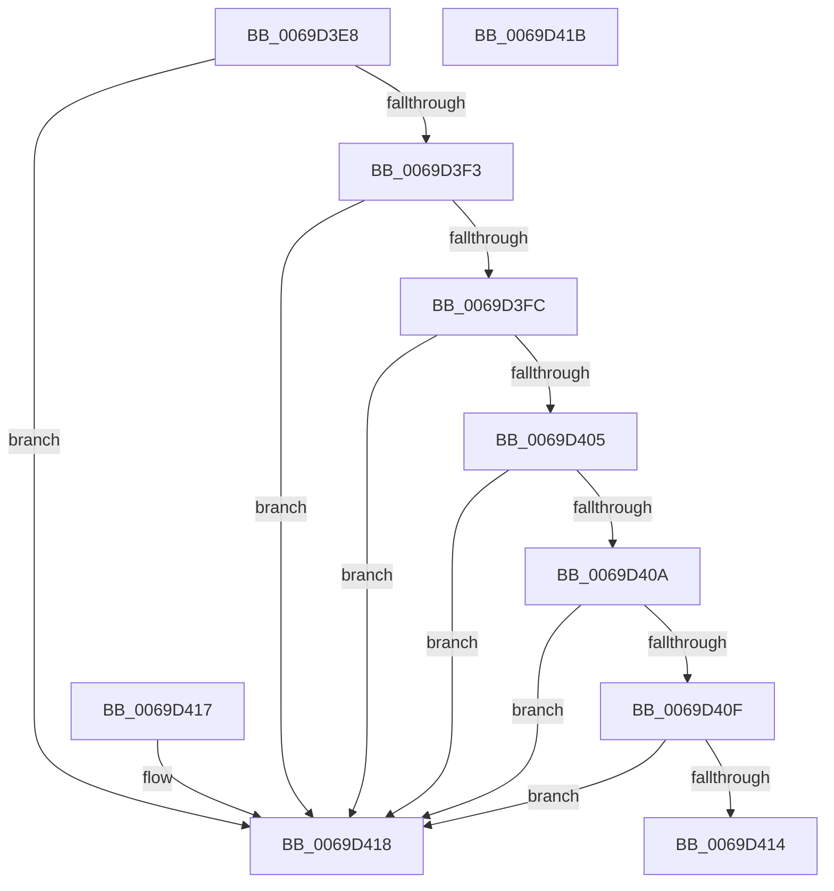

# AslpMemoryRangeCheckBounds

- RVA: `0x0069D3E8`–`0x0069D41C` (길이 `52` bytes)
- VA: `0x000000014069D3E8`
- 실행 섹션: `.text`
- PDB 이름 있음: `예`; PDB Function 태그: `아니요`
- unwind 정보 RVA: `0x000DB714`
- 디코드: `22`개 명령, `52/52` bytes 표시
- 미해석 바이트: `0` (있으면 어셈블리에 `.byte`로 보존)

> 이 문서는 커널 이미지의 기계어와 PDB 기호를 분석해 생성했습니다. 4번과 5번은 함수 원형과 자료형을 바이너리 사용 방식에서 추정한 C 해석이며 원본 소스 복구 결과는 아닙니다.

## 1. Dependencies

- 직접 호출 지점: **0**; 고유 호출 대상: **0**
- 직접 호출자로 확인된 함수: **2**
- RIP 상대 이미지 참조: **0**

### Outgoing calls
- 직접 디코드된 call 명령이 없습니다.

### Direct callers
- [AslpFileGetCrcChecksumBoot](../../page/81/AslpFileGetCrcChecksumBoot_function_0081E7D4.md) at `0x0081E877`
- [AslpFileGetCrcChecksumBoot](../../page/81/AslpFileGetCrcChecksumBoot_function_0081E7D4.md) at `0x0081E8E4`
- [AslpFileGetCrcChecksumBoot](../../page/81/AslpFileGetCrcChecksumBoot_function_0081E7D4.md) at `0x0081E963`
- [AslpFileGetCrcChecksumBoot](../../page/81/AslpFileGetCrcChecksumBoot_function_0081E7D4.md) at `0x0081E9BE`
- [AslpFileGetCrcChecksumBoot](../../page/81/AslpFileGetCrcChecksumBoot_function_0081E7D4.md) at `0x0081EA6C`
- [AslpFileGetImageCodeSectionHeader](../../page/81/AslpFileGetImageCodeSectionHeader_function_0081F298.md) at `0x0081F3A2`

### Static image references
- 디코드된 RIP-relative 메모리 참조가 없습니다.

## 2. Other-region calls and transfers

- 다른 실행 섹션으로 향하는 call: **0**
- 별도 외부 분기/꼬리 이동을 확인하지 못했습니다.

## 3. Assembly (complete function range)

```asm
0069D3E8  4C 8B 09                        mov r9, qword ptr [rcx]
0069D3EB  4C 8B 02                        mov r8, qword ptr [rdx]
0069D3EE  4D 3B C8                        cmp r9, r8
0069D3F1  72 25                           jb 0x14069d418
0069D3F3  48 8B 49 08                     mov rcx, qword ptr [rcx + 8]
0069D3F7  4C 3B C9                        cmp r9, rcx
0069D3FA  77 1C                           ja 0x14069d418
0069D3FC  48 8B 42 08                     mov rax, qword ptr [rdx + 8]
0069D400  4C 3B C8                        cmp r9, rax
0069D403  77 13                           ja 0x14069d418
0069D405  49 3B C8                        cmp rcx, r8
0069D408  72 0E                           jb 0x14069d418
0069D40A  48 3B C8                        cmp rcx, rax
0069D40D  77 09                           ja 0x14069d418
0069D40F  4C 3B C0                        cmp r8, rax
0069D412  77 04                           ja 0x14069d418
0069D414  B0 01                           mov al, 1
0069D416  C3                              ret
0069D417  CC                              int3
0069D418  32 C0                           xor al, al
0069D41A  C3                              ret
0069D41B  CC                              int3
```

## 4. C-style interpretation (structured pseudocode)

```c
__int64 __fastcall AslpMemoryRangeCheckBounds(__int64 a1, __int64 a2)
{
    __int64 result;

    if ((*(unsigned __int64 *)(a1)) < (*(unsigned __int64 *)(a2))) goto loc_0069D418;
    if ((*(unsigned __int64 *)(a1)) > (*(unsigned __int64 *)(a1 + 8))) goto loc_0069D418;
    if ((*(unsigned __int64 *)(a1)) > (*(unsigned __int64 *)(a2 + 8))) goto loc_0069D418;
    if ((*(unsigned __int64 *)(a1 + 8)) < (*(unsigned __int64 *)(a2))) goto loc_0069D418;
    if ((*(unsigned __int64 *)(a1 + 8)) > (*(unsigned __int64 *)(a2 + 8))) goto loc_0069D418;
    if ((*(unsigned __int64 *)(a2)) > (*(unsigned __int64 *)(a2 + 8))) goto loc_0069D418;
    return 1;
loc_0069D418:
    result = 0;
    return result;
}
```

## 5. (Beta) C Style

```c
int64_t AslpMemoryRangeCheckBounds(void *Arg1, void *Arg2)
{
    uint8_t *arg1 = (uint8_t *)Arg1;
    uint8_t *arg2 = (uint8_t *)Arg2;

    int64_t result;

    if ((*(uint64_t *)(arg1)) < (*(uint64_t *)(arg2))) goto loc_0069D418;
    if ((*(uint64_t *)(arg1)) > (*(uint64_t *)(arg1 + 0x8))) goto loc_0069D418;
    if ((*(uint64_t *)(arg1)) > (*(uint64_t *)(arg2 + 0x8))) goto loc_0069D418;
    if ((*(uint64_t *)(arg1 + 0x8)) < (*(uint64_t *)(arg2))) goto loc_0069D418;
    if ((*(uint64_t *)(arg1 + 0x8)) > (*(uint64_t *)(arg2 + 0x8))) goto loc_0069D418;
    if ((*(uint64_t *)(arg2)) > (*(uint64_t *)(arg2 + 0x8))) goto loc_0069D418;
    return 1;
loc_0069D418:
    result = 0;
    return result;
}
```

### 관측된 메모리 오프셋

구조체 형식이 확인되지 않은 접근은 인자 기준의 오프셋으로만 기록했습니다.

| 기준 인자 | 오프셋 표현 | 폭 (bit) | 접근 |
|---|---:|---:|---|
| `Arg1` | `+ 0x0` | `64` | `R` |
| `Arg1` | `+ 0x8` | `64` | `R` |
| `Arg2` | `+ 0x0` | `64` | `R` |
| `Arg2` | `+ 0x8` | `64` | `R` |

## 6. Execution-region graph

[열기: 2D/3D 그래프와 함수 탐색 컨트롤 패널](../../../control-panel.html?section=text&rva=0x0069D3E8&view=graph)

- 2D 그래프는 위에서 아래로 흐르고, 3D 그래프는 빈 공간을 드래그해 회전합니다. Shift+드래그는 이동, 휠은 확대·축소, 함수 노드 선택은 대상 보고서 이동입니다.

### Static fallback


