# AslpMemorySpanCheckBounds

- RVA: `0x0069D424`–`0x0069D465` (길이 `65` bytes)
- VA: `0x000000014069D424`
- 실행 섹션: `.text`
- PDB 이름 있음: `예`; PDB Function 태그: `아니요`
- unwind 정보 RVA: `0x000DB714`
- 디코드: `26`개 명령, `65/65` bytes 표시
- 미해석 바이트: `0` (있으면 어셈블리에 `.byte`로 보존)

> 이 문서는 커널 이미지의 기계어와 PDB 기호를 분석해 생성했습니다. 4번과 5번은 함수 원형과 자료형을 바이너리 사용 방식에서 추정한 C 해석이며 원본 소스 복구 결과는 아닙니다.

## 1. Dependencies

- 직접 호출 지점: **0**; 고유 호출 대상: **0**
- 직접 호출자로 확인된 함수: **2**
- RIP 상대 이미지 참조: **0**

### Outgoing calls
- 직접 디코드된 call 명령이 없습니다.

### Direct callers
- [AslpFileGetImageCodeSectionHeader](../../page/81/AslpFileGetImageCodeSectionHeader_function_0081F298.md) at `0x0081F36C`
- [AslpFileQueryExportName](../../page/82/AslpFileQueryExportName_function_00820EF8.md) at `0x00820FD6`
- [AslpFileQueryExportName](../../page/82/AslpFileQueryExportName_function_00820EF8.md) at `0x00821016`
- [AslpFileQueryExportName](../../page/82/AslpFileQueryExportName_function_00820EF8.md) at `0x0082107E`

### Static image references
- 디코드된 RIP-relative 메모리 참조가 없습니다.

## 2. Other-region calls and transfers

- 다른 실행 섹션으로 향하는 call: **0**
- 별도 외부 분기/꼬리 이동을 확인하지 못했습니다.

## 3. Assembly (complete function range)

```asm
0069D424  4C 8B 09                        mov r9, qword ptr [rcx]
0069D427  4C 8B 02                        mov r8, qword ptr [rdx]
0069D42A  4C 8B 51 08                     mov r10, qword ptr [rcx + 8]
0069D42E  4C 8B 5A 08                     mov r11, qword ptr [rdx + 8]
0069D432  4B 8D 0C 11                     lea rcx, [r9 + r10]
0069D436  4B 8D 04 18                     lea rax, [r8 + r11]
0069D43A  4D 3B C8                        cmp r9, r8
0069D43D  72 22                           jb 0x14069d461
0069D43F  4C 3B C9                        cmp r9, rcx
0069D442  77 1D                           ja 0x14069d461
0069D444  4C 3B C8                        cmp r9, rax
0069D447  77 18                           ja 0x14069d461
0069D449  49 3B C8                        cmp rcx, r8
0069D44C  72 13                           jb 0x14069d461
0069D44E  48 3B C8                        cmp rcx, rax
0069D451  77 0E                           ja 0x14069d461
0069D453  4C 3B C0                        cmp r8, rax
0069D456  77 09                           ja 0x14069d461
0069D458  4D 3B D3                        cmp r10, r11
0069D45B  77 04                           ja 0x14069d461
0069D45D  B0 01                           mov al, 1
0069D45F  C3                              ret
0069D460  CC                              int3
0069D461  32 C0                           xor al, al
0069D463  C3                              ret
0069D464  CC                              int3
```

## 4. C-style interpretation (structured pseudocode)

```c
__int64 __fastcall AslpMemorySpanCheckBounds(__int64 a1, __int64 a2)
{
    __int64 result;

    if ((*(unsigned __int64 *)(a1)) < (*(unsigned __int64 *)(a2))) goto loc_0069D461;
    if ((*(unsigned __int64 *)(a1)) > (*(unsigned __int64 *)(a1) + *(unsigned __int64 *)(a1 + 8) * 1)) goto loc_0069D461;
    if ((*(unsigned __int64 *)(a1)) > (*(unsigned __int64 *)(a2) + *(unsigned __int64 *)(a2 + 8) * 1)) goto loc_0069D461;
    if ((*(unsigned __int64 *)(a1) + *(unsigned __int64 *)(a1 + 8) * 1) < (*(unsigned __int64 *)(a2))) goto loc_0069D461;
    if ((*(unsigned __int64 *)(a1) + *(unsigned __int64 *)(a1 + 8) * 1) > (*(unsigned __int64 *)(a2) + *(unsigned __int64 *)(a2 + 8) * 1)) goto loc_0069D461;
    if ((*(unsigned __int64 *)(a2)) > (*(unsigned __int64 *)(a2) + *(unsigned __int64 *)(a2 + 8) * 1)) goto loc_0069D461;
    if ((*(unsigned __int64 *)(a1 + 8)) > (*(unsigned __int64 *)(a2 + 8))) goto loc_0069D461;
    return 1;
loc_0069D461:
    result = 0;
    return result;
}
```

## 5. (Beta) C Style

```c
int64_t AslpMemorySpanCheckBounds(void *Arg1, void *Arg2)
{
    uint8_t *arg1 = (uint8_t *)Arg1;
    uint8_t *arg2 = (uint8_t *)Arg2;

    int64_t result;

    if ((*(uint64_t *)(arg1)) < (*(uint64_t *)(arg2))) goto loc_0069D461;
    if ((*(uint64_t *)(arg1)) > (*(uint64_t *)(arg1) + *(uint64_t *)(arg1 + 0x8) * 1)) goto loc_0069D461;
    if ((*(uint64_t *)(arg1)) > (*(uint64_t *)(arg2) + *(uint64_t *)(arg2 + 0x8) * 1)) goto loc_0069D461;
    if ((*(uint64_t *)(arg1) + *(uint64_t *)(arg1 + 0x8) * 1) < (*(uint64_t *)(arg2))) goto loc_0069D461;
    if ((*(uint64_t *)(arg1) + *(uint64_t *)(arg1 + 0x8) * 1) > (*(uint64_t *)(arg2) + *(uint64_t *)(arg2 + 0x8) * 1)) goto loc_0069D461;
    if ((*(uint64_t *)(arg2)) > (*(uint64_t *)(arg2) + *(uint64_t *)(arg2 + 0x8) * 1)) goto loc_0069D461;
    if ((*(uint64_t *)(arg1 + 0x8)) > (*(uint64_t *)(arg2 + 0x8))) goto loc_0069D461;
    return 1;
loc_0069D461:
    result = 0;
    return result;
}
```

### 관측된 메모리 오프셋

구조체 형식이 확인되지 않은 접근은 인자 기준의 오프셋으로만 기록했습니다.

| 기준 인자 | 오프셋 표현 | 폭 (bit) | 접근 |
|---|---:|---:|---|
| `Arg1` | `+ 0x0` | `64` | `R` |
| `Arg1` | `+ 0x8` | `64` | `R` |
| `Arg2` | `+ 0x0` | `64` | `R` |
| `Arg2` | `+ 0x8` | `64` | `R` |

## 6. Execution-region graph

[열기: 2D/3D 그래프와 함수 탐색 컨트롤 패널](../../../control-panel.html?section=text&rva=0x0069D424&view=graph)

- 2D 그래프는 위에서 아래로 흐르고, 3D 그래프는 빈 공간을 드래그해 회전합니다. Shift+드래그는 이동, 휠은 확대·축소, 함수 노드 선택은 대상 보고서 이동입니다.

### Static fallback

```mermaid
flowchart TD
  bb_0069D424[BB_0069D424]
  bb_0069D43F[BB_0069D43F]
  bb_0069D444[BB_0069D444]
  bb_0069D449[BB_0069D449]
  bb_0069D44E[BB_0069D44E]
  bb_0069D453[BB_0069D453]
  bb_0069D458[BB_0069D458]
  bb_0069D45D[BB_0069D45D]
  bb_0069D460[BB_0069D460]
  bb_0069D461[BB_0069D461]
  bb_0069D464[BB_0069D464]
  bb_0069D424 -->|branch| bb_0069D461
  bb_0069D424 -->|fallthrough| bb_0069D43F
  bb_0069D43F -->|branch| bb_0069D461
  bb_0069D43F -->|fallthrough| bb_0069D444
  bb_0069D444 -->|branch| bb_0069D461
  bb_0069D444 -->|fallthrough| bb_0069D449
  bb_0069D449 -->|branch| bb_0069D461
  bb_0069D449 -->|fallthrough| bb_0069D44E
  bb_0069D44E -->|branch| bb_0069D461
  bb_0069D44E -->|fallthrough| bb_0069D453
  bb_0069D453 -->|branch| bb_0069D461
  bb_0069D453 -->|fallthrough| bb_0069D458
  bb_0069D458 -->|branch| bb_0069D461
  bb_0069D458 -->|fallthrough| bb_0069D45D
  bb_0069D460 -->|flow| bb_0069D461
```


