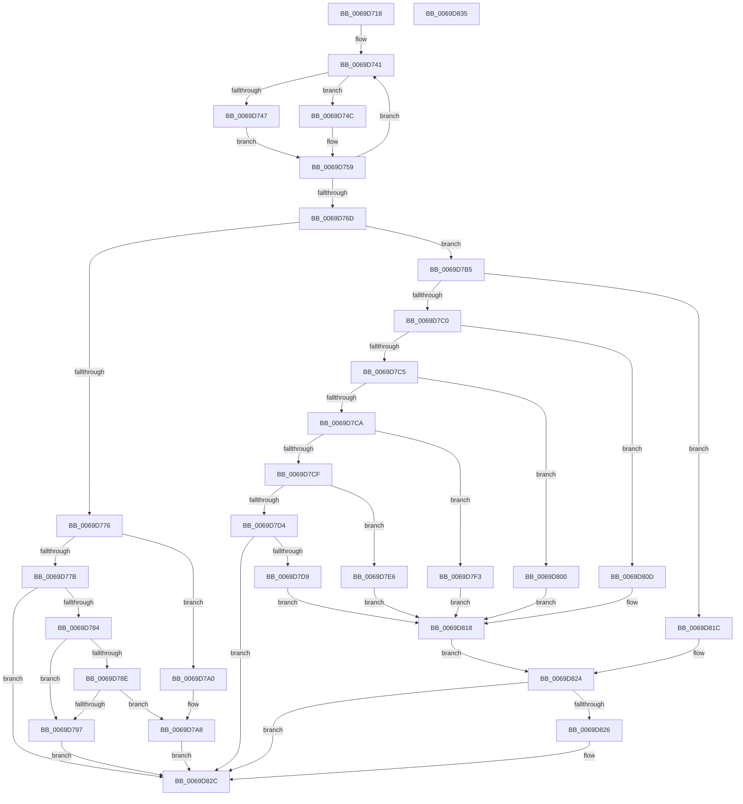

# AuthzBasepCompareIntegerOperands

- RVA: `0x0069D718`–`0x0069D836` (길이 `286` bytes)
- VA: `0x000000014069D718`
- 실행 섹션: `.text`
- PDB 이름 있음: `예`; PDB Function 태그: `아니요`
- unwind 정보 RVA: `0x000BE840`
- 디코드: `88`개 명령, `286/286` bytes 표시
- 미해석 바이트: `0` (있으면 어셈블리에 `.byte`로 보존)

> 이 문서는 커널 이미지의 기계어와 PDB 기호를 분석해 생성했습니다. 4번과 5번은 함수 원형과 자료형을 바이너리 사용 방식에서 추정한 C 해석이며 원본 소스 복구 결과는 아닙니다.

## 1. Dependencies

- 직접 호출 지점: **1**; 고유 호출 대상: **1**
- 직접 호출자로 확인된 함수: **2**
- RIP 상대 이미지 참조: **0**

### Outgoing calls
- `0x0069D7AB` → [AuthzBasepCompareUnsigned](../30/AuthzBasepCompareUnsigned_function_00302FEC.md) (function, `0x00302FEC`)

### Direct callers
- [AuthzBasepValueInSet](../2F/AuthzBasepValueInSet_function_002FE9B0.md) at `0x002FEB78`
- [AuthzBasepEvaluateExpression](../30/AuthzBasepEvaluateExpression_function_00300578.md) at `0x003006B8`

### Static image references
- 디코드된 RIP-relative 메모리 참조가 없습니다.

## 2. Other-region calls and transfers

- 다른 실행 섹션으로 향하는 call: **0**
- 별도 외부 분기/꼬리 이동을 확인하지 못했습니다.

## 3. Assembly (complete function range)

```asm
0069D718  40 55                           push rbp
0069D71A  48 8B EC                        mov rbp, rsp
0069D71D  48 83 EC 30                     sub rsp, 0x30
0069D721  48 83 4D F0 FF                  or qword ptr [rbp - 0x10], 0xffffffffffffffff
0069D726  45 33 C0                        xor r8d, r8d
0069D729  48 83 4D F8 FF                  or qword ptr [rbp - 8], 0xffffffffffffffff
0069D72E  44 0F B6 C9                     movzx r9d, cl
0069D732  48 83 C2 20                     add rdx, 0x20
0069D736  41 8B C8                        mov ecx, r8d
0069D739  45 8D 58 02                     lea r11d, [r8 + 2]
0069D73D  45 0F B7 D3                     movzx r10d, r11w
0069D741  83 7A EC 01                     cmp dword ptr [rdx - 0x14], 1
0069D745  75 05                           jne 0x14069d74c
0069D747  48 8B 02                        mov rax, qword ptr [rdx]
0069D74A  EB 0D                           jmp 0x14069d759
0069D74C  48 8B 42 F0                     mov rax, qword ptr [rdx - 0x10]
0069D750  44 0F B7 52 E0                  movzx r10d, word ptr [rdx - 0x20]
0069D755  48 8B 40 30                     mov rax, qword ptr [rax + 0x30]
0069D759  48 8B 00                        mov rax, qword ptr [rax]
0069D75C  48 83 C2 28                     add rdx, 0x28
0069D760  48 89 44 CD F0                  mov qword ptr [rbp + rcx*8 - 0x10], rax
0069D765  48 FF C1                        inc rcx
0069D768  49 3B CB                        cmp rcx, r11
0069D76B  7C D4                           jl 0x14069d741
0069D76D  41 0F B7 CA                     movzx ecx, r10w
0069D771  83 E9 01                        sub ecx, 1
0069D774  74 3F                           je 0x14069d7b5
0069D776  83 E9 01                        sub ecx, 1
0069D779  74 25                           je 0x14069d7a0
0069D77B  83 F9 04                        cmp ecx, 4
0069D77E  0F 85 A8 00 00 00               jne 0x14069d82c
0069D784  48 8B 55 F0                     mov rdx, qword ptr [rbp - 0x10]
0069D788  48 83 FA 01                     cmp rdx, 1
0069D78C  77 09                           ja 0x14069d797
0069D78E  4C 8B 45 F8                     mov r8, qword ptr [rbp - 8]
0069D792  4D 3B C3                        cmp r8, r11
0069D795  72 11                           jb 0x14069d7a8
0069D797  41 83 C8 FF                     or r8d, 0xffffffff
0069D79B  E9 8C 00 00 00                  jmp 0x14069d82c
0069D7A0  4C 8B 45 F8                     mov r8, qword ptr [rbp - 8]
0069D7A4  48 8B 55 F0                     mov rdx, qword ptr [rbp - 0x10]
0069D7A8  41 8A C9                        mov cl, r9b
0069D7AB  E8 3C 58 C6 FF                  call 0x140302fec
0069D7B0  44 8B C0                        mov r8d, eax
0069D7B3  EB 77                           jmp 0x14069d82c
0069D7B5  41 8B C9                        mov ecx, r9d
0069D7B8  81 E9 80 00 00 00               sub ecx, 0x80
0069D7BE  74 5C                           je 0x14069d81c
0069D7C0  83 E9 01                        sub ecx, 1
0069D7C3  74 48                           je 0x14069d80d
0069D7C5  83 E9 01                        sub ecx, 1
0069D7C8  74 36                           je 0x14069d800
0069D7CA  83 E9 01                        sub ecx, 1
0069D7CD  74 24                           je 0x14069d7f3
0069D7CF  83 E9 01                        sub ecx, 1
0069D7D2  74 12                           je 0x14069d7e6
0069D7D4  83 F9 01                        cmp ecx, 1
0069D7D7  75 53                           jne 0x14069d82c
0069D7D9  48 8B 45 F8                     mov rax, qword ptr [rbp - 8]
0069D7DD  48 39 45 F0                     cmp qword ptr [rbp - 0x10], rax
0069D7E1  0F 9D C0                        setge al
0069D7E4  EB 32                           jmp 0x14069d818
0069D7E6  48 8B 45 F8                     mov rax, qword ptr [rbp - 8]
0069D7EA  48 39 45 F0                     cmp qword ptr [rbp - 0x10], rax
0069D7EE  0F 9F C0                        setg al
0069D7F1  EB 25                           jmp 0x14069d818
0069D7F3  48 8B 45 F8                     mov rax, qword ptr [rbp - 8]
0069D7F7  48 39 45 F0                     cmp qword ptr [rbp - 0x10], rax
0069D7FB  0F 9E C0                        setle al
0069D7FE  EB 18                           jmp 0x14069d818
0069D800  48 8B 45 F8                     mov rax, qword ptr [rbp - 8]
0069D804  48 39 45 F0                     cmp qword ptr [rbp - 0x10], rax
0069D808  0F 9C C0                        setl al
0069D80B  EB 0B                           jmp 0x14069d818
0069D80D  48 8B 45 F8                     mov rax, qword ptr [rbp - 8]
0069D811  48 39 45 F0                     cmp qword ptr [rbp - 0x10], rax
0069D815  0F 95 C0                        setne al
0069D818  3C 01                           cmp al, 1
0069D81A  EB 08                           jmp 0x14069d824
0069D81C  48 8B 45 F8                     mov rax, qword ptr [rbp - 8]
0069D820  48 39 45 F0                     cmp qword ptr [rbp - 0x10], rax
0069D824  75 06                           jne 0x14069d82c
0069D826  41 B8 01 00 00 00               mov r8d, 1
0069D82C  41 8B C0                        mov eax, r8d
0069D82F  48 83 C4 30                     add rsp, 0x30
0069D833  5D                              pop rbp
0069D834  C3                              ret
0069D835  CC                              int3
```

## 4. C-style interpretation (structured pseudocode)

```c
__int64 __fastcall AuthzBasepCompareIntegerOperands(unsigned __int8 a1, __int64 a2, int a3)
{
    __int64 result;
    __int64 v_rsp;
    unsigned __int64 v_stack_m10;
    unsigned __int64 v_stack_m18;

    v_rsp = (v_rsp) - (48);
    a3 = 0;
    a2 = (a2) + (32);
loc_0069D741:
    if ((*(unsigned int *)(a2 - 20)) != 1) goto loc_0069D74C;
    goto loc_0069D759;
loc_0069D74C:
loc_0069D759:
    a2 = (a2) + (40);
    *(unsigned __int64 *)(v_rsp + 0 * 8 - 16) = *(unsigned __int64 *)(*(unsigned __int64 *)(*(unsigned __int64 *)(a2 - 16) + 48));
    a1 = (0) + 1;
    if (a1 < (a3 + 2)) goto loc_0069D741;
    a1 = (unsigned int)(((unsigned __int16)(*(unsigned __int16 *)(a2 - 32))) - (1));
    if (condition_is_equal) goto loc_0069D7B5;
    a1 = (unsigned int)((a1) - (1));
    if (condition_is_equal) goto loc_0069D7A0;
    if (a1 != 4) goto loc_0069D82C;
    if (v_stack_m18 > 1) goto loc_0069D797;
    if (v_stack_m10 < (a3 + 2)) goto loc_0069D7A8;
loc_0069D797:
    a3 = (unsigned int)((v_stack_m10) | (0xFFFFFFFFULL));
    goto loc_0069D82C;
loc_0069D7A0:
loc_0069D7A8:
    result = AuthzBasepCompareUnsigned(a1, v_stack_m18, v_stack_m10, a1);
    goto loc_0069D82C;
loc_0069D7B5:
    a1 = (unsigned int)(((unsigned int)(a1)) - (128));
    if (condition_is_equal) goto loc_0069D81C;
    a1 = (unsigned int)((a1) - (1));
    if (condition_is_equal) goto loc_0069D80D;
    a1 = (unsigned int)((a1) - (1));
    if (condition_is_equal) goto loc_0069D800;
    a1 = (unsigned int)((a1) - (1));
    if (condition_is_equal) goto loc_0069D7F3;
    a1 = (unsigned int)((a1) - (1));
    if (condition_is_equal) goto loc_0069D7E6;
    if (a1 != 1) goto loc_0069D82C;
    result = (v_stack_m18 >= v_stack_m10) ? 1 : 0;
    goto loc_0069D818;
loc_0069D7E6:
    result = (v_stack_m18 > v_stack_m10) ? 1 : 0;
    goto loc_0069D818;
loc_0069D7F3:
    result = (v_stack_m18 <= v_stack_m10) ? 1 : 0;
    goto loc_0069D818;
loc_0069D800:
    result = (v_stack_m18 < v_stack_m10) ? 1 : 0;
    goto loc_0069D818;
loc_0069D80D:
    result = (v_stack_m18 != v_stack_m10) ? 1 : 0;
loc_0069D818:
    goto loc_0069D824;
loc_0069D81C:
loc_0069D824:
    if (v_stack_m18 == v_stack_m10) {
        a3 = 1;
    }
    v_rsp = (v_rsp) + (48);
    return (unsigned int)(a3);
}
```

## 5. (Beta) C Style

```c
int64_t AuthzBasepCompareIntegerOperands(uint8_t Arg1, void *Arg2, int32_t Arg3)
{
    uint8_t *arg2 = (uint8_t *)Arg2;

    int64_t result;
    int64_t local_rsp;
    uint64_t v_stack_m10;
    uint64_t v_stack_m18;

    local_rsp = (local_rsp) - (48);
    Arg3 = 0;
    Arg2 = (Arg2) + (32);
loc_0069D741:
    if ((*(uint32_t *)(arg2 - 0x14)) != 1) goto loc_0069D74C;
    goto loc_0069D759;
loc_0069D74C:
loc_0069D759:
    Arg2 = (Arg2) + (40);
    *(uint64_t *)(local_rsp + 0x0 * 8 - 0x10) = *(uint64_t *)(*(uint64_t *)(*(uint64_t *)(arg2 - 0x10) + 0x30));
    Arg1 = (0) + 1;
    if (Arg1 < (Arg3 + 2)) goto loc_0069D741;
    Arg1 = (uint32_t)(((uint16_t)(*(uint16_t *)(arg2 - 0x20))) - (1));
    if (condition_is_equal) goto loc_0069D7B5;
    Arg1 = (uint32_t)((Arg1) - (1));
    if (condition_is_equal) goto loc_0069D7A0;
    if (Arg1 != 4) goto loc_0069D82C;
    if (v_stack_m18 > 1) goto loc_0069D797;
    if (v_stack_m10 < (Arg3 + 2)) goto loc_0069D7A8;
loc_0069D797:
    Arg3 = (uint32_t)((v_stack_m10) | (0xFFFFFFFFULL));
    goto loc_0069D82C;
loc_0069D7A0:
loc_0069D7A8:
    result = AuthzBasepCompareUnsigned(Arg1, v_stack_m18, v_stack_m10, Arg1);
    goto loc_0069D82C;
loc_0069D7B5:
    Arg1 = (uint32_t)(((uint32_t)(Arg1)) - (128));
    if (condition_is_equal) goto loc_0069D81C;
    Arg1 = (uint32_t)((Arg1) - (1));
    if (condition_is_equal) goto loc_0069D80D;
    Arg1 = (uint32_t)((Arg1) - (1));
    if (condition_is_equal) goto loc_0069D800;
    Arg1 = (uint32_t)((Arg1) - (1));
    if (condition_is_equal) goto loc_0069D7F3;
    Arg1 = (uint32_t)((Arg1) - (1));
    if (condition_is_equal) goto loc_0069D7E6;
    if (Arg1 != 1) goto loc_0069D82C;
    result = (v_stack_m18 >= v_stack_m10) ? 1 : 0;
    goto loc_0069D818;
loc_0069D7E6:
    result = (v_stack_m18 > v_stack_m10) ? 1 : 0;
    goto loc_0069D818;
loc_0069D7F3:
    result = (v_stack_m18 <= v_stack_m10) ? 1 : 0;
    goto loc_0069D818;
loc_0069D800:
    result = (v_stack_m18 < v_stack_m10) ? 1 : 0;
    goto loc_0069D818;
loc_0069D80D:
    result = (v_stack_m18 != v_stack_m10) ? 1 : 0;
loc_0069D818:
    goto loc_0069D824;
loc_0069D81C:
loc_0069D824:
    if (v_stack_m18 == v_stack_m10) {
        Arg3 = 1;
    }
    local_rsp = (local_rsp) + (48);
    return (uint32_t)(Arg3);
}
```

### 관측된 메모리 오프셋

구조체 형식이 확인되지 않은 접근은 인자 기준의 오프셋으로만 기록했습니다.

| 기준 인자 | 오프셋 표현 | 폭 (bit) | 접근 |
|---|---:|---:|---|
| `Arg2` | `- 0x20` | `16` | `R` |
| `Arg2` | `- 0x14` | `32` | `R` |
| `Arg2` | `- 0x10` | `64` | `R` |
| `Arg2` | `+ 0x0` | `64` | `R` |

## 6. Execution-region graph

[열기: 2D/3D 그래프와 함수 탐색 컨트롤 패널](../../../control-panel.html?section=text&rva=0x0069D718&view=graph)

- 2D 그래프는 위에서 아래로 흐르고, 3D 그래프는 빈 공간을 드래그해 회전합니다. Shift+드래그는 이동, 휠은 확대·축소, 함수 노드 선택은 대상 보고서 이동입니다.

### Static fallback


