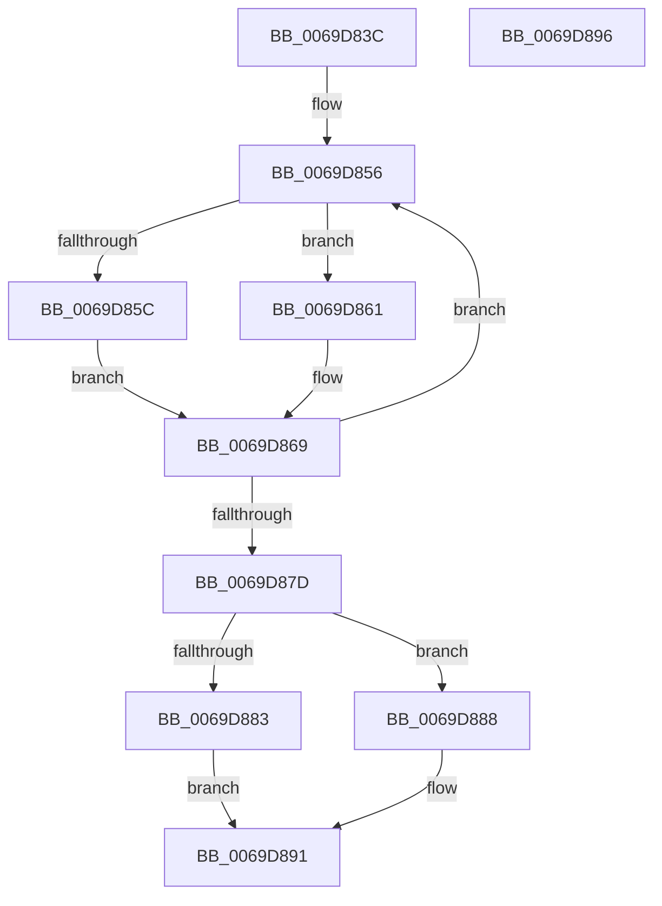

# AuthzBasepComputeBitwise

- RVA: `0x0069D83C`–`0x0069D897` (길이 `91` bytes)
- VA: `0x000000014069D83C`
- 실행 섹션: `.text`
- PDB 이름 있음: `예`; PDB Function 태그: `아니요`
- unwind 정보 RVA: `0x000A67F4`
- 디코드: `28`개 명령, `91/91` bytes 표시
- 미해석 바이트: `0` (있으면 어셈블리에 `.byte`로 보존)

> 이 문서는 커널 이미지의 기계어와 PDB 기호를 분석해 생성했습니다. 4번과 5번은 함수 원형과 자료형을 바이너리 사용 방식에서 추정한 C 해석이며 원본 소스 복구 결과는 아닙니다.

## 1. Dependencies

- 직접 호출 지점: **0**; 고유 호출 대상: **0**
- 직접 호출자로 확인된 함수: **1**
- RIP 상대 이미지 참조: **0**

### Outgoing calls
- 직접 디코드된 call 명령이 없습니다.

### Direct callers
- [AuthzBasepEvaluateAceCondition](../2F/AuthzBasepEvaluateAceCondition_function_002FEBD0.md) at `0x002FFCFF`

### Static image references
- 디코드된 RIP-relative 메모리 참조가 없습니다.

## 2. Other-region calls and transfers

- 다른 실행 섹션으로 향하는 call: **0**
- 별도 외부 분기/꼬리 이동을 확인하지 못했습니다.

## 3. Assembly (complete function range)

```asm
0069D83C  48 83 EC 18                     sub rsp, 0x18
0069D840  49 83 C9 FF                     or r9, 0xffffffffffffffff
0069D844  33 C0                           xor eax, eax
0069D846  4C 89 0C 24                     mov qword ptr [rsp], r9
0069D84A  48 83 C2 20                     add rdx, 0x20
0069D84E  4C 89 4C 24 08                  mov qword ptr [rsp + 8], r9
0069D853  44 8A C1                        mov r8b, cl
0069D856  83 7A EC 01                     cmp dword ptr [rdx - 0x14], 1
0069D85A  75 05                           jne 0x14069d861
0069D85C  48 8B 0A                        mov rcx, qword ptr [rdx]
0069D85F  EB 08                           jmp 0x14069d869
0069D861  48 8B 4A F0                     mov rcx, qword ptr [rdx - 0x10]
0069D865  48 8B 49 30                     mov rcx, qword ptr [rcx + 0x30]
0069D869  48 8B 09                        mov rcx, qword ptr [rcx]
0069D86C  48 83 C2 28                     add rdx, 0x28
0069D870  48 89 0C C4                     mov qword ptr [rsp + rax*8], rcx
0069D874  48 FF C0                        inc rax
0069D877  48 83 F8 02                     cmp rax, 2
0069D87B  7C D9                           jl 0x14069d856
0069D87D  41 80 F8 A3                     cmp r8b, 0xa3
0069D881  74 05                           je 0x14069d888
0069D883  49 8B C1                        mov rax, r9
0069D886  EB 09                           jmp 0x14069d891
0069D888  48 8B 44 24 08                  mov rax, qword ptr [rsp + 8]
0069D88D  48 23 04 24                     and rax, qword ptr [rsp]
0069D891  48 83 C4 18                     add rsp, 0x18
0069D895  C3                              ret
0069D896  CC                              int3
```

## 4. C-style interpretation (structured pseudocode)

```c
__int64 __fastcall AuthzBasepComputeBitwise(unsigned __int8 a1, __int64 a2, __int64 a3, __int64 a4)
{
    __int64 result;
    __int64 v_rsp;
    unsigned __int64 v_stack_m10;
    unsigned __int64 v_stack_m18;

    v_rsp = (v_rsp) - (24);
    a4 = (a4) | (-1);
    result = 0;
    v_stack_m18 = a4;
    a2 = (a2) + (32);
    v_stack_m10 = a4;
loc_0069D856:
    if ((*(unsigned int *)(a2 - 20)) != 1) goto loc_0069D861;
    goto loc_0069D869;
loc_0069D861:
loc_0069D869:
    a2 = (a2) + (40);
    *(unsigned __int64 *)(v_rsp + result * 8) = *(unsigned __int64 *)(*(unsigned __int64 *)(*(unsigned __int64 *)(a2 - 16) + 48));
    result = (result) + 1;
    if (result < 2) goto loc_0069D856;
    if (a1 == 163) goto loc_0069D888;
    goto loc_0069D891;
loc_0069D888:
    result = (v_stack_m10) & (v_stack_m18);
loc_0069D891:
    v_rsp = (v_rsp) + (24);
    return result;
}
```

## 5. (Beta) C Style

```c
int64_t AuthzBasepComputeBitwise(uint8_t Arg1, void *Arg2, int64_t Arg3, int64_t Arg4)
{
    uint8_t *arg2 = (uint8_t *)Arg2;

    int64_t result;
    int64_t local_rsp;
    uint64_t v_stack_m10;
    uint64_t v_stack_m18;

    local_rsp = (local_rsp) - (24);
    Arg4 = (Arg4) | (-1);
    result = 0;
    v_stack_m18 = Arg4;
    Arg2 = (Arg2) + (32);
    v_stack_m10 = Arg4;
loc_0069D856:
    if ((*(uint32_t *)(arg2 - 0x14)) != 1) goto loc_0069D861;
    goto loc_0069D869;
loc_0069D861:
loc_0069D869:
    Arg2 = (Arg2) + (40);
    *(uint64_t *)(local_rsp + result * 8) = *(uint64_t *)(*(uint64_t *)(*(uint64_t *)(arg2 - 0x10) + 0x30));
    result = (result) + 1;
    if (result < 2) goto loc_0069D856;
    if (Arg1 == 163) goto loc_0069D888;
    goto loc_0069D891;
loc_0069D888:
    result = (v_stack_m10) & (v_stack_m18);
loc_0069D891:
    local_rsp = (local_rsp) + (24);
    return result;
}
```

### 관측된 메모리 오프셋

구조체 형식이 확인되지 않은 접근은 인자 기준의 오프셋으로만 기록했습니다.

| 기준 인자 | 오프셋 표현 | 폭 (bit) | 접근 |
|---|---:|---:|---|
| `Arg2` | `- 0x14` | `32` | `R` |
| `Arg2` | `- 0x10` | `64` | `R` |
| `Arg2` | `+ 0x0` | `64` | `R` |

## 6. Execution-region graph

[열기: 2D/3D 그래프와 함수 탐색 컨트롤 패널](../../../control-panel.html?section=text&rva=0x0069D83C&view=graph)

- 2D 그래프는 위에서 아래로 흐르고, 3D 그래프는 빈 공간을 드래그해 회전합니다. Shift+드래그는 이동, 휠은 확대·축소, 함수 노드 선택은 대상 보고서 이동입니다.

### Static fallback


