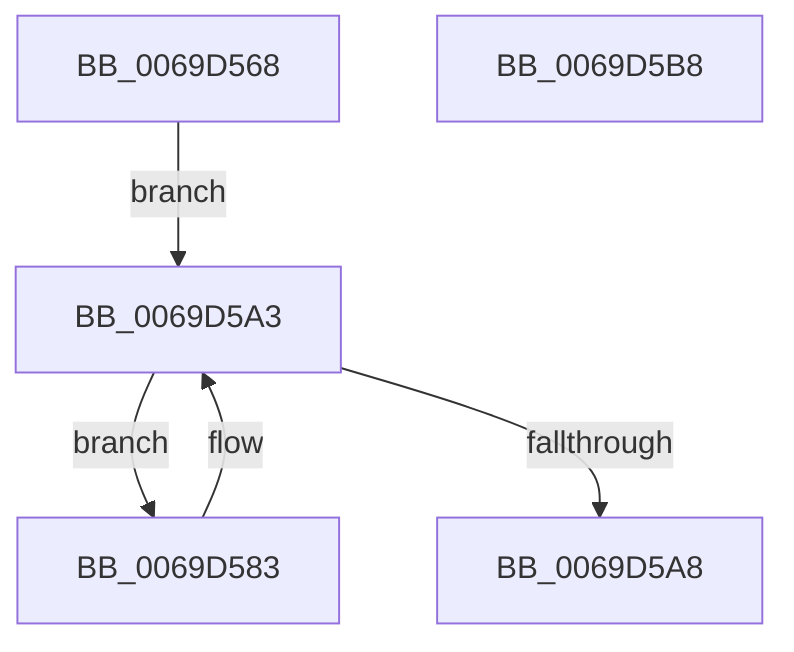

# AuthzBasepDeleteAllSecurityAttributes

- RVA: `0x0069D568`–`0x0069D5B9` (길이 `81` bytes)
- VA: `0x000000014069D568`
- 실행 섹션: `.text`
- PDB 이름 있음: `예`; PDB Function 태그: `아니요`
- unwind 정보 RVA: `0x00060BC4`
- 디코드: `25`개 명령, `81/81` bytes 표시
- 미해석 바이트: `0` (있으면 어셈블리에 `.byte`로 보존)

> 이 문서는 커널 이미지의 기계어와 PDB 기호를 분석해 생성했습니다. 4번과 5번은 함수 원형과 자료형을 바이너리 사용 방식에서 추정한 C 해석이며 원본 소스 복구 결과는 아닙니다.

## 1. Dependencies

- 직접 호출 지점: **2**; 고유 호출 대상: **2**
- 직접 호출자로 확인된 함수: **1**
- RIP 상대 이미지 참조: **0**

### Outgoing calls
- `0x0069D593` → [AuthzBasepAddSecurityAttributeToLists](../43/AuthzBasepAddSecurityAttributeToLists_function_0043F850.md) (function, `0x0043F850`)
- `0x0069D59B` → [AuthzBasepDeleteAllSecurityAttributeValues](../3A/AuthzBasepDeleteAllSecurityAttributeValues_function_003A95B0.md) (function, `0x003A95B0`)

### Direct callers
- [AuthzBasepSetSecurityAttributesToken](../3A/AuthzBasepSetSecurityAttributesToken_function_003A8D1C.md) at `0x003A8E0A`

### Static image references
- 디코드된 RIP-relative 메모리 참조가 없습니다.

## 2. Other-region calls and transfers

- 다른 실행 섹션으로 향하는 call: **0**
- 별도 외부 분기/꼬리 이동을 확인하지 못했습니다.

## 3. Assembly (complete function range)

```asm
0069D568  48 89 5C 24 08                  mov qword ptr [rsp + 8], rbx
0069D56D  48 89 74 24 10                  mov qword ptr [rsp + 0x10], rsi
0069D572  57                              push rdi
0069D573  48 83 EC 20                     sub rsp, 0x20
0069D577  48 8D 79 08                     lea rdi, [rcx + 8]
0069D57B  48 8B F1                        mov rsi, rcx
0069D57E  48 8B 1F                        mov rbx, qword ptr [rdi]
0069D581  EB 20                           jmp 0x14069d5a3
0069D583  83 4B 38 04                     or dword ptr [rbx + 0x38], 4
0069D587  41 B1 01                        mov r9b, 1
0069D58A  45 33 C0                        xor r8d, r8d
0069D58D  48 8B D3                        mov rdx, rbx
0069D590  48 8B CE                        mov rcx, rsi
0069D593  E8 B8 22 DA FF                  call 0x14043f850
0069D598  48 8B CB                        mov rcx, rbx
0069D59B  E8 10 C0 D0 FF                  call 0x1403a95b0
0069D5A0  48 8B 1B                        mov rbx, qword ptr [rbx]
0069D5A3  48 3B DF                        cmp rbx, rdi
0069D5A6  75 DB                           jne 0x14069d583
0069D5A8  48 8B 5C 24 30                  mov rbx, qword ptr [rsp + 0x30]
0069D5AD  48 8B 74 24 38                  mov rsi, qword ptr [rsp + 0x38]
0069D5B2  48 83 C4 20                     add rsp, 0x20
0069D5B6  5F                              pop rdi
0069D5B7  C3                              ret
0069D5B8  CC                              int3
```

## 4. C-style interpretation (structured pseudocode)

```c
__int64 __fastcall AuthzBasepDeleteAllSecurityAttributes(__int64 a1, __int64 a2, int a3)
{
    __int64 result;
    __int64 v_rsp;
    unsigned __int64 v_stack_p10;
    unsigned __int64 v_stack_p8;

    v_stack_p8 = v_rbx;
    v_stack_p10 = v_rsi;
    v_rsp = (v_rsp) - (32);
    goto loc_0069D5A3;
loc_0069D583:
    a3 = 0;
    result = AuthzBasepAddSecurityAttributeToLists(a1, *(unsigned __int64 *)(a1 + 8), a3, 1);
    result = AuthzBasepDeleteAllSecurityAttributeValues(*(unsigned __int64 *)(a1 + 8), *(unsigned __int64 *)(a1 + 8), a3, 1);
loc_0069D5A3:
    if ((*(unsigned __int64 *)(*(unsigned __int64 *)(a1 + 8))) != (a1 + 8)) goto loc_0069D583;
    v_rsp = (v_rsp) + (32);
    return result;
}
```

## 5. (Beta) C Style

```c
int64_t AuthzBasepDeleteAllSecurityAttributes(void *Arg1, int64_t Arg2, int32_t Arg3)
{
    uint8_t *arg1 = (uint8_t *)Arg1;

    int64_t result;
    int64_t local_rsp;
    uint64_t v_stack_p10;
    uint64_t v_stack_p8;

    v_stack_p8 = local_rbx;
    v_stack_p10 = local_rsi;
    local_rsp = (local_rsp) - (32);
    goto loc_0069D5A3;
loc_0069D583:
    Arg3 = 0;
    result = AuthzBasepAddSecurityAttributeToLists(Arg1, *(uint64_t *)(arg1 + 0x8), Arg3, 1);
    result = AuthzBasepDeleteAllSecurityAttributeValues(*(uint64_t *)(arg1 + 0x8), *(uint64_t *)(arg1 + 0x8), Arg3, 1);
loc_0069D5A3:
    if ((*(uint64_t *)(*(uint64_t *)(arg1 + 0x8))) != (Arg1 + 8)) goto loc_0069D583;
    local_rsp = (local_rsp) + (32);
    return result;
}
```

### 관측된 메모리 오프셋

구조체 형식이 확인되지 않은 접근은 인자 기준의 오프셋으로만 기록했습니다.

| 기준 인자 | 오프셋 표현 | 폭 (bit) | 접근 |
|---|---:|---:|---|
| `Arg1` | `+ 0x0` | `64` | `R` |
| `Arg1` | `+ 0x8` | `64` | `R` |

## 6. Execution-region graph

[열기: 2D/3D 그래프와 함수 탐색 컨트롤 패널](../../../control-panel.html?section=text&rva=0x0069D568&view=graph)

- 2D 그래프는 위에서 아래로 흐르고, 3D 그래프는 빈 공간을 드래그해 회전합니다. Shift+드래그는 이동, 휠은 확대·축소, 함수 노드 선택은 대상 보고서 이동입니다.

### Static fallback


