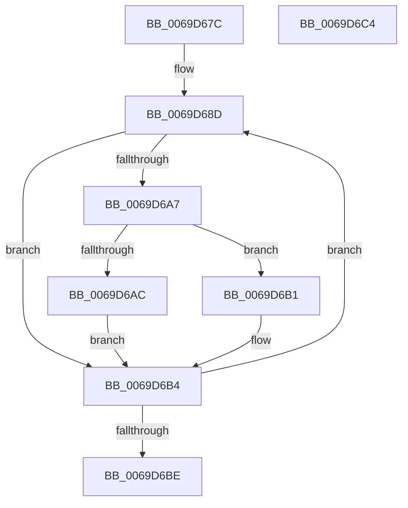

# AuthzBasepMergeAccessReasons

- RVA: `0x0069D67C`–`0x0069D6C5` (길이 `73` bytes)
- VA: `0x000000014069D67C`
- 실행 섹션: `.text`
- PDB 이름 있음: `예`; PDB Function 태그: `아니요`
- unwind 정보 RVA: `0x00071750`
- 디코드: `23`개 명령, `73/73` bytes 표시
- 미해석 바이트: `0` (있으면 어셈블리에 `.byte`로 보존)

> 이 문서는 커널 이미지의 기계어와 PDB 기호를 분석해 생성했습니다. 4번과 5번은 함수 원형과 자료형을 바이너리 사용 방식에서 추정한 C 해석이며 원본 소스 복구 결과는 아닙니다.

## 1. Dependencies

- 직접 호출 지점: **0**; 고유 호출 대상: **0**
- 직접 호출자로 확인된 함수: **1**
- RIP 상대 이미지 참조: **0**

### Outgoing calls
- 직접 디코드된 call 명령이 없습니다.

### Direct callers
- [SepCommonAccessCheckEx](../47/SepCommonAccessCheckEx_function_0047602C.md) at `0x00476F5A`
- [SepCommonAccessCheckEx](../47/SepCommonAccessCheckEx_function_0047602C.md) at `0x00476FBD`
- [SepCommonAccessCheckEx](../47/SepCommonAccessCheckEx_function_0047602C.md) at `0x00476FD3`

### Static image references
- 디코드된 RIP-relative 메모리 참조가 없습니다.

## 2. Other-region calls and transfers

- 다른 실행 섹션으로 향하는 call: **0**
- 별도 외부 분기/꼬리 이동을 확인하지 못했습니다.

## 3. Assembly (complete function range)

```asm
0069D67C  48 89 5C 24 08                  mov qword ptr [rsp + 8], rbx
0069D681  4C 8B C9                        mov r9, rcx
0069D684  48 2B D1                        sub rdx, rcx
0069D687  41 BB 20 00 00 00               mov r11d, 0x20
0069D68D  42 8B 1C 0A                     mov ebx, dword ptr [rdx + r9]
0069D691  F7 C3 00 00 FF 00               test ebx, 0xff0000
0069D697  44 8B D3                        mov r10d, ebx
0069D69A  0F 94 C1                        sete cl
0069D69D  45 23 D0                        and r10d, r8d
0069D6A0  0F 94 C0                        sete al
0069D6A3  84 C8                           test al, cl
0069D6A5  75 0D                           jne 0x14069d6b4
0069D6A7  45 85 C0                        test r8d, r8d
0069D6AA  74 05                           je 0x14069d6b1
0069D6AC  45 09 11                        or dword ptr [r9], r10d
0069D6AF  EB 03                           jmp 0x14069d6b4
0069D6B1  41 89 19                        mov dword ptr [r9], ebx
0069D6B4  49 83 C1 04                     add r9, 4
0069D6B8  49 83 EB 01                     sub r11, 1
0069D6BC  75 CF                           jne 0x14069d68d
0069D6BE  48 8B 5C 24 08                  mov rbx, qword ptr [rsp + 8]
0069D6C3  C3                              ret
0069D6C4  CC                              int3
```

## 4. C-style interpretation (structured pseudocode)

```c
__int64 __fastcall AuthzBasepMergeAccessReasons(__int64 a1, __int64 a2, int a3)
{
    __int64 result;
    __int64 v_r10;
    __int64 v_r11;
    unsigned __int64 v_stack_p8;

    v_stack_p8 = v_rbx;
    a2 = (a2) - (a1);
loc_0069D68D:
    a1 = ((((unsigned int)((unsigned int)(*(unsigned int *)(a2 + a1 * 1)))) & (0xFF0000ULL)) == 0) ? 1 : 0;
    v_r10 = (unsigned int)(((unsigned int)((unsigned int)((unsigned int)(*(unsigned int *)(a2 + a1 * 1))))) & (a3));
    result = (condition_is_equal) ? 1 : 0;
    if ((((unsigned __int8)(result)) & ((unsigned __int8)(a1))) != 0) goto loc_0069D6B4;
    if (a3 == 0) goto loc_0069D6B1;
    goto loc_0069D6B4;
loc_0069D6B1:
    *(unsigned int *)(a1) = (unsigned int)((unsigned int)(*(unsigned int *)(a2 + a1 * 1)));
loc_0069D6B4:
    a4 = (a1) + (4);
    v_r11 = (32) - (1);
    if (condition_is_not_equal) goto loc_0069D68D;
    return result;
}
```

## 5. (Beta) C Style

```c
int64_t AuthzBasepMergeAccessReasons(void *Arg1, void *Arg2, int32_t Arg3)
{
    uint8_t *arg1 = (uint8_t *)Arg1;
    uint8_t *arg2 = (uint8_t *)Arg2;

    int64_t result;
    int64_t local_r10;
    int64_t local_r11;
    uint64_t v_stack_p8;

    v_stack_p8 = local_rbx;
    Arg2 = (Arg2) - (Arg1);
loc_0069D68D:
    Arg1 = ((((uint32_t)((uint32_t)(*(uint32_t *)(arg2 + arg1 * 1)))) & (0xFF0000ULL)) == 0) ? 1 : 0;
    local_r10 = (uint32_t)(((uint32_t)((uint32_t)((uint32_t)(*(uint32_t *)(arg2 + arg1 * 1))))) & (Arg3));
    result = (condition_is_equal) ? 1 : 0;
    if ((((uint8_t)(result)) & ((uint8_t)(Arg1))) != 0) goto loc_0069D6B4;
    if (Arg3 == 0) goto loc_0069D6B1;
    goto loc_0069D6B4;
loc_0069D6B1:
    *(uint32_t *)(arg1) = (uint32_t)((uint32_t)(*(uint32_t *)(arg2 + arg1 * 1)));
loc_0069D6B4:
    a4 = (Arg1) + (4);
    local_r11 = (32) - (1);
    if (condition_is_not_equal) goto loc_0069D68D;
    return result;
}
```

### 관측된 메모리 오프셋

구조체 형식이 확인되지 않은 접근은 인자 기준의 오프셋으로만 기록했습니다.

| 기준 인자 | 오프셋 표현 | 폭 (bit) | 접근 |
|---|---:|---:|---|
| `Arg1` | `+ 0x0` | `32` | `R/W` |
| `Arg1` | `+ 0x0` | `32` | `W` |
| `Arg2` | `+ 0x0 + r9*1` | `32` | `R` |

## 6. Execution-region graph

[열기: 2D/3D 그래프와 함수 탐색 컨트롤 패널](../../../control-panel.html?section=text&rva=0x0069D67C&view=graph)

- 2D 그래프는 위에서 아래로 흐르고, 3D 그래프는 빈 공간을 드래그해 회전합니다. Shift+드래그는 이동, 휠은 확대·축소, 함수 노드 선택은 대상 보고서 이동입니다.

### Static fallback


