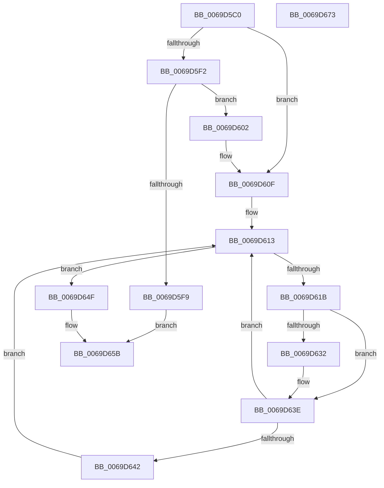

# AuthzBasepRollbackSecurityAttributeChanges

- RVA: `0x0069D5C0`–`0x0069D674` (길이 `180` bytes)
- VA: `0x000000014069D5C0`
- 실행 섹션: `.text`
- PDB 이름 있음: `예`; PDB Function 태그: `아니요`
- unwind 정보 RVA: `0x0006F978`
- 디코드: `56`개 명령, `180/180` bytes 표시
- 미해석 바이트: `0` (있으면 어셈블리에 `.byte`로 보존)

> 이 문서는 커널 이미지의 기계어와 PDB 기호를 분석해 생성했습니다. 4번과 5번은 함수 원형과 자료형을 바이너리 사용 방식에서 추정한 C 해석이며 원본 소스 복구 결과는 아닙니다.

## 1. Dependencies

- 직접 호출 지점: **5**; 고유 호출 대상: **4**
- 직접 호출자로 확인된 함수: **2**
- RIP 상대 이미지 참조: **0**

### Outgoing calls
- `0x0069D5E6` → [AuthzBasepRemoveSecurityAttributeFromLists](../3A/AuthzBasepRemoveSecurityAttributeFromLists_function_003A9960.md) (function, `0x003A9960`)
- `0x0069D5FB` → [AuthzBasepFreeSecurityAttributeValues](../3A/AuthzBasepFreeSecurityAttributeValues_function_003A9630.md) (function, `0x003A9630`)
- `0x0069D60A` → [AuthzBasepFreeSecurityAttributeValues](../3A/AuthzBasepFreeSecurityAttributeValues_function_003A9630.md) (function, `0x003A9630`)
- `0x0069D625` → [AuthzBasepRemoveSecurityAttributeValueFromLists](../30/AuthzBasepRemoveSecurityAttributeValueFromLists_function_00302E00.md) (function, `0x00302E00`)
- `0x0069D648` → [ExFreePoolWithTag](../../poolcode/B8/ExFreePoolWithTag_function_00B82870.md) (function, `0x00B82870`)

### Direct callers
- [AuthzBasepDuplicateSecurityAttributes](../30/AuthzBasepDuplicateSecurityAttributes_function_003023C0.md) at `0x00302AC6`
- [AuthzBasepFinaliseSecurityAttributesList](../3A/AuthzBasepFinaliseSecurityAttributesList_function_003A8E20.md) at `0x003A90D9`

### Static image references
- 디코드된 RIP-relative 메모리 참조가 없습니다.

## 2. Other-region calls and transfers

- 다른 실행 섹션으로 향하는 call: **1**
  - `0x0069D648` → [ExFreePoolWithTag](../../poolcode/B8/ExFreePoolWithTag_function_00B82870.md) (`.text` → `POOLCODE`)
- 별도 외부 분기/꼬리 이동을 확인하지 못했습니다.

## 3. Assembly (complete function range)

```asm
0069D5C0  48 89 5C 24 08                  mov qword ptr [rsp + 8], rbx
0069D5C5  48 89 74 24 10                  mov qword ptr [rsp + 0x10], rsi
0069D5CA  48 89 7C 24 18                  mov qword ptr [rsp + 0x18], rdi
0069D5CF  41 56                           push r14
0069D5D1  48 83 EC 20                     sub rsp, 0x20
0069D5D5  BB 01 00 00 00                  mov ebx, 1
0069D5DA  45 33 C0                        xor r8d, r8d
0069D5DD  44 8A CB                        mov r9b, bl
0069D5E0  48 8B FA                        mov rdi, rdx
0069D5E3  45 32 F6                        xor r14b, r14b
0069D5E6  E8 75 C3 D0 FF                  call 0x1403a9960
0069D5EB  8B 42 38                        mov eax, dword ptr [rdx + 0x38]
0069D5EE  A8 04                           test al, 4
0069D5F0  74 1D                           je 0x14069d60f
0069D5F2  48 8B CA                        mov rcx, rdx
0069D5F5  84 C3                           test bl, al
0069D5F7  75 09                           jne 0x14069d602
0069D5F9  33 D2                           xor edx, edx
0069D5FB  E8 30 C0 D0 FF                  call 0x1403a9630
0069D600  EB 59                           jmp 0x14069d65b
0069D602  83 E0 FB                        and eax, 0xfffffffb
0069D605  89 42 38                        mov dword ptr [rdx + 0x38], eax
0069D608  8A D3                           mov dl, bl
0069D60A  E8 21 C0 D0 FF                  call 0x1403a9630
0069D60F  48 8D 77 60                     lea rsi, [rdi + 0x60]
0069D613  4C 8B 1E                        mov r11, qword ptr [rsi]
0069D616  4C 3B DE                        cmp r11, rsi
0069D619  74 34                           je 0x14069d64f
0069D61B  45 33 C0                        xor r8d, r8d
0069D61E  49 8D 53 F0                     lea rdx, [r11 - 0x10]
0069D622  48 8B CF                        mov rcx, rdi
0069D625  E8 D6 57 C6 FF                  call 0x140302e00
0069D62A  41 8B 43 10                     mov eax, dword ptr [r11 + 0x10]
0069D62E  A8 04                           test al, 4
0069D630  74 0C                           je 0x14069d63e
0069D632  FF 4F 40                        dec dword ptr [rdi + 0x40]
0069D635  41 83 63 10 FB                  and dword ptr [r11 + 0x10], 0xfffffffb
0069D63A  41 8B 43 10                     mov eax, dword ptr [r11 + 0x10]
0069D63E  84 C3                           test bl, al
0069D640  75 D1                           jne 0x14069d613
0069D642  33 D2                           xor edx, edx
0069D644  49 8D 4B F0                     lea rcx, [r11 - 0x10]
0069D648  E8 23 52 4E 00                  call 0x140b82870
0069D64D  EB C4                           jmp 0x14069d613
0069D64F  84 5F 38                        test byte ptr [rdi + 0x38], bl
0069D652  41 0F B6 C6                     movzx eax, r14b
0069D656  0F 44 C3                        cmove eax, ebx
0069D659  8A D8                           mov bl, al
0069D65B  48 8B 74 24 38                  mov rsi, qword ptr [rsp + 0x38]
0069D660  8A C3                           mov al, bl
0069D662  48 8B 5C 24 30                  mov rbx, qword ptr [rsp + 0x30]
0069D667  48 8B 7C 24 40                  mov rdi, qword ptr [rsp + 0x40]
0069D66C  48 83 C4 20                     add rsp, 0x20
0069D670  41 5E                           pop r14
0069D672  C3                              ret
0069D673  CC                              int3
```

## 4. C-style interpretation (structured pseudocode)

```c
__int64 __fastcall AuthzBasepRollbackSecurityAttributeChanges(__int64 a1, __int64 a2, int a3)
{
    __int64 result;
    __int64 v_r14;
    __int64 v_rsp;
    unsigned __int64 v_stack_p10;
    unsigned __int64 v_stack_p18;
    unsigned __int64 v_stack_p8;

    v_stack_p8 = v_rbx;
    v_stack_p10 = v_rsi;
    v_stack_p18 = v_rdi;
    v_rsp = (v_rsp) - (32);
    a3 = 0;
    v_r14 = 0;
    result = AuthzBasepRemoveSecurityAttributeFromLists(a1, a2, a3, 1);
    if ((((unsigned __int8)((unsigned int)(*(unsigned int *)(a2 + 56)))) & (4)) == 0) goto loc_0069D60F;
    if (((1) & ((unsigned __int8)((unsigned int)(*(unsigned int *)(a2 + 56))))) != 0) goto loc_0069D602;
    a2 = 0;
    result = AuthzBasepFreeSecurityAttributeValues(a2, a2, a3, 1);
    goto loc_0069D65B;
loc_0069D602:
    result = (unsigned int)((result) & (0xFFFFFFFBULL));
    *(unsigned int *)(a2 + 56) = (unsigned int)(result);
    result = AuthzBasepFreeSecurityAttributeValues(a2, 1, a3, 1);
loc_0069D60F:
loc_0069D613:
    if ((*(unsigned __int64 *)(a2 + 96)) == (a2 + 96)) goto loc_0069D64F;
    a3 = 0;
    result = AuthzBasepRemoveSecurityAttributeValueFromLists(0, *(unsigned __int64 *)(a2 + 96) - 16, a3, 1);
    result = (unsigned int)(*(unsigned int *)(*(unsigned __int64 *)(a2 + 96) + 16));
    if ((((unsigned __int8)((unsigned int)(*(unsigned int *)(*(unsigned __int64 *)(a2 + 96) + 16)))) & (4)) != 0) {
        result = *(unsigned int *)(*(unsigned __int64 *)(a2 + 96) + 16);
    }
    if (((1) & ((unsigned __int8)(result))) != 0) goto loc_0069D613;
    a2 = 0;
    result = ExFreePoolWithTag(*(unsigned __int64 *)(a2 + 96) - 16, a2, a3, 1);
    goto loc_0069D613;
loc_0069D64F:
    result = 0;
    if (((*(unsigned __int8 *)(a2 + 56)) & (1)) == 0) { result = 1; }
loc_0069D65B:
    v_rsp = (v_rsp) + (32);
    return (unsigned __int8)((unsigned __int8)(result));
}
```

## 5. (Beta) C Style

```c
int64_t AuthzBasepRollbackSecurityAttributeChanges(int64_t Arg1, void *Arg2, int32_t Arg3)
{
    uint8_t *arg2 = (uint8_t *)Arg2;

    int64_t result;
    int64_t local_r14;
    int64_t local_rsp;
    uint64_t v_stack_p10;
    uint64_t v_stack_p18;
    uint64_t v_stack_p8;

    v_stack_p8 = local_rbx;
    v_stack_p10 = local_rsi;
    v_stack_p18 = local_rdi;
    local_rsp = (local_rsp) - (32);
    Arg3 = 0;
    local_r14 = 0;
    result = AuthzBasepRemoveSecurityAttributeFromLists(Arg1, Arg2, Arg3, 1);
    if ((((uint8_t)((uint32_t)(*(uint32_t *)(arg2 + 0x38)))) & (4)) == 0) goto loc_0069D60F;
    if (((1) & ((uint8_t)((uint32_t)(*(uint32_t *)(arg2 + 0x38))))) != 0) goto loc_0069D602;
    Arg2 = 0;
    result = AuthzBasepFreeSecurityAttributeValues(Arg2, Arg2, Arg3, 1);
    goto loc_0069D65B;
loc_0069D602:
    result = (uint32_t)((result) & (0xFFFFFFFBULL));
    *(uint32_t *)(arg2 + 0x38) = (uint32_t)(result);
    result = AuthzBasepFreeSecurityAttributeValues(Arg2, 1, Arg3, 1);
loc_0069D60F:
loc_0069D613:
    if ((*(uint64_t *)(arg2 + 0x60)) == (Arg2 + 96)) goto loc_0069D64F;
    Arg3 = 0;
    result = AuthzBasepRemoveSecurityAttributeValueFromLists(0, *(uint64_t *)(arg2 + 0x60) - 16, Arg3, 1);
    result = (uint32_t)(*(uint32_t *)(*(uint64_t *)(arg2 + 0x60) + 0x10));
    if ((((uint8_t)((uint32_t)(*(uint32_t *)(*(uint64_t *)(arg2 + 0x60) + 0x10)))) & (4)) != 0) {
        result = *(uint32_t *)(*(uint64_t *)(arg2 + 0x60) + 0x10);
    }
    if (((1) & ((uint8_t)(result))) != 0) goto loc_0069D613;
    Arg2 = 0;
    result = ExFreePoolWithTag(*(uint64_t *)(arg2 + 0x60) - 16, Arg2, Arg3, 1);
    goto loc_0069D613;
loc_0069D64F:
    result = 0;
    if (((*(uint8_t *)(arg2 + 0x38)) & (1)) == 0) { result = 1; }
loc_0069D65B:
    local_rsp = (local_rsp) + (32);
    return (uint8_t)((uint8_t)(result));
}
```

### 관측된 메모리 오프셋

구조체 형식이 확인되지 않은 접근은 인자 기준의 오프셋으로만 기록했습니다.

| 기준 인자 | 오프셋 표현 | 폭 (bit) | 접근 |
|---|---:|---:|---|
| `Arg2` | `+ 0x0` | `64` | `R` |
| `Arg2` | `+ 0x38` | `8` | `R` |
| `Arg2` | `+ 0x40` | `32` | `R/W` |
| `Arg2` | `+ 0x60` | `64` | `R` |

## 6. Execution-region graph

[열기: 2D/3D 그래프와 함수 탐색 컨트롤 패널](../../../control-panel.html?section=text&rva=0x0069D5C0&view=graph)

- 2D 그래프는 위에서 아래로 흐르고, 3D 그래프는 빈 공간을 드래그해 회전합니다. Shift+드래그는 이동, 휠은 확대·축소, 함수 노드 선택은 대상 보고서 이동입니다.

### Static fallback


