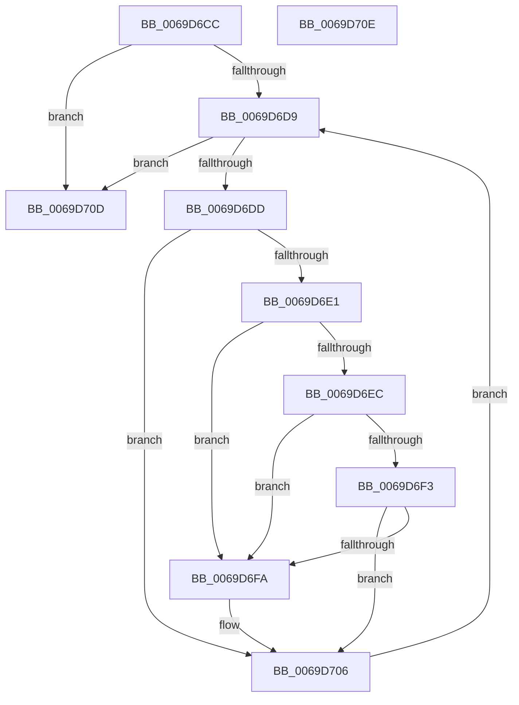

# AuthzBasepSetAppContainerAccessReasons

- RVA: `0x0069D6CC`–`0x0069D70F` (길이 `67` bytes)
- VA: `0x000000014069D6CC`
- 실행 섹션: `.text`
- PDB 이름 있음: `예`; PDB Function 태그: `아니요`
- unwind 정보 RVA: `0x000DB714`
- 디코드: `23`개 명령, `67/67` bytes 표시
- 미해석 바이트: `0` (있으면 어셈블리에 `.byte`로 보존)

> 이 문서는 커널 이미지의 기계어와 PDB 기호를 분석해 생성했습니다. 4번과 5번은 함수 원형과 자료형을 바이너리 사용 방식에서 추정한 C 해석이며 원본 소스 복구 결과는 아닙니다.

## 1. Dependencies

- 직접 호출 지점: **0**; 고유 호출 대상: **0**
- 직접 호출자로 확인된 함수: **2**
- RIP 상대 이미지 참조: **0**

### Outgoing calls
- 직접 디코드된 call 명령이 없습니다.

### Direct callers
- [AuthzBasepAddAccessTypeList](../3D/AuthzBasepAddAccessTypeList_function_003D196C.md) at `0x003D1AE1`
- [sub_006E9392](../6E/Unknown_function_006E9392.md) at `0x006E9435`

### Static image references
- 디코드된 RIP-relative 메모리 참조가 없습니다.

## 2. Other-region calls and transfers

- 다른 실행 섹션으로 향하는 call: **0**
- 별도 외부 분기/꼬리 이동을 확인하지 못했습니다.

## 3. Assembly (complete function range)

```asm
0069D6CC  45 33 D2                        xor r10d, r10d
0069D6CF  BA 01 00 00 00                  mov edx, 1
0069D6D4  4D 85 C9                        test r9, r9
0069D6D7  74 34                           je 0x14069d70d
0069D6D9  85 D2                           test edx, edx
0069D6DB  74 30                           je 0x14069d70d
0069D6DD  85 D1                           test ecx, edx
0069D6DF  74 25                           je 0x14069d706
0069D6E1  43 8B 04 91                     mov eax, dword ptr [r9 + r10*4]
0069D6E5  3D 00 00 01 00                  cmp eax, 0x10000
0069D6EA  74 0E                           je 0x14069d6fa
0069D6EC  3D 00 00 03 00                  cmp eax, 0x30000
0069D6F1  74 07                           je 0x14069d6fa
0069D6F3  3D 00 00 40 00                  cmp eax, 0x400000
0069D6F8  75 0C                           jne 0x14069d706
0069D6FA  41 8B C0                        mov eax, r8d
0069D6FD  0D 00 00 07 00                  or eax, 0x70000
0069D702  43 89 04 91                     mov dword ptr [r9 + r10*4], eax
0069D706  41 FF C2                        inc r10d
0069D709  03 D2                           add edx, edx
0069D70B  EB CC                           jmp 0x14069d6d9
0069D70D  C3                              ret
0069D70E  CC                              int3
```

## 4. C-style interpretation (structured pseudocode)

```c
__int64 __fastcall AuthzBasepSetAppContainerAccessReasons(int a1, __int64 a2, int a3, __int64 a4)
{
    __int64 result;
    __int64 v_r10;

    v_r10 = 0;
    if (a4 == 0) goto loc_0069D70D;
loc_0069D6D9:
    if (1 == 0) goto loc_0069D70D;
    if (((a1) & (1)) == 0) goto loc_0069D706;
    if (((unsigned int)((unsigned int)(*(unsigned int *)(a4 + v_r10 * 4)))) == 0x10000ULL) goto loc_0069D6FA;
    if (((unsigned int)((unsigned int)(*(unsigned int *)(a4 + v_r10 * 4)))) == 0x30000ULL) goto loc_0069D6FA;
    result = (unsigned int)(*(unsigned int *)(a4 + v_r10 * 4));
    if (((unsigned int)((unsigned int)(*(unsigned int *)(a4 + v_r10 * 4)))) == 0x400000ULL) {
        result = a3;
        result = (unsigned int)((result) | (0x70000ULL));
        *(unsigned int *)(a4 + v_r10 * 4) = (unsigned int)(result);
    }
    v_r10 = (unsigned int)((v_r10) + 1);
    a2 = (unsigned int)((1) + (1));
    goto loc_0069D6D9;
loc_0069D70D:
    return result;
}
```

## 5. (Beta) C Style

```c
int64_t AuthzBasepSetAppContainerAccessReasons(int32_t Arg1, int64_t Arg2, int32_t Arg3, int64_t Arg4)
{
    int64_t result;
    int64_t local_r10;

    local_r10 = 0;
    if (Arg4 == 0) goto loc_0069D70D;
loc_0069D6D9:
    if (1 == 0) goto loc_0069D70D;
    if (((Arg1) & (1)) == 0) goto loc_0069D706;
    if (((uint32_t)((uint32_t)(*(uint32_t *)(Arg4 + local_r10 * 4)))) == 0x10000ULL) goto loc_0069D6FA;
    if (((uint32_t)((uint32_t)(*(uint32_t *)(Arg4 + local_r10 * 4)))) == 0x30000ULL) goto loc_0069D6FA;
    result = (uint32_t)(*(uint32_t *)(Arg4 + local_r10 * 4));
    if (((uint32_t)((uint32_t)(*(uint32_t *)(Arg4 + local_r10 * 4)))) == 0x400000ULL) {
        result = Arg3;
        result = (uint32_t)((result) | (0x70000ULL));
        *(uint32_t *)(Arg4 + local_r10 * 4) = (uint32_t)(result);
    }
    local_r10 = (uint32_t)((local_r10) + 1);
    Arg2 = (uint32_t)((1) + (1));
    goto loc_0069D6D9;
loc_0069D70D:
    return result;
}
```

## 6. Execution-region graph

[열기: 2D/3D 그래프와 함수 탐색 컨트롤 패널](../../../control-panel.html?section=text&rva=0x0069D6CC&view=graph)

- 2D 그래프는 위에서 아래로 흐르고, 3D 그래프는 빈 공간을 드래그해 회전합니다. Shift+드래그는 이동, 휠은 확대·축소, 함수 노드 선택은 대상 보고서 이동입니다.

### Static fallback


