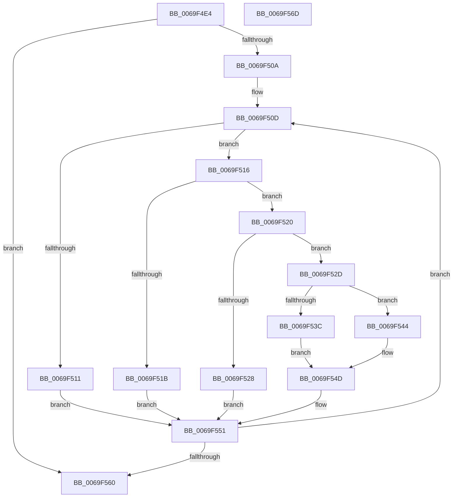

# BcpConvertBugDataToString

- RVA: `0x0069F4E4`–`0x0069F56E` (길이 `138` bytes)
- VA: `0x000000014069F4E4`
- 실행 섹션: `.text`
- PDB 이름 있음: `예`; PDB Function 태그: `아니요`
- unwind 정보 RVA: `0x000950EC`
- 디코드: `47`개 명령, `138/138` bytes 표시
- 미해석 바이트: `0` (있으면 어셈블리에 `.byte`로 보존)

> 이 문서는 커널 이미지의 기계어와 PDB 기호를 분석해 생성했습니다. 4번과 5번은 함수 원형과 자료형을 바이너리 사용 방식에서 추정한 C 해석이며 원본 소스 복구 결과는 아닙니다.

## 1. Dependencies

- 직접 호출 지점: **0**; 고유 호출 대상: **0**
- 직접 호출자로 확인된 함수: **2**
- RIP 상대 이미지 참조: **0**

### Outgoing calls
- 직접 디코드된 call 명령이 없습니다.

### Direct callers
- [BcpDisplayErrorInformation](BcpDisplayErrorInformation_function_0069FE74.md) at `0x006A0042`
- [BcpDisplayErrorInformationModernized](../6A/BcpDisplayErrorInformationModernized_function_006A00DC.md) at `0x006A03E7`

### Static image references
- 디코드된 RIP-relative 메모리 참조가 없습니다.

## 2. Other-region calls and transfers

- 다른 실행 섹션으로 향하는 call: **0**
- 별도 외부 분기/꼬리 이동을 확인하지 못했습니다.

## 3. Assembly (complete function range)

```asm
0069F4E4  48 89 5C 24 08                  mov qword ptr [rsp + 8], rbx
0069F4E9  48 89 7C 24 10                  mov qword ptr [rsp + 0x10], rdi
0069F4EE  44 0F B7 42 02                  movzx r8d, word ptr [rdx + 2]
0069F4F3  BB 00 00 00 00                  mov ebx, 0
0069F4F8  41 D1 E8                        shr r8d, 1
0069F4FB  4C 8B D9                        mov r11, rcx
0069F4FE  4C 8B 4A 08                     mov r9, qword ptr [rdx + 8]
0069F502  8B D3                           mov edx, ebx
0069F504  44 8D 53 3C                     lea r10d, [rbx + 0x3c]
0069F508  74 56                           je 0x14069f560
0069F50A  8D 7B 30                        lea edi, [rbx + 0x30]
0069F50D  85 D2                           test edx, edx
0069F50F  75 05                           jne 0x14069f516
0069F511  0F B7 CF                        movzx ecx, di
0069F514  EB 3B                           jmp 0x14069f551
0069F516  83 FA 01                        cmp edx, 1
0069F519  75 05                           jne 0x14069f520
0069F51B  8D 4A 77                        lea ecx, [rdx + 0x77]
0069F51E  EB 31                           jmp 0x14069f551
0069F520  41 8D 40 FF                     lea eax, [r8 - 1]
0069F524  3B D0                           cmp edx, eax
0069F526  75 05                           jne 0x14069f52d
0069F528  0F B7 CB                        movzx ecx, bx
0069F52B  EB 24                           jmp 0x14069f551
0069F52D  49 8B C3                        mov rax, r11
0069F530  41 8B CA                        mov ecx, r10d
0069F533  48 D3 E8                        shr rax, cl
0069F536  24 0F                           and al, 0xf
0069F538  3C 0A                           cmp al, 0xa
0069F53A  73 08                           jae 0x14069f544
0069F53C  0F B6 C8                        movzx ecx, al
0069F53F  66 03 CF                        add cx, di
0069F542  EB 09                           jmp 0x14069f54d
0069F544  2C 0A                           sub al, 0xa
0069F546  0F B6 C8                        movzx ecx, al
0069F549  66 83 C1 41                     add cx, 0x41
0069F54D  41 83 EA 04                     sub r10d, 4
0069F551  66 41 89 09                     mov word ptr [r9], cx
0069F555  FF C2                           inc edx
0069F557  49 83 C1 02                     add r9, 2
0069F55B  41 3B D0                        cmp edx, r8d
0069F55E  72 AD                           jb 0x14069f50d
0069F560  48 8B 5C 24 08                  mov rbx, qword ptr [rsp + 8]
0069F565  33 C0                           xor eax, eax
0069F567  48 8B 7C 24 10                  mov rdi, qword ptr [rsp + 0x10]
0069F56C  C3                              ret
0069F56D  CC                              int3
```

## 4. C-style interpretation (structured pseudocode)

```c
__int64 __fastcall BcpConvertBugDataToString(__int64 a1, __int64 a2)
{
    __int64 result;
    __int64 v_r10;
    unsigned __int64 v_stack_p10;
    unsigned __int64 v_stack_p8;

    v_stack_p8 = v_rbx;
    v_stack_p10 = v_rdi;
    a3 = (unsigned int)((*(unsigned __int16 *)(a2 + 2)) >> (1));
    if (condition_is_equal) goto loc_0069F560;
loc_0069F50D:
    if (0 != 0) goto loc_0069F516;
    goto loc_0069F551;
loc_0069F516:
    if (0 != 1) goto loc_0069F520;
    goto loc_0069F551;
loc_0069F520:
    if (0 != ((unsigned int)(a3 - 1))) goto loc_0069F52D;
    goto loc_0069F551;
loc_0069F52D:
    result = (a1) >> ((unsigned __int8)((unsigned int)((unsigned int)(0 + 60))));
    result = (unsigned __int8)((result) & (15));
    if (((unsigned __int8)(result)) >= 10) goto loc_0069F544;
    a1 = (unsigned __int16)(((unsigned __int8)(result)) + ((unsigned __int16)(0 + 48)));
    goto loc_0069F54D;
loc_0069F544:
    result = (unsigned __int8)((result) - (10));
    a1 = (unsigned __int16)(((unsigned __int8)(result)) + (65));
loc_0069F54D:
    v_r10 = (unsigned int)((0 + 60) - (4));
loc_0069F551:
    *(unsigned __int16 *)(*(unsigned __int64 *)(a2 + 8)) = (unsigned __int16)(a1);
    a2 = (unsigned int)((0) + 1);
    a4 = (*(unsigned __int64 *)(a2 + 8)) + (2);
    if (((unsigned int)(a2)) < ((unsigned int)(a3))) goto loc_0069F50D;
loc_0069F560:
    result = 0;
    return result;
}
```

## 5. (Beta) C Style

```c
int64_t BcpConvertBugDataToString(int64_t Arg1, void *Arg2)
{
    uint8_t *arg2 = (uint8_t *)Arg2;

    int64_t result;
    int64_t local_r10;
    uint64_t v_stack_p10;
    uint64_t v_stack_p8;

    v_stack_p8 = local_rbx;
    v_stack_p10 = local_rdi;
    a3 = (uint32_t)((*(uint16_t *)(arg2 + 0x2)) >> (1));
    if (condition_is_equal) goto loc_0069F560;
loc_0069F50D:
    if (0 != 0) goto loc_0069F516;
    goto loc_0069F551;
loc_0069F516:
    if (0 != 1) goto loc_0069F520;
    goto loc_0069F551;
loc_0069F520:
    if (0 != ((uint32_t)(a3 - 1))) goto loc_0069F52D;
    goto loc_0069F551;
loc_0069F52D:
    result = (Arg1) >> ((uint8_t)((uint32_t)((uint32_t)(0 + 60))));
    result = (uint8_t)((result) & (15));
    if (((uint8_t)(result)) >= 10) goto loc_0069F544;
    Arg1 = (uint16_t)(((uint8_t)(result)) + ((uint16_t)(0 + 48)));
    goto loc_0069F54D;
loc_0069F544:
    result = (uint8_t)((result) - (10));
    Arg1 = (uint16_t)(((uint8_t)(result)) + (65));
loc_0069F54D:
    local_r10 = (uint32_t)((0 + 60) - (4));
loc_0069F551:
    *(uint16_t *)(*(uint64_t *)(arg2 + 0x8)) = (uint16_t)(Arg1);
    Arg2 = (uint32_t)((0) + 1);
    a4 = (*(uint64_t *)(arg2 + 0x8)) + (2);
    if (((uint32_t)(Arg2)) < ((uint32_t)(a3))) goto loc_0069F50D;
loc_0069F560:
    result = 0;
    return result;
}
```

### 관측된 메모리 오프셋

구조체 형식이 확인되지 않은 접근은 인자 기준의 오프셋으로만 기록했습니다.

| 기준 인자 | 오프셋 표현 | 폭 (bit) | 접근 |
|---|---:|---:|---|
| `Arg2` | `+ 0x2` | `16` | `R` |
| `Arg2` | `+ 0x8` | `64` | `R` |

## 6. Execution-region graph

[열기: 2D/3D 그래프와 함수 탐색 컨트롤 패널](../../../control-panel.html?section=text&rva=0x0069F4E4&view=graph)

- 2D 그래프는 위에서 아래로 흐르고, 3D 그래프는 빈 공간을 드래그해 회전합니다. Shift+드래그는 이동, 휠은 확대·축소, 함수 노드 선택은 대상 보고서 이동입니다.

### Static fallback


