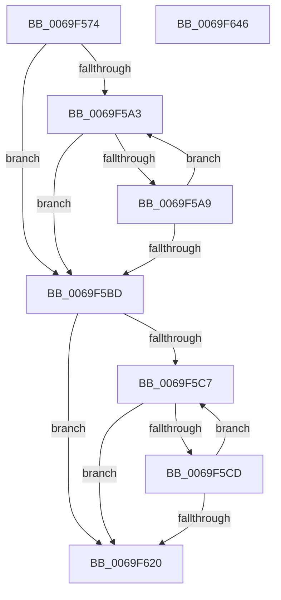

# BcpConvertProgressToString

- RVA: `0x0069F574`–`0x0069F647` (길이 `211` bytes)
- VA: `0x000000014069F574`
- 실행 섹션: `.text`
- PDB 이름 있음: `예`; PDB Function 태그: `아니요`
- unwind 정보 RVA: `0x000A5A38`
- 디코드: `62`개 명령, `211/211` bytes 표시
- 미해석 바이트: `0` (있으면 어셈블리에 `.byte`로 보존)

> 이 문서는 커널 이미지의 기계어와 PDB 기호를 분석해 생성했습니다. 4번과 5번은 함수 원형과 자료형을 바이너리 사용 방식에서 추정한 C 해석이며 원본 소스 복구 결과는 아닙니다.

## 1. Dependencies

- 직접 호출 지점: **0**; 고유 호출 대상: **0**
- 직접 호출자로 확인된 함수: **3**
- RIP 상대 이미지 참조: **0**

### Outgoing calls
- 직접 디코드된 call 명령이 없습니다.

### Direct callers
- [BcpDisplayProgress](../6A/BcpDisplayProgress_function_006A047C.md) at `0x006A050E`
- [BcpDisplayProgressModernized](../6A/BcpDisplayProgressModernized_function_006A068C.md) at `0x006A072F`
- [BgpFwDisplayBugCheckProgressUpdate](../6A/BgpFwDisplayBugCheckProgressUpdate_function_006A0E1C.md) at `0x006A0F8E`

### Static image references
- 디코드된 RIP-relative 메모리 참조가 없습니다.

## 2. Other-region calls and transfers

- 다른 실행 섹션으로 향하는 call: **0**
- 별도 외부 분기/꼬리 이동을 확인하지 못했습니다.

## 3. Assembly (complete function range)

```asm
0069F574  48 8B C4                        mov rax, rsp
0069F577  48 89 58 08                     mov qword ptr [rax + 8], rbx
0069F57B  48 89 68 10                     mov qword ptr [rax + 0x10], rbp
0069F57F  48 89 70 18                     mov qword ptr [rax + 0x18], rsi
0069F583  48 89 78 20                     mov qword ptr [rax + 0x20], rdi
0069F587  44 0F B7 5A 02                  movzx r11d, word ptr [rdx + 2]
0069F58C  41 B9 E8 03 00 00               mov r9d, 0x3e8
0069F592  48 8B 72 08                     mov rsi, qword ptr [rdx + 8]
0069F596  48 8B DA                        mov rbx, rdx
0069F599  41 D1 EB                        shr r11d, 1
0069F59C  8B F9                           mov edi, ecx
0069F59E  41 3B C9                        cmp ecx, r9d
0069F5A1  73 1A                           jae 0x14069f5bd
0069F5A3  41 83 F9 01                     cmp r9d, 1
0069F5A7  76 14                           jbe 0x14069f5bd
0069F5A9  B8 CD CC CC CC                  mov eax, 0xcccccccd
0069F5AE  41 F7 E1                        mul r9d
0069F5B1  44 8B CA                        mov r9d, edx
0069F5B4  41 C1 E9 03                     shr r9d, 3
0069F5B8  44 3B CF                        cmp r9d, edi
0069F5BB  77 E6                           ja 0x14069f5a3
0069F5BD  33 ED                           xor ebp, ebp
0069F5BF  44 8B D5                        mov r10d, ebp
0069F5C2  45 85 DB                        test r11d, r11d
0069F5C5  74 59                           je 0x14069f620
0069F5C7  41 83 F9 01                     cmp r9d, 1
0069F5CB  72 53                           jb 0x14069f620
0069F5CD  33 D2                           xor edx, edx
0069F5CF  8B C7                           mov eax, edi
0069F5D1  41 F7 F1                        div r9d
0069F5D4  44 8B C0                        mov r8d, eax
0069F5D7  B8 CD CC CC CC                  mov eax, 0xcccccccd
0069F5DC  41 F7 E0                        mul r8d
0069F5DF  B8 FF 00 00 00                  mov eax, 0xff
0069F5E4  C1 EA 03                        shr edx, 3
0069F5E7  0F B7 CA                        movzx ecx, dx
0069F5EA  66 C1 E1 02                     shl cx, 2
0069F5EE  66 03 D1                        add dx, cx
0069F5F1  66 03 D2                        add dx, dx
0069F5F4  66 44 2B C2                     sub r8w, dx
0069F5F8  66 44 23 C0                     and r8w, ax
0069F5FC  41 8B C2                        mov eax, r10d
0069F5FF  66 41 83 C0 30                  add r8w, 0x30
0069F604  41 FF C2                        inc r10d
0069F607  66 44 89 04 46                  mov word ptr [rsi + rax*2], r8w
0069F60C  B8 CD CC CC CC                  mov eax, 0xcccccccd
0069F611  41 F7 E1                        mul r9d
0069F614  44 8B CA                        mov r9d, edx
0069F617  41 C1 E9 03                     shr r9d, 3
0069F61B  45 3B D3                        cmp r10d, r11d
0069F61E  72 A7                           jb 0x14069f5c7
0069F620  48 8B 7C 24 20                  mov rdi, qword ptr [rsp + 0x20]
0069F625  41 8B C2                        mov eax, r10d
0069F628  66 45 03 D2                     add r10w, r10w
0069F62C  66 89 2C 46                     mov word ptr [rsi + rax*2], bp
0069F630  33 C0                           xor eax, eax
0069F632  48 8B 6C 24 10                  mov rbp, qword ptr [rsp + 0x10]
0069F637  48 8B 74 24 18                  mov rsi, qword ptr [rsp + 0x18]
0069F63C  66 44 89 13                     mov word ptr [rbx], r10w
0069F640  48 8B 5C 24 08                  mov rbx, qword ptr [rsp + 8]
0069F645  C3                              ret
0069F646  CC                              int3
```

## 4. C-style interpretation (structured pseudocode)

```c
__int64 __fastcall BcpConvertProgressToString(int a1, __int64 a2)
{
    __int64 result;
    __int64 v_r10;
    __int64 v_r11;
    __int64 v_rbp;
    unsigned __int64 v_stack_p10;
    unsigned __int64 v_stack_p18;
    unsigned __int64 v_stack_p20;
    unsigned __int64 v_stack_p8;

    *(unsigned __int64 *)(v_rsp + 8) = v_rbx;
    *(unsigned __int64 *)(v_rsp + 16) = v_rbp;
    *(unsigned __int64 *)(v_rsp + 24) = v_rsi;
    *(unsigned __int64 *)(v_rsp + 32) = v_rdi;
    v_r11 = (unsigned int)((*(unsigned __int16 *)(a2 + 2)) >> (1));
    if (a1 >= 1000) goto loc_0069F5BD;
loc_0069F5A3:
    if (1000 <= 1) goto loc_0069F5BD;
    a4 = (unsigned int)(((unsigned int)((unsigned int)(a2))) >> (3));
    if (((unsigned int)(a4)) > ((unsigned int)((unsigned int)(a1)))) goto loc_0069F5A3;
loc_0069F5BD:
    v_rbp = 0;
    if ((unsigned int)(v_r11) == 0) goto loc_0069F620;
loc_0069F5C7:
    if (((unsigned int)(a4)) < 1) goto loc_0069F620;
    a2 = 0;
    a2 = (unsigned int)((a2) >> (3));
    a1 = (unsigned __int16)(((unsigned __int16)(a2)) << (2));
    a2 = (unsigned __int16)((a2) + ((unsigned __int16)(a1)));
    a2 = (unsigned __int16)((a2) + ((unsigned __int16)(a2)));
    a3 = (unsigned __int16)(((unsigned int)((unsigned int)((unsigned int)((unsigned int)((unsigned int)(a1)))))) - ((unsigned __int16)(a2)));
    a3 = (unsigned __int16)((a3) & (255));
    a3 = (unsigned __int16)((a3) + (48));
    v_r10 = (unsigned int)((0) + 1);
    *(unsigned __int16 *)(*(unsigned __int64 *)(a2 + 8) + 0 * 2) = (unsigned __int16)(a3);
    a4 = (unsigned int)(((unsigned int)((unsigned int)(a2))) >> (3));
    if (((unsigned int)(v_r10)) < ((unsigned int)(v_r11))) goto loc_0069F5C7;
loc_0069F620:
    v_r10 = (unsigned __int16)((v_r10) + ((unsigned __int16)(v_r10)));
    *(unsigned __int16 *)(*(unsigned __int64 *)(a2 + 8) + (unsigned int)((unsigned int)(v_r10)) * 2) = 0;
    result = 0;
    *(unsigned __int16 *)(a2) = (unsigned __int16)(v_r10);
    return result;
}
```

## 5. (Beta) C Style

```c
int64_t BcpConvertProgressToString(int32_t Arg1, void *Arg2)
{
    uint8_t *arg2 = (uint8_t *)Arg2;

    int64_t result;
    int64_t local_r10;
    int64_t local_r11;
    int64_t local_rbp;
    uint64_t v_stack_p10;
    uint64_t v_stack_p18;
    uint64_t v_stack_p20;
    uint64_t v_stack_p8;

    *(uint64_t *)(local_rsp + 0x8) = local_rbx;
    *(uint64_t *)(local_rsp + 0x10) = local_rbp;
    *(uint64_t *)(local_rsp + 0x18) = local_rsi;
    *(uint64_t *)(local_rsp + 0x20) = local_rdi;
    local_r11 = (uint32_t)((*(uint16_t *)(arg2 + 0x2)) >> (1));
    if (Arg1 >= 1000) goto loc_0069F5BD;
loc_0069F5A3:
    if (1000 <= 1) goto loc_0069F5BD;
    a4 = (uint32_t)(((uint32_t)((uint32_t)(Arg2))) >> (3));
    if (((uint32_t)(a4)) > ((uint32_t)((uint32_t)(Arg1)))) goto loc_0069F5A3;
loc_0069F5BD:
    local_rbp = 0;
    if ((uint32_t)(local_r11) == 0) goto loc_0069F620;
loc_0069F5C7:
    if (((uint32_t)(a4)) < 1) goto loc_0069F620;
    Arg2 = 0;
    Arg2 = (uint32_t)((Arg2) >> (3));
    Arg1 = (uint16_t)(((uint16_t)(Arg2)) << (2));
    Arg2 = (uint16_t)((Arg2) + ((uint16_t)(Arg1)));
    Arg2 = (uint16_t)((Arg2) + ((uint16_t)(Arg2)));
    a3 = (uint16_t)(((uint32_t)((uint32_t)((uint32_t)((uint32_t)((uint32_t)(Arg1)))))) - ((uint16_t)(Arg2)));
    a3 = (uint16_t)((a3) & (255));
    a3 = (uint16_t)((a3) + (48));
    local_r10 = (uint32_t)((0) + 1);
    *(uint16_t *)(*(uint64_t *)(arg2 + 0x8) + 0x0 * 2) = (uint16_t)(a3);
    a4 = (uint32_t)(((uint32_t)((uint32_t)(Arg2))) >> (3));
    if (((uint32_t)(local_r10)) < ((uint32_t)(local_r11))) goto loc_0069F5C7;
loc_0069F620:
    local_r10 = (uint16_t)((local_r10) + ((uint16_t)(local_r10)));
    *(uint16_t *)(*(uint64_t *)(arg2 + 0x8) + (uint32_t)((uint32_t)(local_r10)) * 2) = 0;
    result = 0;
    *(uint16_t *)(arg2) = (uint16_t)(local_r10);
    return result;
}
```

### 관측된 메모리 오프셋

구조체 형식이 확인되지 않은 접근은 인자 기준의 오프셋으로만 기록했습니다.

| 기준 인자 | 오프셋 표현 | 폭 (bit) | 접근 |
|---|---:|---:|---|
| `Arg2` | `+ 0x0` | `16` | `W` |
| `Arg2` | `+ 0x2` | `16` | `R` |
| `Arg2` | `+ 0x8` | `64` | `R` |

## 6. Execution-region graph

[열기: 2D/3D 그래프와 함수 탐색 컨트롤 패널](../../../control-panel.html?section=text&rva=0x0069F574&view=graph)

- 2D 그래프는 위에서 아래로 흐르고, 3D 그래프는 빈 공간을 드래그해 회전합니다. Shift+드래그는 이동, 휠은 확대·축소, 함수 노드 선택은 대상 보고서 이동입니다.

### Static fallback


