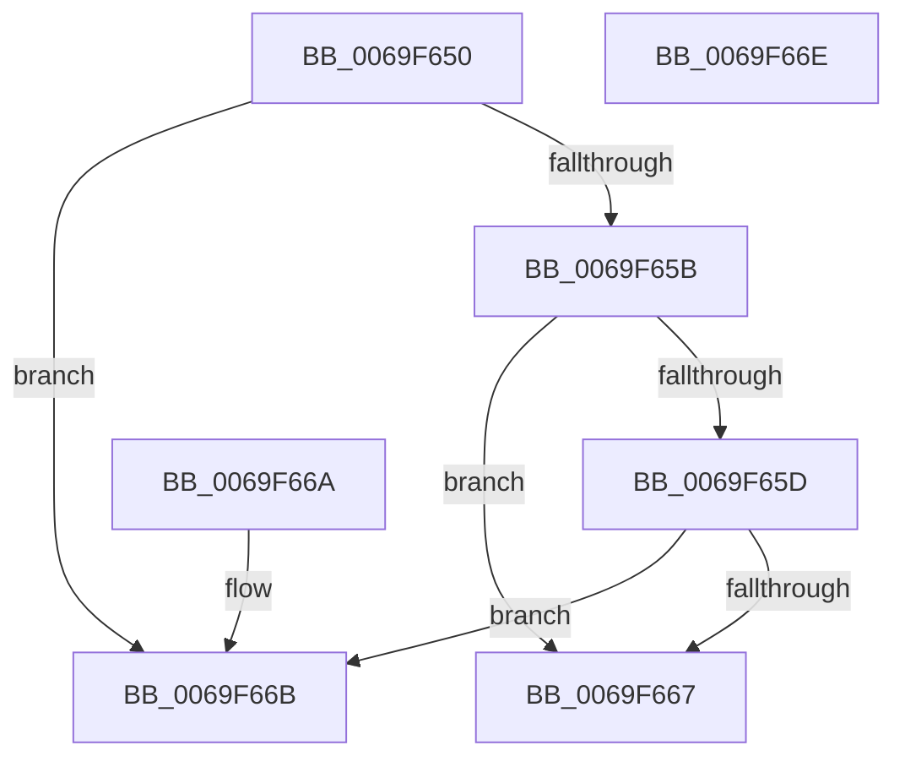

# BcpCursorLessThan

- RVA: `0x0069F650`–`0x0069F66F` (길이 `31` bytes)
- VA: `0x000000014069F650`
- 실행 섹션: `.text`
- PDB 이름 있음: `예`; PDB Function 태그: `아니요`
- unwind 정보 RVA: `0x000DB714`
- 디코드: `13`개 명령, `31/31` bytes 표시
- 미해석 바이트: `0` (있으면 어셈블리에 `.byte`로 보존)

> 이 문서는 커널 이미지의 기계어와 PDB 기호를 분석해 생성했습니다. 4번과 5번은 함수 원형과 자료형을 바이너리 사용 방식에서 추정한 C 해석이며 원본 소스 복구 결과는 아닙니다.

## 1. Dependencies

- 직접 호출 지점: **0**; 고유 호출 대상: **0**
- 직접 호출자로 확인된 함수: **1**
- RIP 상대 이미지 참조: **2**

### Outgoing calls
- 직접 디코드된 call 명령이 없습니다.

### Direct callers
- [BcpDisplayProgress](../6A/BcpDisplayProgress_function_006A047C.md) at `0x006A0562`
- [BcpDisplayProgress](../6A/BcpDisplayProgress_function_006A047C.md) at `0x006A05D7`

### Static image references
- `0x0069F653` → RVA `0x00EF0394` (`.data`; read)
- `0x0069F65D` → RVA `0x00EF0390` (`.data`; read)

## 2. Other-region calls and transfers

- 다른 실행 섹션으로 향하는 call: **0**
- 별도 외부 분기/꼬리 이동을 확인하지 못했습니다.

## 3. Assembly (complete function range)

```asm
0069F650  8B 41 04                        mov eax, dword ptr [rcx + 4]
0069F653  3B 05 3B 0D 85 00               cmp eax, dword ptr [rip + 0x850d3b]
0069F659  72 10                           jb 0x14069f66b
0069F65B  75 0A                           jne 0x14069f667
0069F65D  8B 05 2D 0D 85 00               mov eax, dword ptr [rip + 0x850d2d]
0069F663  39 01                           cmp dword ptr [rcx], eax
0069F665  72 04                           jb 0x14069f66b
0069F667  32 C0                           xor al, al
0069F669  C3                              ret
0069F66A  CC                              int3
0069F66B  B0 01                           mov al, 1
0069F66D  C3                              ret
0069F66E  CC                              int3
```

## 4. C-style interpretation (structured pseudocode)

```c
__int64 __fastcall BcpCursorLessThan(__int64 a1)
{
    __int64 result;

    if (((unsigned int)((unsigned int)(*(unsigned int *)(a1 + 4)))) < (*(unsigned int *)(v_rip + 8719675))) goto loc_0069F66B;
    if (((unsigned int)((unsigned int)(*(unsigned int *)(a1 + 4)))) != (*(unsigned int *)(v_rip + 8719675))) goto loc_0069F667;
    if ((*(unsigned int *)(a1)) < ((unsigned int)((unsigned int)(*(unsigned int *)(v_rip + 8719661))))) goto loc_0069F66B;
loc_0069F667:
    result = 0;
    return result;
loc_0069F66B:
    return 1;
}
```

## 5. (Beta) C Style

```c
int64_t BcpCursorLessThan(void *Arg1)
{
    uint8_t *arg1 = (uint8_t *)Arg1;

    int64_t result;

    if (((uint32_t)((uint32_t)(*(uint32_t *)(arg1 + 0x4)))) < (*(uint32_t *)(v_rip + 0x850D3B))) goto loc_0069F66B;
    if (((uint32_t)((uint32_t)(*(uint32_t *)(arg1 + 0x4)))) != (*(uint32_t *)(v_rip + 0x850D3B))) goto loc_0069F667;
    if ((*(uint32_t *)(arg1)) < ((uint32_t)((uint32_t)(*(uint32_t *)(v_rip + 0x850D2D))))) goto loc_0069F66B;
loc_0069F667:
    result = 0;
    return result;
loc_0069F66B:
    return 1;
}
```

### 관측된 메모리 오프셋

구조체 형식이 확인되지 않은 접근은 인자 기준의 오프셋으로만 기록했습니다.

| 기준 인자 | 오프셋 표현 | 폭 (bit) | 접근 |
|---|---:|---:|---|
| `Arg1` | `+ 0x0` | `32` | `R` |
| `Arg1` | `+ 0x4` | `32` | `R` |

## 6. Execution-region graph

[열기: 2D/3D 그래프와 함수 탐색 컨트롤 패널](../../../control-panel.html?section=text&rva=0x0069F650&view=graph)

- 2D 그래프는 위에서 아래로 흐르고, 3D 그래프는 빈 공간을 드래그해 회전합니다. Shift+드래그는 이동, 휠은 확대·축소, 함수 노드 선택은 대상 보고서 이동입니다.

### Static fallback


