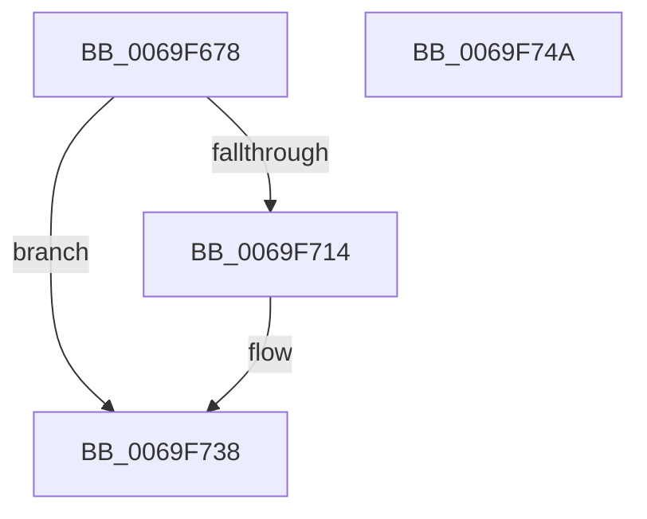

# BcpDisplayCriticalCharacter

- RVA: `0x0069F678`–`0x0069F74B` (길이 `211` bytes)
- VA: `0x000000014069F678`
- 실행 섹션: `.text`
- PDB 이름 있음: `예`; PDB Function 태그: `아니요`
- unwind 정보 RVA: `0x000DA56C`
- 디코드: `53`개 명령, `211/211` bytes 표시
- 미해석 바이트: `0` (있으면 어셈블리에 `.byte`로 보존)

> 이 문서는 커널 이미지의 기계어와 PDB 기호를 분석해 생성했습니다. 4번과 5번은 함수 원형과 자료형을 바이너리 사용 방식에서 추정한 C 해석이며 원본 소스 복구 결과는 아닙니다.

## 1. Dependencies

- 직접 호출 지점: **2**; 고유 호출 대상: **2**
- 직접 호출자로 확인된 함수: **2**
- RIP 상대 이미지 참조: **5**

### Outgoing calls
- `0x0069F70B` → [BgpDisplayCharacterEx](BgpDisplayCharacterEx_function_0069EBF4.md) (function, `0x0069EBF4`)
- `0x0069F733` → [BcpSetCursorPosition](../6A/BcpSetCursorPosition_function_006A0D50.md) (function, `0x006A0D50`)

### Direct callers
- [BcpDisplayErrorInformation](BcpDisplayErrorInformation_function_0069FE74.md) at `0x0069FF76`
- [BcpDisplayErrorInformation](BcpDisplayErrorInformation_function_0069FE74.md) at `0x0069FFCA`
- [BgpFwDisplayBugCheckScreen](../6A/BgpFwDisplayBugCheckScreen_function_006A0FE8.md) at `0x006A1152`

### Static image references
- `0x0069F691` → RVA `0x00E3EBA0` (`.data`; read)
- `0x0069F698` → RVA `0x00EEFEF8` (`.data`; read)
- `0x0069F6A1` → RVA `0x00EEFEFC` (`.data`; read)
- `0x0069F6BD` → RVA `0x00EEFF00` (`.data`; read)
- `0x0069F6D8` → RVA `0x00EF0360` (`.data`; read)

## 2. Other-region calls and transfers

- 다른 실행 섹션으로 향하는 call: **0**
- 별도 외부 분기/꼬리 이동을 확인하지 못했습니다.

## 3. Assembly (complete function range)

```asm
0069F678  4C 8B DC                        mov r11, rsp
0069F67B  49 89 5B 10                     mov qword ptr [r11 + 0x10], rbx
0069F67F  49 89 73 20                     mov qword ptr [r11 + 0x20], rsi
0069F683  45 89 43 18                     mov dword ptr [r11 + 0x18], r8d
0069F687  66 89 4C 24 08                  mov word ptr [rsp + 8], cx
0069F68C  57                              push rdi
0069F68D  48 83 EC 60                     sub rsp, 0x60
0069F691  48 8B 05 08 F5 79 00            mov rax, qword ptr [rip + 0x79f508]
0069F698  8B 35 5A 08 85 00               mov esi, dword ptr [rip + 0x85085a]
0069F69E  44 8B C6                        mov r8d, esi
0069F6A1  8B 3D 55 08 85 00               mov edi, dword ptr [rip + 0x850855]
0069F6A7  44 8B CF                        mov r9d, edi
0069F6AA  49 83 63 E8 00                  and qword ptr [r11 - 0x18], 0
0069F6AF  48 8B 48 18                     mov rcx, qword ptr [rax + 0x18]
0069F6B3  41 83 63 18 00                  and dword ptr [r11 + 0x18], 0
0069F6B8  83 64 24 70 00                  and dword ptr [rsp + 0x70], 0
0069F6BD  8B 1D 3D 08 85 00               mov ebx, dword ptr [rip + 0x85083d]
0069F6C3  89 51 38                        mov dword ptr [rcx + 0x38], edx
0069F6C6  48 8B 05 D3 F4 79 00            mov rax, qword ptr [rip + 0x79f4d3]
0069F6CD  89 74 24 50                     mov dword ptr [rsp + 0x50], esi
0069F6D1  89 7C 24 54                     mov dword ptr [rsp + 0x54], edi
0069F6D5  89 50 08                        mov dword ptr [rax + 8], edx
0069F6D8  48 8D 15 81 0C 85 00            lea rdx, [rip + 0x850c81]
0069F6DF  8B 41 28                        mov eax, dword ptr [rcx + 0x28]
0069F6E2  B9 20 00 00 00                  mov ecx, 0x20
0069F6E7  49 89 53 E0                     mov qword ptr [r11 - 0x20], rdx
0069F6EB  49 8D 53 08                     lea rdx, [r11 + 8]
0069F6EF  49 89 53 D0                     mov qword ptr [r11 - 0x30], rdx
0069F6F3  49 8D 53 18                     lea rdx, [r11 + 0x18]
0069F6F7  49 89 53 C8                     mov qword ptr [r11 - 0x38], rdx
0069F6FB  83 4C 24 28 FF                  or dword ptr [rsp + 0x28], 0xffffffff
0069F700  48 8B 15 99 F4 79 00            mov rdx, qword ptr [rip + 0x79f499]
0069F707  89 44 24 20                     mov dword ptr [rsp + 0x20], eax
0069F70B  E8 E4 F4 FF FF                  call 0x14069ebf4
0069F710  85 C0                           test eax, eax
0069F712  78 24                           js 0x14069f738
0069F714  8B 4C 24 70                     mov ecx, dword ptr [rsp + 0x70]
0069F718  4C 8D 44 24 58                  lea r8, [rsp + 0x58]
0069F71D  03 CF                           add ecx, edi
0069F71F  8B D7                           mov edx, edi
0069F721  3B D9                           cmp ebx, ecx
0069F723  0F 42 D9                        cmovb ebx, ecx
0069F726  8B 8C 24 80 00 00 00            mov ecx, dword ptr [rsp + 0x80]
0069F72D  03 CE                           add ecx, esi
0069F72F  89 5C 24 58                     mov dword ptr [rsp + 0x58], ebx
0069F733  E8 18 16 00 00                  call 0x1406a0d50
0069F738  4C 8D 5C 24 60                  lea r11, [rsp + 0x60]
0069F73D  49 8B 5B 18                     mov rbx, qword ptr [r11 + 0x18]
0069F741  49 8B 73 28                     mov rsi, qword ptr [r11 + 0x28]
0069F745  49 8B E3                        mov rsp, r11
0069F748  5F                              pop rdi
0069F749  C3                              ret
0069F74A  CC                              int3
```

## 4. C-style interpretation (structured pseudocode)

```c
__int64 __fastcall BcpDisplayCriticalCharacter(unsigned __int16 a1, int a2, int a3)
{
    __int64 result;
    __int64 v_rbx;
    __int64 v_rsp;
    unsigned __int64 v_stack_m10;
    unsigned int v_stack_m14;
    unsigned int v_stack_m18;
    unsigned int v_stack_m40;
    unsigned int v_stack_m48;
    unsigned __int64 v_stack_m8;
    unsigned int v_stack_p18;
    unsigned __int16 v_stack_p8;

    *(unsigned __int64 *)(v_rsp + 16) = v_rbx;
    *(unsigned __int64 *)(v_rsp + 32) = v_rsi;
    *(unsigned int *)(v_rsp + 24) = a3;
    v_stack_p8 = a1;
    v_rsp = (v_rsp) - (96);
    *(unsigned int *)(*(unsigned __int64 *)(*(unsigned __int64 *)(v_rip + 7992584) + 24) + 56) = a2;
    v_stack_m18 = (unsigned int)((unsigned int)(*(unsigned int *)(v_rip + 8718426)));
    v_stack_m14 = (unsigned int)((unsigned int)(*(unsigned int *)(v_rip + 8718421)));
    *(unsigned int *)(*(unsigned __int64 *)(v_rip + 7992531) + 8) = a2;
    *(unsigned __int64 *)(v_rsp - 32) = v_rip + 8719489;
    *(unsigned __int64 *)(v_rsp - 48) = v_rsp + 8;
    *(unsigned __int64 *)(v_rsp - 56) = v_rsp + 24;
    v_stack_m48 = (unsigned int)((unsigned int)(*(unsigned int *)(*(unsigned __int64 *)(*(unsigned __int64 *)(v_rip + 7992584) + 24) + 40)));
    result = BgpDisplayCharacterEx(32, *(unsigned __int64 *)(v_rip + 7992473), (unsigned int)((unsigned int)((unsigned int)(*(unsigned int *)(v_rip + 8718426)))), (unsigned int)((unsigned int)((unsigned int)(*(unsigned int *)(v_rip + 8718421)))));
    v_rbx = (unsigned int)(*(unsigned int *)(v_rip + 8718397));
    if (!(sign_flag)) {
        a1 = v_stack_p8;
        a3 = v_stack_m10;
        a1 = (unsigned int)((a1) + ((unsigned int)((unsigned int)(*(unsigned int *)(v_rip + 8718421)))));
        a2 = (unsigned int)((unsigned int)(*(unsigned int *)(v_rip + 8718421)));
        v_rbx = (unsigned int)(*(unsigned int *)(v_rip + 8718397));
        if (((unsigned int)((unsigned int)(*(unsigned int *)(v_rip + 8718397)))) < a1) { v_rbx = a1; }
        a1 = v_stack_p18;
        a1 = (unsigned int)((a1) + ((unsigned int)((unsigned int)(*(unsigned int *)(v_rip + 8718426)))));
        v_stack_m10 = (unsigned int)(v_rbx);
        result = BcpSetCursorPosition(a1, a2, a3, (unsigned int)((unsigned int)((unsigned int)(*(unsigned int *)(v_rip + 8718421)))));
    }
    return result;
}
```

## 5. (Beta) C Style

```c
int64_t BcpDisplayCriticalCharacter(uint16_t Arg1, int32_t Arg2, int32_t Arg3)
{
    int64_t result;
    int64_t local_rbx;
    int64_t local_rsp;
    uint64_t v_stack_m10;
    uint32_t v_stack_m14;
    uint32_t v_stack_m18;
    uint32_t v_stack_m40;
    uint32_t v_stack_m48;
    uint64_t v_stack_m8;
    uint32_t v_stack_p18;
    uint16_t v_stack_p8;

    *(uint64_t *)(local_rsp + 0x10) = local_rbx;
    *(uint64_t *)(local_rsp + 0x20) = local_rsi;
    *(uint32_t *)(local_rsp + 0x18) = Arg3;
    v_stack_p8 = Arg1;
    local_rsp = (local_rsp) - (96);
    *(uint32_t *)(*(uint64_t *)(*(uint64_t *)(v_rip + 0x79F508) + 0x18) + 0x38) = Arg2;
    v_stack_m18 = (uint32_t)((uint32_t)(*(uint32_t *)(v_rip + 0x85085A)));
    v_stack_m14 = (uint32_t)((uint32_t)(*(uint32_t *)(v_rip + 0x850855)));
    *(uint32_t *)(*(uint64_t *)(v_rip + 0x79F4D3) + 0x8) = Arg2;
    *(uint64_t *)(local_rsp - 0x20) = v_rip + 8719489;
    *(uint64_t *)(local_rsp - 0x30) = local_rsp + 8;
    *(uint64_t *)(local_rsp - 0x38) = local_rsp + 24;
    v_stack_m48 = (uint32_t)((uint32_t)(*(uint32_t *)(*(uint64_t *)(*(uint64_t *)(v_rip + 0x79F508) + 0x18) + 0x28)));
    result = BgpDisplayCharacterEx(32, *(uint64_t *)(v_rip + 0x79F499), (uint32_t)((uint32_t)((uint32_t)(*(uint32_t *)(v_rip + 0x85085A)))), (uint32_t)((uint32_t)((uint32_t)(*(uint32_t *)(v_rip + 0x850855)))));
    local_rbx = (uint32_t)(*(uint32_t *)(v_rip + 0x85083D));
    if (!(sign_flag)) {
        Arg1 = v_stack_p8;
        Arg3 = v_stack_m10;
        Arg1 = (uint32_t)((Arg1) + ((uint32_t)((uint32_t)(*(uint32_t *)(v_rip + 0x850855)))));
        Arg2 = (uint32_t)((uint32_t)(*(uint32_t *)(v_rip + 0x850855)));
        local_rbx = (uint32_t)(*(uint32_t *)(v_rip + 0x85083D));
        if (((uint32_t)((uint32_t)(*(uint32_t *)(v_rip + 0x85083D)))) < Arg1) { local_rbx = Arg1; }
        Arg1 = v_stack_p18;
        Arg1 = (uint32_t)((Arg1) + ((uint32_t)((uint32_t)(*(uint32_t *)(v_rip + 0x85085A)))));
        v_stack_m10 = (uint32_t)(local_rbx);
        result = BcpSetCursorPosition(Arg1, Arg2, Arg3, (uint32_t)((uint32_t)((uint32_t)(*(uint32_t *)(v_rip + 0x850855)))));
    }
    return result;
}
```

## 6. Execution-region graph

[열기: 2D/3D 그래프와 함수 탐색 컨트롤 패널](../../../control-panel.html?section=text&rva=0x0069F678&view=graph)

- 2D 그래프는 위에서 아래로 흐르고, 3D 그래프는 빈 공간을 드래그해 회전합니다. Shift+드래그는 이동, 휠은 확대·축소, 함수 노드 선택은 대상 보고서 이동입니다.

### Static fallback


