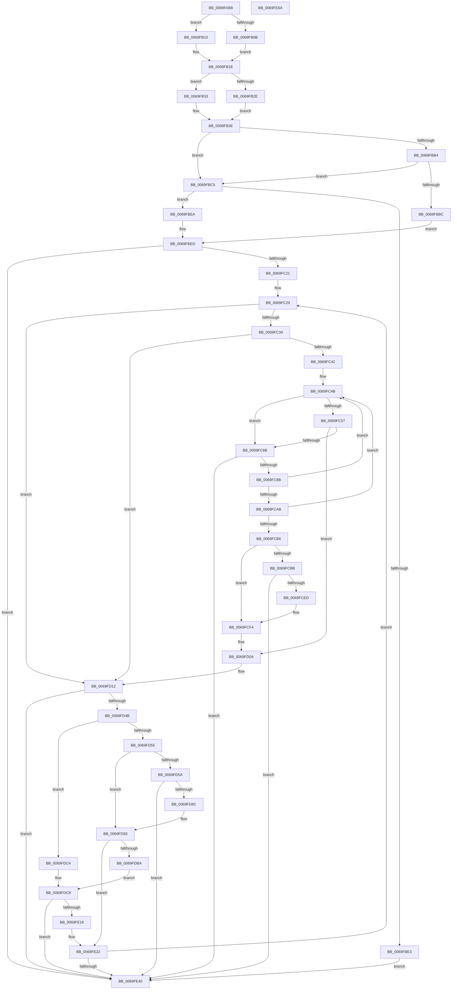

# BcpDisplayCriticalStringCentered

- RVA: `0x0069FAB8`–`0x0069FE6B` (길이 `947` bytes)
- VA: `0x000000014069FAB8`
- 실행 섹션: `.text`
- PDB 이름 있음: `예`; PDB Function 태그: `아니요`
- unwind 정보 RVA: `0x0009E8C8`
- 디코드: `263`개 명령, `947/947` bytes 표시
- 미해석 바이트: `0` (있으면 어셈블리에 `.byte`로 보존)

> 이 문서는 커널 이미지의 기계어와 PDB 기호를 분석해 생성했습니다. 4번과 5번은 함수 원형과 자료형을 바이너리 사용 방식에서 추정한 C 해석이며 원본 소스 복구 결과는 아닙니다.

## 1. Dependencies

- 직접 호출 지점: **10**; 고유 호출 대상: **6**
- 직접 호출자로 확인된 함수: **3**
- RIP 상대 이미지 참조: **8**

### Outgoing calls
- `0x0069FB87` → [BcpSetCursorPosition](../6A/BcpSetCursorPosition_function_006A0D50.md) (function, `0x006A0D50`)
- `0x0069FBA2` → [BgpFoGetStringAdvanceWidth](BgpFoGetStringAdvanceWidth_function_0069F370.md) (function, `0x0069F370`)
- `0x0069FBCE` → [RtlULongSub](../4A/RtlULongSub_function_004A1DA8.md) (function, `0x004A1DA8`)
- `0x0069FBF4` → [BcpSetCursorPosition](../6A/BcpSetCursorPosition_function_006A0D50.md) (function, `0x006A0D50`)
- `0x0069FC78` → [BgpRasGetGlyphAdvanceWidth](../6A/BgpRasGetGlyphAdvanceWidth_function_006A1888.md) (function, `0x006A1888`)
- `0x0069FCDA` → [BcpPrintSpaces](../6A/BcpPrintSpaces_function_006A0BF0.md) (function, `0x006A0BF0`)
- `0x0069FD38` → [BgpRasGetGlyphAdvanceWidth](../6A/BgpRasGetGlyphAdvanceWidth_function_006A1888.md) (function, `0x006A1888`)
- `0x0069FD79` → [BcpPrintSpaces](../6A/BcpPrintSpaces_function_006A0BF0.md) (function, `0x006A0BF0`)
- `0x0069FE09` → [BgpDisplayCharacterEx](BgpDisplayCharacterEx_function_0069EBF4.md) (function, `0x0069EBF4`)
- `0x0069FE4E` → [BcpSetCursorPosition](../6A/BcpSetCursorPosition_function_006A0D50.md) (function, `0x006A0D50`)

### Direct callers
- [BcpDisplayErrorInformationModernized](../6A/BcpDisplayErrorInformationModernized_function_006A00DC.md) at `0x006A031D`
- [BcpDisplayErrorInformationModernized](../6A/BcpDisplayErrorInformationModernized_function_006A00DC.md) at `0x006A0346`
- [BcpDisplayErrorInformationModernized](../6A/BcpDisplayErrorInformationModernized_function_006A00DC.md) at `0x006A0378`
- [BcpDisplayErrorInformationModernized](../6A/BcpDisplayErrorInformationModernized_function_006A00DC.md) at `0x006A039D`
- [BcpDisplayProgressModernized](../6A/BcpDisplayProgressModernized_function_006A068C.md) at `0x006A07CB`
- [BgpFwDisplayBugCheckScreenModernized](../6A/BgpFwDisplayBugCheckScreenModernized_function_006A1338.md) at `0x006A16B3`
- [BgpFwDisplayBugCheckScreenModernized](../6A/BgpFwDisplayBugCheckScreenModernized_function_006A1338.md) at `0x006A16D6`
- [BgpFwDisplayBugCheckScreenModernized](../6A/BgpFwDisplayBugCheckScreenModernized_function_006A1338.md) at `0x006A1702`

### Static image references
- `0x0069FAE4` → RVA `0x00EEFEF0` (`.data`; read)
- `0x0069FAEB` → RVA `0x00E0EF60` (`.data`; read)
- `0x0069FB1E` → RVA `0x00EEFF10` (`.data`; read)
- `0x0069FB3E` → RVA `0x00E3EBA0` (`.data`; read)
- `0x0069FB48` → RVA `0x00EEFEFC` (`.data`; read)
- `0x0069FB4E` → RVA `0x00EEFEF8` (`.data`; read)
- `0x0069FB55` → RVA `0x00EEFF00` (`.data`; read)
- `0x0069FC29` → RVA `0x00EF0360` (`.data`; read)

## 2. Other-region calls and transfers

- 다른 실행 섹션으로 향하는 call: **0**
- 별도 외부 분기/꼬리 이동을 확인하지 못했습니다.

## 3. Assembly (complete function range)

```asm
0069FAB8  44 89 44 24 18                  mov dword ptr [rsp + 0x18], r8d
0069FABD  48 89 4C 24 08                  mov qword ptr [rsp + 8], rcx
0069FAC2  55                              push rbp
0069FAC3  53                              push rbx
0069FAC4  56                              push rsi
0069FAC5  57                              push rdi
0069FAC6  41 54                           push r12
0069FAC8  41 55                           push r13
0069FACA  41 56                           push r14
0069FACC  41 57                           push r15
0069FACE  48 8D 6C 24 E1                  lea rbp, [rsp - 0x1f]
0069FAD3  48 81 EC 88 00 00 00            sub rsp, 0x88
0069FADA  45 33 DB                        xor r11d, r11d
0069FADD  49 63 C1                        movsxd rax, r9d
0069FAE0  4C 6B F8 54                     imul r15, rax, 0x54
0069FAE4  48 8B 05 05 04 85 00            mov rax, qword ptr [rip + 0x850405]
0069FAEB  48 8D 3D 6E F4 76 00            lea rdi, [rip + 0x76f46e]
0069FAF2  44 89 5D 7F                     mov dword ptr [rbp + 0x7f], r11d
0069FAF6  4C 8B D1                        mov r10, rcx
0069FAF9  44 89 5D 6F                     mov dword ptr [rbp + 0x6f], r11d
0069FAFD  44 89 5D EF                     mov dword ptr [rbp - 0x11], r11d
0069FB01  41 8B 4C 3F 10                  mov ecx, dword ptr [r15 + rdi + 0x10]
0069FB06  48 85 C0                        test rax, rax
0069FB09  74 0A                           je 0x14069fb15
0069FB0B  44 8B 00                        mov r8d, dword ptr [rax]
0069FB0E  41 8B 44 3F 50                  mov eax, dword ptr [r15 + rdi + 0x50]
0069FB13  EB 09                           jmp 0x14069fb1e
0069FB15  41 8B 44 3F 50                  mov eax, dword ptr [r15 + rdi + 0x50]
0069FB1A  44 8D 04 01                     lea r8d, [rcx + rax]
0069FB1E  4C 8B 35 EB 03 85 00            mov r14, qword ptr [rip + 0x8503eb]
0069FB25  44 89 45 EB                     mov dword ptr [rbp - 0x15], r8d
0069FB29  4D 85 F6                        test r14, r14
0069FB2C  74 05                           je 0x14069fb33
0069FB2E  45 8B 36                        mov r14d, dword ptr [r14]
0069FB31  EB 0B                           jmp 0x14069fb3e
0069FB33  45 8B 74 3F 18                  mov r14d, dword ptr [r15 + rdi + 0x18]
0069FB38  44 03 F1                        add r14d, ecx
0069FB3B  44 03 F0                        add r14d, eax
0069FB3E  48 8B 05 5B F0 79 00            mov rax, qword ptr [rip + 0x79f05b]
0069FB45  45 33 C0                        xor r8d, r8d
0069FB48  8B 35 AE 03 85 00               mov esi, dword ptr [rip + 0x8503ae]
0069FB4E  44 8B 25 A3 03 85 00            mov r12d, dword ptr [rip + 0x8503a3]
0069FB55  8B 1D A5 03 85 00               mov ebx, dword ptr [rip + 0x8503a5]
0069FB5B  4C 8B 48 18                     mov r9, qword ptr [rax + 0x18]
0069FB5F  44 89 65 F7                     mov dword ptr [rbp - 9], r12d
0069FB63  89 75 FB                        mov dword ptr [rbp - 5], esi
0069FB66  89 5D FF                        mov dword ptr [rbp - 1], ebx
0069FB69  41 89 51 38                     mov dword ptr [r9 + 0x38], edx
0069FB6D  48 8B 05 2C F0 79 00            mov rax, qword ptr [rip + 0x79f02c]
0069FB74  89 50 08                        mov dword ptr [rax + 8], edx
0069FB77  8B D6                           mov edx, esi
0069FB79  41 8B 4C 3F 50                  mov ecx, dword ptr [r15 + rdi + 0x50]
0069FB7E  41 8B 7C 3F 10                  mov edi, dword ptr [r15 + rdi + 0x10]
0069FB83  03 F9                           add edi, ecx
0069FB85  8B CF                           mov ecx, edi
0069FB87  E8 C4 11 00 00                  call 0x1406a0d50
0069FB8C  4D 8D 69 28                     lea r13, [r9 + 0x28]
0069FB90  44 88 5D 77                     mov byte ptr [rbp + 0x77], r11b
0069FB94  49 8B CD                        mov rcx, r13
0069FB97  4C 89 6D 07                     mov qword ptr [rbp + 7], r13
0069FB9B  4C 8D 45 EF                     lea r8, [rbp - 0x11]
0069FB9F  49 8B D2                        mov rdx, r10
0069FBA2  E8 C9 F7 FF FF                  call 0x14069f370
0069FBA7  8B 55 EF                        mov edx, dword ptr [rbp - 0x11]
0069FBAA  45 33 DB                        xor r11d, r11d
0069FBAD  44 8B C8                        mov r9d, eax
0069FBB0  85 C0                           test eax, eax
0069FBB2  78 11                           js 0x14069fbc5
0069FBB4  8D 0C 17                        lea ecx, [rdi + rdx]
0069FBB7  41 3B CE                        cmp ecx, r14d
0069FBBA  76 09                           jbe 0x14069fbc5
0069FBBC  41 B2 01                        mov r10b, 1
0069FBBF  44 88 55 77                     mov byte ptr [rbp + 0x77], r10b
0069FBC3  EB 28                           jmp 0x14069fbed
0069FBC5  D1 EA                           shr edx, 1
0069FBC7  4C 8D 45 F7                     lea r8, [rbp - 9]
0069FBCB  41 8B CC                        mov ecx, r12d
0069FBCE  E8 D5 21 E0 FF                  call 0x1404a1da8
0069FBD3  8B 7D F7                        mov edi, dword ptr [rbp - 9]
0069FBD6  44 8B C8                        mov r9d, eax
0069FBD9  8B 75 FB                        mov esi, dword ptr [rbp - 5]
0069FBDC  8B 5D FF                        mov ebx, dword ptr [rbp - 1]
0069FBDF  85 C0                           test eax, eax
0069FBE1  79 07                           jns 0x14069fbea
0069FBE3  2B DE                           sub ebx, esi
0069FBE5  E9 56 02 00 00                  jmp 0x14069fe40
0069FBEA  45 8A D3                        mov r10b, r11b
0069FBED  45 33 C0                        xor r8d, r8d
0069FBF0  8B D6                           mov edx, esi
0069FBF2  8B CF                           mov ecx, edi
0069FBF4  E8 57 11 00 00                  call 0x1406a0d50
0069FBF9  41 8B 45 00                     mov eax, dword ptr [r13]
0069FBFD  2B DE                           sub ebx, esi
0069FBFF  4C 8B 45 67                     mov r8, qword ptr [rbp + 0x67]
0069FC03  85 DB                           test ebx, ebx
0069FC05  89 45 EF                        mov dword ptr [rbp - 0x11], eax
0069FC08  45 8B EB                        mov r13d, r11d
0069FC0B  41 0F 4E DB                     cmovle ebx, r11d
0069FC0F  45 8B E3                        mov r12d, r11d
0069FC12  41 0F B7 00                     movzx eax, word ptr [r8]
0069FC16  A9 FE FF FF FF                  test eax, 0xfffffffe
0069FC1B  0F 86 1F 02 00 00               jbe 0x14069fe40
0069FC21  49 8D 40 08                     lea rax, [r8 + 8]
0069FC25  48 89 45 F7                     mov qword ptr [rbp - 9], rax
0069FC29  4C 8D 0D 30 07 85 00            lea r9, [rip + 0x850730]
0069FC30  45 84 D2                        test r10b, r10b
0069FC33  0F 84 D9 00 00 00               je 0x14069fd12
0069FC39  45 3B EC                        cmp r13d, r12d
0069FC3C  0F 87 D0 00 00 00               ja 0x14069fd12
0069FC42  41 8B CC                        mov ecx, r12d
0069FC45  45 8B EB                        mov r13d, r11d
0069FC48  89 4D E7                        mov dword ptr [rbp - 0x19], ecx
0069FC4B  48 8B 00                        mov rax, qword ptr [rax]
0069FC4E  0F B7 14 48                     movzx edx, word ptr [rax + rcx*2]
0069FC52  83 FA 20                        cmp edx, 0x20
0069FC55  77 14                           ja 0x14069fc6b
0069FC57  48 B9 01 24 00 00 01 00 00 00   movabs rcx, 0x100002401
0069FC61  48 0F A3 D1                     bt rcx, rdx
0069FC65  0F 82 9F 00 00 00               jb 0x14069fd0a
0069FC6B  48 8B 4D 07                     mov rcx, qword ptr [rbp + 7]
0069FC6F  4C 8D 45 7F                     lea r8, [rbp + 0x7f]
0069FC73  4C 89 4C 24 20                  mov qword ptr [rsp + 0x20], r9
0069FC78  E8 0B 1C 00 00                  call 0x1406a1888
0069FC7D  45 33 DB                        xor r11d, r11d
0069FC80  44 8B C8                        mov r9d, eax
0069FC83  85 C0                           test eax, eax
0069FC85  0F 88 B5 01 00 00               js 0x14069fe40
0069FC8B  44 03 6D 7F                     add r13d, dword ptr [rbp + 0x7f]
0069FC8F  4C 8D 0D CA 06 85 00            lea r9, [rip + 0x8506ca]
0069FC96  8B 4D E7                        mov ecx, dword ptr [rbp - 0x19]
0069FC99  FF C1                           inc ecx
0069FC9B  89 4D E7                        mov dword ptr [rbp - 0x19], ecx
0069FC9E  42 8D 04 2F                     lea eax, [rdi + r13]
0069FCA2  44 3B F0                        cmp r14d, eax
0069FCA5  48 8B 45 F7                     mov rax, qword ptr [rbp - 9]
0069FCA9  73 A0                           jae 0x14069fc4b
0069FCAB  4C 8D 0D AE 06 85 00            lea r9, [rip + 0x8506ae]
0069FCB2  85 DB                           test ebx, ebx
0069FCB4  74 95                           je 0x14069fc4b
0069FCB6  41 3B FE                        cmp edi, r14d
0069FCB9  73 39                           jae 0x14069fcf4
0069FCBB  48 8B 0D DE EE 79 00            mov rcx, qword ptr [rip + 0x79eede]
0069FCC2  48 8D 45 6F                     lea rax, [rbp + 0x6f]
0069FCC6  48 89 44 24 28                  mov qword ptr [rsp + 0x28], rax
0069FCCB  44 8B CE                        mov r9d, esi
0069FCCE  8B 45 EF                        mov eax, dword ptr [rbp - 0x11]
0069FCD1  45 8B C6                        mov r8d, r14d
0069FCD4  8B D7                           mov edx, edi
0069FCD6  89 44 24 20                     mov dword ptr [rsp + 0x20], eax
0069FCDA  E8 11 0F 00 00                  call 0x1406a0bf0
0069FCDF  45 33 DB                        xor r11d, r11d
0069FCE2  44 8B C8                        mov r9d, eax
0069FCE5  85 C0                           test eax, eax
0069FCE7  0F 88 53 01 00 00               js 0x14069fe40
0069FCED  3B 5D 6F                        cmp ebx, dword ptr [rbp + 0x6f]
0069FCF0  0F 42 5D 6F                     cmovb ebx, dword ptr [rbp + 0x6f]
0069FCF4  8B 7D EB                        mov edi, dword ptr [rbp - 0x15]
0069FCF7  48 8D 05 62 F2 76 00            lea rax, [rip + 0x76f262]
0069FCFE  41 8B 44 07 28                  mov eax, dword ptr [r15 + rax + 0x28]
0069FD03  03 C3                           add eax, ebx
0069FD05  41 8B DB                        mov ebx, r11d
0069FD08  03 F0                           add esi, eax
0069FD0A  4C 8B 45 67                     mov r8, qword ptr [rbp + 0x67]
0069FD0E  44 8B 6D E7                     mov r13d, dword ptr [rbp - 0x19]
0069FD12  49 8D 40 08                     lea rax, [r8 + 8]
0069FD16  41 8B CC                        mov ecx, r12d
0069FD19  48 89 45 F7                     mov qword ptr [rbp - 9], rax
0069FD1D  4C 8D 45 7F                     lea r8, [rbp + 0x7f]
0069FD21  48 8B 00                        mov rax, qword ptr [rax]
0069FD24  0F B7 14 48                     movzx edx, word ptr [rax + rcx*2]
0069FD28  48 8D 05 31 06 85 00            lea rax, [rip + 0x850631]
0069FD2F  48 8B 4D 07                     mov rcx, qword ptr [rbp + 7]
0069FD33  48 89 44 24 20                  mov qword ptr [rsp + 0x20], rax
0069FD38  E8 4B 1B 00 00                  call 0x1406a1888
0069FD3D  45 33 DB                        xor r11d, r11d
0069FD40  44 8B C8                        mov r9d, eax
0069FD43  85 C0                           test eax, eax
0069FD45  0F 88 F5 00 00 00               js 0x14069fe40
0069FD4B  8B 4D 7F                        mov ecx, dword ptr [rbp + 0x7f]
0069FD4E  03 CF                           add ecx, edi
0069FD50  44 3B F1                        cmp r14d, ecx
0069FD53  73 6F                           jae 0x14069fdc4
0069FD55  41 3B FE                        cmp edi, r14d
0069FD58  73 39                           jae 0x14069fd93
0069FD5A  48 8B 0D 3F EE 79 00            mov rcx, qword ptr [rip + 0x79ee3f]
0069FD61  48 8D 45 6F                     lea rax, [rbp + 0x6f]
0069FD65  48 89 44 24 28                  mov qword ptr [rsp + 0x28], rax
0069FD6A  44 8B CE                        mov r9d, esi
0069FD6D  8B 45 EF                        mov eax, dword ptr [rbp - 0x11]
0069FD70  45 8B C6                        mov r8d, r14d
0069FD73  8B D7                           mov edx, edi
0069FD75  89 44 24 20                     mov dword ptr [rsp + 0x20], eax
0069FD79  E8 72 0E 00 00                  call 0x1406a0bf0
0069FD7E  45 33 DB                        xor r11d, r11d
0069FD81  44 8B C8                        mov r9d, eax
0069FD84  85 C0                           test eax, eax
0069FD86  0F 88 B4 00 00 00               js 0x14069fe40
0069FD8C  3B 5D 6F                        cmp ebx, dword ptr [rbp + 0x6f]
0069FD8F  0F 42 5D 6F                     cmovb ebx, dword ptr [rbp + 0x6f]
0069FD93  48 8B 4D F7                     mov rcx, qword ptr [rbp - 9]
0069FD97  48 8D 05 C2 F1 76 00            lea rax, [rip + 0x76f1c2]
0069FD9E  41 8B 44 07 28                  mov eax, dword ptr [r15 + rax + 0x28]
0069FDA3  8B 7D EB                        mov edi, dword ptr [rbp - 0x15]
0069FDA6  03 C3                           add eax, ebx
0069FDA8  03 F0                           add esi, eax
0069FDAA  41 8B DB                        mov ebx, r11d
0069FDAD  48 8B 01                        mov rax, qword ptr [rcx]
0069FDB0  41 8B CC                        mov ecx, r12d
0069FDB3  66 83 3C 48 20                  cmp word ptr [rax + rcx*2], 0x20
0069FDB8  74 68                           je 0x14069fe22
0069FDBA  48 8B 4D 67                     mov rcx, qword ptr [rbp + 0x67]
0069FDBE  48 83 C1 08                     add rcx, 8
0069FDC2  EB 04                           jmp 0x14069fdc8
0069FDC4  48 8B 4D F7                     mov rcx, qword ptr [rbp - 9]
0069FDC8  48 8B 09                        mov rcx, qword ptr [rcx]
0069FDCB  48 8D 15 8E 05 85 00            lea rdx, [rip + 0x85058e]
0069FDD2  48 89 54 24 48                  mov qword ptr [rsp + 0x48], rdx
0069FDD7  44 8B CE                        mov r9d, esi
0069FDDA  48 8D 55 6F                     lea rdx, [rbp + 0x6f]
0069FDDE  41 8B C4                        mov eax, r12d
0069FDE1  48 89 54 24 38                  mov qword ptr [rsp + 0x38], rdx
0069FDE6  44 8B C7                        mov r8d, edi
0069FDE9  48 8D 55 7F                     lea rdx, [rbp + 0x7f]
0069FDED  48 89 54 24 30                  mov qword ptr [rsp + 0x30], rdx
0069FDF2  8B 55 EF                        mov edx, dword ptr [rbp - 0x11]
0069FDF5  83 4C 24 28 FF                  or dword ptr [rsp + 0x28], 0xffffffff
0069FDFA  0F B7 0C 41                     movzx ecx, word ptr [rcx + rax*2]
0069FDFE  89 54 24 20                     mov dword ptr [rsp + 0x20], edx
0069FE02  48 8B 15 97 ED 79 00            mov rdx, qword ptr [rip + 0x79ed97]
0069FE09  E8 E6 ED FF FF                  call 0x14069ebf4
0069FE0E  45 33 DB                        xor r11d, r11d
0069FE11  44 8B C8                        mov r9d, eax
0069FE14  85 C0                           test eax, eax
0069FE16  78 28                           js 0x14069fe40
0069FE18  03 7D 7F                        add edi, dword ptr [rbp + 0x7f]
0069FE1B  39 5D 6F                        cmp dword ptr [rbp + 0x6f], ebx
0069FE1E  0F 47 5D 6F                     cmova ebx, dword ptr [rbp + 0x6f]
0069FE22  4C 8B 45 67                     mov r8, qword ptr [rbp + 0x67]
0069FE26  41 FF C4                        inc r12d
0069FE29  44 8A 55 77                     mov r10b, byte ptr [rbp + 0x77]
0069FE2D  41 0F B7 00                     movzx eax, word ptr [r8]
0069FE31  D1 E8                           shr eax, 1
0069FE33  44 3B E0                        cmp r12d, eax
0069FE36  48 8B 45 F7                     mov rax, qword ptr [rbp - 9]
0069FE3A  0F 82 E9 FD FF FF               jb 0x14069fc29
0069FE40  8D 04 1E                        lea eax, [rsi + rbx]
0069FE43  8B D6                           mov edx, esi
0069FE45  4C 8D 45 77                     lea r8, [rbp + 0x77]
0069FE49  89 45 77                        mov dword ptr [rbp + 0x77], eax
0069FE4C  8B CF                           mov ecx, edi
0069FE4E  E8 FD 0E 00 00                  call 0x1406a0d50
0069FE53  41 8B C1                        mov eax, r9d
0069FE56  48 81 C4 88 00 00 00            add rsp, 0x88
0069FE5D  41 5F                           pop r15
0069FE5F  41 5E                           pop r14
0069FE61  41 5D                           pop r13
0069FE63  41 5C                           pop r12
0069FE65  5F                              pop rdi
0069FE66  5E                              pop rsi
0069FE67  5B                              pop rbx
0069FE68  5D                              pop rbp
0069FE69  C3                              ret
0069FE6A  CC                              int3
```

## 4. C-style interpretation (structured pseudocode)

```c
__int64 __fastcall BcpDisplayCriticalStringCentered(__int64 a1, int a2, int a3, int a4)
{
    __int64 result;
    __int64 v_r11;
    __int64 v_r12;
    __int64 v_r13;
    __int64 v_r14;
    __int64 v_r15;
    __int64 v_rbx;
    __int64 v_rdi;
    __int64 v_rsi;
    __int64 v_rsp;
    unsigned __int64 v_stack_m58;
    unsigned __int64 v_stack_m5F;
    unsigned int v_stack_m60;
    unsigned int v_stack_m64;
    unsigned int v_stack_m68;
    unsigned int v_stack_m70;
    unsigned int v_stack_m74;
    unsigned int v_stack_m78;
    unsigned __int64 v_stack_m80;
    unsigned __int64 v_stack_m90;
    unsigned __int64 v_stack_m98;
    unsigned __int64 v_stack_mA0;
    unsigned __int64 v_stack_mA8;
    unsigned int v_stack_p10;
    unsigned int v_stack_p18;
    unsigned int v_stack_p20;
    unsigned __int64 v_stack_p8;

    v_stack_p18 = a3;
    v_stack_p8 = a1;
    v_rsp = (v_rsp) - (136);
    v_r11 = 0;
    v_r15 = (v_r15) * ((int)(a4));
    v_stack_p20 = 0;
    v_stack_p10 = 0;
    v_stack_m70 = 0;
    if (*(unsigned __int64 *)(v_rip + 8717317) == 0) goto loc_0069FB15;
    goto loc_0069FB1E;
loc_0069FB15:
loc_0069FB1E:
    v_stack_m74 = (unsigned int)((unsigned int)(*(unsigned int *)(v_r15 + v_rip + 7795822 * 1 + 16)) + (unsigned int)(*(unsigned int *)(v_r15 + v_rip + 7795822 * 1 + 80)) * 1);
    if (*(unsigned __int64 *)(v_rip + 8717291) == 0) goto loc_0069FB33;
    goto loc_0069FB3E;
loc_0069FB33:
    v_r14 = (unsigned int)(((unsigned int)(*(unsigned int *)(v_r15 + v_rip + 7795822 * 1 + 24))) + ((unsigned int)((unsigned int)(*(unsigned int *)(v_r15 + v_rip + 7795822 * 1 + 16)))));
    v_r14 = (unsigned int)((v_r14) + ((unsigned int)((unsigned int)(*(unsigned int *)(v_r15 + v_rip + 7795822 * 1 + 80)))));
loc_0069FB3E:
    a3 = 0;
    v_stack_m68 = (unsigned int)((unsigned int)(*(unsigned int *)(v_rip + 8717219)));
    v_stack_m64 = (unsigned int)((unsigned int)(*(unsigned int *)(v_rip + 8717230)));
    v_stack_m60 = (unsigned int)((unsigned int)(*(unsigned int *)(v_rip + 8717221)));
    *(unsigned int *)(*(unsigned __int64 *)(*(unsigned __int64 *)(v_rip + 7991387) + 24) + 56) = a2;
    *(unsigned int *)(*(unsigned __int64 *)(v_rip + 7991340) + 8) = a2;
    v_rdi = (unsigned int)(((unsigned int)(*(unsigned int *)(v_r15 + v_rip + 7795822 * 1 + 16))) + ((unsigned int)((unsigned int)(*(unsigned int *)(v_r15 + v_rip + 7795822 * 1 + 80)))));
    result = BcpSetCursorPosition((unsigned int)((unsigned int)(v_rdi)), (unsigned int)((unsigned int)((unsigned int)(*(unsigned int *)(v_rip + 8717230)))), a3, *(unsigned __int64 *)(*(unsigned __int64 *)(v_rip + 7991387) + 24));
    v_stack_p18 = 0;
    v_stack_m58 = *(unsigned __int64 *)(*(unsigned __int64 *)(v_rip + 7991387) + 24) + 40;
    result = BgpFoGetStringAdvanceWidth(*(unsigned __int64 *)(*(unsigned __int64 *)(v_rip + 7991387) + 24) + 40, a1, v_stack_m70, *(unsigned __int64 *)(*(unsigned __int64 *)(v_rip + 7991387) + 24));
    v_r11 = 0;
    if (sign_flag) goto loc_0069FBC5;
    if (((unsigned int)(v_rdi + (unsigned int)(v_stack_m70) * 1)) <= ((unsigned int)(v_r14))) goto loc_0069FBC5;
    v_stack_p18 = 1;
    goto loc_0069FBED;
loc_0069FBC5:
    a2 = (unsigned int)(((unsigned int)(v_stack_m70)) >> (1));
    result = RtlULongSub((unsigned int)((unsigned int)((unsigned int)(*(unsigned int *)(v_rip + 8717219)))), a2, v_stack_m68, (unsigned int)((unsigned int)(result)));
    if (!sign_flag) goto loc_0069FBEA;
    v_rbx = (unsigned int)(((unsigned int)(v_stack_m60)) - ((unsigned int)((unsigned int)(v_stack_m64))));
    goto loc_0069FE40;
loc_0069FBEA:
loc_0069FBED:
    a3 = 0;
    result = BcpSetCursorPosition((unsigned int)((unsigned int)((unsigned int)(v_stack_m68))), (unsigned int)((unsigned int)((unsigned int)(v_stack_m64))), a3, (unsigned int)((unsigned int)(result)));
    v_rbx = (unsigned int)((v_rbx) - ((unsigned int)((unsigned int)(v_stack_m64))));
    v_stack_m70 = (unsigned int)((unsigned int)(*(unsigned int *)(*(unsigned __int64 *)(*(unsigned __int64 *)(v_rip + 7991387) + 24) + 40)));
    if (condition_is_less_or_equal) { v_rbx = 0; }
    if (condition_is_below_or_equal) goto loc_0069FE40;
    v_stack_m68 = v_stack_p8 + 8;
loc_0069FC29:
    if (0 == 0) goto loc_0069FD12;
    if (0 > 0) goto loc_0069FD12;
    v_stack_m78 = 0;
loc_0069FC4B:
    if (((unsigned int)(*(unsigned __int16 *)(*(unsigned __int64 *)(v_stack_p8 + 8) + 0 * 2))) > 32) goto loc_0069FC6B;
    if (((unsigned int)(*(unsigned __int16 *)(*(unsigned __int64 *)(v_stack_p8 + 8) + 0 * 2))) < 32) goto loc_0069FD0A;
loc_0069FC6B:
    v_stack_mA8 = v_rip + 8718128;
    result = BgpRasGetGlyphAdvanceWidth(v_stack_m58, *(unsigned __int16 *)(*(unsigned __int64 *)(v_stack_p8 + 8) + 0 * 2), v_stack_p20, v_rip + 8718128);
    v_r11 = 0;
    if (sign_flag) goto loc_0069FE40;
    v_r13 = (unsigned int)((0) + (v_stack_p20));
    a1 = (unsigned int)(((unsigned int)(v_stack_m78)) + 1);
    v_stack_m78 = (unsigned int)(a1);
    if (((unsigned int)(v_r14)) >= ((unsigned int)((unsigned int)(v_stack_m68) + v_r13 * 1))) goto loc_0069FC4B;
    if ((unsigned int)(v_rbx) == 0) goto loc_0069FC4B;
    if (((unsigned int)((unsigned int)(v_stack_m68))) >= ((unsigned int)(v_r14))) goto loc_0069FCF4;
    v_stack_mA0 = v_stack_p10;
    v_stack_mA8 = (unsigned int)((unsigned int)(v_stack_m70));
    result = BcpPrintSpaces(*(unsigned __int64 *)(v_rip + 7991006), (unsigned int)((unsigned int)((unsigned int)(v_stack_m68))), (unsigned int)((unsigned int)(v_r14)), (unsigned int)((unsigned int)((unsigned int)(v_stack_m64))));
    v_r11 = 0;
    if (sign_flag) goto loc_0069FE40;
    if (((unsigned int)(v_rbx)) < v_stack_p10) { v_rbx = v_stack_p10; }
loc_0069FCF4:
    result = (unsigned int)(((unsigned int)(*(unsigned int *)(v_r15 + v_rip + 7795298 * 1 + 40))) + ((unsigned int)(v_rbx)));
    v_rsi = (unsigned int)(((unsigned int)(v_stack_m64)) + ((unsigned int)(result)));
loc_0069FD0A:
loc_0069FD12:
    v_stack_m68 = v_stack_p8 + 8;
    v_stack_mA8 = v_rip + 8717873;
    result = BgpRasGetGlyphAdvanceWidth(v_stack_m58, *(unsigned __int16 *)(*(unsigned __int64 *)(v_stack_p8 + 8) + 0 * 2), v_stack_p20, (unsigned int)((unsigned int)(result)));
    v_r11 = 0;
    if (sign_flag) goto loc_0069FE40;
    a1 = (unsigned int)(((unsigned int)(v_stack_p20)) + ((unsigned int)((unsigned int)(v_stack_m74))));
    if (((unsigned int)(v_r14)) >= ((unsigned int)(a1))) goto loc_0069FDC4;
    if (((unsigned int)((unsigned int)(v_stack_m74))) >= ((unsigned int)(v_r14))) goto loc_0069FD93;
    v_stack_mA0 = v_stack_p10;
    v_stack_mA8 = (unsigned int)((unsigned int)(v_stack_m70));
    result = BcpPrintSpaces(*(unsigned __int64 *)(v_rip + 7990847), (unsigned int)((unsigned int)((unsigned int)(v_stack_m74))), (unsigned int)((unsigned int)(v_r14)), (unsigned int)((unsigned int)(v_rsi)));
    v_r11 = 0;
    if (sign_flag) goto loc_0069FE40;
    v_rbx = 0;
    if (0 < v_stack_p10) { v_rbx = v_stack_p10; }
loc_0069FD93:
    result = (unsigned int)(((unsigned int)(*(unsigned int *)(v_r15 + v_rip + 7795138 * 1 + 40))) + ((unsigned int)(v_rbx)));
    v_rsi = (unsigned int)((v_rsi) + ((unsigned int)(result)));
    if ((*(unsigned __int16 *)(*(unsigned __int64 *)(v_stack_m68) + 0 * 2)) == 32) goto loc_0069FE22;
    a1 = (v_stack_p8) + (8);
    goto loc_0069FDC8;
loc_0069FDC4:
loc_0069FDC8:
    v_stack_m80 = v_rip + 8717710;
    v_stack_m90 = v_stack_p10;
    v_stack_m98 = v_stack_p20;
    v_stack_mA8 = (unsigned int)((unsigned int)(v_stack_m70));
    result = BgpDisplayCharacterEx(*(unsigned __int16 *)(*(unsigned __int64 *)(v_stack_m68) + 0 * 2), *(unsigned __int64 *)(v_rip + 7990679), (unsigned int)((unsigned int)((unsigned int)(v_stack_m74))), (unsigned int)((unsigned int)(v_rsi)));
    v_r11 = 0;
    if (sign_flag) goto loc_0069FE40;
    v_rdi = (unsigned int)(((unsigned int)(v_stack_m74)) + (v_stack_p20));
    v_rbx = 0;
    if (v_stack_p10 > 0) { v_rbx = v_stack_p10; }
loc_0069FE22:
    v_r12 = (unsigned int)((0) + 1);
    result = (unsigned int)((*(unsigned __int16 *)(v_stack_p8)) >> (1));
    if (((unsigned int)(v_r12)) < ((unsigned int)(result))) goto loc_0069FC29;
loc_0069FE40:
    v_stack_p18 = (unsigned int)(v_rsi + v_rbx * 1);
    result = BcpSetCursorPosition((unsigned int)((unsigned int)(v_rdi)), (unsigned int)((unsigned int)(v_rsi)), v_stack_p18, (unsigned int)((unsigned int)(result)));
    v_rsp = (v_rsp) + (136);
    return (unsigned int)((unsigned int)((unsigned int)((unsigned int)(result))));
}
```

## 5. (Beta) C Style

```c
int64_t BcpDisplayCriticalStringCentered(int64_t Arg1, int32_t Arg2, int32_t Arg3, int32_t Arg4)
{
    int64_t result;
    int64_t local_r11;
    int64_t local_r12;
    int64_t local_r13;
    int64_t local_r14;
    int64_t local_r15;
    int64_t local_rbx;
    int64_t local_rdi;
    int64_t local_rsi;
    int64_t local_rsp;
    uint64_t v_stack_m58;
    uint64_t v_stack_m5F;
    uint32_t v_stack_m60;
    uint32_t v_stack_m64;
    uint32_t v_stack_m68;
    uint32_t v_stack_m70;
    uint32_t v_stack_m74;
    uint32_t v_stack_m78;
    uint64_t v_stack_m80;
    uint64_t v_stack_m90;
    uint64_t v_stack_m98;
    uint64_t v_stack_mA0;
    uint64_t v_stack_mA8;
    uint32_t v_stack_p10;
    uint32_t v_stack_p18;
    uint32_t v_stack_p20;
    uint64_t v_stack_p8;

    v_stack_p18 = Arg3;
    v_stack_p8 = Arg1;
    local_rsp = (local_rsp) - (136);
    local_r11 = 0;
    local_r15 = (local_r15) * ((int32_t)(Arg4));
    v_stack_p20 = 0;
    v_stack_p10 = 0;
    v_stack_m70 = 0;
    if (*(uint64_t *)(v_rip + 0x850405) == 0) goto loc_0069FB15;
    goto loc_0069FB1E;
loc_0069FB15:
loc_0069FB1E:
    v_stack_m74 = (uint32_t)((uint32_t)(*(uint32_t *)(local_r15 + v_rip + 0x76F46E * 1 + 0x10)) + (uint32_t)(*(uint32_t *)(local_r15 + v_rip + 0x76F46E * 1 + 0x50)) * 1);
    if (*(uint64_t *)(v_rip + 0x8503EB) == 0) goto loc_0069FB33;
    goto loc_0069FB3E;
loc_0069FB33:
    local_r14 = (uint32_t)(((uint32_t)(*(uint32_t *)(local_r15 + v_rip + 0x76F46E * 1 + 0x18))) + ((uint32_t)((uint32_t)(*(uint32_t *)(local_r15 + v_rip + 0x76F46E * 1 + 0x10)))));
    local_r14 = (uint32_t)((local_r14) + ((uint32_t)((uint32_t)(*(uint32_t *)(local_r15 + v_rip + 0x76F46E * 1 + 0x50)))));
loc_0069FB3E:
    Arg3 = 0;
    v_stack_m68 = (uint32_t)((uint32_t)(*(uint32_t *)(v_rip + 0x8503A3)));
    v_stack_m64 = (uint32_t)((uint32_t)(*(uint32_t *)(v_rip + 0x8503AE)));
    v_stack_m60 = (uint32_t)((uint32_t)(*(uint32_t *)(v_rip + 0x8503A5)));
    *(uint32_t *)(*(uint64_t *)(*(uint64_t *)(v_rip + 0x79F05B) + 0x18) + 0x38) = Arg2;
    *(uint32_t *)(*(uint64_t *)(v_rip + 0x79F02C) + 0x8) = Arg2;
    local_rdi = (uint32_t)(((uint32_t)(*(uint32_t *)(local_r15 + v_rip + 0x76F46E * 1 + 0x10))) + ((uint32_t)((uint32_t)(*(uint32_t *)(local_r15 + v_rip + 0x76F46E * 1 + 0x50)))));
    result = BcpSetCursorPosition((uint32_t)((uint32_t)(local_rdi)), (uint32_t)((uint32_t)((uint32_t)(*(uint32_t *)(v_rip + 0x8503AE)))), Arg3, *(uint64_t *)(*(uint64_t *)(v_rip + 0x79F05B) + 0x18));
    v_stack_p18 = 0;
    v_stack_m58 = *(uint64_t *)(*(uint64_t *)(v_rip + 0x79F05B) + 0x18) + 40;
    result = BgpFoGetStringAdvanceWidth(*(uint64_t *)(*(uint64_t *)(v_rip + 0x79F05B) + 0x18) + 40, Arg1, v_stack_m70, *(uint64_t *)(*(uint64_t *)(v_rip + 0x79F05B) + 0x18));
    local_r11 = 0;
    if (sign_flag) goto loc_0069FBC5;
    if (((uint32_t)(local_rdi + (uint32_t)(v_stack_m70) * 1)) <= ((uint32_t)(local_r14))) goto loc_0069FBC5;
    v_stack_p18 = 1;
    goto loc_0069FBED;
loc_0069FBC5:
    Arg2 = (uint32_t)(((uint32_t)(v_stack_m70)) >> (1));
    result = RtlULongSub((uint32_t)((uint32_t)((uint32_t)(*(uint32_t *)(v_rip + 0x8503A3)))), Arg2, v_stack_m68, (uint32_t)((uint32_t)(result)));
    if (!sign_flag) goto loc_0069FBEA;
    local_rbx = (uint32_t)(((uint32_t)(v_stack_m60)) - ((uint32_t)((uint32_t)(v_stack_m64))));
    goto loc_0069FE40;
loc_0069FBEA:
loc_0069FBED:
    Arg3 = 0;
    result = BcpSetCursorPosition((uint32_t)((uint32_t)((uint32_t)(v_stack_m68))), (uint32_t)((uint32_t)((uint32_t)(v_stack_m64))), Arg3, (uint32_t)((uint32_t)(result)));
    local_rbx = (uint32_t)((local_rbx) - ((uint32_t)((uint32_t)(v_stack_m64))));
    v_stack_m70 = (uint32_t)((uint32_t)(*(uint32_t *)(*(uint64_t *)(*(uint64_t *)(v_rip + 0x79F05B) + 0x18) + 0x28)));
    if (condition_is_less_or_equal) { local_rbx = 0; }
    if (condition_is_below_or_equal) goto loc_0069FE40;
    v_stack_m68 = v_stack_p8 + 8;
loc_0069FC29:
    if (0 == 0) goto loc_0069FD12;
    if (0 > 0) goto loc_0069FD12;
    v_stack_m78 = 0;
loc_0069FC4B:
    if (((uint32_t)(*(uint16_t *)(*(uint64_t *)(v_stack_p8 + 0x8) + 0x0 * 2))) > 32) goto loc_0069FC6B;
    if (((uint32_t)(*(uint16_t *)(*(uint64_t *)(v_stack_p8 + 0x8) + 0x0 * 2))) < 32) goto loc_0069FD0A;
loc_0069FC6B:
    v_stack_mA8 = v_rip + 8718128;
    result = BgpRasGetGlyphAdvanceWidth(v_stack_m58, *(uint16_t *)(*(uint64_t *)(v_stack_p8 + 0x8) + 0x0 * 2), v_stack_p20, v_rip + 8718128);
    local_r11 = 0;
    if (sign_flag) goto loc_0069FE40;
    local_r13 = (uint32_t)((0) + (v_stack_p20));
    Arg1 = (uint32_t)(((uint32_t)(v_stack_m78)) + 1);
    v_stack_m78 = (uint32_t)(Arg1);
    if (((uint32_t)(local_r14)) >= ((uint32_t)((uint32_t)(v_stack_m68) + local_r13 * 1))) goto loc_0069FC4B;
    if ((uint32_t)(local_rbx) == 0) goto loc_0069FC4B;
    if (((uint32_t)((uint32_t)(v_stack_m68))) >= ((uint32_t)(local_r14))) goto loc_0069FCF4;
    v_stack_mA0 = v_stack_p10;
    v_stack_mA8 = (uint32_t)((uint32_t)(v_stack_m70));
    result = BcpPrintSpaces(*(uint64_t *)(v_rip + 0x79EEDE), (uint32_t)((uint32_t)((uint32_t)(v_stack_m68))), (uint32_t)((uint32_t)(local_r14)), (uint32_t)((uint32_t)((uint32_t)(v_stack_m64))));
    local_r11 = 0;
    if (sign_flag) goto loc_0069FE40;
    if (((uint32_t)(local_rbx)) < v_stack_p10) { local_rbx = v_stack_p10; }
loc_0069FCF4:
    result = (uint32_t)(((uint32_t)(*(uint32_t *)(local_r15 + v_rip + 0x76F262 * 1 + 0x28))) + ((uint32_t)(local_rbx)));
    local_rsi = (uint32_t)(((uint32_t)(v_stack_m64)) + ((uint32_t)(result)));
loc_0069FD0A:
loc_0069FD12:
    v_stack_m68 = v_stack_p8 + 8;
    v_stack_mA8 = v_rip + 8717873;
    result = BgpRasGetGlyphAdvanceWidth(v_stack_m58, *(uint16_t *)(*(uint64_t *)(v_stack_p8 + 0x8) + 0x0 * 2), v_stack_p20, (uint32_t)((uint32_t)(result)));
    local_r11 = 0;
    if (sign_flag) goto loc_0069FE40;
    Arg1 = (uint32_t)(((uint32_t)(v_stack_p20)) + ((uint32_t)((uint32_t)(v_stack_m74))));
    if (((uint32_t)(local_r14)) >= ((uint32_t)(Arg1))) goto loc_0069FDC4;
    if (((uint32_t)((uint32_t)(v_stack_m74))) >= ((uint32_t)(local_r14))) goto loc_0069FD93;
    v_stack_mA0 = v_stack_p10;
    v_stack_mA8 = (uint32_t)((uint32_t)(v_stack_m70));
    result = BcpPrintSpaces(*(uint64_t *)(v_rip + 0x79EE3F), (uint32_t)((uint32_t)((uint32_t)(v_stack_m74))), (uint32_t)((uint32_t)(local_r14)), (uint32_t)((uint32_t)(local_rsi)));
    local_r11 = 0;
    if (sign_flag) goto loc_0069FE40;
    local_rbx = 0;
    if (0 < v_stack_p10) { local_rbx = v_stack_p10; }
loc_0069FD93:
    result = (uint32_t)(((uint32_t)(*(uint32_t *)(local_r15 + v_rip + 0x76F1C2 * 1 + 0x28))) + ((uint32_t)(local_rbx)));
    local_rsi = (uint32_t)((local_rsi) + ((uint32_t)(result)));
    if ((*(uint16_t *)(*(uint64_t *)(v_stack_m68) + 0x0 * 2)) == 32) goto loc_0069FE22;
    Arg1 = (v_stack_p8) + (8);
    goto loc_0069FDC8;
loc_0069FDC4:
loc_0069FDC8:
    v_stack_m80 = v_rip + 8717710;
    v_stack_m90 = v_stack_p10;
    v_stack_m98 = v_stack_p20;
    v_stack_mA8 = (uint32_t)((uint32_t)(v_stack_m70));
    result = BgpDisplayCharacterEx(*(uint16_t *)(*(uint64_t *)(v_stack_m68) + 0x0 * 2), *(uint64_t *)(v_rip + 0x79ED97), (uint32_t)((uint32_t)((uint32_t)(v_stack_m74))), (uint32_t)((uint32_t)(local_rsi)));
    local_r11 = 0;
    if (sign_flag) goto loc_0069FE40;
    local_rdi = (uint32_t)(((uint32_t)(v_stack_m74)) + (v_stack_p20));
    local_rbx = 0;
    if (v_stack_p10 > 0) { local_rbx = v_stack_p10; }
loc_0069FE22:
    local_r12 = (uint32_t)((0) + 1);
    result = (uint32_t)((*(uint16_t *)(v_stack_p8)) >> (1));
    if (((uint32_t)(local_r12)) < ((uint32_t)(result))) goto loc_0069FC29;
loc_0069FE40:
    v_stack_p18 = (uint32_t)(local_rsi + local_rbx * 1);
    result = BcpSetCursorPosition((uint32_t)((uint32_t)(local_rdi)), (uint32_t)((uint32_t)(local_rsi)), v_stack_p18, (uint32_t)((uint32_t)(result)));
    local_rsp = (local_rsp) + (136);
    return (uint32_t)((uint32_t)((uint32_t)((uint32_t)(result))));
}
```

## 6. Execution-region graph

[열기: 2D/3D 그래프와 함수 탐색 컨트롤 패널](../../../control-panel.html?section=text&rva=0x0069FAB8&view=graph)

- 2D 그래프는 위에서 아래로 흐르고, 3D 그래프는 빈 공간을 드래그해 회전합니다. Shift+드래그는 이동, 휠은 확대·축소, 함수 노드 선택은 대상 보고서 이동입니다.

### Static fallback


