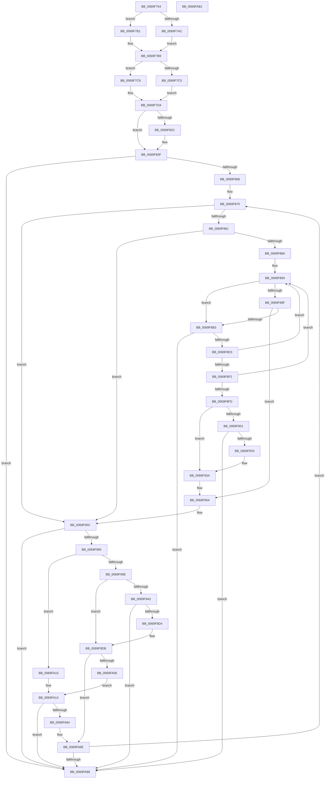

# BcpDisplayCriticalString

- RVA: `0x0069F754`–`0x0069FAB2` (길이 `862` bytes)
- VA: `0x000000014069F754`
- 실행 섹션: `.text`
- PDB 이름 있음: `예`; PDB Function 태그: `아니요`
- unwind 정보 RVA: `0x000D714C`
- 디코드: `238`개 명령, `862/862` bytes 표시
- 미해석 바이트: `0` (있으면 어셈블리에 `.byte`로 보존)

> 이 문서는 커널 이미지의 기계어와 PDB 기호를 분석해 생성했습니다. 4번과 5번은 함수 원형과 자료형을 바이너리 사용 방식에서 추정한 C 해석이며 원본 소스 복구 결과는 아닙니다.

## 1. Dependencies

- 직접 호출 지점: **7**; 고유 호출 대상: **5**
- 직접 호출자로 확인된 함수: **5**
- RIP 상대 이미지 참조: **8**

### Outgoing calls
- `0x0069F817` → [BgpFoGetStringAdvanceWidth](BgpFoGetStringAdvanceWidth_function_0069F370.md) (function, `0x0069F370`)
- `0x0069F8C0` → [BgpRasGetGlyphAdvanceWidth](../6A/BgpRasGetGlyphAdvanceWidth_function_006A1888.md) (function, `0x006A1888`)
- `0x0069F920` → [BcpPrintSpaces](../6A/BcpPrintSpaces_function_006A0BF0.md) (function, `0x006A0BF0`)
- `0x0069F982` → [BgpRasGetGlyphAdvanceWidth](../6A/BgpRasGetGlyphAdvanceWidth_function_006A1888.md) (function, `0x006A1888`)
- `0x0069F9C1` → [BcpPrintSpaces](../6A/BcpPrintSpaces_function_006A0BF0.md) (function, `0x006A0BF0`)
- `0x0069FA55` → [BgpDisplayCharacterEx](BgpDisplayCharacterEx_function_0069EBF4.md) (function, `0x0069EBF4`)
- `0x0069FA98` → [BcpSetCursorPosition](../6A/BcpSetCursorPosition_function_006A0D50.md) (function, `0x006A0D50`)

### Direct callers
- [BcpDisplayErrorInformation](BcpDisplayErrorInformation_function_0069FE74.md) at `0x0069FEF4`
- [BcpDisplayErrorInformation](BcpDisplayErrorInformation_function_0069FE74.md) at `0x0069FF06`
- [BcpDisplayErrorInformation](BcpDisplayErrorInformation_function_0069FE74.md) at `0x0069FF3F`
- [BcpDisplayErrorInformation](BcpDisplayErrorInformation_function_0069FE74.md) at `0x0069FF6F`
- [BcpDisplayErrorInformation](BcpDisplayErrorInformation_function_0069FE74.md) at `0x0069FF84`
- [BcpDisplayErrorInformation](BcpDisplayErrorInformation_function_0069FE74.md) at `0x0069FFC3`
- [BcpDisplayErrorInformation](BcpDisplayErrorInformation_function_0069FE74.md) at `0x0069FFF7`
- [BcpDisplayErrorInformation](BcpDisplayErrorInformation_function_0069FE74.md) at `0x006A006C`
- [BcpDisplayErrorInformationModernized](../6A/BcpDisplayErrorInformationModernized_function_006A00DC.md) at `0x006A0413`
- [BcpDisplayProgress](../6A/BcpDisplayProgress_function_006A047C.md) at `0x006A04EB`
- [BcpDisplayProgress](../6A/BcpDisplayProgress_function_006A047C.md) at `0x006A051F`
- [BcpDisplayProgress](../6A/BcpDisplayProgress_function_006A047C.md) at `0x006A0541`
- [BgpDisplaySafeToPowerOffScreen](../6A/BgpDisplaySafeToPowerOffScreen_function_006A0D74.md) at `0x006A0E00`
- [BgpFwDisplayBugCheckScreen](../6A/BgpFwDisplayBugCheckScreen_function_006A0FE8.md) at `0x006A10F4`
- [BgpFwDisplayBugCheckScreen](../6A/BgpFwDisplayBugCheckScreen_function_006A0FE8.md) at `0x006A1148`
- [BgpFwDisplayBugCheckScreen](../6A/BgpFwDisplayBugCheckScreen_function_006A0FE8.md) at `0x006A11AE`

### Static image references
- `0x0069F77B` → RVA `0x00E0EF60` (`.data`; read)
- `0x0069F78D` → RVA `0x00EEFEF0` (`.data`; read)
- `0x0069F7B9` → RVA `0x00EEFF10` (`.data`; read)
- `0x0069F7D4` → RVA `0x00E3EBA0` (`.data`; read)
- `0x0069F7DE` → RVA `0x00EEFEF8` (`.data`; read)
- `0x0069F7E4` → RVA `0x00EEFEFC` (`.data`; read)
- `0x0069F7EB` → RVA `0x00EEFF00` (`.data`; read)
- `0x0069F870` → RVA `0x00EF0360` (`.data`; read)

## 2. Other-region calls and transfers

- 다른 실행 섹션으로 향하는 call: **0**
- 별도 외부 분기/꼬리 이동을 확인하지 못했습니다.

## 3. Assembly (complete function range)

```asm
0069F754  44 89 44 24 18                  mov dword ptr [rsp + 0x18], r8d
0069F759  48 89 4C 24 08                  mov qword ptr [rsp + 8], rcx
0069F75E  55                              push rbp
0069F75F  53                              push rbx
0069F760  56                              push rsi
0069F761  57                              push rdi
0069F762  41 54                           push r12
0069F764  41 55                           push r13
0069F766  41 56                           push r14
0069F768  41 57                           push r15
0069F76A  48 8B EC                        mov rbp, rsp
0069F76D  48 83 EC 78                     sub rsp, 0x78
0069F771  45 33 FF                        xor r15d, r15d
0069F774  49 63 C1                        movsxd rax, r9d
0069F777  4C 6B C8 54                     imul r9, rax, 0x54
0069F77B  4C 8D 1D DE F7 76 00            lea r11, [rip + 0x76f7de]
0069F782  44 89 7D 50                     mov dword ptr [rbp + 0x50], r15d
0069F786  44 8B C2                        mov r8d, edx
0069F789  44 89 7D 58                     mov dword ptr [rbp + 0x58], r15d
0069F78D  48 8B 15 5C 07 85 00            mov rdx, qword ptr [rip + 0x85075c]
0069F794  4C 8B D1                        mov r10, rcx
0069F797  44 89 7D 60                     mov dword ptr [rbp + 0x60], r15d
0069F79B  4C 89 4D F0                     mov qword ptr [rbp - 0x10], r9
0069F79F  4B 8D 04 19                     lea rax, [r9 + r11]
0069F7A3  4B 8D 0C 19                     lea rcx, [r9 + r11]
0069F7A7  48 85 D2                        test rdx, rdx
0069F7AA  74 05                           je 0x14069f7b1
0069F7AC  44 8B 22                        mov r12d, dword ptr [rdx]
0069F7AF  EB 08                           jmp 0x14069f7b9
0069F7B1  44 8B 60 20                     mov r12d, dword ptr [rax + 0x20]
0069F7B5  44 03 61 10                     add r12d, dword ptr [rcx + 0x10]
0069F7B9  48 8B 35 50 07 85 00            mov rsi, qword ptr [rip + 0x850750]
0069F7C0  48 85 F6                        test rsi, rsi
0069F7C3  74 04                           je 0x14069f7c9
0069F7C5  8B 36                           mov esi, dword ptr [rsi]
0069F7C7  EB 0B                           jmp 0x14069f7d4
0069F7C9  43 8B 74 19 18                  mov esi, dword ptr [r9 + r11 + 0x18]
0069F7CE  03 70 20                        add esi, dword ptr [rax + 0x20]
0069F7D1  03 71 10                        add esi, dword ptr [rcx + 0x10]
0069F7D4  48 8B 05 C5 F3 79 00            mov rax, qword ptr [rip + 0x79f3c5]
0069F7DB  49 8B D2                        mov rdx, r10
0069F7DE  8B 3D 14 07 85 00               mov edi, dword ptr [rip + 0x850714]
0069F7E4  44 8B 35 11 07 85 00            mov r14d, dword ptr [rip + 0x850711]
0069F7EB  8B 1D 0F 07 85 00               mov ebx, dword ptr [rip + 0x85070f]
0069F7F1  48 8B 48 18                     mov rcx, qword ptr [rax + 0x18]
0069F7F5  44 89 7D DC                     mov dword ptr [rbp - 0x24], r15d
0069F7F9  44 89 41 38                     mov dword ptr [rcx + 0x38], r8d
0069F7FD  4C 8D 69 28                     lea r13, [rcx + 0x28]
0069F801  48 8B 05 98 F3 79 00            mov rax, qword ptr [rip + 0x79f398]
0069F808  49 8B CD                        mov rcx, r13
0069F80B  4C 89 6D E8                     mov qword ptr [rbp - 0x18], r13
0069F80F  44 89 40 08                     mov dword ptr [rax + 8], r8d
0069F813  4C 8D 45 60                     lea r8, [rbp + 0x60]
0069F817  E8 54 FB FF FF                  call 0x14069f370
0069F81C  44 8B C8                        mov r9d, eax
0069F81F  45 33 D2                        xor r10d, r10d
0069F822  B8 01 00 00 00                  mov eax, 1
0069F827  45 85 C9                        test r9d, r9d
0069F82A  78 13                           js 0x14069f83f
0069F82C  8B 55 60                        mov edx, dword ptr [rbp + 0x60]
0069F82F  03 D7                           add edx, edi
0069F831  45 0F B6 FF                     movzx r15d, r15b
0069F835  3B D6                           cmp edx, esi
0069F837  44 0F 47 F8                     cmova r15d, eax
0069F83B  44 89 7D DC                     mov dword ptr [rbp - 0x24], r15d
0069F83F  41 8B 45 00                     mov eax, dword ptr [r13]
0069F843  41 2B DE                        sub ebx, r14d
0069F846  4C 8B 45 48                     mov r8, qword ptr [rbp + 0x48]
0069F84A  85 DB                           test ebx, ebx
0069F84C  89 45 D8                        mov dword ptr [rbp - 0x28], eax
0069F84F  45 8B FA                        mov r15d, r10d
0069F852  41 0F 4E DA                     cmovle ebx, r10d
0069F856  45 8B EA                        mov r13d, r10d
0069F859  41 0F B7 00                     movzx eax, word ptr [r8]
0069F85D  A9 FE FF FF FF                  test eax, 0xfffffffe
0069F862  0F 86 20 02 00 00               jbe 0x14069fa88
0069F868  49 8D 40 08                     lea rax, [r8 + 8]
0069F86C  48 89 45 E0                     mov qword ptr [rbp - 0x20], rax
0069F870  4C 8D 0D E9 0A 85 00            lea r9, [rip + 0x850ae9]
0069F877  44 38 55 DC                     cmp byte ptr [rbp - 0x24], r10b
0069F87B  0F 84 DB 00 00 00               je 0x14069f95c
0069F881  45 3B FD                        cmp r15d, r13d
0069F884  0F 87 D2 00 00 00               ja 0x14069f95c
0069F88A  41 8B CD                        mov ecx, r13d
0069F88D  45 8B FA                        mov r15d, r10d
0069F890  89 4D 60                        mov dword ptr [rbp + 0x60], ecx
0069F893  48 8B 00                        mov rax, qword ptr [rax]
0069F896  0F B7 14 48                     movzx edx, word ptr [rax + rcx*2]
0069F89A  83 FA 20                        cmp edx, 0x20
0069F89D  77 14                           ja 0x14069f8b3
0069F89F  48 B9 01 24 00 00 01 00 00 00   movabs rcx, 0x100002401
0069F8A9  48 0F A3 D1                     bt rcx, rdx
0069F8AD  0F 82 A1 00 00 00               jb 0x14069f954
0069F8B3  48 8B 4D E8                     mov rcx, qword ptr [rbp - 0x18]
0069F8B7  4C 8D 45 50                     lea r8, [rbp + 0x50]
0069F8BB  4C 89 4C 24 20                  mov qword ptr [rsp + 0x20], r9
0069F8C0  E8 C3 1F 00 00                  call 0x1406a1888
0069F8C5  45 33 D2                        xor r10d, r10d
0069F8C8  44 8B C8                        mov r9d, eax
0069F8CB  85 C0                           test eax, eax
0069F8CD  0F 88 B5 01 00 00               js 0x14069fa88
0069F8D3  44 03 7D 50                     add r15d, dword ptr [rbp + 0x50]
0069F8D7  4C 8D 0D 82 0A 85 00            lea r9, [rip + 0x850a82]
0069F8DE  8B 4D 60                        mov ecx, dword ptr [rbp + 0x60]
0069F8E1  FF C1                           inc ecx
0069F8E3  89 4D 60                        mov dword ptr [rbp + 0x60], ecx
0069F8E6  41 8D 04 3F                     lea eax, [r15 + rdi]
0069F8EA  3B F0                           cmp esi, eax
0069F8EC  48 8B 45 E0                     mov rax, qword ptr [rbp - 0x20]
0069F8F0  73 A1                           jae 0x14069f893
0069F8F2  4C 8D 0D 67 0A 85 00            lea r9, [rip + 0x850a67]
0069F8F9  85 DB                           test ebx, ebx
0069F8FB  74 96                           je 0x14069f893
0069F8FD  3B FE                           cmp edi, esi
0069F8FF  73 39                           jae 0x14069f93a
0069F901  48 8B 0D 98 F2 79 00            mov rcx, qword ptr [rip + 0x79f298]
0069F908  48 8D 45 58                     lea rax, [rbp + 0x58]
0069F90C  48 89 44 24 28                  mov qword ptr [rsp + 0x28], rax
0069F911  45 8B CE                        mov r9d, r14d
0069F914  8B 45 D8                        mov eax, dword ptr [rbp - 0x28]
0069F917  44 8B C6                        mov r8d, esi
0069F91A  8B D7                           mov edx, edi
0069F91C  89 44 24 20                     mov dword ptr [rsp + 0x20], eax
0069F920  E8 CB 12 00 00                  call 0x1406a0bf0
0069F925  45 33 D2                        xor r10d, r10d
0069F928  44 8B C8                        mov r9d, eax
0069F92B  85 C0                           test eax, eax
0069F92D  0F 88 55 01 00 00               js 0x14069fa88
0069F933  3B 5D 58                        cmp ebx, dword ptr [rbp + 0x58]
0069F936  0F 42 5D 58                     cmovb ebx, dword ptr [rbp + 0x58]
0069F93A  48 8B 45 F0                     mov rax, qword ptr [rbp - 0x10]
0069F93E  48 8D 0D 1B F6 76 00            lea rcx, [rip + 0x76f61b]
0069F945  41 8B FC                        mov edi, r12d
0069F948  8B 44 08 28                     mov eax, dword ptr [rax + rcx + 0x28]
0069F94C  03 C3                           add eax, ebx
0069F94E  41 8B DA                        mov ebx, r10d
0069F951  44 03 F0                        add r14d, eax
0069F954  4C 8B 45 48                     mov r8, qword ptr [rbp + 0x48]
0069F958  44 8B 7D 60                     mov r15d, dword ptr [rbp + 0x60]
0069F95C  49 8D 40 08                     lea rax, [r8 + 8]
0069F960  41 8B CD                        mov ecx, r13d
0069F963  48 89 45 E0                     mov qword ptr [rbp - 0x20], rax
0069F967  4C 8D 45 50                     lea r8, [rbp + 0x50]
0069F96B  48 8B 00                        mov rax, qword ptr [rax]
0069F96E  0F B7 14 48                     movzx edx, word ptr [rax + rcx*2]
0069F972  48 8D 05 E7 09 85 00            lea rax, [rip + 0x8509e7]
0069F979  48 8B 4D E8                     mov rcx, qword ptr [rbp - 0x18]
0069F97D  48 89 44 24 20                  mov qword ptr [rsp + 0x20], rax
0069F982  E8 01 1F 00 00                  call 0x1406a1888
0069F987  45 33 D2                        xor r10d, r10d
0069F98A  44 8B C8                        mov r9d, eax
0069F98D  85 C0                           test eax, eax
0069F98F  0F 88 F3 00 00 00               js 0x14069fa88
0069F995  8B 4D 50                        mov ecx, dword ptr [rbp + 0x50]
0069F998  03 CF                           add ecx, edi
0069F99A  3B F1                           cmp esi, ecx
0069F99C  73 72                           jae 0x14069fa10
0069F99E  3B FE                           cmp edi, esi
0069F9A0  73 39                           jae 0x14069f9db
0069F9A2  48 8B 0D F7 F1 79 00            mov rcx, qword ptr [rip + 0x79f1f7]
0069F9A9  48 8D 45 58                     lea rax, [rbp + 0x58]
0069F9AD  48 89 44 24 28                  mov qword ptr [rsp + 0x28], rax
0069F9B2  45 8B CE                        mov r9d, r14d
0069F9B5  8B 45 D8                        mov eax, dword ptr [rbp - 0x28]
0069F9B8  44 8B C6                        mov r8d, esi
0069F9BB  8B D7                           mov edx, edi
0069F9BD  89 44 24 20                     mov dword ptr [rsp + 0x20], eax
0069F9C1  E8 2A 12 00 00                  call 0x1406a0bf0
0069F9C6  45 33 D2                        xor r10d, r10d
0069F9C9  44 8B C8                        mov r9d, eax
0069F9CC  85 C0                           test eax, eax
0069F9CE  0F 88 B4 00 00 00               js 0x14069fa88
0069F9D4  3B 5D 58                        cmp ebx, dword ptr [rbp + 0x58]
0069F9D7  0F 42 5D 58                     cmovb ebx, dword ptr [rbp + 0x58]
0069F9DB  48 8B 45 F0                     mov rax, qword ptr [rbp - 0x10]
0069F9DF  48 8D 0D 7A F5 76 00            lea rcx, [rip + 0x76f57a]
0069F9E6  41 8B FC                        mov edi, r12d
0069F9E9  8B 44 08 28                     mov eax, dword ptr [rax + rcx + 0x28]
0069F9ED  48 8B 4D E0                     mov rcx, qword ptr [rbp - 0x20]
0069F9F1  03 C3                           add eax, ebx
0069F9F3  44 03 F0                        add r14d, eax
0069F9F6  41 8B DA                        mov ebx, r10d
0069F9F9  48 8B 01                        mov rax, qword ptr [rcx]
0069F9FC  41 8B CD                        mov ecx, r13d
0069F9FF  66 83 3C 48 20                  cmp word ptr [rax + rcx*2], 0x20
0069FA04  74 68                           je 0x14069fa6e
0069FA06  48 8B 4D 48                     mov rcx, qword ptr [rbp + 0x48]
0069FA0A  48 83 C1 08                     add rcx, 8
0069FA0E  EB 04                           jmp 0x14069fa14
0069FA10  48 8B 4D E0                     mov rcx, qword ptr [rbp - 0x20]
0069FA14  48 8B 09                        mov rcx, qword ptr [rcx]
0069FA17  48 8D 15 42 09 85 00            lea rdx, [rip + 0x850942]
0069FA1E  48 89 54 24 48                  mov qword ptr [rsp + 0x48], rdx
0069FA23  45 8B CE                        mov r9d, r14d
0069FA26  48 8D 55 58                     lea rdx, [rbp + 0x58]
0069FA2A  41 8B C5                        mov eax, r13d
0069FA2D  48 89 54 24 38                  mov qword ptr [rsp + 0x38], rdx
0069FA32  44 8B C7                        mov r8d, edi
0069FA35  48 8D 55 50                     lea rdx, [rbp + 0x50]
0069FA39  48 89 54 24 30                  mov qword ptr [rsp + 0x30], rdx
0069FA3E  8B 55 D8                        mov edx, dword ptr [rbp - 0x28]
0069FA41  83 4C 24 28 FF                  or dword ptr [rsp + 0x28], 0xffffffff
0069FA46  0F B7 0C 41                     movzx ecx, word ptr [rcx + rax*2]
0069FA4A  89 54 24 20                     mov dword ptr [rsp + 0x20], edx
0069FA4E  48 8B 15 4B F1 79 00            mov rdx, qword ptr [rip + 0x79f14b]
0069FA55  E8 9A F1 FF FF                  call 0x14069ebf4
0069FA5A  45 33 D2                        xor r10d, r10d
0069FA5D  44 8B C8                        mov r9d, eax
0069FA60  85 C0                           test eax, eax
0069FA62  78 24                           js 0x14069fa88
0069FA64  03 7D 50                        add edi, dword ptr [rbp + 0x50]
0069FA67  39 5D 58                        cmp dword ptr [rbp + 0x58], ebx
0069FA6A  0F 47 5D 58                     cmova ebx, dword ptr [rbp + 0x58]
0069FA6E  4C 8B 45 48                     mov r8, qword ptr [rbp + 0x48]
0069FA72  41 FF C5                        inc r13d
0069FA75  41 0F B7 00                     movzx eax, word ptr [r8]
0069FA79  D1 E8                           shr eax, 1
0069FA7B  44 3B E8                        cmp r13d, eax
0069FA7E  48 8B 45 E0                     mov rax, qword ptr [rbp - 0x20]
0069FA82  0F 82 E8 FD FF FF               jb 0x14069f870
0069FA88  41 8D 04 1E                     lea eax, [r14 + rbx]
0069FA8C  41 8B D6                        mov edx, r14d
0069FA8F  4C 8D 45 58                     lea r8, [rbp + 0x58]
0069FA93  89 45 58                        mov dword ptr [rbp + 0x58], eax
0069FA96  8B CF                           mov ecx, edi
0069FA98  E8 B3 12 00 00                  call 0x1406a0d50
0069FA9D  41 8B C1                        mov eax, r9d
0069FAA0  48 83 C4 78                     add rsp, 0x78
0069FAA4  41 5F                           pop r15
0069FAA6  41 5E                           pop r14
0069FAA8  41 5D                           pop r13
0069FAAA  41 5C                           pop r12
0069FAAC  5F                              pop rdi
0069FAAD  5E                              pop rsi
0069FAAE  5B                              pop rbx
0069FAAF  5D                              pop rbp
0069FAB0  C3                              ret
0069FAB1  CC                              int3
```

## 4. C-style interpretation (structured pseudocode)

```c
__int64 __fastcall BcpDisplayCriticalString(__int64 a1, int a2, int a3, int a4)
{
    __int64 result;
    __int64 v_r10;
    __int64 v_r12;
    __int64 v_r13;
    __int64 v_r14;
    __int64 v_r15;
    __int64 v_rbx;
    __int64 v_rdi;
    __int64 v_rsi;
    __int64 v_rsp;
    unsigned __int64 v_stack_m50;
    unsigned __int64 v_stack_m58;
    unsigned __int64 v_stack_m60;
    unsigned int v_stack_m64;
    unsigned int v_stack_m68;
    unsigned __int64 v_stack_m70;
    unsigned __int64 v_stack_m80;
    unsigned __int64 v_stack_m88;
    unsigned __int64 v_stack_m90;
    unsigned __int64 v_stack_m98;
    unsigned int v_stack_p10;
    unsigned int v_stack_p18;
    unsigned int v_stack_p20;
    unsigned __int64 v_stack_p8;

    v_stack_p18 = a3;
    v_stack_p8 = a1;
    v_rsp = (v_rsp) - (120);
    v_r15 = 0;
    a4 = (a4) * ((int)(a4));
    v_stack_p10 = 0;
    v_stack_p18 = 0;
    v_stack_p20 = 0;
    v_stack_m50 = a4;
    if (*(unsigned __int64 *)(v_rip + 8718172) == 0) goto loc_0069F7B1;
    goto loc_0069F7B9;
loc_0069F7B1:
    v_r12 = (unsigned int)(((unsigned int)(*(unsigned int *)(a4 + v_rip + 7796702 * 1 + 32))) + (*(unsigned int *)(a4 + v_rip + 7796702 * 1 + 16)));
loc_0069F7B9:
    if (*(unsigned __int64 *)(v_rip + 8718160) == 0) goto loc_0069F7C9;
    goto loc_0069F7D4;
loc_0069F7C9:
    v_rsi = (unsigned int)(((unsigned int)(*(unsigned int *)(a4 + v_rip + 7796702 * 1 + 24))) + (*(unsigned int *)(a4 + v_rip + 7796702 * 1 + 32)));
    v_rsi = (unsigned int)((v_rsi) + (*(unsigned int *)(a4 + v_rip + 7796702 * 1 + 16)));
loc_0069F7D4:
    v_stack_m64 = 0;
    *(unsigned int *)(*(unsigned __int64 *)(*(unsigned __int64 *)(v_rip + 7992261) + 24) + 56) = (unsigned int)((unsigned int)(a2));
    v_stack_m58 = *(unsigned __int64 *)(*(unsigned __int64 *)(v_rip + 7992261) + 24) + 40;
    *(unsigned int *)(*(unsigned __int64 *)(v_rip + 7992216) + 8) = (unsigned int)((unsigned int)(a2));
    result = BgpFoGetStringAdvanceWidth(*(unsigned __int64 *)(*(unsigned __int64 *)(v_rip + 7992261) + 24) + 40, a1, v_stack_p20, a4);
    v_r10 = 0;
    if (!(sign_flag)) {
        a2 = v_stack_p20;
        a2 = (unsigned int)((a2) + ((unsigned int)((unsigned int)(*(unsigned int *)(v_rip + 8718100)))));
        v_r15 = 0;
        if (a2 > ((unsigned int)(v_rsi))) { v_r15 = 1; }
        v_stack_m64 = (unsigned int)(v_r15);
    }
    v_rbx = (unsigned int)(((unsigned int)(*(unsigned int *)(v_rip + 8718095))) - ((unsigned int)((unsigned int)(*(unsigned int *)(v_rip + 8718097)))));
    v_stack_m68 = (unsigned int)((unsigned int)(*(unsigned int *)(*(unsigned __int64 *)(*(unsigned __int64 *)(v_rip + 7992261) + 24) + 40)));
    if (condition_is_less_or_equal) { v_rbx = 0; }
    if (condition_is_below_or_equal) goto loc_0069FA88;
    v_stack_m60 = v_stack_p8 + 8;
loc_0069F870:
    if (v_stack_m64 == 0) goto loc_0069F95C;
    if (0 > 0) goto loc_0069F95C;
    v_stack_p20 = 0;
loc_0069F893:
    if (((unsigned int)(*(unsigned __int16 *)(*(unsigned __int64 *)(v_stack_p8 + 8) + 0 * 2))) > 32) goto loc_0069F8B3;
    if (((unsigned int)(*(unsigned __int16 *)(*(unsigned __int64 *)(v_stack_p8 + 8) + 0 * 2))) < 32) goto loc_0069F954;
loc_0069F8B3:
    v_stack_m98 = v_rip + 8719081;
    result = BgpRasGetGlyphAdvanceWidth(v_stack_m58, *(unsigned __int16 *)(*(unsigned __int64 *)(v_stack_p8 + 8) + 0 * 2), v_stack_p10, v_rip + 8719081);
    v_r10 = 0;
    if (sign_flag) goto loc_0069FA88;
    v_r15 = (unsigned int)((0) + (v_stack_p10));
    a1 = (unsigned int)(((unsigned int)(v_stack_p20)) + 1);
    v_stack_p20 = (unsigned int)(a1);
    if (((unsigned int)(v_rsi)) >= ((unsigned int)(v_r15 + (unsigned int)(*(unsigned int *)(v_rip + 8718100)) * 1))) goto loc_0069F893;
    if ((unsigned int)(v_rbx) == 0) goto loc_0069F893;
    if (((unsigned int)((unsigned int)(*(unsigned int *)(v_rip + 8718100)))) >= ((unsigned int)(v_rsi))) goto loc_0069F93A;
    v_stack_m90 = v_stack_p18;
    v_stack_m98 = (unsigned int)((unsigned int)(v_stack_m68));
    result = BcpPrintSpaces(*(unsigned __int64 *)(v_rip + 7991960), (unsigned int)((unsigned int)((unsigned int)(*(unsigned int *)(v_rip + 8718100)))), (unsigned int)((unsigned int)(v_rsi)), (unsigned int)((unsigned int)((unsigned int)(*(unsigned int *)(v_rip + 8718097)))));
    v_r10 = 0;
    if (sign_flag) goto loc_0069FA88;
    if (((unsigned int)(v_rbx)) < v_stack_p18) { v_rbx = v_stack_p18; }
loc_0069F93A:
    result = (unsigned int)(((unsigned int)(*(unsigned int *)(v_stack_m50 + v_rip + 7796251 * 1 + 40))) + ((unsigned int)(v_rbx)));
    v_r14 = (unsigned int)(((unsigned int)(*(unsigned int *)(v_rip + 8718097))) + ((unsigned int)(result)));
loc_0069F954:
loc_0069F95C:
    v_stack_m60 = v_stack_p8 + 8;
    v_stack_m98 = v_rip + 8718823;
    result = BgpRasGetGlyphAdvanceWidth(v_stack_m58, *(unsigned __int16 *)(*(unsigned __int64 *)(v_stack_p8 + 8) + 0 * 2), v_stack_p10, (unsigned int)((unsigned int)(result)));
    v_r10 = 0;
    if (sign_flag) goto loc_0069FA88;
    a1 = (unsigned int)(((unsigned int)(v_stack_p10)) + ((unsigned int)((unsigned int)((unsigned int)(v_r12)))));
    if (((unsigned int)(v_rsi)) >= ((unsigned int)(a1))) goto loc_0069FA10;
    if (((unsigned int)((unsigned int)((unsigned int)(v_r12)))) >= ((unsigned int)(v_rsi))) goto loc_0069F9DB;
    v_stack_m90 = v_stack_p18;
    v_stack_m98 = (unsigned int)((unsigned int)(v_stack_m68));
    result = BcpPrintSpaces(*(unsigned __int64 *)(v_rip + 7991799), (unsigned int)((unsigned int)((unsigned int)((unsigned int)(v_r12)))), (unsigned int)((unsigned int)(v_rsi)), (unsigned int)((unsigned int)(v_r14)));
    v_r10 = 0;
    if (sign_flag) goto loc_0069FA88;
    v_rbx = 0;
    if (0 < v_stack_p18) { v_rbx = v_stack_p18; }
loc_0069F9DB:
    result = (unsigned int)(((unsigned int)(*(unsigned int *)(v_stack_m50 + v_rip + 7796090 * 1 + 40))) + ((unsigned int)(v_rbx)));
    v_r14 = (unsigned int)((v_r14) + ((unsigned int)(result)));
    if ((*(unsigned __int16 *)(*(unsigned __int64 *)(v_stack_m60) + 0 * 2)) == 32) goto loc_0069FA6E;
    a1 = (v_stack_p8) + (8);
    goto loc_0069FA14;
loc_0069FA10:
loc_0069FA14:
    v_stack_m70 = v_rip + 8718658;
    v_stack_m80 = v_stack_p18;
    v_stack_m88 = v_stack_p10;
    v_stack_m98 = (unsigned int)((unsigned int)(v_stack_m68));
    result = BgpDisplayCharacterEx(*(unsigned __int16 *)(*(unsigned __int64 *)(v_stack_m60) + 0 * 2), *(unsigned __int64 *)(v_rip + 7991627), (unsigned int)((unsigned int)((unsigned int)((unsigned int)(v_r12)))), (unsigned int)((unsigned int)(v_r14)));
    v_r10 = 0;
    if (sign_flag) goto loc_0069FA88;
    v_rdi = (unsigned int)(((unsigned int)((unsigned int)(v_r12))) + (v_stack_p10));
    v_rbx = 0;
    if (v_stack_p18 > 0) { v_rbx = v_stack_p18; }
loc_0069FA6E:
    v_r13 = (unsigned int)((0) + 1);
    result = (unsigned int)((*(unsigned __int16 *)(v_stack_p8)) >> (1));
    if (((unsigned int)(v_r13)) < ((unsigned int)(result))) goto loc_0069F870;
loc_0069FA88:
    v_stack_p18 = (unsigned int)(v_r14 + v_rbx * 1);
    result = BcpSetCursorPosition((unsigned int)((unsigned int)(v_rdi)), (unsigned int)((unsigned int)(v_r14)), v_stack_p18, (unsigned int)((unsigned int)(result)));
    v_rsp = (v_rsp) + (120);
    return (unsigned int)((unsigned int)((unsigned int)((unsigned int)(result))));
}
```

## 5. (Beta) C Style

```c
int64_t BcpDisplayCriticalString(int64_t Arg1, int32_t Arg2, int32_t Arg3, void *Arg4)
{
    uint8_t *arg4 = (uint8_t *)Arg4;

    int64_t result;
    int64_t local_r10;
    int64_t local_r12;
    int64_t local_r13;
    int64_t local_r14;
    int64_t local_r15;
    int64_t local_rbx;
    int64_t local_rdi;
    int64_t local_rsi;
    int64_t local_rsp;
    uint64_t v_stack_m50;
    uint64_t v_stack_m58;
    uint64_t v_stack_m60;
    uint32_t v_stack_m64;
    uint32_t v_stack_m68;
    uint64_t v_stack_m70;
    uint64_t v_stack_m80;
    uint64_t v_stack_m88;
    uint64_t v_stack_m90;
    uint64_t v_stack_m98;
    uint32_t v_stack_p10;
    uint32_t v_stack_p18;
    uint32_t v_stack_p20;
    uint64_t v_stack_p8;

    v_stack_p18 = Arg3;
    v_stack_p8 = Arg1;
    local_rsp = (local_rsp) - (120);
    local_r15 = 0;
    Arg4 = (Arg4) * ((int32_t)(Arg4));
    v_stack_p10 = 0;
    v_stack_p18 = 0;
    v_stack_p20 = 0;
    v_stack_m50 = Arg4;
    if (*(uint64_t *)(v_rip + 0x85075C) == 0) goto loc_0069F7B1;
    goto loc_0069F7B9;
loc_0069F7B1:
    local_r12 = (uint32_t)(((uint32_t)(*(uint32_t *)(arg4 + v_rip + 0x76F7DE * 1 + 0x20))) + (*(uint32_t *)(arg4 + v_rip + 0x76F7DE * 1 + 0x10)));
loc_0069F7B9:
    if (*(uint64_t *)(v_rip + 0x850750) == 0) goto loc_0069F7C9;
    goto loc_0069F7D4;
loc_0069F7C9:
    local_rsi = (uint32_t)(((uint32_t)(*(uint32_t *)(arg4 + v_rip + 0x76F7DE * 1 + 0x18))) + (*(uint32_t *)(arg4 + v_rip + 0x76F7DE * 1 + 0x20)));
    local_rsi = (uint32_t)((local_rsi) + (*(uint32_t *)(arg4 + v_rip + 0x76F7DE * 1 + 0x10)));
loc_0069F7D4:
    v_stack_m64 = 0;
    *(uint32_t *)(*(uint64_t *)(*(uint64_t *)(v_rip + 0x79F3C5) + 0x18) + 0x38) = (uint32_t)((uint32_t)(Arg2));
    v_stack_m58 = *(uint64_t *)(*(uint64_t *)(v_rip + 0x79F3C5) + 0x18) + 40;
    *(uint32_t *)(*(uint64_t *)(v_rip + 0x79F398) + 0x8) = (uint32_t)((uint32_t)(Arg2));
    result = BgpFoGetStringAdvanceWidth(*(uint64_t *)(*(uint64_t *)(v_rip + 0x79F3C5) + 0x18) + 40, Arg1, v_stack_p20, Arg4);
    local_r10 = 0;
    if (!(sign_flag)) {
        Arg2 = v_stack_p20;
        Arg2 = (uint32_t)((Arg2) + ((uint32_t)((uint32_t)(*(uint32_t *)(v_rip + 0x850714)))));
        local_r15 = 0;
        if (Arg2 > ((uint32_t)(local_rsi))) { local_r15 = 1; }
        v_stack_m64 = (uint32_t)(local_r15);
    }
    local_rbx = (uint32_t)(((uint32_t)(*(uint32_t *)(v_rip + 0x85070F))) - ((uint32_t)((uint32_t)(*(uint32_t *)(v_rip + 0x850711)))));
    v_stack_m68 = (uint32_t)((uint32_t)(*(uint32_t *)(*(uint64_t *)(*(uint64_t *)(v_rip + 0x79F3C5) + 0x18) + 0x28)));
    if (condition_is_less_or_equal) { local_rbx = 0; }
    if (condition_is_below_or_equal) goto loc_0069FA88;
    v_stack_m60 = v_stack_p8 + 8;
loc_0069F870:
    if (v_stack_m64 == 0) goto loc_0069F95C;
    if (0 > 0) goto loc_0069F95C;
    v_stack_p20 = 0;
loc_0069F893:
    if (((uint32_t)(*(uint16_t *)(*(uint64_t *)(v_stack_p8 + 0x8) + 0x0 * 2))) > 32) goto loc_0069F8B3;
    if (((uint32_t)(*(uint16_t *)(*(uint64_t *)(v_stack_p8 + 0x8) + 0x0 * 2))) < 32) goto loc_0069F954;
loc_0069F8B3:
    v_stack_m98 = v_rip + 8719081;
    result = BgpRasGetGlyphAdvanceWidth(v_stack_m58, *(uint16_t *)(*(uint64_t *)(v_stack_p8 + 0x8) + 0x0 * 2), v_stack_p10, v_rip + 8719081);
    local_r10 = 0;
    if (sign_flag) goto loc_0069FA88;
    local_r15 = (uint32_t)((0) + (v_stack_p10));
    Arg1 = (uint32_t)(((uint32_t)(v_stack_p20)) + 1);
    v_stack_p20 = (uint32_t)(Arg1);
    if (((uint32_t)(local_rsi)) >= ((uint32_t)(local_r15 + (uint32_t)(*(uint32_t *)(v_rip + 0x850714)) * 1))) goto loc_0069F893;
    if ((uint32_t)(local_rbx) == 0) goto loc_0069F893;
    if (((uint32_t)((uint32_t)(*(uint32_t *)(v_rip + 0x850714)))) >= ((uint32_t)(local_rsi))) goto loc_0069F93A;
    v_stack_m90 = v_stack_p18;
    v_stack_m98 = (uint32_t)((uint32_t)(v_stack_m68));
    result = BcpPrintSpaces(*(uint64_t *)(v_rip + 0x79F298), (uint32_t)((uint32_t)((uint32_t)(*(uint32_t *)(v_rip + 0x850714)))), (uint32_t)((uint32_t)(local_rsi)), (uint32_t)((uint32_t)((uint32_t)(*(uint32_t *)(v_rip + 0x850711)))));
    local_r10 = 0;
    if (sign_flag) goto loc_0069FA88;
    if (((uint32_t)(local_rbx)) < v_stack_p18) { local_rbx = v_stack_p18; }
loc_0069F93A:
    result = (uint32_t)(((uint32_t)(*(uint32_t *)(v_stack_m50 + v_rip + 0x76F61B * 1 + 0x28))) + ((uint32_t)(local_rbx)));
    local_r14 = (uint32_t)(((uint32_t)(*(uint32_t *)(v_rip + 0x850711))) + ((uint32_t)(result)));
loc_0069F954:
loc_0069F95C:
    v_stack_m60 = v_stack_p8 + 8;
    v_stack_m98 = v_rip + 8718823;
    result = BgpRasGetGlyphAdvanceWidth(v_stack_m58, *(uint16_t *)(*(uint64_t *)(v_stack_p8 + 0x8) + 0x0 * 2), v_stack_p10, (uint32_t)((uint32_t)(result)));
    local_r10 = 0;
    if (sign_flag) goto loc_0069FA88;
    Arg1 = (uint32_t)(((uint32_t)(v_stack_p10)) + ((uint32_t)((uint32_t)((uint32_t)(local_r12)))));
    if (((uint32_t)(local_rsi)) >= ((uint32_t)(Arg1))) goto loc_0069FA10;
    if (((uint32_t)((uint32_t)((uint32_t)(local_r12)))) >= ((uint32_t)(local_rsi))) goto loc_0069F9DB;
    v_stack_m90 = v_stack_p18;
    v_stack_m98 = (uint32_t)((uint32_t)(v_stack_m68));
    result = BcpPrintSpaces(*(uint64_t *)(v_rip + 0x79F1F7), (uint32_t)((uint32_t)((uint32_t)((uint32_t)(local_r12)))), (uint32_t)((uint32_t)(local_rsi)), (uint32_t)((uint32_t)(local_r14)));
    local_r10 = 0;
    if (sign_flag) goto loc_0069FA88;
    local_rbx = 0;
    if (0 < v_stack_p18) { local_rbx = v_stack_p18; }
loc_0069F9DB:
    result = (uint32_t)(((uint32_t)(*(uint32_t *)(v_stack_m50 + v_rip + 0x76F57A * 1 + 0x28))) + ((uint32_t)(local_rbx)));
    local_r14 = (uint32_t)((local_r14) + ((uint32_t)(result)));
    if ((*(uint16_t *)(*(uint64_t *)(v_stack_m60) + 0x0 * 2)) == 32) goto loc_0069FA6E;
    Arg1 = (v_stack_p8) + (8);
    goto loc_0069FA14;
loc_0069FA10:
loc_0069FA14:
    v_stack_m70 = v_rip + 8718658;
    v_stack_m80 = v_stack_p18;
    v_stack_m88 = v_stack_p10;
    v_stack_m98 = (uint32_t)((uint32_t)(v_stack_m68));
    result = BgpDisplayCharacterEx(*(uint16_t *)(*(uint64_t *)(v_stack_m60) + 0x0 * 2), *(uint64_t *)(v_rip + 0x79F14B), (uint32_t)((uint32_t)((uint32_t)((uint32_t)(local_r12)))), (uint32_t)((uint32_t)(local_r14)));
    local_r10 = 0;
    if (sign_flag) goto loc_0069FA88;
    local_rdi = (uint32_t)(((uint32_t)((uint32_t)(local_r12))) + (v_stack_p10));
    local_rbx = 0;
    if (v_stack_p18 > 0) { local_rbx = v_stack_p18; }
loc_0069FA6E:
    local_r13 = (uint32_t)((0) + 1);
    result = (uint32_t)((*(uint16_t *)(v_stack_p8)) >> (1));
    if (((uint32_t)(local_r13)) < ((uint32_t)(result))) goto loc_0069F870;
loc_0069FA88:
    v_stack_p18 = (uint32_t)(local_r14 + local_rbx * 1);
    result = BcpSetCursorPosition((uint32_t)((uint32_t)(local_rdi)), (uint32_t)((uint32_t)(local_r14)), v_stack_p18, (uint32_t)((uint32_t)(result)));
    local_rsp = (local_rsp) + (120);
    return (uint32_t)((uint32_t)((uint32_t)((uint32_t)(result))));
}
```

### 관측된 메모리 오프셋

구조체 형식이 확인되지 않은 접근은 인자 기준의 오프셋으로만 기록했습니다.

| 기준 인자 | 오프셋 표현 | 폭 (bit) | 접근 |
|---|---:|---:|---|
| `Arg4` | `+ 0x0 + r11*1` | `64` | `R` |
| `Arg4` | `+ 0x10` | `32` | `R` |
| `Arg4` | `+ 0x18 + r11*1` | `32` | `R` |
| `Arg4` | `+ 0x20` | `32` | `R` |

## 6. Execution-region graph

[열기: 2D/3D 그래프와 함수 탐색 컨트롤 패널](../../../control-panel.html?section=text&rva=0x0069F754&view=graph)

- 2D 그래프는 위에서 아래로 흐르고, 3D 그래프는 빈 공간을 드래그해 회전합니다. Shift+드래그는 이동, 휠은 확대·축소, 함수 노드 선택은 대상 보고서 이동입니다.

### Static fallback


