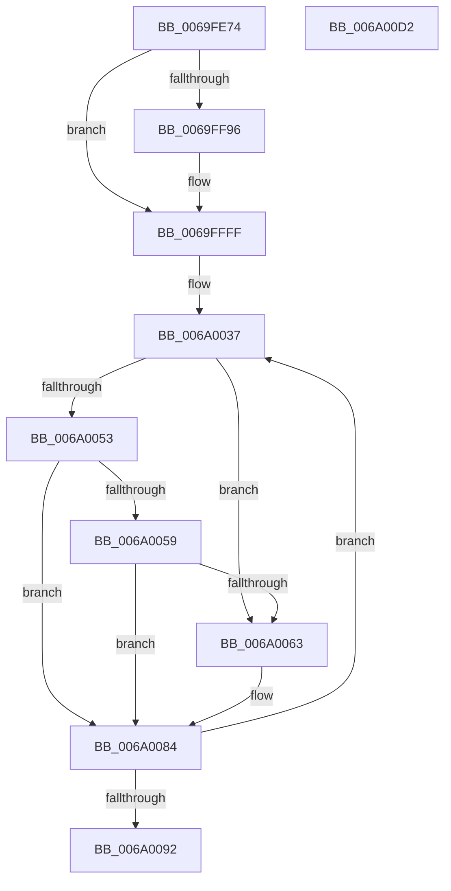

# BcpDisplayErrorInformation

- RVA: `0x0069FE74`–`0x006A00D3` (길이 `607` bytes)
- VA: `0x000000014069FE74`
- 실행 섹션: `.text`
- PDB 이름 있음: `예`; PDB Function 태그: `아니요`
- unwind 정보 RVA: `0x000DA5F8`
- 디코드: `153`개 명령, `607/607` bytes 표시
- 미해석 바이트: `0` (있으면 어셈블리에 `.byte`로 보존)

> 이 문서는 커널 이미지의 기계어와 PDB 기호를 분석해 생성했습니다. 4번과 5번은 함수 원형과 자료형을 바이너리 사용 방식에서 추정한 C 해석이며 원본 소스 복구 결과는 아닙니다.

## 1. Dependencies

- 직접 호출 지점: **19**; 고유 호출 대상: **6**
- 직접 호출자로 확인된 함수: **1**
- RIP 상대 이미지 참조: **11**

### Outgoing calls
- `0x0069FEF4` → [BcpDisplayCriticalString](BcpDisplayCriticalString_function_0069F754.md) (function, `0x0069F754`)
- `0x0069FF06` → [BcpDisplayCriticalString](BcpDisplayCriticalString_function_0069F754.md) (function, `0x0069F754`)
- `0x0069FF2E` → [BcpSetCursorPosition](../6A/BcpSetCursorPosition_function_006A0D50.md) (function, `0x006A0D50`)
- `0x0069FF3F` → [BcpDisplayCriticalString](BcpDisplayCriticalString_function_0069F754.md) (function, `0x0069F754`)
- `0x0069FF5E` → [BcpSetCursorPosition](../6A/BcpSetCursorPosition_function_006A0D50.md) (function, `0x006A0D50`)
- `0x0069FF6F` → [BcpDisplayCriticalString](BcpDisplayCriticalString_function_0069F754.md) (function, `0x0069F754`)
- `0x0069FF76` → [BcpDisplayCriticalCharacter](BcpDisplayCriticalCharacter_function_0069F678.md) (function, `0x0069F678`)
- `0x0069FF84` → [BcpDisplayCriticalString](BcpDisplayCriticalString_function_0069F754.md) (function, `0x0069F754`)
- `0x0069FFB2` → [BcpSetCursorPosition](../6A/BcpSetCursorPosition_function_006A0D50.md) (function, `0x006A0D50`)
- `0x0069FFC3` → [BcpDisplayCriticalString](BcpDisplayCriticalString_function_0069F754.md) (function, `0x0069F754`)
- `0x0069FFCA` → [BcpDisplayCriticalCharacter](BcpDisplayCriticalCharacter_function_0069F678.md) (function, `0x0069F678`)
- `0x0069FFE8` → [BcpSanitizeDriverName](../6A/BcpSanitizeDriverName_function_006A0C9C.md) (function, `0x006A0C9C`)
- `0x0069FFF7` → [BcpDisplayCriticalString](BcpDisplayCriticalString_function_0069F754.md) (function, `0x0069F754`)
- `0x006A002B` → [BcpSetCursorPosition](../6A/BcpSetCursorPosition_function_006A0D50.md) (function, `0x006A0D50`)
- `0x006A0042` → [BcpConvertBugDataToString](BcpConvertBugDataToString_function_0069F4E4.md) (function, `0x0069F4E4`)
- `0x006A006C` → [BcpDisplayCriticalString](BcpDisplayCriticalString_function_0069F754.md) (function, `0x0069F754`)
- `0x006A007C` → [BcpSetCursorPosition](../6A/BcpSetCursorPosition_function_006A0D50.md) (function, `0x006A0D50`)
- `0x006A009F` → [BcpSetCursorPosition](../6A/BcpSetCursorPosition_function_006A0D50.md) (function, `0x006A0D50`)
- `0x006A00B2` → [_security_check_cookie](../6A/_security_check_cookie_function_006AC640.md) (function, `0x006AC640`)

### Direct callers
- [BgpFwDisplayBugCheckScreen](../6A/BgpFwDisplayBugCheckScreen_function_006A0FE8.md) at `0x006A1251`

### Static image references
- `0x0069FE90` → RVA `0x00E0A740` (`.data`; read)
- `0x0069FE9E` → RVA `0x00EEFEF8` (`.data`; read)
- `0x0069FEBF` → RVA `0x00E0EF60` (`.data`; read)
- `0x0069FED2` → RVA `0x00E3EB40` (`.data`; read)
- `0x0069FEEA` → RVA `0x00EEFEF0` (`.data`; write)
- `0x0069FEFC` → RVA `0x00E3EB50` (`.data`; read)
- `0x0069FF13` → RVA `0x00EEFF00` (`.data`; read)
- `0x0069FF35` → RVA `0x00E3EA90` (`.data`; read)
- `0x0069FF65` → RVA `0x00E3EB30` (`.data`; read)
- `0x0069FFB9` → RVA `0x00E3EB20` (`.data`; read)
- `0x006A004A` → RVA `0x00EEFF18` (`.data`; read)

## 2. Other-region calls and transfers

- 다른 실행 섹션으로 향하는 call: **0**
- 별도 외부 분기/꼬리 이동을 확인하지 못했습니다.

## 3. Assembly (complete function range)

```asm
0069FE74  48 89 5C 24 10                  mov qword ptr [rsp + 0x10], rbx
0069FE79  55                              push rbp
0069FE7A  56                              push rsi
0069FE7B  57                              push rdi
0069FE7C  41 54                           push r12
0069FE7E  41 55                           push r13
0069FE80  41 56                           push r14
0069FE82  41 57                           push r15
0069FE84  48 8D 6C 24 E9                  lea rbp, [rsp - 0x17]
0069FE89  48 81 EC F0 00 00 00            sub rsp, 0xf0
0069FE90  48 8B 05 A9 A8 76 00            mov rax, qword ptr [rip + 0x76a8a9]
0069FE97  48 33 C4                        xor rax, rsp
0069FE9A  48 89 45 07                     mov qword ptr [rbp + 7], rax
0069FE9E  44 8B 3D 53 00 85 00            mov r15d, dword ptr [rip + 0x850053]
0069FEA5  33 C0                           xor eax, eax
0069FEA7  4C 8B 6D 77                     mov r13, qword ptr [rbp + 0x77]
0069FEAB  49 8B F0                        mov rsi, r8
0069FEAE  44 8B E1                        mov r12d, ecx
0069FEB1  48 89 44 24 24                  mov qword ptr [rsp + 0x24], rax
0069FEB6  48 89 44 24 38                  mov qword ptr [rsp + 0x38], rax
0069FEBB  89 44 24 4C                     mov dword ptr [rsp + 0x4c], eax
0069FEBF  48 8D 05 9A F0 76 00            lea rax, [rip + 0x76f09a]
0069FEC6  4C 89 4C 24 58                  mov qword ptr [rsp + 0x58], r9
0069FECB  44 8B C9                        mov r9d, ecx
0069FECE  89 54 24 34                     mov dword ptr [rsp + 0x34], edx
0069FED2  48 8D 0D 67 EC 79 00            lea rcx, [rip + 0x79ec67]
0069FED9  49 6B FC 54                     imul rdi, r12, 0x54
0069FEDD  44 89 7C 24 30                  mov dword ptr [rsp + 0x30], r15d
0069FEE2  48 03 F8                        add rdi, rax
0069FEE5  48 8D 44 24 30                  lea rax, [rsp + 0x30]
0069FEEA  48 89 05 FF FF 84 00            mov qword ptr [rip + 0x84ffff], rax
0069FEF1  8B 57 04                        mov edx, dword ptr [rdi + 4]
0069FEF4  E8 5B F8 FF FF                  call 0x14069f754
0069FEF9  8B 57 04                        mov edx, dword ptr [rdi + 4]
0069FEFC  48 8D 0D 4D EC 79 00            lea rcx, [rip + 0x79ec4d]
0069FF03  45 8B CC                        mov r9d, r12d
0069FF06  E8 49 F8 FF FF                  call 0x14069f754
0069FF0B  8B 4F 2C                        mov ecx, dword ptr [rdi + 0x2c]
0069FF0E  4C 8D 44 24 28                  lea r8, [rsp + 0x28]
0069FF13  8B 15 E7 FF 84 00               mov edx, dword ptr [rip + 0x84ffe7]
0069FF19  03 D1                           add edx, ecx
0069FF1B  44 89 7C 24 20                  mov dword ptr [rsp + 0x20], r15d
0069FF20  89 54 24 24                     mov dword ptr [rsp + 0x24], edx
0069FF24  8D 1C 0A                        lea ebx, [rdx + rcx]
0069FF27  41 8B CF                        mov ecx, r15d
0069FF2A  89 5C 24 28                     mov dword ptr [rsp + 0x28], ebx
0069FF2E  E8 1D 0E 00 00                  call 0x1406a0d50
0069FF33  8B 17                           mov edx, dword ptr [rdi]
0069FF35  48 8D 0D 54 EB 79 00            lea rcx, [rip + 0x79eb54]
0069FF3C  45 8B CC                        mov r9d, r12d
0069FF3F  E8 10 F8 FF FF                  call 0x14069f754
0069FF44  44 8B 77 2C                     mov r14d, dword ptr [rdi + 0x2c]
0069FF48  4C 8D 44 24 28                  lea r8, [rsp + 0x28]
0069FF4D  44 03 F3                        add r14d, ebx
0069FF50  89 5C 24 24                     mov dword ptr [rsp + 0x24], ebx
0069FF54  8B D3                           mov edx, ebx
0069FF56  44 89 74 24 28                  mov dword ptr [rsp + 0x28], r14d
0069FF5B  41 8B CF                        mov ecx, r15d
0069FF5E  E8 ED 0D 00 00                  call 0x1406a0d50
0069FF63  8B 17                           mov edx, dword ptr [rdi]
0069FF65  48 8D 0D C4 EB 79 00            lea rcx, [rip + 0x79ebc4]
0069FF6C  45 8B CC                        mov r9d, r12d
0069FF6F  E8 E0 F7 FF FF                  call 0x14069f754
0069FF74  8B 17                           mov edx, dword ptr [rdi]
0069FF76  E8 FD F6 FF FF                  call 0x14069f678
0069FF7B  8B 17                           mov edx, dword ptr [rdi]
0069FF7D  49 8D 4D 10                     lea rcx, [r13 + 0x10]
0069FF81  45 8B CC                        mov r9d, r12d
0069FF84  E8 CB F7 FF FF                  call 0x14069f754
0069FF89  48 8B 5C 24 58                  mov rbx, qword ptr [rsp + 0x58]
0069FF8E  45 33 C9                        xor r9d, r9d
0069FF91  48 85 DB                        test rbx, rbx
0069FF94  74 69                           je 0x14069ffff
0069FF96  44 8B 47 2C                     mov r8d, dword ptr [rdi + 0x2c]
0069FF9A  41 8B D6                        mov edx, r14d
0069FF9D  45 03 C6                        add r8d, r14d
0069FFA0  44 89 74 24 24                  mov dword ptr [rsp + 0x24], r14d
0069FFA5  44 89 44 24 28                  mov dword ptr [rsp + 0x28], r8d
0069FFAA  41 8B CF                        mov ecx, r15d
0069FFAD  4C 8D 44 24 28                  lea r8, [rsp + 0x28]
0069FFB2  E8 99 0D 00 00                  call 0x1406a0d50
0069FFB7  8B 17                           mov edx, dword ptr [rdi]
0069FFB9  48 8D 0D 60 EB 79 00            lea rcx, [rip + 0x79eb60]
0069FFC0  45 8B CC                        mov r9d, r12d
0069FFC3  E8 8C F7 FF FF                  call 0x14069f754
0069FFC8  8B 17                           mov edx, dword ptr [rdi]
0069FFCA  E8 A9 F6 FF FF                  call 0x14069f678
0069FFCF  48 8D 45 87                     lea rax, [rbp - 0x79]
0069FFD3  C7 44 24 48 00 00 80 00         mov dword ptr [rsp + 0x48], 0x800000
0069FFDB  48 8D 54 24 48                  lea rdx, [rsp + 0x48]
0069FFE0  48 89 44 24 50                  mov qword ptr [rsp + 0x50], rax
0069FFE5  48 8B CB                        mov rcx, rbx
0069FFE8  E8 AF 0C 00 00                  call 0x1406a0c9c
0069FFED  8B 17                           mov edx, dword ptr [rdi]
0069FFEF  48 8D 4C 24 48                  lea rcx, [rsp + 0x48]
0069FFF4  45 8B CC                        mov r9d, r12d
0069FFF7  E8 58 F7 FF FF                  call 0x14069f754
0069FFFC  45 33 C9                        xor r9d, r9d
0069FFFF  F2 0F 10 05 F1 FE 84 00         movsd xmm0, qword ptr [rip + 0x84fef1]
006A0007  4C 8D 44 24 28                  lea r8, [rsp + 0x28]
006A000C  8B 05 EE FE 84 00               mov eax, dword ptr [rip + 0x84feee]
006A0012  33 D2                           xor edx, edx
006A0014  48 83 64 24 20 00               and qword ptr [rsp + 0x20], 0
006A001A  33 C9                           xor ecx, ecx
006A001C  F2 0F 11 44 24 38               movsd qword ptr [rsp + 0x38], xmm0
006A0022  89 44 24 40                     mov dword ptr [rsp + 0x40], eax
006A0026  44 89 4C 24 28                  mov dword ptr [rsp + 0x28], r9d
006A002B  E8 20 0D 00 00                  call 0x1406a0d50
006A0030  49 8B D9                        mov rbx, r9
006A0033  44 8D 72 04                     lea r14d, [rdx + 4]
006A0037  48 8B 0E                        mov rcx, qword ptr [rsi]
006A003A  4E 8D 3C 2B                     lea r15, [rbx + r13]
006A003E  49 8D 57 20                     lea rdx, [r15 + 0x20]
006A0042  E8 9D F4 FF FF                  call 0x14069f4e4
006A0047  45 33 C9                        xor r9d, r9d
006A004A  44 38 0D C7 FE 84 00            cmp byte ptr [rip + 0x84fec7], r9b
006A0051  75 10                           jne 0x1406a0063
006A0053  F6 45 7F 08                     test byte ptr [rbp + 0x7f], 8
006A0057  74 2B                           je 0x1406a0084
006A0059  81 7C 24 34 3D 01 00 00         cmp dword ptr [rsp + 0x34], 0x13d
006A0061  75 21                           jne 0x1406a0084
006A0063  8B 17                           mov edx, dword ptr [rdi]
006A0065  49 8D 4F 20                     lea rcx, [r15 + 0x20]
006A0069  45 8B CC                        mov r9d, r12d
006A006C  E8 E3 F6 FF FF                  call 0x14069f754
006A0071  8B 15 89 FE 84 00               mov edx, dword ptr [rip + 0x84fe89]
006A0077  45 33 C0                        xor r8d, r8d
006A007A  33 C9                           xor ecx, ecx
006A007C  E8 CF 0C 00 00                  call 0x1406a0d50
006A0081  45 33 C9                        xor r9d, r9d
006A0084  48 83 C3 10                     add rbx, 0x10
006A0088  48 83 C6 08                     add rsi, 8
006A008C  49 83 EE 01                     sub r14, 1
006A0090  75 A5                           jne 0x1406a0037
006A0092  8B 54 24 3C                     mov edx, dword ptr [rsp + 0x3c]
006A0096  4C 8D 44 24 40                  lea r8, [rsp + 0x40]
006A009B  8B 4C 24 38                     mov ecx, dword ptr [rsp + 0x38]
006A009F  E8 AC 0C 00 00                  call 0x1406a0d50
006A00A4  4C 89 0D 45 FE 84 00            mov qword ptr [rip + 0x84fe45], r9
006A00AB  48 8B 4D 07                     mov rcx, qword ptr [rbp + 7]
006A00AF  48 33 CC                        xor rcx, rsp
006A00B2  E8 89 C5 00 00                  call 0x1406ac640
006A00B7  48 8B 9C 24 38 01 00 00         mov rbx, qword ptr [rsp + 0x138]
006A00BF  48 81 C4 F0 00 00 00            add rsp, 0xf0
006A00C6  41 5F                           pop r15
006A00C8  41 5E                           pop r14
006A00CA  41 5D                           pop r13
006A00CC  41 5C                           pop r12
006A00CE  5F                              pop rdi
006A00CF  5E                              pop rsi
006A00D0  5D                              pop rbp
006A00D1  C3                              ret
006A00D2  CC                              int3
```

## 4. C-style interpretation (structured pseudocode)

```c
__int64 __fastcall BcpDisplayErrorInformation(int a1, int a2, __int64 a3, __int64 a4, __int64 a5, unsigned __int8 a6)
{
    __int64 result;
    __int64 v_r14;
    __int64 v_rbx;
    __int64 v_rdi;
    __int64 v_rsi;
    __int64 v_rsp;
    unsigned __int64 v_stack_m100;
    unsigned __int64 v_stack_m104;
    unsigned int v_stack_m108;
    unsigned __int64 v_stack_m48;
    unsigned __int64 v_stack_m4F;
    unsigned __int64 v_stack_mC8;
    unsigned __int64 v_stack_mD0;
    unsigned __int64 v_stack_mD8;
    unsigned int v_stack_mDC;
    unsigned int v_stack_mE0;
    unsigned int v_stack_mE8;
    unsigned int v_stack_mEC;
    unsigned __int64 v_stack_mF0;
    unsigned int v_stack_mF4;
    unsigned int v_stack_mF8;
    unsigned __int64 v_stack_p10;

    v_stack_p10 = v_rbx;
    v_rsp = (v_rsp) - (240);
    result = (*(unsigned __int64 *)(v_rip + 7776425)) ^ (v_rsp);
    v_stack_m48 = result;
    result = 0;
    v_stack_m104 = 0;
    v_stack_mF0 = 0;
    v_stack_mDC = 0;
    v_stack_mD0 = a4;
    v_stack_mF4 = a2;
    v_rdi = (v_rdi) * ((unsigned int)(a1));
    v_stack_mF8 = (unsigned int)((unsigned int)(*(unsigned int *)(v_rip + 8716371)));
    v_rdi = (v_rdi) + (v_rip + 7794842);
    *(unsigned __int64 *)(v_rip + 8716287) = v_stack_mF8;
    result = BcpDisplayCriticalString(v_rip + 7990375, (unsigned int)(*(unsigned int *)(v_rdi + 4)), a3, (unsigned int)(a1));
    result = BcpDisplayCriticalString(v_rip + 7990349, (unsigned int)(*(unsigned int *)(v_rdi + 4)), a3, (unsigned int)((unsigned int)((unsigned int)(a1))));
    a2 = (unsigned int)(((unsigned int)(*(unsigned int *)(v_rip + 8716263))) + ((unsigned int)((unsigned int)(*(unsigned int *)(v_rdi + 44)))));
    v_stack_m108 = (unsigned int)((unsigned int)(*(unsigned int *)(v_rip + 8716371)));
    v_stack_m104 = a2;
    v_stack_m100 = (unsigned int)(a2 + (unsigned int)(*(unsigned int *)(v_rdi + 44)) * 1);
    result = BcpSetCursorPosition((unsigned int)((unsigned int)((unsigned int)(*(unsigned int *)(v_rip + 8716371)))), a2, v_stack_m100, (unsigned int)((unsigned int)((unsigned int)(a1))));
    result = BcpDisplayCriticalString(v_rip + 7990100, (unsigned int)(*(unsigned int *)(v_rdi)), v_stack_m100, (unsigned int)((unsigned int)((unsigned int)(a1))));
    v_r14 = (unsigned int)(((unsigned int)(*(unsigned int *)(v_rdi + 44))) + ((unsigned int)(a2 + (unsigned int)(*(unsigned int *)(v_rdi + 44)) * 1)));
    v_stack_m104 = (unsigned int)(a2 + (unsigned int)(*(unsigned int *)(v_rdi + 44)) * 1);
    v_stack_m100 = (unsigned int)(v_r14);
    result = BcpSetCursorPosition((unsigned int)((unsigned int)((unsigned int)(*(unsigned int *)(v_rip + 8716371)))), (unsigned int)((unsigned int)(a2 + (unsigned int)(*(unsigned int *)(v_rdi + 44)) * 1)), v_stack_m100, (unsigned int)((unsigned int)((unsigned int)(a1))));
    result = BcpDisplayCriticalString(v_rip + 7990212, (unsigned int)(*(unsigned int *)(v_rdi)), v_stack_m100, (unsigned int)((unsigned int)((unsigned int)(a1))));
    result = BcpDisplayCriticalCharacter(v_rip + 7990212, (unsigned int)(*(unsigned int *)(v_rdi)), v_stack_m100, (unsigned int)((unsigned int)((unsigned int)(a1))));
    result = BcpDisplayCriticalString(a5 + 16, (unsigned int)(*(unsigned int *)(v_rdi)), v_stack_m100, (unsigned int)((unsigned int)((unsigned int)(a1))));
    a4 = 0;
    if (v_stack_mD0 != 0) {
        a3 = *(unsigned int *)(v_rdi + 44);
        a2 = (unsigned int)(v_r14);
        a3 = (unsigned int)((a3) + ((unsigned int)(v_r14)));
        v_stack_m104 = (unsigned int)(v_r14);
        v_stack_m100 = (unsigned int)(a3);
        a1 = (unsigned int)((unsigned int)(*(unsigned int *)(v_rip + 8716371)));
        a3 = v_stack_m100;
        result = BcpSetCursorPosition(a1, a2, a3, a4);
        a2 = *(unsigned int *)(v_rdi);
        a1 = v_rip + 7990112;
        a4 = (unsigned int)((unsigned int)(a1));
        result = BcpDisplayCriticalString(a1, a2, a3, a4);
        a2 = *(unsigned int *)(v_rdi);
        result = BcpDisplayCriticalCharacter(a1, a2, a3, a4);
        result = v_stack_mC8;
        v_stack_mE0 = 0x800000ULL;
        a2 = v_stack_mE0;
        v_stack_mD8 = result;
        a1 = v_stack_mD0;
        result = BcpSanitizeDriverName(a1, a2, a3, a4);
        a2 = *(unsigned int *)(v_rdi);
        a1 = v_stack_mE0;
        a4 = (unsigned int)((unsigned int)(a1));
        result = BcpDisplayCriticalString(a1, a2, a3, a4);
        a4 = 0;
    }
    a2 = 0;
    a1 = 0;
    v_stack_mF0 = v_xmm0;
    v_stack_mE8 = (unsigned int)((unsigned int)(*(unsigned int *)(v_rip + 8716014)));
    v_stack_m100 = 0;
    result = BcpSetCursorPosition(a1, a2, v_stack_m100, a4);
loc_006A0037:
    result = BcpConvertBugDataToString(*(unsigned __int64 *)(a3), 0 + a5 * 1 + 32, v_stack_m100, a4);
    a4 = 0;
    if ((*(unsigned __int8 *)(v_rip + 8715975)) != 0) goto loc_006A0063;
    if (((a6) & (8)) == 0) goto loc_006A0084;
    if (v_stack_mF4 == 317) {
        a2 = *(unsigned int *)(v_rdi);
        a1 = 0 + a5 * 1 + 32;
        a4 = (unsigned int)((unsigned int)(a1));
        result = BcpDisplayCriticalString(a1, a2, v_stack_m100, a4);
        a2 = *(unsigned int *)(v_rip + 8715913);
        a3 = 0;
        a1 = 0;
        result = BcpSetCursorPosition(a1, a2, a3, a4);
        a4 = 0;
    }
    v_rbx = (0) + (16);
    v_rsi = (a3) + (8);
    v_r14 = (a2 + 4) - (1);
    if (condition_is_not_equal) goto loc_006A0037;
    result = BcpSetCursorPosition((unsigned int)(v_stack_mF0), (unsigned int)(v_stack_mEC), v_stack_mE8, a4);
    *(unsigned __int64 *)(v_rip + 8715845) = 0;
    a1 = (v_stack_m48) ^ (v_rsp);
    result = _security_check_cookie(a1, (unsigned int)(v_stack_mEC), v_stack_mE8, a4);
    v_rsp = (v_rsp) + (240);
    return result;
}
```

## 5. (Beta) C Style

```c
int64_t BcpDisplayErrorInformation(int32_t Arg1, int32_t Arg2, void *Arg3, int64_t Arg4, void *Arg5, uint8_t Arg6)
{
    uint8_t *arg3 = (uint8_t *)Arg3;
    uint8_t *arg5 = (uint8_t *)Arg5;

    int64_t result;
    int64_t local_r14;
    int64_t local_rbx;
    int64_t local_rdi;
    int64_t local_rsi;
    int64_t local_rsp;
    uint64_t v_stack_m100;
    uint64_t v_stack_m104;
    uint32_t v_stack_m108;
    uint64_t v_stack_m48;
    uint64_t v_stack_m4F;
    uint64_t v_stack_mC8;
    uint64_t v_stack_mD0;
    uint64_t v_stack_mD8;
    uint32_t v_stack_mDC;
    uint32_t v_stack_mE0;
    uint32_t v_stack_mE8;
    uint32_t v_stack_mEC;
    uint64_t v_stack_mF0;
    uint32_t v_stack_mF4;
    uint32_t v_stack_mF8;
    uint64_t v_stack_p10;

    v_stack_p10 = local_rbx;
    local_rsp = (local_rsp) - (240);
    result = (*(uint64_t *)(v_rip + 0x76A8A9)) ^ (local_rsp);
    v_stack_m48 = result;
    result = 0;
    v_stack_m104 = 0;
    v_stack_mF0 = 0;
    v_stack_mDC = 0;
    v_stack_mD0 = Arg4;
    v_stack_mF4 = Arg2;
    local_rdi = (local_rdi) * ((uint32_t)(Arg1));
    v_stack_mF8 = (uint32_t)((uint32_t)(*(uint32_t *)(v_rip + 0x850053)));
    local_rdi = (local_rdi) + (v_rip + 7794842);
    *(uint64_t *)(v_rip + 0x84FFFF) = v_stack_mF8;
    result = BcpDisplayCriticalString(v_rip + 7990375, (uint32_t)(*(uint32_t *)(local_rdi + 0x4)), Arg3, (uint32_t)(Arg1));
    result = BcpDisplayCriticalString(v_rip + 7990349, (uint32_t)(*(uint32_t *)(local_rdi + 0x4)), Arg3, (uint32_t)((uint32_t)((uint32_t)(Arg1))));
    Arg2 = (uint32_t)(((uint32_t)(*(uint32_t *)(v_rip + 0x84FFE7))) + ((uint32_t)((uint32_t)(*(uint32_t *)(local_rdi + 0x2C)))));
    v_stack_m108 = (uint32_t)((uint32_t)(*(uint32_t *)(v_rip + 0x850053)));
    v_stack_m104 = Arg2;
    v_stack_m100 = (uint32_t)(Arg2 + (uint32_t)(*(uint32_t *)(local_rdi + 0x2C)) * 1);
    result = BcpSetCursorPosition((uint32_t)((uint32_t)((uint32_t)(*(uint32_t *)(v_rip + 0x850053)))), Arg2, v_stack_m100, (uint32_t)((uint32_t)((uint32_t)(Arg1))));
    result = BcpDisplayCriticalString(v_rip + 7990100, (uint32_t)(*(uint32_t *)(local_rdi)), v_stack_m100, (uint32_t)((uint32_t)((uint32_t)(Arg1))));
    local_r14 = (uint32_t)(((uint32_t)(*(uint32_t *)(local_rdi + 0x2C))) + ((uint32_t)(Arg2 + (uint32_t)(*(uint32_t *)(local_rdi + 0x2C)) * 1)));
    v_stack_m104 = (uint32_t)(Arg2 + (uint32_t)(*(uint32_t *)(local_rdi + 0x2C)) * 1);
    v_stack_m100 = (uint32_t)(local_r14);
    result = BcpSetCursorPosition((uint32_t)((uint32_t)((uint32_t)(*(uint32_t *)(v_rip + 0x850053)))), (uint32_t)((uint32_t)(Arg2 + (uint32_t)(*(uint32_t *)(local_rdi + 0x2C)) * 1)), v_stack_m100, (uint32_t)((uint32_t)((uint32_t)(Arg1))));
    result = BcpDisplayCriticalString(v_rip + 7990212, (uint32_t)(*(uint32_t *)(local_rdi)), v_stack_m100, (uint32_t)((uint32_t)((uint32_t)(Arg1))));
    result = BcpDisplayCriticalCharacter(v_rip + 7990212, (uint32_t)(*(uint32_t *)(local_rdi)), v_stack_m100, (uint32_t)((uint32_t)((uint32_t)(Arg1))));
    result = BcpDisplayCriticalString(Arg5 + 16, (uint32_t)(*(uint32_t *)(local_rdi)), v_stack_m100, (uint32_t)((uint32_t)((uint32_t)(Arg1))));
    Arg4 = 0;
    if (v_stack_mD0 != 0) {
        Arg3 = *(uint32_t *)(local_rdi + 0x2C);
        Arg2 = (uint32_t)(local_r14);
        Arg3 = (uint32_t)((Arg3) + ((uint32_t)(local_r14)));
        v_stack_m104 = (uint32_t)(local_r14);
        v_stack_m100 = (uint32_t)(Arg3);
        Arg1 = (uint32_t)((uint32_t)(*(uint32_t *)(v_rip + 0x850053)));
        Arg3 = v_stack_m100;
        result = BcpSetCursorPosition(Arg1, Arg2, Arg3, Arg4);
        Arg2 = *(uint32_t *)(local_rdi);
        Arg1 = v_rip + 7990112;
        Arg4 = (uint32_t)((uint32_t)(Arg1));
        result = BcpDisplayCriticalString(Arg1, Arg2, Arg3, Arg4);
        Arg2 = *(uint32_t *)(local_rdi);
        result = BcpDisplayCriticalCharacter(Arg1, Arg2, Arg3, Arg4);
        result = v_stack_mC8;
        v_stack_mE0 = 0x800000ULL;
        Arg2 = v_stack_mE0;
        v_stack_mD8 = result;
        Arg1 = v_stack_mD0;
        result = BcpSanitizeDriverName(Arg1, Arg2, Arg3, Arg4);
        Arg2 = *(uint32_t *)(local_rdi);
        Arg1 = v_stack_mE0;
        Arg4 = (uint32_t)((uint32_t)(Arg1));
        result = BcpDisplayCriticalString(Arg1, Arg2, Arg3, Arg4);
        Arg4 = 0;
    }
    Arg2 = 0;
    Arg1 = 0;
    v_stack_mF0 = v_xmm0;
    v_stack_mE8 = (uint32_t)((uint32_t)(*(uint32_t *)(v_rip + 0x84FEEE)));
    v_stack_m100 = 0;
    result = BcpSetCursorPosition(Arg1, Arg2, v_stack_m100, Arg4);
loc_006A0037:
    result = BcpConvertBugDataToString(*(uint64_t *)(arg3), 0 + Arg5 * 1 + 32, v_stack_m100, Arg4);
    Arg4 = 0;
    if ((*(uint8_t *)(v_rip + 0x84FEC7)) != 0) goto loc_006A0063;
    if (((Arg6) & (8)) == 0) goto loc_006A0084;
    if (v_stack_mF4 == 317) {
        Arg2 = *(uint32_t *)(local_rdi);
        Arg1 = 0 + Arg5 * 1 + 32;
        Arg4 = (uint32_t)((uint32_t)(Arg1));
        result = BcpDisplayCriticalString(Arg1, Arg2, v_stack_m100, Arg4);
        Arg2 = *(uint32_t *)(v_rip + 0x84FE89);
        Arg3 = 0;
        Arg1 = 0;
        result = BcpSetCursorPosition(Arg1, Arg2, Arg3, Arg4);
        Arg4 = 0;
    }
    local_rbx = (0) + (16);
    local_rsi = (Arg3) + (8);
    local_r14 = (Arg2 + 4) - (1);
    if (condition_is_not_equal) goto loc_006A0037;
    result = BcpSetCursorPosition((uint32_t)(v_stack_mF0), (uint32_t)(v_stack_mEC), v_stack_mE8, Arg4);
    *(uint64_t *)(v_rip + 0x84FE45) = 0;
    Arg1 = (v_stack_m48) ^ (local_rsp);
    result = _security_check_cookie(Arg1, (uint32_t)(v_stack_mEC), v_stack_mE8, Arg4);
    local_rsp = (local_rsp) + (240);
    return result;
}
```

### 관측된 메모리 오프셋

구조체 형식이 확인되지 않은 접근은 인자 기준의 오프셋으로만 기록했습니다.

| 기준 인자 | 오프셋 표현 | 폭 (bit) | 접근 |
|---|---:|---:|---|
| `Arg3` | `+ 0x0` | `64` | `R` |
| `Arg5` | `+ 0x10` | `64` | `R` |

## 6. Execution-region graph

[열기: 2D/3D 그래프와 함수 탐색 컨트롤 패널](../../../control-panel.html?section=text&rva=0x0069FE74&view=graph)

- 2D 그래프는 위에서 아래로 흐르고, 3D 그래프는 빈 공간을 드래그해 회전합니다. Shift+드래그는 이동, 휠은 확대·축소, 함수 노드 선택은 대상 보고서 이동입니다.

### Static fallback


