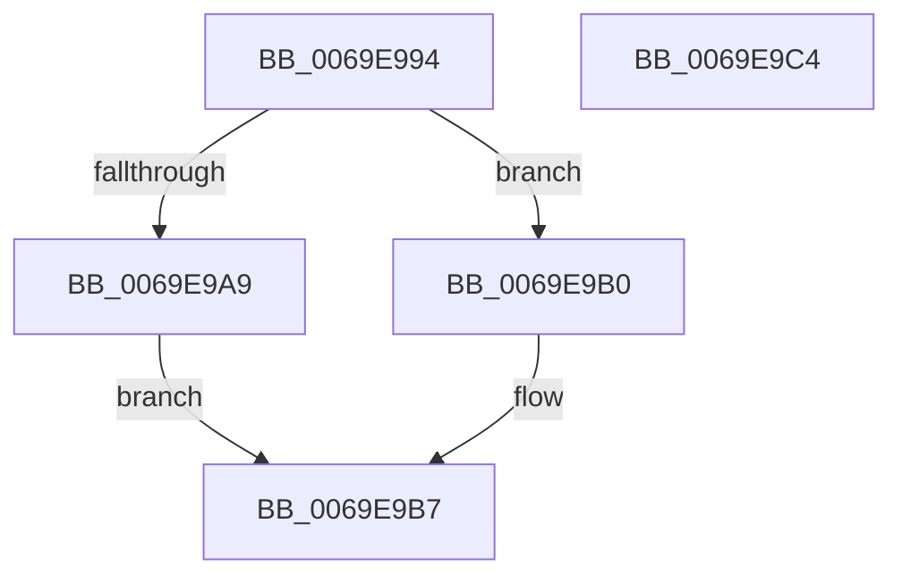

# BgDisplaySafeToPowerOffScreen

- RVA: `0x0069E994`–`0x0069E9C5` (길이 `49` bytes)
- VA: `0x000000014069E994`
- 실행 섹션: `.text`
- PDB 이름 있음: `예`; PDB Function 태그: `아니요`
- unwind 정보 RVA: `0x0005CF00`
- 디코드: `16`개 명령, `49/49` bytes 표시
- 미해석 바이트: `0` (있으면 어셈블리에 `.byte`로 보존)

> 이 문서는 커널 이미지의 기계어와 PDB 기호를 분석해 생성했습니다. 4번과 5번은 함수 원형과 자료형을 바이너리 사용 방식에서 추정한 C 해석이며 원본 소스 복구 결과는 아닙니다.

## 1. Dependencies

- 직접 호출 지점: **3**; 고유 호출 대상: **3**
- 직접 호출자로 확인된 함수: **1**
- RIP 상대 이미지 참조: **1**

### Outgoing calls
- `0x0069E99A` → [BgpFwAcquireLock](../4B/BgpFwAcquireLock_function_004B3AA4.md) (function, `0x004B3AA4`)
- `0x0069E9B0` → [BgpDisplaySafeToPowerOffScreen](../6A/BgpDisplaySafeToPowerOffScreen_function_006A0D74.md) (function, `0x006A0D74`)
- `0x0069E9B7` → [BgpFwReleaseLock](../4B/BgpFwReleaseLock_function_004B357C.md) (function, `0x004B357C`)

### Direct callers
- [PopShutdownHandler](../../pagelk/B7/PopShutdownHandler_function_00B71750.md) at `0x00B71769`

### Static image references
- `0x0069E99F` → RVA `0x00EF0450` (`.data`; read)

## 2. Other-region calls and transfers

- 다른 실행 섹션으로 향하는 call: **0**
- 별도 외부 분기/꼬리 이동을 확인하지 못했습니다.

## 3. Assembly (complete function range)

```asm
0069E994  40 53                           push rbx
0069E996  48 83 EC 20                     sub rsp, 0x20
0069E99A  E8 05 51 E1 FF                  call 0x1404b3aa4
0069E99F  8B 05 AB 1A 85 00               mov eax, dword ptr [rip + 0x851aab]
0069E9A5  A8 02                           test al, 2
0069E9A7  75 07                           jne 0x14069e9b0
0069E9A9  BB 01 00 00 C0                  mov ebx, 0xc0000001
0069E9AE  EB 07                           jmp 0x14069e9b7
0069E9B0  E8 BF 23 00 00                  call 0x1406a0d74
0069E9B5  8B D8                           mov ebx, eax
0069E9B7  E8 C0 4B E1 FF                  call 0x1404b357c
0069E9BC  8B C3                           mov eax, ebx
0069E9BE  48 83 C4 20                     add rsp, 0x20
0069E9C2  5B                              pop rbx
0069E9C3  C3                              ret
0069E9C4  CC                              int3
```

## 4. C-style interpretation (structured pseudocode)

```c
__int64 __fastcall BgDisplaySafeToPowerOffScreen(void)
{
    __int64 result;
    __int64 v_rsp;

    v_rsp = (v_rsp) - (32);
    result = BgpFwAcquireLock(a1, a2, a3, a4);
    if ((((unsigned __int8)((unsigned int)(*(unsigned int *)(v_rip + 8723115)))) & (2)) != 0) goto loc_0069E9B0;
    goto loc_0069E9B7;
loc_0069E9B0:
    result = BgpDisplaySafeToPowerOffScreen(a1, a2, a3, a4);
loc_0069E9B7:
    result = BgpFwReleaseLock(a1, a2, a3, a4);
    v_rsp = (v_rsp) + (32);
    return (unsigned int)((unsigned int)((unsigned int)((unsigned int)(result))));
}
```

## 5. (Beta) C Style

```c
void BgDisplaySafeToPowerOffScreen(void)
{
    int64_t result;
    int64_t local_rsp;

    local_rsp = (local_rsp) - (32);
    result = BgpFwAcquireLock(a1, a2, a3, a4);
    if ((((uint8_t)((uint32_t)(*(uint32_t *)(v_rip + 0x851AAB)))) & (2)) != 0) goto loc_0069E9B0;
    goto loc_0069E9B7;
loc_0069E9B0:
    result = BgpDisplaySafeToPowerOffScreen(a1, a2, a3, a4);
loc_0069E9B7:
    result = BgpFwReleaseLock(a1, a2, a3, a4);
    local_rsp = (local_rsp) + (32);
    return (uint32_t)((uint32_t)((uint32_t)((uint32_t)(result))));
}
```

## 6. Execution-region graph

[열기: 2D/3D 그래프와 함수 탐색 컨트롤 패널](../../../control-panel.html?section=text&rva=0x0069E994&view=graph)

- 2D 그래프는 위에서 아래로 흐르고, 3D 그래프는 빈 공간을 드래그해 회전합니다. Shift+드래그는 이동, 휠은 확대·축소, 함수 노드 선택은 대상 보고서 이동입니다.

### Static fallback


