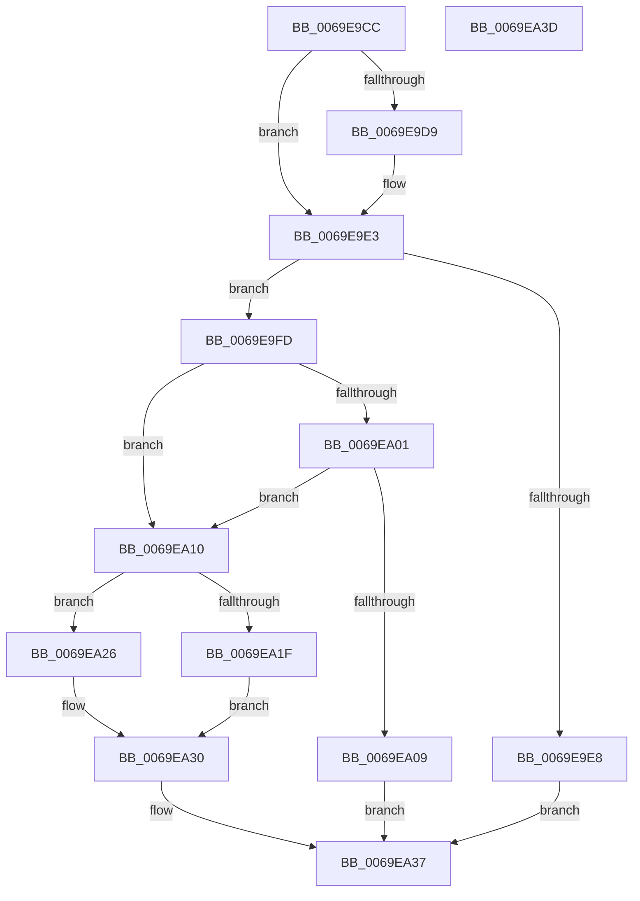

# BgLibraryEnable

- RVA: `0x0069E9CC`–`0x0069EA3E` (길이 `114` bytes)
- VA: `0x000000014069E9CC`
- 실행 섹션: `.text`
- PDB 이름 있음: `예`; PDB Function 태그: `아니요`
- unwind 정보 RVA: `0x0005CF00`
- 디코드: `37`개 명령, `114/114` bytes 표시
- 미해석 바이트: `0` (있으면 어셈블리에 `.byte`로 보존)

> 이 문서는 커널 이미지의 기계어와 PDB 기호를 분석해 생성했습니다. 4번과 5번은 함수 원형과 자료형을 바이너리 사용 방식에서 추정한 C 해석이며 원본 소스 복구 결과는 아닙니다.

## 1. Dependencies

- 직접 호출 지점: **3**; 고유 호출 대상: **3**
- 직접 호출자로 확인된 함수: **2**
- RIP 상대 이미지 참조: **2**

### Outgoing calls
- `0x0069EA10` → [BgpFwAcquireLock](../4B/BgpFwAcquireLock_function_004B3AA4.md) (function, `0x004B3AA4`)
- `0x0069EA29` → [BgpFwLibraryEnable](BgpFwLibraryEnable_function_0069ED8C.md) (function, `0x0069ED8C`)
- `0x0069EA30` → [BgpFwReleaseLock](../4B/BgpFwReleaseLock_function_004B357C.md) (function, `0x004B357C`)

### Direct callers
- [BgkAcquireDisplayOwnership](../59/BgkAcquireDisplayOwnership_function_00590AA0.md) at `0x00590ADB`
- [BgkAcquireDisplayOwnership](../59/BgkAcquireDisplayOwnership_function_00590AA0.md) at `0x00590B10`
- [BgkNotifyDisplayOwnershipChange](../59/BgkNotifyDisplayOwnershipChange_function_00590CC0.md) at `0x00590D71`

### Static image references
- `0x0069E9D9` → RVA `0x00EF0450` (`.data`; read/write)
- `0x0069E9E8` → RVA `0x00EF0450` (`.data`; read)

## 2. Other-region calls and transfers

- 다른 실행 섹션으로 향하는 call: **0**
- 별도 외부 분기/꼬리 이동을 확인하지 못했습니다.

## 3. Assembly (complete function range)

```asm
0069E9CC  40 53                           push rbx
0069E9CE  48 83 EC 20                     sub rsp, 0x20
0069E9D2  48 8B D9                        mov rbx, rcx
0069E9D5  84 D2                           test dl, dl
0069E9D7  74 0A                           je 0x14069e9e3
0069E9D9  81 0D 6D 1A 85 00 00 0C 00 00   or dword ptr [rip + 0x851a6d], 0xc00
0069E9E3  48 85 DB                        test rbx, rbx
0069E9E6  75 15                           jne 0x14069e9fd
0069E9E8  8B 05 62 1A 85 00               mov eax, dword ptr [rip + 0x851a62]
0069E9EE  24 02                           and al, 2
0069E9F0  F6 D8                           neg al
0069E9F2  1B C0                           sbb eax, eax
0069E9F4  F7 D0                           not eax
0069E9F6  25 EF 00 00 C0                  and eax, 0xc00000ef
0069E9FB  EB 3A                           jmp 0x14069ea37
0069E9FD  84 D2                           test dl, dl
0069E9FF  75 0F                           jne 0x14069ea10
0069EA01  44 0F 20 C0                     mov rax, cr8
0069EA05  84 C0                           test al, al
0069EA07  74 07                           je 0x14069ea10
0069EA09  B8 01 00 00 C0                  mov eax, 0xc0000001
0069EA0E  EB 27                           jmp 0x14069ea37
0069EA10  E8 8F 50 E1 FF                  call 0x1404b3aa4
0069EA15  8B 05 35 1A 85 00               mov eax, dword ptr [rip + 0x851a35]
0069EA1B  A8 01                           test al, 1
0069EA1D  75 07                           jne 0x14069ea26
0069EA1F  BB BB 00 00 C0                  mov ebx, 0xc00000bb
0069EA24  EB 0A                           jmp 0x14069ea30
0069EA26  48 8B CB                        mov rcx, rbx
0069EA29  E8 5E 03 00 00                  call 0x14069ed8c
0069EA2E  8B D8                           mov ebx, eax
0069EA30  E8 47 4B E1 FF                  call 0x1404b357c
0069EA35  8B C3                           mov eax, ebx
0069EA37  48 83 C4 20                     add rsp, 0x20
0069EA3B  5B                              pop rbx
0069EA3C  C3                              ret
0069EA3D  CC                              int3
```

## 4. C-style interpretation (structured pseudocode)

```c
__int64 __fastcall BgLibraryEnable(__int64 a1, unsigned __int8 a2)
{
    __int64 result;
    __int64 v_rsp;

    v_rsp = (v_rsp) - (32);
    if (a2 != 0) {
    }
    if (a1 != 0) goto loc_0069E9FD;
    result = (unsigned __int8)(((unsigned int)(*(unsigned int *)(v_rip + 8723042))) & (2));
    result = (unsigned __int8)(-(result));
    result = (unsigned int)(~(result));
    result = (unsigned int)((result) & (0xC00000EFULL));
    goto loc_0069EA37;
loc_0069E9FD:
    if (a2 != 0) goto loc_0069EA10;
    if ((unsigned __int8)(v_cr8) == 0) goto loc_0069EA10;
    goto loc_0069EA37;
loc_0069EA10:
    result = BgpFwAcquireLock(a1, a2, a3, a4);
    if ((((unsigned __int8)((unsigned int)(*(unsigned int *)(v_rip + 8722997)))) & (1)) != 0) goto loc_0069EA26;
    goto loc_0069EA30;
loc_0069EA26:
    result = BgpFwLibraryEnable((unsigned int)(0xC00000BBULL), a2, a3, a4);
loc_0069EA30:
    result = BgpFwReleaseLock((unsigned int)(0xC00000BBULL), a2, a3, a4);
loc_0069EA37:
    v_rsp = (v_rsp) + (32);
    return (unsigned int)((unsigned int)((unsigned int)((unsigned int)(result))));
}
```

## 5. (Beta) C Style

```c
int64_t BgLibraryEnable(int64_t Arg1, uint8_t Arg2)
{
    int64_t result;
    int64_t local_rsp;

    local_rsp = (local_rsp) - (32);
    if (Arg2 != 0) {
    }
    if (Arg1 != 0) goto loc_0069E9FD;
    result = (uint8_t)(((uint32_t)(*(uint32_t *)(v_rip + 0x851A62))) & (2));
    result = (uint8_t)(-(result));
    result = (uint32_t)(~(result));
    result = (uint32_t)((result) & (0xC00000EFULL));
    goto loc_0069EA37;
loc_0069E9FD:
    if (Arg2 != 0) goto loc_0069EA10;
    if ((uint8_t)(v_cr8) == 0) goto loc_0069EA10;
    goto loc_0069EA37;
loc_0069EA10:
    result = BgpFwAcquireLock(Arg1, Arg2, a3, a4);
    if ((((uint8_t)((uint32_t)(*(uint32_t *)(v_rip + 0x851A35)))) & (1)) != 0) goto loc_0069EA26;
    goto loc_0069EA30;
loc_0069EA26:
    result = BgpFwLibraryEnable((uint32_t)(0xC00000BBULL), Arg2, a3, a4);
loc_0069EA30:
    result = BgpFwReleaseLock((uint32_t)(0xC00000BBULL), Arg2, a3, a4);
loc_0069EA37:
    local_rsp = (local_rsp) + (32);
    return (uint32_t)((uint32_t)((uint32_t)((uint32_t)(result))));
}
```

## 6. Execution-region graph

[열기: 2D/3D 그래프와 함수 탐색 컨트롤 패널](../../../control-panel.html?section=text&rva=0x0069E9CC&view=graph)

- 2D 그래프는 위에서 아래로 흐르고, 3D 그래프는 빈 공간을 드래그해 회전합니다. Shift+드래그는 이동, 휠은 확대·축소, 함수 노드 선택은 대상 보고서 이동입니다.

### Static fallback


